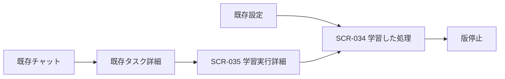

# 06. 成長機構の画面・UX
- 版数：v1.8（2026-10-26） ／ インプット：[FR-117〜122](04_functional_spec/learning.md)

> **3行で**
> 1. 普段は1本のチャットで依頼する。
> 2. 詳細を開くと、覚えた処理とAIに戻った理由がわかる。
> 3. 学習の停止と外部操作の確認を別々に表示する。

## 🧭 判断してほしいこと
なし。

## 全体図

見てほしいところ：新しい常設チャットやエージェント一覧を増やさない。

## 要点
- [SCR-034](#scr-034)で採用理由と停止を扱う。
- [SCR-035](#scr-035)で今回の実行を説明する。
- [表示規則](#表示規則)で成功と推論削減を混同しない。

## 詳細
### SCR-034
画面名「学習した処理」、URL `/settings/learning`。持ち主専用。FR-117・118・119・122。

```text
学習した処理                  [学習と再利用 ON]
日程の候補を探す     利用中 v3
  検証結果 / 有効な範囲 / 期限 / [詳細]
  [この版を停止]
```

- API-158で一覧、API-159で詳細、API-160で停止、API-162で全体設定を読む・変更する。
- 候補は「確認中」、activeは「利用中」、disabledは「停止済み」、invalidatedは「条件変更で停止」と表示。その他の状態も日本語ラベルを持つ。
- 初期：skeleton。空：「まだ学習した処理はありません」。通信失敗：再取得。競合：最新の状態を再取得し、操作の再確認を求める。
- 検証件数・適用範囲・期限・採用理由を詳細に表示。「100%安全」「完全に学習済み」は表示しない。
- 全体OFFの説明：「新しい学習と、学習した処理の利用を止めます」。既存AI機能の停止や送信済み操作の取り消しとは表示しない。

### SCR-035
画面名「学習実行詳細」、URL `/tasks/:taskId/learning/:runId`。持ち主専用。FR-120・121・122。

```text
今回の処理：日程の候補を探す
既知の処理 4件 / AIに確認 1件
戻った理由：タイムゾーンの情報が不足
状態：あなたの確認待ち
AI呼出し 2回 / 費用 / 使用した版 v3
```

- API-122のlearningRunIdからAPI-161へ。programIdからSCR-034の版詳細に移る。
- runの状態、穴の数・理由、LLM回数・費用を表示。契約を通っただけでは「予定を登録しました」と表示せず、外部操作結果を確認する。
- unknown_outcome：「登録結果を確認しています。重複防止のため再送していません」。人の判断が必要なら既存チャットの確認経路へ。
- 404は「保持期間が終了したか、対象がありません」。taskIdとrunのtaskIdが不一致なら遷移を拒否する。

### 表示規則
320px幅から1列、キーボード操作とラベルを用意し、状態は色だけで伝えない。操作後の成功・失敗はaria-liveで通知する。
自由文解析・報告にもLLMを使う場合、決定論的ノード数を「AI呼び出しゼロ」と言い換えない。学習費と通常実行費は別に表示する。

## このドキュメントで決まったこと
[D-401](00_learning.md#決定事項ログ)。
