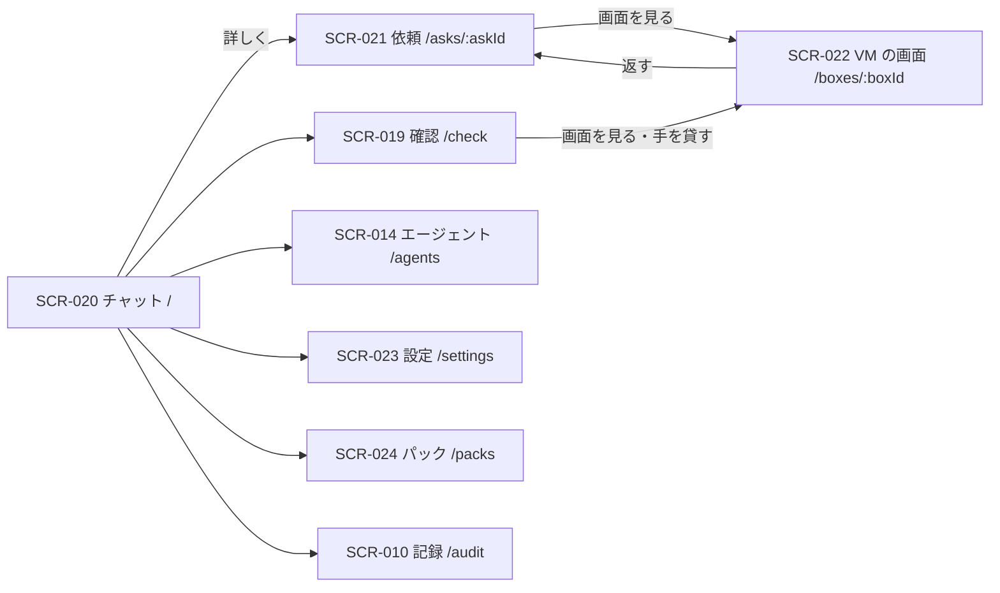

# 06. 画面・UX設計
- プロジェクト：Agent-Team-Open ／ 版数：v0.5（2026-10-24） ／ インプット：[04_functional_spec](04_functional_spec.md)

> **3行で**
> 1. 画面は8つ。今の5つ（チャット・依頼・確認・エージェント・記録）に、VM の画面（SCR-022）・設定（SCR-023）・パック（SCR-024）を足す。
> 2. VM の画面はスマホが主役。見るだけで開き、「代わる」を押したときだけ操作できる。
> 3. 呼び名は「エージェント」。チャットは1本（今の UI の決まりのまま）。パックはメニューに置く（D-176）。依頼の一覧はメニューに置かない。

## 🧭 判断してほしいこと
なし（Q-119 は D-181 で決着）。

## 全体図

見てほしいところ：VM の画面へは「依頼」と「確認」の2か所から入る。メニューから直接は行かない。

## 要点
- VM の画面は、開くと見るだけ。「代わる」で操作でき、「返す」でエージェントに戻す（[SCR-022](#scr-022vm-の画面)）
- こわい操作の確認カードは、スクショに押す場所の印を重ねて出す（[SCR-019](#scr-019確認差分)）
- チャットには、VM が動いている間だけ小さな画面（サムネイル）を出す（SCR-020）
- 設定に、上限・確認するドメインと言葉・つながり・引っ越し・ホストの状態をまとめる（[SCR-023](#scr-023設定)）
- パックは入っているものと入れられるものを並べ、入れる・外す・更新ができる（[SCR-024](#scr-024パック)）

---

## 詳細

### デザイン方針
- 今の画面の決まり（[docs/ui-design.md](../ui-design.md)）を引き継ぐ。言葉は短く、呼び名は「エージェント」
- VM の操作は「見る」が既定。誤ってタップしてもエージェントの邪魔をしない
- こわい操作の確認は、何を押すかが一目で分かることを最優先にする（スクショ＋印＋見えている名前）

### 画面一覧
| ID | 画面名 | パス | 関連FR | 状態 |
|---|---|---|---|---|
| SCR-020 | チャット | `/` | FR-061, FR-063, FR-018 | 今のまま＋ VM のサムネイル |
| SCR-021 | 依頼 | `/asks/:askId` | FR-061, FR-063, FR-075, FR-086 | 今のまま＋ VM の欄・ターミナルの欄 |
| SCR-019 | 確認 | `/check` | FR-077, FR-078, FR-081 | 今のまま＋ブラウザの確認・交代の頼み |
| SCR-014 | エージェント | `/agents` | FR-072, FR-079, FR-085 | 今のまま＋ブラウザのデータを消す＋パック名のラベル |
| SCR-010 | 記録 | `/audit` | FR-016 | 今のまま＋ VM の事象 |
| SCR-022 | VM の画面 | `/boxes/:boxId` | FR-078 | 新規 |
| SCR-023 | 設定 | `/settings` | FR-013, FR-076, FR-081, FR-082, FR-083 | 新規（つながりは今の場所から移す） |
| SCR-024 | パック | `/packs` | FR-085 | 新規 |

### SCR-022：VM の画面
- 目的：エージェントのブラウザを見る・代わりに操作する
- ワイヤーフレーム（スマホ）：
 ```
 +----------------------------------+
 | ← 予約サイトの空きを調べる ● 動作中 |
 +----------------------------------+
 |                 |
 |  （VM の画面。ピンチで拡大）    |
 |                 |
 +----------------------------------+
 | エージェント：「日付を選んでいます」 |
 +----------------------------------+
 | [ 代わる ]      [ 止める ]  |
 +----------------------------------+
     ↓ 代わったあと
 +----------------------------------+
 | ← 予約サイトの空きを調べる ✋ 交代中 |
 +----------------------------------+
 |  （VM の画面。タップ＝クリック）  |
 +----------------------------------+
 | [ 文字を入れる……    ] [送る] |
 | [Tab] [Enter] [Esc] [⌫]     |
 +----------------------------------+
 | [ 返す ]             |
 +----------------------------------+
 ```
 注記：スマホの文字入力欄（「文字を入れる……」と [送る]）は次の版（D-181）。最初の版はタップと専用キー [Tab][Enter][Esc][⌫] だけ。文字入力は PC のキーボードでする。
- 表示項目：
 | 項目 | データ元 | 備考 |
 |---|---|---|
 | 依頼の文・状態 | API-088 | 動作中・交代中・確認待ち・止まった |
 | 画面 | API-089（WebSocket） | 見るときは `mode=view` |
 | エージェントのひとこと | API-085（SSE） | 直前の操作の要約 |
 | 交代の頼みの理由 | API-088 | 頼まれているときだけ、上に帯で出す |
- 操作：
 | 操作 | 挙動 | API | 遷移先 |
 |---|---|---|---|
 | 代わる | エージェントを止め、操作できる形でつなぎ直す | API-090 | 同じ画面（交代中） |
 | 文字を入れて送る（次の版） | 入力欄の文字を VM に打ち込む（スマホ。D-181） | API-103（人の `control_epoch` で呼ぶ） | — |
 | 返す | エージェントに戻す | API-091 | SCR-021 |
 | 止める | 確かめてから VM を止め、タスクを取り消す | API-099 | SCR-021 |
- 状態：つないでいる / 動作中 / 渡す準備中（「エージェントの操作が終わるのを待っています」） / 交代中 / 確認待ち（画面の上に「確認待ち」の帯と確認へのリンク） / 止まった（最後のスクショを出す。頼みのまま 30 分、交代中は 15 分操作がないと止まる） / つながらない（もう一度つなぐ）
- PC では画面を原寸で出し、入力欄は出さない（キーボードをそのまま渡す）。最初の版で交代中に文字を打てるのは PC だけ

### SCR-019：確認（差分）
- ブラウザの確認カード：
 ```
 +----------------------------------+
 | 🛒 購入ボタンを押します      |
 | 予約サイト（example.jp）      |
 | +------------------------------+ |
 | | スクショ（押す場所に赤い印）  | |
 | +------------------------------+ |
 | 押すもの：「予約を確定する」    |
 | 理由：決まった言葉「確定」     |
 | あと 28 分             |
 | [ 画面を見る ]  [ × ]  [ ○ ]  |
 +----------------------------------+
 ```
- 理由は「エージェントの申告」か、当たった合図（秘密の欄・確認するドメイン（`open_url` を含む）・決まった言葉・キーでの作動（`type` の改行を含む）・修飾キー・押す先が分からない）を出す
- 交代の頼みのカード：理由と [ 手を貸す ]（SCR-022 を開き、そのまま交代する）
- ○ / × はブラウザの確認では API-110 を呼ぶ（API の書き込みのカードは今のまま API-019）
- ○ のあと画面が変わっていたら、カードは「画面が変わったので実行しませんでした。エージェントが決め直します」と出て消える（新しい確認が要れば、エージェントの判断で改めて出る）。実行されたか分からないときは「実行されたか分かりません。画面を見て確かめてください」と出す
- 交代を始めると、その VM の確認カードは消える（交代のあとに必要なら出し直される）

### SCR-020：チャット（差分）
- VM が動いている依頼には、返事の上に小さな画面（最新の操作のスクショ。別に撮らない。1歩ごとに更新）を出す。タップで SCR-022
- 画面側の変更：SSE の経路を `/api/v1/workspaces/w1/stream` から API-085 `/api/v1/events` に差し替える

### SCR-021：依頼（差分）
- 「ブラウザ」の欄：VM の状態・最新のスクショ・[ 画面を見る ]・操作の回数と上限
- 「ターミナル」欄：エージェントが VM の中で実行したコマンドと出力のログ（FR-086。1 行ずつ、出力は 64KB まで）。人が直接打つのは次の版

### SCR-014：エージェント（差分）
- エージェントの行のメニューに「ブラウザのデータを消す」を足す（確かめのダイアログつき。動いている間は押せない）
- プロフィールが 1GB を超えたら行に知らせを出す
- パック由来のエージェントには、行にパック名のラベルを出す（FR-085）

### SCR-023：設定
| 欄 | 中身 | API |
|---|---|---|
| 上限 | 1タスクの費用・日次の費用・操作の回数・時間・VM の同時数 | API-096 |
| こわい操作 | 確認するドメイン・確かめないドメイン（先が分からない操作でも確認しない）・決まった言葉の一覧（足す・外す） | API-096 |
| つながり | Google カレンダー・GitHub をつなぐ・外す | API-093, 094, 107 |
| 引っ越し | 書き出す・取り込む | API-097, 098 |
| ホスト | 版・空きメモリ・空きディスク・動いている VM・LLM の接続先とモデル（表示だけ。Bedrock・Vertex のときは「費用の見積もりは Anthropic 直の単価の目安」と添える。FR-087） | API-111 |

### SCR-024：パック
- 目的：用途ごとのエージェント集（パック）を入れる・外す・更新する（FR-085、D-176）
- ワイヤーフレーム：
 ```
 +----------------------------------+
 | ← パック                         |
 +----------------------------------+
 | 入っている                       |
 | 旅行の手配   3人  v2  [ 更新 ] [ 外す ] |
 | 用途：宿・交通の調べものと予約     |
 +----------------------------------+
 | 入れられる                       |
 | コードの修理 2人  v1  [ 入れる ]  |
 | 用途：リポジトリを動かして直す     |
 +----------------------------------+
 ```
- 表示項目：入っている・入れられるの2つの一覧。各行は次のとおり。
 | 項目 | データ元 | 備考 |
 |---|---|---|
 | 名前 | API-114 | パックの `name` |
 | 用途 | API-114 | パックの `purpose`（依頼の振り分けに使う言葉） |
 | エージェント数 | API-114 | パックの `agents[]` の数 |
 | 版 | API-114 | 入っているパックは入っている版と、新しい版があれば「更新あり」 |
- 操作：
 | 操作 | 挙動 | API | 遷移先 |
 |---|---|---|---|
 | 入れる | エージェントと手順書を作り、ブラウザの追加分をポリシーに足す | API-115 | 同じ画面（入っているに移る） |
 | 外す | 確かめのダイアログのあと、パックのエージェントとプロフィールを消す。動いているエージェントがいると外せない（`AGENT_BUSY`） | API-116 | 同じ画面 |
 | 更新 | 新しい版でパックのエージェントの設定を作り直す。「手で変えた設定は失われます」と知らせてから実行 | API-115 | 同じ画面 |
- 状態：読み込み中 / 空（入っているパックなし）/ 入れられるものなし / 失敗（エラーの文を出す）
- メニューに「パック」を置く（D-176）

### レスポンシブ・アクセシビリティ方針
- 幅 360px から。VM の画面だけは横向きも使えるようにする
- ボタンは 44px 以上。○ / × は色だけでなく文字でも分ける

## このドキュメントで決まったこと
- D-126、D-169、D-176、D-179、D-181（[00 決定事項ログ](00_overview.md#決定事項ログ)）
