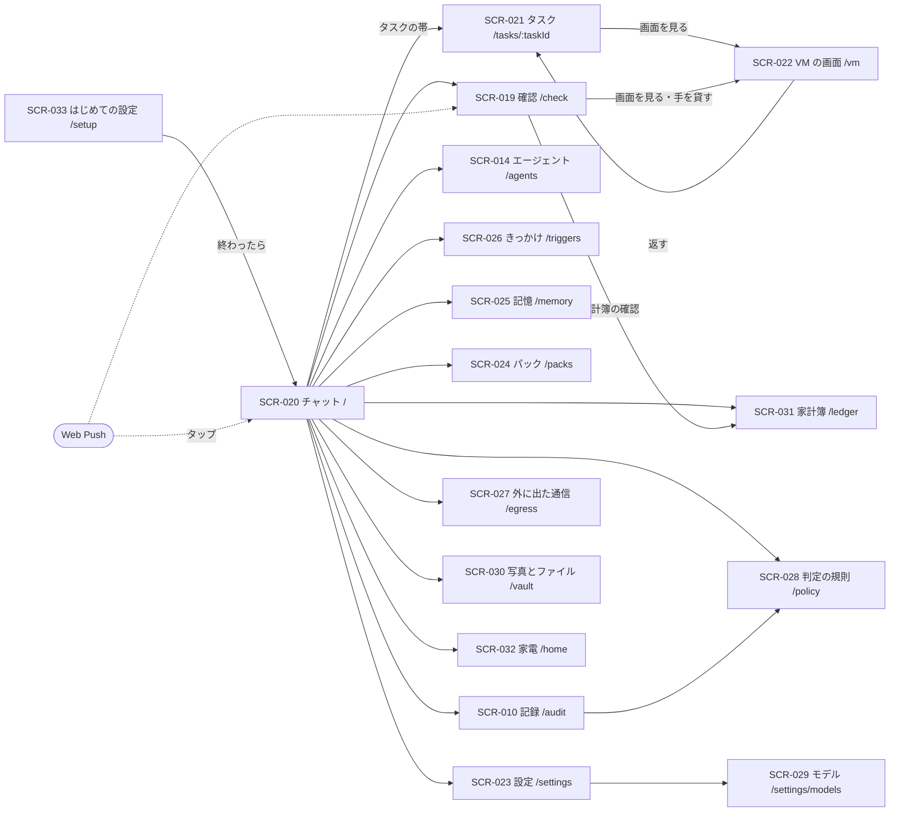

# 06. 画面・UX設計
- プロジェクト：Agent-Team-Open ／ 版数：v1.7（2026-10-26） ／ インプット：[04_functional_spec](04_functional_spec/README.md)

> **3行で**
> 1. 画面は 17 個（v1.7 で 4 つ増えた）。中心は 1 本のチャット（SCR-020）で、相手はメインだけ。裏で動いているタスクは、チャットの上に細い帯で出し、タップでタスクのページ（SCR-021）を開く。
> 2. v1.0 で足したのは、記憶（SCR-025）ときっかけ（SCR-026：ルーチン・予約した確認・受け口）。依頼のページはタスクのページになり、VM の画面は 1 つ（`/vm`）になった。v1.6 で、外に出た通信（SCR-027）・判定の規則（SCR-028）・モデル（SCR-029）を足した。v1.7 で、家の人（非エンジニアを含む）がスマホで使えるように、写真とファイル（SCR-030）・家計簿（SCR-031）・家電（SCR-032）・はじめての設定（SCR-033）を足した。
> 3. 呼び名は「メイン」「エージェント」「タスク」。チャットには作業の途中経過を流さない（メインが `send_to_owner` を呼んだときだけ）。通知は Web Push（閉域では画面の中の通知）。

## 🧭 判断してほしいこと
なし

## 全体図

見てほしいところ：初めての人は SCR-033 から始まって、最後にチャットへ来る。写真・家計簿・家電は、チャットの下のタブから開く。通知をタップすると、チャットか確認に直接開く。VM の画面へは「タスク」と「確認」の 2 か所から入る。

## 要点
- チャットに出るのは、持ち主のメッセージとメインの `send_to_owner` だけ。メインが黙れば何も増えない（[SCR-020](#scr-020チャット)）
- 裏のタスクはチャットの上の帯（動いている数とタイトル）。タップでタスクのページ（[SCR-021](#scr-021タスク)）
- v1.7：家の人がスマホで使う前提を、画面の決まりに足した（言葉・大きさ・1 画面 1 つのこと：[デザイン方針](#デザイン方針)）。写真とファイル・家計簿・家電・はじめての設定の 4 画面を足した（[SCR-030](#scr-030写真とファイル)〜[SCR-033](#scr-033はじめての設定)）
- チャットに写真を添付できる。レシートを送ると、読み取った結果を短い返事で返す（[SCR-020](#scr-020チャット)）
- 確認カードに、家電・保管庫・家計簿の確認が加わった。ゴミ箱を空にするのは必ず人で、件数を見せてから確かめる（[SCR-019](#scr-019確認)・[SCR-030](#scr-030写真とファイル)）
- 確認カードには、人に回った理由（合図・オートレビューが止めた理由）を出す（[SCR-019](#scr-019確認)）
- 記憶の画面で、プロフィールを見て直せる（[SCR-025](#scr-025記憶)）
- きっかけの画面に、ルーチン・予約した確認・受け口をまとめる（[SCR-026](#scr-026きっかけ)）
- 設定に、上限・こわい操作・つながり・通知・VM（控え・作り直し・ブラウザのデータ）・ホストの状態をまとめる（[SCR-023](#scr-023設定)）。状態欄に「家の中だけで動かす」（コード上は `closed`）と「オートレビュー：切（既定）」を出す（v1.6：D-340・351。言葉は v1.7：D-381）
- 外に出た通信を日ごと・宛先ごと・目的ごとに見て、CSV で書き出せる。`closed`（家の中だけで動かす）のときは「許可リストの外への外向き 0」を大きく出す（[SCR-027](#scr-027外に出た通信)）
- 判定の規則は版つきで見て、試験を通して保存し、試し当ての結果を見られる（[SCR-028](#scr-028判定の規則)）
- モデルは役割ごとに選ぶ。能力が足りないモデルは選べない理由を出す（[SCR-029](#scr-029モデル)）

---

## 詳細

### デザイン方針
- 今の画面の決まり（[docs/ui-design.md](../ui-design.md)）を引き継ぐ。言葉は短く、呼び名は「メイン」「エージェント」「タスク」（「担当」「依頼」は使わない）
- チャットは友達とのチャットに近づける（参考資料：画面は単純に）。作業の途中経過は見に行けば見える（タスクのページ）が、流れてはこない
- VM の操作は「見る」が既定。誤ってタップしてもエージェントの邪魔をしない
- こわい操作の確認は、何を押すかが一目で分かることを最優先にする（スクショ＋印＋見えている名前）
- 家の人向けの画面の決まり（v1.7：D-371。SCR-030〜033、SCR-020 の添付、SCR-019 の家電・保管庫・家計簿のカード、はじめての設定に適用する。家の人はスマホで使う非エンジニアを想定する）：
 | 決まり | 内容 |
 |---|---|
 | 言葉 | 専門用語を出さない。「VM」「entity」「SHA」「webhook」は出さず、「パソコンの画面」「機器」などに言い換える。必要なら [ 詳しく ] の中に出す。ボタンは「〜する」の動詞で書く（「実行」「適用」でなく「空にする」「元に戻す」）。見出しは名詞の短い言葉。エラーは「何が起きたか」と「次にすること」を 1 つずつ |
 | 大きさ | ボタンは高さ 48px 以上（SCR-030〜033 では 56px）、間は 12px 以上あける。本文は 16px 以上、大事な数字（月の合計など）は 28px 以上。1 行は 20 字前後を目安にして、細かい表は使わない |
 | 1 画面 1 つのこと | 1 つの画面で頼むことは 1 つ。はじめての設定は 1 手順 1 画面。一覧は縦に流し、横にスクロールしない。選択肢は 3 つまで（それ以上は [ ほか ] に入れる） |
 | 戻れる | どの画面にも [ 戻る ] がある。消す操作はゴミ箱に入れる（取り消せる）。取り消せない操作（ゴミ箱を空にする）は、件数と中身を見せ、[ やめる ] を左・目立つ側、[ 空にする ] を右・赤にして確かめる |
 | 色だけに頼らない | 状態は色と文字と印で表す（「つながっています ●」「自信が低い ⚠」「こわい 🔒」）。赤は「戻せない・外に出る」だけに使う |
 | 待ち時間 | 5 秒かかるものは「読み取っています…」と動いていることを見せる。放っておいても大丈夫、と一言添える |

### 画面一覧
| ID | 画面名 | パス | 関連FR | 状態 |
|---|---|---|---|---|
| SCR-020 | チャット | `/` | FR-090, FR-093, FR-089, FR-018, FR-114 | 作り直し（メインとの 1 本のチャット・タスクの帯）。v1.7：写真の添付・レシートの返事 |
| SCR-021 | タスク | `/tasks/:taskId` | FR-092, FR-075, FR-086, FR-099 | v0.6 の依頼のページを置き換え |
| SCR-019 | 確認 | `/check` | FR-077, FR-078, FR-081, FR-094, FR-110, FR-112, FR-113 | 今のまま＋ルーチンの提案・人に回った理由。v1.7：家電・保管庫・家計簿のカード |
| SCR-014 | エージェント | `/agents` | FR-072, FR-085 | 今のまま＋メインの行・「いつ使うか」 |
| SCR-010 | 記録 | `/audit` | FR-016, FR-106 | 今のまま＋きっかけ・オートレビュー・VM の事象＋誰が決めたか・規則の版・鎖の検査 |
| SCR-022 | VM の画面 | `/vm` | FR-078 | v0.6 の `/boxes/:boxId` を 1 つに |
| SCR-023 | 設定 | `/settings` | FR-013, FR-116, FR-017, FR-076, FR-079, FR-081〜083, FR-100, FR-101, FR-102, FR-110, FR-113, FR-115 | 通知・VM の欄を足す＋閉域モード・オートレビューの状態。v1.7：保管庫・家電・仕分けの欄 |
| SCR-024 | パック | `/packs` | FR-085 | 今のまま |
| SCR-025 | 記憶 | `/memory` | FR-097 | 新規 |
| SCR-026 | きっかけ | `/triggers` | FR-094〜096 | 新規 |
| SCR-027 | 外に出た通信 | `/egress` | FR-103, FR-101 | 新規（v1.6：D-344） |
| SCR-028 | 判定の規則 | `/policy` | FR-104, FR-105 | 新規（v1.6：D-347〜349） |
| SCR-029 | モデル | `/settings/models` | FR-107, FR-108, FR-115, FR-116 | 新規（v1.6：D-352・353）。SCR-023 の中の欄でもよい。v1.7：役割 `classify` と接続先 `decision` |
| SCR-030 | 写真とファイル | `/vault` | FR-110, FR-111 | 新規（v1.7：D-373・374） |
| SCR-031 | 家計簿 | `/ledger` | FR-112 | 新規（v1.7：D-375） |
| SCR-032 | 家電 | `/home` | FR-113 | 新規（v1.7：D-377・378） |
| SCR-033 | はじめての設定 | `/setup` | FR-109, FR-116 | 新規（v1.7：D-372・384）。④は「ChatGPT でサインイン」を先に、API キーは「ほかの方法」（D-387） |

- ログイン（v1.6：D-358）：Tailscale・Headscale の入口では画面は出ない（ヘッダーで持ち主を確かめる）。家の LAN の直結の入口（スマホのブラウザで直接開いたとき）でセッションがないときだけ、どの画面の代わりに「パスキーでログイン」の画面（[ 持ち主としてログイン ] の 1 ボタン）を出す。成功すると元の画面に戻る（セッションは 12 時間）。パスキーがまだ 0 件なら、「ホストで `docker compose exec makase makase owner-enroll` を実行し、出た URL を開いてください」と案内する（v1.7：キットでは SCR-033 の QR から登録するので、この案内は開発者向け）。登録は SCR-023 の状態欄からも足せる（5 件まで）（API-083）

メニュー：チャット・確認（件数）・エージェント・きっかけ・記憶・パック・記録・外に出た通信・判定の規則・設定（モデルは設定の中）。v1.7：写真とファイル・家計簿・家電を足す。スマホでは、下のタブにチャット・写真とファイル・家計簿・家電・[ ほか ] の 5 つを置き、確認・エージェント・きっかけ・記憶・パック・記録・外に出た通信・判定の規則・設定は [ ほか ] の中に入れる（確認の件数は [ ほか ] とチャットの右上に出す）。はじめての設定が終わるまで、タブは出さない。

言葉の言い換え（v1.7：D-381）。コード上の名前（`network.mode`・`internal_hosts`・`egress_events` など）は変えず、画面と説明の言葉を家向けにする：
| コード・規則の言葉 | 画面の言葉 |
|---|---|
| 閉域モード（`closed`）／標準（`standard`） | 家の中だけで動かす／ふつう |
| 内部ホスト（`internal_hosts`） | 家の機械 |
| 台帳（`egress_events`）／外に出た通信 | 外に出たもの（SCR-027 の題は「外に出た通信」のまま） |
| 許可リスト | 出てよい行き先 |
| 社内の ntfy | 家の ntfy（企業なら社内の ntfy） |

### SCR-020：チャット
- 目的：メインと話す。裏で何が動いているかを一目で知る
- ワイヤーフレーム（スマホ）：
 ```
 +----------------------------------+
 | ≡  メイン            確認 2 |
 +----------------------------------+
 | ▶ 動いている 2：店探し・PR の修正 > |  ← タスクの帯（タップで一覧）
 +----------------------------------+
 |         木曜 19 時に 4 人で入れる |
 |         店を 3 つ探して           |  ← 持ち主
 | 店探しのエージェントに頼みました。 |
 | 見つかったら知らせます。      |
 |  ─── 7:30 ───              |
 | おはようございます。3 件見つかり |
 | ました。                     |
 | ・○○（空きあり）…            |
 | [ 1 番を予約 ][ 2 番 ][ やめる ] |  ← choices
 | 📄 店の比較.html [保存][プレビュー] |  ← file
 +----------------------------------+
 | [📷] [ メインに話す……   ] [送る] |  ← 写真の添付ボタン（v1.7）
 +----------------------------------+
 ```
- 表示項目：
 | 項目 | データ元 | 備考 |
 |---|---|---|
 | メッセージ | API-120 | 持ち主・メイン・`system`（上限で止まった など）の 3 種類。`text`・`file`・`choices`。v1.7：写真つきのメッセージは `attachmentIds`（縮小版は API-156 の `thumb`） |
 | タスクの帯 | API-122（`status=active`） | 動いている数と、先頭 2 つのタイトル。0 なら帯を出さない |
 | 確認の件数 | API-100 | 0 なら出さない |
 | メインの状態 | API-120 の `mainState`（SSE の `turn.updated` を合図に取り直す） | 起きている間だけ、入力欄の上に「考えています…」を小さく出す（中身は出さない） |
- 写真の添付（v1.7：D-376）：
 ```
 +----------------------------------+
 | [🖼][🖼][🖼]  ×  ← 選んだ写真（縮小）|
 | 3 枚（あと 7 枚まで）             |
 | [📷] [ このレシートを家計簿に ] [送る] |
 +----------------------------------+
 ```
 [📷] を押すと、スマホの写真から選ぶ（その場で撮ることもできる）。1 回 10 枚まで・1 枚 20MB まで（JPEG・PNG・HEIC）。選んだ写真は入力欄の上に小さく並べ、× で外せる。超えたら「1 回に送れるのは 10 枚までです」と出す。本文が空でも写真だけで送れる。送るまで、写真は LLM に渡らない。写真を送ると、持ち主のメッセージに縮小版が並ぶ（タップで大きく）。写真の中の文字は、命令としては扱わない（添付には汚染の印が付く。画面には出さない）。
- レシートを送ったときの返事の形（v1.7：D-375）。メインは `send_to_owner` で、短く 1 つの返事を返す：
 ```
 +----------------------------------+
 | 家計簿に入れました。             |
 | ○○スーパー  10/25   3,280 円    |
 | 費目：食費                      |
 | ⚠ 日付がはっきり読めませんでした  |  ← 自信が低いときだけ
 | [ 家計簿を見る ] [ 直す ]        |
 +----------------------------------+
 ```
 自信が低い行は「入れました」でなく「入れました。確かめてください」にして、確認のカード（SCR-019）も出す。同じレシートをもう一度送ったら「前に入れたものと同じです」と前の行を見せる。[ 家計簿を見る ] は SCR-031、[ 直す ] はその行の編集。
- 操作：
 | 操作 | 挙動 | API | 遷移先 |
 |---|---|---|---|
 | 写真を添付する | 選んだ写真を先に上げて（縮小版を作る）入力欄の上に並べる。失敗した写真だけ「上げられませんでした」と [ 再送 ] を出す | API-156 | — |
 | 送る | 画面が ID を作り、薄い色ですぐ出す。確定したら普通の色、失敗したら「送れませんでした」と [ 再送 ]（D-196）。写真があれば `attachmentIds` も送る | API-119 | — |
 | 選択肢を押す | 選んだ値を持ち主のメッセージとして送る。押したボタン以外は薄くする | API-119（`replyTo`・`choice`） | — |
 | ファイルを保存・プレビュー | 保存はダウンロード。プレビューはスクリプトの動かない形で新しいタブに出す（HTML の中のスクリプトから持ち主の権限で API を呼ばせない。D-243） | API-112 | — |
 | タスクの帯 | 動いているタスクの一覧（下から出る）。行を押すとタスクのページ | API-122 | SCR-021 |
- 状態：読み込み中 / 空（初めて：「メインに話しかけてください」と例を 3 つ。キットでは SCR-033 の最初のお願いの例）/ メインが起きている / 上限で止まった（`system` の行。日次の上限で待っているときは「設定で日次の上限を上げれば 1 分以内に再開します」と設定の上限の欄（SCR-023）へのリンクを付ける。D-322）/ つながらない（再接続）
- メインが動いている間も入力欄は使える。送ったメッセージは、動いているターンが終わったら次のターンで扱う（FR-091）
- 古いメッセージは上に引くと読み込む（`before` で 50 件ずつ）。要約で消えた分もチャットには残っている（要約はメインの文脈の話）

### SCR-021：タスク
- 目的：裏で動いているタスクの中身を見る・言い直す・止める
- 表示項目：
 | 項目 | データ元 | 備考 |
 |---|---|---|
 | タイトル・状態・エージェント | API-123 | 振り分けた理由（`delegate_reason`）・起こされた理由（`origin`） |
 | `brief` | API-123 | メインが書いた仕事の説明 |
 | 歩み | API-123 | LLM の 1 歩ごとの要約・道具の呼び出し。パックの手順書ごとに区切る（R-86） |
 | ブラウザの欄 | API-123・API-088 | 画面の番を持っているか・最新のスクショ・[ 画面を見る ]・操作の回数と上限 |
 | ターミナルの欄 | API-123 | コマンドと出力のログ（64KB まで） |
 | オートレビュー | API-123 | 入れたときだけ。通した・止めた操作と理由（切のときは欄を出さない） |
 | 報告 | API-123 | 終わったら報告の文と成果物 |
- 操作：
 | 操作 | 挙動 | API | 遷移先 |
 |---|---|---|---|
 | 言い直す | 入力欄からタスクに直接伝える。「次の歩みで伝えます」と小さく出す | API-124 | — |
 | 止める | 確かめてから取り消す | API-016 | — |
 | 画面を見る | VM の画面を開く | — | SCR-022 |

### SCR-019：確認
- ブラウザの確認カード：
 ```
 +----------------------------------+
 | 🛒 購入ボタンを押します      |
 | 店探し ・ 予約サイト（example.jp） |
 | +------------------------------+ |
 | | スクショ（押す場所に赤い印）  | |
 | +------------------------------+ |
 | 押すもの：「予約を確定する」    |
 | 理由：決まった言葉「確定」      |
 |    オートレビュー：人数の欄が空 |  ← 入れたときだけ
 | あと 28 分             |
 | [ 画面を見る ]  [ × ]  [ ○ ]  |
 +----------------------------------+
 ```
- 既定では、人に回るのは Kernel が `human` と決めたものだけ（オートレビューは切：D-351）。カードの理由の下に「規則の版」を小さく出す。内部ホストへの作動で `confirm` を選んだものも、この確認に来る（D-343）。
- 理由は申告・確認するドメイン・決まった言葉・キー・修飾キー・先不明・POST送信。T-1秘密入力は○/×でなく交代カード。ブラウザ確認には実効送信先の完全な安全確認済みURLを表示（IMP-004）。秘密URLは表示せず交代。画像マスクを保証できない場合は古い画像で承認させず「画面を確認できないため停止。秘密のある画面を閉じてください」と表示する
- 家電のカード（v1.7：D-378）。こわい機器（鍵・空調・バルブ・警報・シャッター・「こわい」の印つきのコンセント）を動かす、またはそれらに触る自動化を作る・変えるとき、必ず出る（自動化は設定で「こわくない機器だけなら通す」にできる）：
 ```
 +----------------------------------+
 | 🔒 玄関の鍵を開けます            |
 | 朝の支度 ・ 玄関の鍵      |
 | 理由：鍵はいつも確認します        |
 | あと 28 分                       |
 | [ やめる ]        [ 開ける ]      |
 +----------------------------------+
 ```
 自動化のカードには、作る・変える・消すと、触る機器の一覧（こわい機器に 🔒）を出す。区分は規則で決まっていて、LLM は決めない。
- 保管庫のカード（v1.7：D-373・374）：一度に 20 枚以上をゴミ箱へ移す、または写真をクラウドの LLM に送って分類するとき（「写真 300 枚をクラウドに送ります。約 140 円」と件数と見積もりを先に見せる）。送った枚数は後から SCR-027 で見られる。ゴミ箱を空にするのはカードでなく、持ち主が SCR-030 で行う。
- 家計簿のカード（v1.7：D-375）：レシートの金額か日付の自信が低いとき。レシートの縮小版と読み取った金額・日付・店を並べて、[ これでよい ]（`confirm`）か [ 直す ]（SCR-031 の 1 行の編集）。7 日で消える（そのままの値は「確かめてください」の印つきで家計簿に残る）。
- 交代の頼みのカード：理由と [ 手を貸す ]（SCR-022 を開き、そのまま交代する）
- ルーチンの提案のカード（FR-094）：名前・時刻（「平日 8:00」のように読める形）・プロンプト・[ × ] [ ○ ]（API-142）。7 日で消える
- ○ / × はブラウザの確認では API-110、API の書き込み（v1.7：家電・保管庫を含む）では API-019、家計簿は API-154
- ○ のあと画面が変わっていたら、カードは「画面が変わったので実行しませんでした。エージェントが決め直します」と出て消える。実行されたか分からないときは「実行されたか分かりません。画面を見て確かめてください」。実行の直前の確かめに外れたとき（API-110 の `expired`：タスクが取り消された・VM が起こし直された・画面の番が替わった・交代した・控えに戻した）は「状況が変わったので実行しませんでした（理由）」と出て消える（D-307）
- 交代を始めると、その VM の確認カードは消える（交代のあとに必要なら出し直される）
- API の書き込みのカードは、種類ごとに中身を見せてから ○ / × を選ばせる（D-198）：PR は差分の要約とファイルの一覧、カレンダーは予定の題・日時・場所・招く人。○ を押すまでは何も外に出ない（BR-10）

### SCR-022：VM の画面
- 目的：VM のブラウザを見る・代わりに操作する
- ワイヤーフレーム（スマホ）：
 ```
 +----------------------------------+
 | ← VM ・店探し        ● 動作中 |
 +----------------------------------+
 |  （VM の画面。ピンチで拡大）    |
 +----------------------------------+
 | エージェント：「日付を選んでいます」 |
 +----------------------------------+
 | [ 代わる ]      [ VM を止める ] |
 +----------------------------------+
     ↓ 代わったあと
 +----------------------------------+
 | ← VM ・店探し        ✋ 交代中 |
 +----------------------------------+
 |  （VM の画面。タップ＝クリック）  |
 +----------------------------------+
 | [Tab] [Enter] [Esc] [⌫]     |
 +----------------------------------+
 | [ 返す ]             |
 +----------------------------------+
 ```
 注記：スマホの文字入力欄は次の版（D-181）。文字入力は PC のキーボードでする。
- 表示項目：
 | 項目 | データ元 | 備考 |
 |---|---|---|
 | 画面の番を持つタスク・状態 | API-088 | 動作中・交代中・確認待ち・止まっている（眠っている）・番を待っているタスクの数 |
 | 画面 | API-089（WebSocket） | 見るときは `mode=view` |
 | エージェントのひとこと | API-088 の `lastActionSummary`（SSE の `vm.updated` を合図に取り直す） | 直前の操作の要約 |
 | 交代の頼みの理由 | API-088 | 頼まれているときだけ、上に帯で出す |
- 操作：
 | 操作 | 挙動 | API | 遷移先 |
 |---|---|---|---|
 | 代わる | エージェントを止め、操作できる形でつなぎ直す | API-090 | 同じ画面（交代中） |
 | 返す | エージェントに戻す | API-091 | SCR-021 |
 | VM を止める | 確かめてから VM を止める（動いているタスクは VM 待ち。次に使うときに起きる） | API-099 | — |
- 状態：つないでいる / 動作中 / 渡す準備中 / 交代中 / 確認待ち / 眠っている（最後のスクショと「次に使うときに起きます」）/ つながらない
- PC では画面を原寸で出し、キーボードをそのまま渡す

### SCR-014：エージェント（差分）
- 先頭にメインの行（消すメニューなし。「指示の手直し」だけ）
- 各行に「いつ使うか」（`description`）を出し、編集できる（メインの振り分けの手がかり：FR-061）
- パック由来のエージェントには、行にパック名のラベル。メインが作ったエージェントには「メインが作成」のラベル
- v0.6 の「ブラウザのデータを消す」は設定の VM の欄に移した（VM は 1 台）

### SCR-010：記録（差分）
- 種類の絞り込みに「きっかけ」（`wakes`：起こされた理由・受け口・重複で捨てたもの）と「オートレビュー」（入れたときの、通した・止めた・理由・費用）と「VM」（起きた・眠った・控え・戻した）と「規則」（`policy.changed`）と「検査」（`audit.verified`）を足す
- 判定の行に「誰が決めたか」（`kernel`・`human`・`llm_review`。人の言葉では「規則」「持ち主」「オートレビュー」）と、使った規則の版（短いハッシュ。押すと SCR-028 のその版）を出す。[ 再実行 ] で同じ結果になるか確かめられる（API-150）
- 画面の上に「鎖の検査」を出す：最後に検査した時刻と結果（問題なし／切れ目あり）、[ 今すぐ検査 ]（API-151）、毎日の先頭のハッシュの一覧（日付・ハッシュ・コピー・書き出し：API-151）。切れ目があれば、最初に切れた行を出す。外に控えておけば後から確かめられる、と一行で添える（D-350）

### SCR-023：設定
| 欄 | 中身 | API |
|---|---|---|
| 上限 | タスク・メインのターン、日次の費用（`daily_usd`：全体、`daily_auto_usd`：ルーチン・予約・webhook で始まったターンとそこから生まれた分）、歩数・操作の回数・時間、裏のタスクの同時数。日次の上限を上げると、待っているメインのターンが 1 分以内に再開する（D-322）。チャットの `system` の知らせからこの欄へ来られる | API-096 |
| こわい操作 | 確認するドメイン・確かめないドメイン・必ず人の言葉・オートレビューに回す言葉（足す・外す。オートレビューが切のときは、その言葉も人に回る）。規則そのものは SCR-028 で版つきで見る | API-096 |
| ネットワーク | 閉域モード（画面の言葉は「家の中だけで動かす」。`standard`・`closed`）・許可リスト（LLM の接続先も書く）・内部ホスト（`browser` と `terminal` で別。ホストごとに `confirm`・`auto`）。固定の除外（本体・box-manager・tailnet・ホスト自身・クラウドのメタデータ）は書いても断ると出す。`closed` では Web Push を切り、画面の中の通知と任意の家の ntfy（企業なら社内の ntfy）を使う。`standard` の Web Push は、中身は暗号化されるが宛先と時刻が外の Push サービスに出る、と添える | API-096 |
| 保管庫 | つながっているか・空き・ゴミ箱に置く日数（30 日。短くはできない）・上書き前の版を残す日数（30 日）・保管庫の控え（毎週。別のディスクか NAS へ。任意）。ゴミ箱を空にするのはここでなく SCR-030 | API-096・153 |
| 家電 | Home Assistant につなぐ（アドレスと長期トークンを貼る）・外す・「こわい」にする機器の区分（鍵・空調・バルブ・警報・シャッターは外せない。足せる）・自動化を作る・変えるときの確認（既定は毎回。「こわくない機器だけなら通す」にできる）。機器の一覧は SCR-032 | API-096・155 |
| 仕分け | 仕分けの自信の下限（既定 0.8。これより低いと LLM に回す）・仕分けのモデル（SCR-029） | API-096・152 |
| ChatGPT | ChatGPT でサインインしているか・自動のきっかけで使うか（既定は切）・[ もう一度サインイン ]。詳しくは SCR-029 の ChatGPT の行 | API-152・157 |
| オートレビュー | 入れる・切る（既定は切）。入れたときの動きは「通すだけ。止めたら人へ。外に出す・支払う・消す・秘密は必ず人」 | API-096 |
| 通知 | この端末で通知を受ける（許可・外す）・試しに送る。iOS は「ホーム画面に追加」の案内。`closed` のときは Web Push を出さず、「画面の中の通知で知らせます」と出す | API-031, 032, 137 |
| つながり | Google カレンダー・GitHub をつなぐ・外す。`closed` のときは、許可リストにない先は「閉域モードのため使えません」と出して押せなくする | API-093, 094, 107 |
| VM | 状態（動いているか・ホームの大きさと上限 4GB・プロフィールの大きさ・ホームの状態）・控えの一覧（日付・大きさ）・[ 今すぐ控えを取る ]・[ この控えに戻す ]（ダイアログに「動いているタスク N 件が止まります」）・[ 空から作り直す ]・[ ブラウザのデータを消す ]（どれも確かめのダイアログつき）。ホームが 4GB を超えたら「ホームが 4GB を超えたので VM を止めました」と出し、タスクのために VM は起こさない。持ち主の戻り方は [ ブラウザのデータを消す ]・[ この控えに戻す ]・[ 空から作り直す ] の 3 つ。戻し・作り直しに失敗したら（`broken`）「ホームが壊れています。控えに戻すか作り直してください」を出し、ほかのボタンは使えない | API-088, 133〜135, 138 |
| ホスト | 版・空きメモリ・空きディスク・ChatGPT の状態（「ChatGPT：つながっている」「ChatGPT：切れた」「ChatGPT：枠に達した」。切れたときは [ もう一度サインイン ] で SCR-029 へ。つないでいなければ出さない。v1.7：D-386・388）・閉域モード（`ふつう`・`家の中だけ`）・オートレビュー（`切（既定）`・`入`）・役割ごとのモデル（[ モデル ] から SCR-029）・今日の費用・キャッシュの当たり率と外れの件数・Funnel の状態（`closed` では「使いません」）・ブラウザのサンドボックスが使えないときは「ブラウザのサンドボックスなし」・キットの状態（保管庫がつながっているか・空き、HA がつながっているか、ローカルのモデルが動いているか。8GB で VM が起きている間は「ローカルのモデルは休み中」。v1.7）・台帳の欠け（「台帳の欠け N 件」。`standard` で台帳に書けなかった分。押すと SCR-027。`closed` では書けないとき新しい外向きを断るので出ない：D-360） | API-111 |

### SCR-024：パック
- 目的：用途ごとのエージェント集（パック）を入れる・外す・更新する（FR-085、D-176）
- ワイヤーフレーム：
 ```
 +----------------------------------+
 | ← パック                         |
 +----------------------------------+
 | 入っている                       |
 | 告知ページ制作 1人 v1 [ 外す ]    |
 | 用途：告知ページを作って PR にする |
 +----------------------------------+
 | 入れられる                       |
 | コードの修理 2人  v1  [ 入れる ]  |
 | 用途：リポジトリを動かして直す     |
 +----------------------------------+
 ```
- 表示項目：入っている・入れられるの2つの一覧。各行は名前・用途・エージェント数・版（API-114）
- 操作：入れる（API-115）・外す（API-116。動いているエージェントがいると `AGENT_BUSY`）・更新（API-115。「手で変えた設定は失われます」と知らせてから）
- 状態：読み込み中 / 空 / 入れられるものなし / 失敗

### SCR-025：記憶
- 目的：メインが覚えていること（プロフィール）を見て、直す・消す・足す（FR-097）
- ワイヤーフレーム：
 ```
 +----------------------------------+
 | ← 記憶    プロフィール            |
 +----------------------------------+
 | 42 / 100 個 ・ 1,830 / 4,000 字   |
 | ・告知ページは明るい色にする ✎ 🗑 |
 | ・平日は 9 時〜18 時は会議が多い  ✎ 🗑 |
 | [ ＋ 足す ]                       |
 +----------------------------------+
 ```
- プロフィール：事実の一覧（`rank` の順）・数と字数・足した人（メイン・持ち主）と日付。直す（API-131）・消す（API-131）・足す（API-141）
- 検索欄（`?q=`）でプロフィールの中を探せる（API-130）

### SCR-026：きっかけ
- 目的：メインを起こすものを一か所で見る（FR-094〜096）
- タブ 3 つ：
 | タブ | 一覧 | 操作 | API |
 |---|---|---|---|
 | ルーチン | 名前・時刻（読める形）・次の時刻・最後に動いた時刻・振り分け先 | 作る・直す・止める・消す・今すぐ動かす | API-125, 126, 136 |
 | 予約 | 時刻・覚え書き・予約したターン | 消す | API-127, 139 |
 | 受け口 | 名前・形（GitHub・汎用）・最後に届いた時刻・件数 | 作る（URL `https://makase.<tailnet>.ts.net:8443/hooks/<hookId>` と秘密を 1 度だけ出す。コピーのボタン）・止める・消す | API-128, 140 |
- ルーチンを作るとき：時刻は「毎日・平日・毎週○曜・毎月○日」と時刻から選び、cron の 5 欄は「詳しく」で直接書ける。15 分より短い間隔は選べない
- 受け口を作るとき：Funnel が使えない（tailnet の設定で許されていない）ときは、その案内を出す（FR-083）

### SCR-027：外に出た通信
- 目的：本体と VM から外へ出た通信を、全部見る（FR-103。台帳は TBL-056。中身は残さず、宛先・目的・バイト数だけ）
- ワイヤーフレーム（スマホ）：
 ```
 +----------------------------------+
 | ← 外に出た通信   家の中だけ ●      |
 +----------------------------------+
 |  許可リストの外への外向き         |
 |           0 件                   |  ← closed のとき大きく
 |  （最後に確かめた：今日 9:00）     |
 +----------------------------------+
 | 期間 [ 7 日 ▼ ]   [ CSV で書き出す ] |
 | 日ごと   10/24  10/25  10/26      |
 |          ▂▃▅   ▂▂▃   ▁▂▂          |
 | 宛先ごと                          |
 |  api.anthropic.com  120 件  2.1MB |
 |  github.com          14 件  0.3MB |
 | 目的ごと  llm 120 ・ tool 14 ・ …  |
 | 許可 134 ・ 拒否 3                |
 +----------------------------------+
 | 拒否 10/26 8:12 browser  evil.test |
 +----------------------------------+
 ```
- 表示項目：
 | 項目 | データ元 | 備考 |
 |---|---|---|
 | 外向き 0 の表示 | API-148 | `closed` のときだけ。許可リストの外への外向き（許可されたもの以外）の件数を大きく出す。0 でなければ赤で件数と、最新の 3 件へのリンク |
 | 日ごとの集計 | API-148 | 件数・送ったバイト数・受けたバイト数。集計は無期限 |
 | 宛先ごと・目的ごと | API-148 | 目的は `llm`・`tool`・`browser`・`terminal`・`notify`。LLM はトークン数も |
 | 許可/拒否の一覧 | API-148 | 行は 90 日。送り元・宛先ホスト・目的・許可/拒否・時刻 |
- 操作：
 | 操作 | 挙動 | API | 遷移先 |
 |---|---|---|---|
 | 期間・目的・許可/拒否で絞る | 一覧と集計が変わる | API-148 | — |
 | CSV で書き出す | 今の絞り込みのまま CSV をダウンロード | API-148（`/api/egress.csv`） | — |
 | 許可リストを直す | 設定のネットワークの欄へ | — | SCR-023 |
- 状態：読み込み中 / 空（「まだ外に出た通信はありません」）/ `closed` で 0 件（大きく「0」）/ `closed` で 0 でない（赤）/ 失敗
- 全部の役割を家（や社内）の機械の `openai_compatible` にした `closed`（家の中だけで動かす）では、ここが 0 のままになる（D-356）。外に出る通信が 0 であることを、ここで確かめる

### SCR-028：判定の規則
- 目的：判定の規則を版つきで見て、直して、確かめる。再実行と書き出し・取り込みもここ（FR-104・105）
- ワイヤーフレーム（スマホ）：
 ```
 +----------------------------------+
 | ← 判定の規則      今の版 v12       |
 +----------------------------------+
 | [ 版 ] [ 差分 ] [ 試験 ] [ 試し当て ] |
 +----------------------------------+
 | v12  a3f9…  10/26 持ち主 「購入の言葉を足す」|
 | v11  7c21…  10/20 持ち主 「内部ホストを足す」|
 +----------------------------------+
 | [ 書き出す（policy.json） ] [ 取り込む ] |
 +----------------------------------+
 ```
- タブ：
 | タブ | 中身 | API |
 |---|---|---|
 | 版 | 版の一覧（版・短いハッシュ・変えた人・理由・時刻）。押すと中身。今の版を [ この版に戻す ]（新しい版として保存） | API-149 |
 | 差分 | 二つの版の違い（足した行・消した行） | API-149 |
 | 試験 | 規則と一緒に持つ試験の例（作動の入力と、期待する行き先 `allow`・`human`・`deny`）の結果。通った件数・外れた例 | API-149 |
 | 試し当て | 新しい版を過去 30 日の判定に当てた結果：行き先が変わる件数と例（前 → 後） | API-149 |
- 操作：
 | 操作 | 挙動 | API | 遷移先 |
 |---|---|---|---|
 | 直して保存 | 試験が全部通らないと保存できない。外れた例を出す。保存の前に、試し当ての結果（行き先が変わる件数）を見せる。理由（一言）は必須 | API-149 | — |
 | 書き出す | `policy.json` をダウンロード | API-149 | — |
 | 取り込む | ファイルを選ぶ → 試験と試し当てを通してから保存 | API-149 | — |
 | 判定を再実行 | 記録（SCR-010）の判定から。同じ入力と版で同じ結果になるか確かめる | API-150 | SCR-010 |
- 状態：読み込み中 / 試験が外れた（保存できない。外れた例を出す）/ 取り込みの形が違う / 失敗
- 規則を変えても、効くのは次のタスク・ターンから（動いているものは始まるときの版のまま）

### SCR-029：モデル
- 目的：役割ごとに使うモデルを選ぶ（FR-107）。単価を見る・足す
- ワイヤーフレーム（スマホ）：
 ```
 +----------------------------------+
 | ← モデル                         |
 +----------------------------------+
 | メイン       [ anthropic / … ▼ ]  |
 | 振り分け先   [ anthropic / … ▼ ]  |
 | 画面の操作   [ openai / … ▼ ]     |
 | 要約         [ openai_compatible ▼] |
 | 仕分け       [ decision / … ▼ ]  |
 | オートレビュー  切（既定）          |
 +----------------------------------+
 | ChatGPT（openai_chatgpt）          |
 |  ● つながっている                  |
 |  使えるモデル：gpt-…, gpt-…         |
 |  自動のきっかけで使う  [ 切 ]       |
 |  [ もう一度サインイン ]             |
 +----------------------------------+
 | モデル（単価は 100 万トークンあたり） |
 | gpt-local-8b  ローカル 0 円        |
 |  × 画面の操作：能力が足りません    |
 | [ ＋ 足す ]                       |
 +----------------------------------+
 ```
- 役割：`main`（メイン）・`worker`（振り分け先）・`computer`（画面の操作）・`review`（オートレビュー）・`summary`（要約）・`classify`（仕分け。v1.7：D-379）。接続先は `anthropic`・`openai`・`openai_compatible`（`base_url` を書く。Ollama・vLLM・LM Studio など）・`decision`（v1.7：判断モデル。Kev の `/v1/systemone` 互換、または選択肢の確率を返す OpenAI 互換）・`openai_chatgpt`（v1.7：ChatGPT でサインイン。D-385）
- 表示項目：
 | 項目 | データ元 | 備考 |
 |---|---|---|
 | 役割ごとの割り当て | API-152 | 接続先・モデル名 |
 | モデルの一覧 | API-152 | 能力（`tools`・`vision`・`computer_use`・`decision`・文脈の長さ・`prompt_cache`）と単価（入力・出力・キャッシュの読み書き。ローカルは 0 と明示） |
 | ChatGPT の行（`openai_chatgpt`） | API-152・157 | 状態：つながっている／切れた／枠に達した／対象外（403）。使えるモデルはサインインのトークンで取った一覧（固定しない）で、能力は `tools` だけ。単価は 0（枠は持ち主の ChatGPT のもの）。「自動のきっかけ（ルーチン・webhook・予約した確認）で使う」の切り替え（既定は切：`llm.chatgpt_allow_auto = false`。D-389）。切れたときは [ もう一度サインイン ]（デバイスコード）。画面の操作（`computer`）には選べない理由を出す（D-390）。「無料の枠は小さく、すぐ上限に当たることがあります」と添える |
 | 選べない理由 | API-152 | 能力が足りないモデルは、その役割の候補で灰色にして理由を出す。例：「画面の操作には `computer_use` が要ります」「メインには道具の呼び出し（`tools`）が要ります」「オートレビューには画像（`vision`）が要ります」「仕分けには判断モデル（`decision`）が要ります」「ChatGPT の枠では画面の操作はまだ使えません（確かめてから広げます）」 |
- 操作：
 | 操作 | 挙動 | API | 遷移先 |
 |---|---|---|---|
 | 役割に割り当てる | 能力が足りないものは選べない。単価が空のモデルは割り当てられず、「単価を入れてください」と出す | API-152 | — |
 | モデルを足す | 接続先・モデル名・能力・単価。`openai_compatible` は `base_url` も。閉域モードのときは、その `base_url` が許可リストにあるか確かめる | API-152 | — |
 | 画面の操作に「試し」を許す | `openai_compatible` の画面の操作（`generic`）は「試し」。持ち主が入れたときだけ選べる（`llm.experimental_generic_computer`）。選んだ行に「試し」の印を付ける | API-152 | — |
- 状態：読み込み中 / 単価が空 / 能力が足りない / 失敗
- 既定（D-362）：`main`・`worker`・`computer` は `anthropic` の `claude-opus-5-5`、`review`・`summary` は `claude-sonnet-5-5`。`openai`・`openai_compatible` を選ぶときの既定はなく、持ち主が選ぶ
- 費用の上限（`daily_usd`・`daily_auto_usd`）は、ここの単価で計算する（D-355）。ラズパイ 5 では 4B 級（量子化）までのローカルのモデルを `summary` と短い文章の役割に限って選べる、と一行で添える（道具の呼び出しも画面の操作もないので、`main`・`worker`・`computer` は能力が足りず選べない。8GB では VM が起きている間は止まる。実機で測ってから既定にする：D-380）。`classify` の既定は、日本語の精度・速さ・ライセンスを実機で確かめるまで決めない（候補は Von・Laya・Rizzo Flow：R-109）

### SCR-030：写真とファイル
- 目的：家の保管庫の写真・書類を、フォルダや日付で見る。ゴミ箱に入れる・戻す（FR-110・111。D-373・374）
- ワイヤーフレーム（スマホ）：
 ```
 +----------------------------------+
 | ← 写真とファイル                   |
 +----------------------------------+
 | [ 写真 ] [ 書類 ] [ レシート ] [ ほか ] |
 +----------------------------------+
 | 並び：[ 日付 ▼ ]   [ 場所で見る ]   |
 | 2026年10月                        |
 | [🖼][🖼][🖼]                       |
 | [🖼][🖼][🖼]   ← 縮小版（タップで大きく）|
 | 2026年9月  …                       |
 +----------------------------------+
 | 保管庫 ●つながっています 空き 310GB  |
 | [ ゴミ箱（12 件）]                  |
 +----------------------------------+
 ```
- 表示項目：
 | 項目 | データ元 | 備考 |
 |---|---|---|
 | フォルダ | API-153 | `写真`・`書類`・`レシート`・`書き出し`・`ゴミ箱`。はじめは写真。「ほか」に書き出しを入れる |
 | 日付で見る | API-153 | 撮影日（EXIF）の月ごとに区切る。撮影日がないものは「日付なし」。[ 場所で見る ] は場所ごと（顔で人を見分けることはしない） |
 | 縮小版 | API-153（`thumb`） | 一覧は縮小版だけ。タップで大きく見る（元のファイルを開く）。保管庫が抜けていても索引と縮小版は見られる |
 | 重複 | API-153 | 同じ写真は「同じ写真が 2 枚あります」と印を付ける。どちらを残すかは持ち主が決める |
 | 保管庫の状態 | API-153（`status`）・API-111 | つながっているか・空き。つながっていなければ「保管庫がつながっていません。USB を確かめてください」 |
- ゴミ箱の画面：
 ```
 +----------------------------------+
 | ← ゴミ箱                          |
 | 30 日たつと自動で消えます           |
 | [🖼] IMG_0231.jpg  あと 21 日 [ 戻す ] |
 | [🖼] レシート.jpg   あと  3 日 [ 戻す ] |
 | [ ゴミ箱を空にする ]               |
 +----------------------------------+
 ```
- 操作：
 | 操作 | 挙動 | API | 遷移先 |
 |---|---|---|---|
 | 見る | 縮小版を大きく。右上に [ ゴミ箱に入れる ]。書類は新しいタブ（スクリプトの動かない形） | API-153 | — |
 | ゴミ箱に入れる | 確かめなしで入れる（30 日は戻せるので）。「ゴミ箱に入れました。[ 元に戻す ]」を 10 秒出す | API-153 | — |
 | 戻す | 元の場所へ。同じ名前があれば「名前 (1)」にする。上書きの前の版も、30 日以内なら戻せる | API-153 | — |
 | ゴミ箱を空にする | 確かめのダイアログ：「ゴミ箱の 12 件を、完全に消します。元に戻せません。」[ やめる ]（左・大きい）[ 空にする ]（右・赤）。見せた件数と違っていたら「ゴミ箱が変わりました。もう一度確かめてください」と出して消さない。エージェントにはできない（人だけ） | API-153 | — |
 | 写真を分けてもらう | [ メインに頼む ] でチャットへ（「料理の写真だけ集めて」など）。クラウドで読むときは先に枚数と費用の見積もりを SCR-019 のカードで出す | — | SCR-020 |
- 状態：読み込み中 / 空（「まだ写真がありません。スマホの写真をチャットで送ると、ここに入ります」）/ 保管庫がつながっていない / ゴミ箱が空 / 失敗
- 保管庫は USB の SSD（または家の NAS）。VM には保管庫をつながない。消すのはゴミ箱へ移すだけ、上書きは前の版を 30 日残す（NFR-095）

### SCR-031：家計簿
- 目的：チャットで送ったレシートが家計簿になったものを、月ごとに見る・直す・CSV で持ち出す（FR-112。D-375）
- ワイヤーフレーム（スマホ）：
 ```
 +----------------------------------+
 | ← 家計簿            [ ← 10月 → ]   |
 +----------------------------------+
 |     今月の合計                   |
 |      84,320 円                  |  ← 大きく
 | 先月より  +6,100 円              |
 +----------------------------------+
 | 費目ごと                          |
 | 食費      ████████   38,400 円    |
 | 日用品    ███        12,900 円    |
 | 交通      ██          9,800 円    |
 +----------------------------------+
 | ⚠ 確かめてほしい 2 件  [ 見る ]     |
 | 10/25 ○○スーパー  3,280 円  食費   |
 | 10/24 △△薬局  ⚠  1,150 円  医療    |  ← 自信が低い行に印
 | [ CSV で書き出す ]                |
 +----------------------------------+
 ```
- 表示項目：
 | 項目 | データ元 | 備考 |
 |---|---|---|
 | 月の合計・先月との差 | API-154（`summary`） | 月を左右で切り替える |
 | 費目ごと | API-154（`summary`） | 棒と金額。押すとその費目の行だけにする |
 | 行の一覧 | API-154（`entries`） | 日付・店・金額・費目。新しい順。同じ日の予定があれば「家族で外食」のように小さく添える |
 | 自信が低い印 | API-154 | 金額か日付の読み取りの自信が低い行に ⚠。上に「確かめてほしい N 件」をまとめる |
 | 1 行の詳細 | API-154・153 | レシートの縮小版・品目・支払い方法・メモ。レシートの画像を元の大きさで見られる |
- 操作：
 | 操作 | 挙動 | API | 遷移先 |
 |---|---|---|---|
 | 1 行を直す | 金額・日付・費目・店・メモを直す。直した行は「直しました」の印（⚠ は消える）。元のレシートの画像と読み取った元の値は残る | API-154（`PATCH`） | — |
 | これでよい | ⚠ の行を、そのままで確かめた | API-154（`confirm`） | — |
 | 消す | 確かめてから消す（同じレシートをもう一度送れば入れ直せる） | API-154 | — |
 | CSV で書き出す | 見ている月を CSV でダウンロード（Excel で開ける） | API-154（`/api/v1/ledger.csv`） | — |
 | レシートを送る | [ 写真を送る ] でチャットへ | — | SCR-020 |
- 状態：読み込み中 / 空（「まだ家計簿がありません。レシートの写真をチャットで送ってください」）/ 確かめてほしい行あり / 失敗
- 家計簿は家の中の SQLite にだけ置く。レシートの写真は読み取りのためにクラウドの LLM に送られる（既定。家に GPU の PC があればローカルに切り替えられる）と、画面の下に小さく添える（R-108）

### SCR-032：家電
- 目的：Home Assistant（HA）につながった機器と自動化を見て、「こわい」の印を付ける（FR-113。D-377・378）。動かす・自動化を作る・直すのはチャットで頼む
- ワイヤーフレーム（スマホ）：
 ```
 +----------------------------------+
 | ← 家電          HA ●つながっています |
 +----------------------------------+
 | [ 機器 ] [ 自動化 ]                |
 +----------------------------------+
 | リビング                          |
 |  照明        つけた               |
 |  エアコン 🔒   26度 冷房           |
 | 玄関                              |
 |  鍵 🔒        しまっている         |
 |  扇風機のコンセント  [ こわい ○ ]   |
 +----------------------------------+
 | 🔒 は動かす前に、必ず確かめます      |
 +----------------------------------+
 ```
- 表示項目：
 | 項目 | データ元 | 備考 |
 |---|---|---|
 | つながっているか | API-155（`status`） | HA につながっていなければ「HA につながっていません」と [ つなぐ ]（アドレスと長期トークンを貼る。設定の家電の欄でもよい） |
 | 機器の一覧 | API-155（`devices`） | 部屋ごと。名前・今の状態。鍵・空調と暖房・バルブ・警報・シャッターには 🔒（外せない）。ほかは [ こわい ] の切り替え |
 | 自動化の一覧 | API-155（`automations`） | 名前・動いているか・誰が作ったか（あなた・メイン・HA にもとからある）・触る機器。こわい機器に触るものには 🔒 |
- 操作：
 | 操作 | 挙動 | API | 遷移先 |
 |---|---|---|---|
 | 「こわい」の印を付ける・外す | コンセントなど、外せない区分でない機器だけ。付けると、その機器を動かす前に必ず確かめる。外したら「確かめなしで動かします」と確認 | API-155（`PATCH`） | — |
 | 読み直す | HA から写し直す | API-155（`sync`） | — |
 | 家電を頼む | [ メインに頼む ] でチャットへ（「毎朝 7 時にリビングの照明をつけて」など） | — | SCR-020 |
 | 確認のカードへ | こわい機器の操作・自動化の作る/変えるは確認のカードが来る | API-087 | SCR-019 |
- 状態：読み込み中 / HA につながっていない / 機器が 0 / 失敗
- 🔒 は Kernel の規則で決めた区分で、LLM が決めた印ではない（BR-15・16）。自動化を作る・直す・消すのは、既定で毎回確認が来る（設定で「こわくない機器だけなら通す」にできる）

### SCR-033：はじめての設定
- 目的：キットを受け取った非エンジニアが、スマホだけで、15 分以内に最初のお願いまで進む（FR-109。NFR-094。D-372・384）。1 手順 1 画面
- 手順（上に「3 / 5」のような進み具合を出す）：
 | 手順 | 画面の言葉 | やること |
 |---|---|---|
 | ① つなぐ | 「電源を入れて、ネットにつなぎます」 | 電源と LAN（または Wi-Fi をスマホから設定）。つながったら自動で次へ |
 | ② スマホをつなぐ | 「このスマホをつなぎます」 | スマホに Tailscale を入れ、キットの QR で招待を受ける（写真つきの手順） |
 | ③ パスキー | 「ログインの鍵を作ります」 | 画面の QR をスマホで読み、パスキーを登録（指紋・顔・暗証番号）。D-358 の `owner-enroll` を QR にしたもの |
 | ④ AI につなぐ | 「ChatGPT でサインインします」 | ①「ChatGPT でサインイン」を押す →②画面に短いコードが出るので、スマホのブラウザで承認する（デバイスコード：D-386）→③「あなたの ChatGPT の枠を、このおうちの AI が使います」と説明し、枠の共有（トークンの共有）の承認を案内する →④済み（「つながりました ●」）。API キーは要らない。下の「ほかの方法」から API キーを貼る道も選べる（写真つきの手順書：D-384）。どちらもせず [ あとで ] にしてもよい（家の中のモデルだけで動く。できることは減る：D-387） |
 | ⑤ 最初のお願い | 「最初のお願いをしてみましょう」 | つながったかを確認して、お願いの例から選ぶ |
- ワイヤーフレーム（スマホ。④の例。ChatGPT でサインイン）：
 ```
 +----------------------------------+
 | 4 / 5   AI につなぐ                |
 +----------------------------------+
 |  [ ChatGPT でサインイン ]          |
 |  スマホのブラウザで、下のコードを    |
 |  入れてください。                  |
 |       ABCD-EFGH     残り 14:30     |
 |  [ 承認のページを開く ]            |
 |  次に「このおうちの AI に枠を使わせる」 |
 |  を承認してください。              |
 |  つながりました ●                  |
 |  ※ 無料の ChatGPT でも使える見込み   |
 |    ですが、枠は小さめです           |
 |  ほかの方法 ▸ API キーを貼る        |
 +----------------------------------+
 | [ 戻る ]      [ あとで ]  [ 次へ ] |
 +----------------------------------+
 ```
- ワイヤーフレーム（スマホ。④の「ほかの方法」＝API キーを貼る）：
 ```
 +----------------------------------+
 | 4 / 5   AI を使うための鍵           |
 +----------------------------------+
 |  AI の会社でもらった「鍵」を        |
 |  下に貼ってください。              |
 |  [ 手順を写真で見る ]              |
 |  +----------------------------+  |
 |  | sk-…                       |  |
 |  +----------------------------+  |
 |  [ 貼って確かめる ]                |
 |  確かめました ●  末尾 ab12         |
 |  ※ 鍵は、この機械の中にだけ        |
 |    しまいます                    |
 +----------------------------------+
 | [ 戻る ]                  [ 次へ ]  |
 +----------------------------------+
 ```
- ⑤ のつながったかの確認：
 | 項目 | データ元 | 備考 |
 |---|---|---|
 | AI（LLM） | API-157（`check`） | 試しの 1 往復。通れば「AI につながりました ●」。ChatGPT のときは「ChatGPT：つながっている」。切れていれば [ もう一度サインイン ] |
 | 保管庫 | API-157 | 「写真の置き場につながっています。空き 310GB」。つながっていなければ「あとで」にできる |
 | 家電（HA） | API-157 | つながっていなくても進める（「あとで SCR-032 でつなげます」） |
 | ローカルのモデル | API-157 | 「家の中の仕分け：動いています／休み中」。小さく出す |
 最初のお願いの例（`first-requests`）：「写真を整理して」「このレシートを家計簿に入れて」「毎朝 7 時に天気を知らせて」「リビングの照明を夜になったらつけて」（つながっていないものは灰色で理由を添える）。押すとチャット（SCR-020）に例文が入って送れる。
- 操作：
 | 操作 | 挙動 | API | 遷移先 |
 |---|---|---|---|
 | 次へ・戻る | 手順を進める・戻る。終わった手順は印が付く。途中で閉じても、続きから始まる | API-157（`status`） | — |
 | QR を出す | パスキーの QR（15 分で切れる。切れたら [ 作り直す ]） | API-157（`enroll-qr`） | — |
 | ChatGPT でサインイン | コードを出し、承認を待つ（2 秒おきに状態を見る）。枠の共有を承認しないと「枠を使えません」と出し、[ もう一度承認する ] と [ API キーの道へ ] を並べる。403 は「このアカウントでは使えません」、429 は「今は上限です。あとで試すか、API キーの道へ」。コードは 15 分で切れる（切れたら [ 新しいコード ]） | API-157（`POST /api/v1/setup/chatgpt/start`・`GET /api/v1/setup/chatgpt/status`） | — |
 | 鍵を貼る | 貼ると本体が 1 回だけ試して確かめる。外れたら理由をやさしい言葉で（「鍵が違うようです」「使える残りがありません」「ネットにつながりません」） | API-157（`api-key`） | — |
 | 確認する | つながったかを順に確かめる | API-157（`check`） | — |
 | 最初のお願い | 例を選んで送る。選ばず [ あとで ] で終えてもよい | API-157（`complete`） | SCR-020 |
- 状態：読み込み中 / 手順ごとの進み具合 / 失敗（手順の名前と、次にすること 1 つ）/ すべて済み（チャットへ）
- 終わったらこの画面のパスは使われず、設定の状態欄から見直せる。キーを変える・ChatGPT をつなぎ直すときは設定から、同じ手順の④を開く

### レスポンシブ・アクセシビリティ方針
- 幅 360px から。VM の画面だけは横向きも使えるようにする
- ボタンは 44px 以上（家の人向けの SCR-030〜033 は 48px 以上：デザイン方針）。○ / × は色だけでなく文字でも分ける
- 通知の文とチャットの文は同じ言葉を使う（通知で見た言葉がチャットで見つかる）

## このドキュメントで決まったこと
- v1.6：D-358（LAN 直結のパスキーのログイン）、D-360（台帳の欠けを状態欄に）、D-362（役割の既定）
- v1.6：D-340〜D-357（閉域モード・外に出た通信・判定の規則・モデル・オートレビューを既定で切る。[00 決定事項ログ](00_overview.md#決定事項ログ)）
- D-126、D-169、D-176、D-181、D-195〜D-198、D-201、D-205、D-221、D-229、D-234、D-235、D-307、v1.4：D-315、D-316、D-317、D-319、D-320、D-322〜D-326（[00 決定事項ログ](00_overview.md#決定事項ログ)）
- v1.7：D-385〜390（ChatGPT でサインイン：SCR-033 の④・SCR-029 の ChatGPT の行・SCR-023 の状態欄）、D-371（家の人向けの画面の決まり）、D-372・384・387（SCR-033）、D-373・374（SCR-030）、D-375（SCR-031）、D-376（SCR-020 の添付）、D-377・378（SCR-032・SCR-019 のカード）、D-379・380（SCR-029）、D-381（言葉の言い換え）
