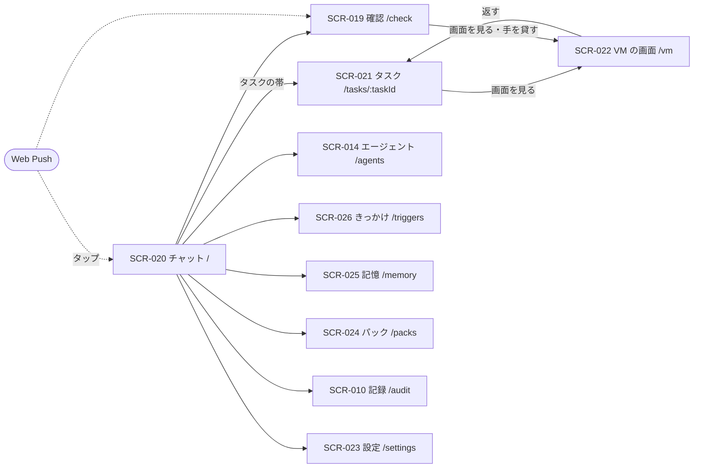

# 06. 画面・UX設計
- プロジェクト：Agent-Team-Open ／ 版数：v1.3（2026-10-24） ／ インプット：[04_functional_spec](04_functional_spec/README.md)

> **3行で**
> 1. 画面は 10 個。中心は 1 本のチャット（SCR-020）で、相手はメインだけ。裏で動いているタスクは、チャットの上に細い帯で出し、タップでタスクのページ（SCR-021）を開く。
> 2. v1.0 で足したのは、記憶（SCR-025）ときっかけ（SCR-026：ルーチン・予約した確認・受け口）。依頼のページはタスクのページになり、VM の画面は 1 つ（`/vm`）になった。
> 3. 呼び名は「メイン」「エージェント」「タスク」。チャットには作業の途中経過を流さない（メインが `send_to_owner` を呼んだときだけ）。通知は Web Push。

## 🧭 判断してほしいこと
なし

## 全体図

見てほしいところ：通知をタップすると、チャットか確認に直接開く。VM の画面へは「タスク」と「確認」の 2 か所から入る。

## 要点
- チャットに出るのは、持ち主のメッセージとメインの `send_to_owner` だけ。メインが黙れば何も増えない（[SCR-020](#scr-020チャット)）
- 裏のタスクはチャットの上の帯（動いている数とタイトル）。タップでタスクのページ（[SCR-021](#scr-021タスク)）
- 確認カードには、人に回った理由（合図・オートレビューが止めた理由）を出す（[SCR-019](#scr-019確認)）
- 記憶の画面で、プロフィールとログを見て直せる（[SCR-025](#scr-025記憶)）
- きっかけの画面に、ルーチン・予約した確認・受け口をまとめる（[SCR-026](#scr-026きっかけ)）
- 設定に、上限・こわい操作・つながり・通知・VM（控え・作り直し・ブラウザのデータ）・ホストの状態をまとめる（[SCR-023](#scr-023設定)）

---

## 詳細

### デザイン方針
- 今の画面の決まり（[docs/ui-design.md](../ui-design.md)）を引き継ぐ。言葉は短く、呼び名は「メイン」「エージェント」「タスク」（「担当」「依頼」は使わない）
- チャットは友達とのチャットに近づける（参考資料：画面は単純に）。作業の途中経過は見に行けば見える（タスクのページ）が、流れてはこない
- VM の操作は「見る」が既定。誤ってタップしてもエージェントの邪魔をしない
- こわい操作の確認は、何を押すかが一目で分かることを最優先にする（スクショ＋印＋見えている名前）

### 画面一覧
| ID | 画面名 | パス | 関連FR | 状態 |
|---|---|---|---|---|
| SCR-020 | チャット | `/` | FR-090, FR-093, FR-089, FR-018 | 作り直し（メインとの 1 本のチャット・タスクの帯） |
| SCR-021 | タスク | `/tasks/:taskId` | FR-092, FR-075, FR-086, FR-099 | v0.6 の依頼のページを置き換え |
| SCR-019 | 確認 | `/check` | FR-077, FR-078, FR-081, FR-094 | 今のまま＋ルーチンの提案・人に回った理由 |
| SCR-014 | エージェント | `/agents` | FR-072, FR-085 | 今のまま＋メインの行・「いつ使うか」 |
| SCR-010 | 記録 | `/audit` | FR-016 | 今のまま＋きっかけ・オートレビュー・VM の事象 |
| SCR-022 | VM の画面 | `/vm` | FR-078 | v0.6 の `/boxes/:boxId` を 1 つに |
| SCR-023 | 設定 | `/settings` | FR-013, FR-017, FR-076, FR-079, FR-081〜083, FR-100 | 通知・VM の欄を足す |
| SCR-024 | パック | `/packs` | FR-085 | 今のまま |
| SCR-025 | 記憶 | `/memory` | FR-097 | 新規 |
| SCR-026 | きっかけ | `/triggers` | FR-094〜096 | 新規 |

メニュー：チャット・確認（件数）・エージェント・きっかけ・記憶・パック・記録・設定。

### SCR-020：チャット
- 目的：メインと話す。裏で何が動いているかを一目で知る
- ワイヤーフレーム（スマホ）：
 ```
 +----------------------------------+
 | ≡  メイン            確認 2 |
 +----------------------------------+
 | ▶ 動いている 2：店探し・PR の修正 > |  ← タスクの帯（タップで一覧）
 +----------------------------------+
 |         木曜 19 時に 4 人で入れる |
 |         店を 3 つ探して      ♥  |  ← 持ち主（♥ はメインのリアクション）
 | 店探しのエージェントに頼みました。 |
 | 見つかったら知らせます。      |
 |  ─── 7:30 ───              |
 | おはようございます。3 件見つかり |
 | ました。                     |
 | ・○○（空きあり）…            |
 | [ 1 番を予約 ][ 2 番 ][ やめる ] |  ← choices
 | 📄 店の比較.html [保存][プレビュー] |  ← file
 +----------------------------------+
 | [ メインに話す……       ] [送る] |
 +----------------------------------+
 ```
- 表示項目：
 | 項目 | データ元 | 備考 |
 |---|---|---|
 | メッセージ | API-120 | 持ち主・メイン・`system`（上限で止まった など）の 3 種類。`text`・`file`・`choices`・`reaction` |
 | タスクの帯 | API-122（`status=active`） | 動いている数と、先頭 2 つのタイトル。0 なら帯を出さない |
 | 確認の件数 | API-100 | 0 なら出さない |
 | メインの状態 | API-120 の `mainState`（SSE の `turn.updated` を合図に取り直す） | 起きている間だけ、入力欄の上に「考えています…」を小さく出す（中身は出さない） |
 | 外の印 | API-120 の `summaryTainted` | `true` の間だけ、ヘッダーの近くに小さく「外の印あり」を出す。押すと SCR-025 の要約の欄へ行く（D-311） |
- 操作：
 | 操作 | 挙動 | API | 遷移先 |
 |---|---|---|---|
 | 送る | 画面が ID を作り、薄い色ですぐ出す。確定したら普通の色、失敗したら「送れませんでした」と [ 再送 ]（D-196） | API-119 | — |
 | 打ち始める | 5 分に 1 回、先温めの合図を送る（Should。D-233） | API-121 | — |
 | 選択肢を押す | 選んだ値を持ち主のメッセージとして送る。押したボタン以外は薄くする | API-119（`replyTo`・`choice`） | — |
 | ファイルを保存・プレビュー | 保存はダウンロード。プレビューはスクリプトの動かない形で新しいタブに出す（HTML の中のスクリプトから持ち主の権限で API を呼ばせない。D-243） | API-112 | — |
 | タスクの帯 | 動いているタスクの一覧（下から出る）。行を押すとタスクのページ | API-122 | SCR-021 |
- 状態：読み込み中 / 空（初めて：「メインに話しかけてください」と例を 3 つ）/ メインが起きている / 上限で止まった（`system` の行。日次の上限で待っているときは「設定で日次の上限を上げればすぐ再開します」と設定の上限の欄（SCR-023）へのリンクを付ける。D-312）/ つながらない（再接続）
- メインが動いている間も入力欄は使える。送ったメッセージはそのまま次の歩みに入る（FR-089）
- 古いメッセージは上に引くと読み込む（`before` で 50 件ずつ）。要約で消えた分もチャットには残っている（要約はメインの文脈の話）

### SCR-021：タスク
- 目的：裏で動いているタスクの中身を見る・言い直す・止める
- 表示項目：
 | 項目 | データ元 | 備考 |
 |---|---|---|
 | タイトル・状態・エージェント | API-123 | 振り分けた理由（`delegate_reason`）・起こされた理由（`origin`） |
 | `brief` | API-123 | メインが書いた仕事の説明 |
 | 歩み | API-123 | LLM の 1 歩ごとの要約・道具の呼び出し。パックの手順書ごとに区切る（R-86） |
 | ブラウザの欄 | API-123・API-088 | 画面の番を持っているか・最新のスクショ・[ 画面を見る ]・操作の回数と上限 |
 | ターミナルの欄 | API-123 | コマンドと出力のログ（64KB まで） |
 | オートレビュー | API-123 | 通した・止めた操作と理由 |
 | 報告 | API-123 | 終わったら報告の文と成果物 |
- 操作：
 | 操作 | 挙動 | API | 遷移先 |
 |---|---|---|---|
 | 言い直す | 入力欄からタスクに直接伝える。「次の歩みで伝えます」と小さく出す | API-124 | — |
 | 止める | 確かめてから取り消す | API-016 | — |
 | 画面を見る | VM の画面を開く | — | SCR-022 |

### SCR-019：確認
- ブラウザの確認カード：
 ```
 +----------------------------------+
 | 🛒 購入ボタンを押します      |
 | 店探し ・ 予約サイト（example.jp） |
 | +------------------------------+ |
 | | スクショ（押す場所に赤い印）  | |
 | +------------------------------+ |
 | 押すもの：「予約を確定する」    |
 | 理由：決まった言葉「確定」      |
 |    オートレビュー：人数の欄が空 |
 | あと 28 分             |
 | [ 画面を見る ]  [ × ]  [ ○ ]  |
 +----------------------------------+
 ```
- 理由は「エージェントの申告（種類）」か、当たった合図（秘密の欄・確認するドメイン・必ず人の言葉・決まった言葉・キーでの作動・修飾キー・押す先が分からない・POST の送信（T-7））。オートレビューが止めたものは、その理由も出す
- 確認のカードの注記（D-311）：メインのターンの汚染が今の要約の印から来ているとき（応答の `summaryTainted` が `true`）、API の書き込みのカードとルーチンの提案のカードに「メインの記憶の要約に外の内容が入っているため確認しています」と、SCR-025 の要約の欄へのリンクを出す。要約でない出どころ（そのターンで読んだ外の文など）のときは出さない。Web Push の文は変えない（カードを開いたときに見える）
- 交代の頼みのカード：理由と [ 手を貸す ]（SCR-022 を開き、そのまま交代する）
- ルーチンの提案のカード（FR-094）：名前・時刻（「平日 8:00」のように読める形）・プロンプト・[ × ] [ ○ ]（API-142）。7 日で消える
- ○ / × はブラウザの確認では API-110、API の書き込みでは API-019
- ○ のあと画面が変わっていたら、カードは「画面が変わったので実行しませんでした。エージェントが決め直します」と出て消える。実行されたか分からないときは「実行されたか分かりません。画面を見て確かめてください」。実行の直前の確かめに外れたとき（API-110 の `expired`：タスクが取り消された・VM が起こし直された・画面の番が替わった・交代した・控えに戻した）は「状況が変わったので実行しませんでした（理由）」と出て消える（D-307）
- 交代を始めると、その VM の確認カードは消える（交代のあとに必要なら出し直される）
- API の書き込みのカードは、種類ごとに中身を見せてから ○ / × を選ばせる（D-198）：PR は差分の要約とファイルの一覧、カレンダーは予定の題・日時・場所・招く人。○ を押すまでは何も外に出ない（BR-10）

### SCR-022：VM の画面
- 目的：VM のブラウザを見る・代わりに操作する
- ワイヤーフレーム（スマホ）：
 ```
 +----------------------------------+
 | ← VM ・店探し        ● 動作中 |
 +----------------------------------+
 |  （VM の画面。ピンチで拡大）    |
 +----------------------------------+
 | エージェント：「日付を選んでいます」 |
 +----------------------------------+
 | [ 代わる ]      [ VM を止める ] |
 +----------------------------------+
     ↓ 代わったあと
 +----------------------------------+
 | ← VM ・店探し        ✋ 交代中 |
 +----------------------------------+
 |  （VM の画面。タップ＝クリック）  |
 +----------------------------------+
 | [Tab] [Enter] [Esc] [⌫]     |
 +----------------------------------+
 | [ 返す ]             |
 +----------------------------------+
 ```
 注記：スマホの文字入力欄は次の版（D-181）。文字入力は PC のキーボードでする。
- 表示項目：
 | 項目 | データ元 | 備考 |
 |---|---|---|
 | 画面の番を持つタスク・状態 | API-088 | 動作中・交代中・確認待ち・止まっている（眠っている）・番を待っているタスクの数 |
 | 画面 | API-089（WebSocket） | 見るときは `mode=view` |
 | エージェントのひとこと | API-088 の `lastActionSummary`（SSE の `vm.updated` を合図に取り直す） | 直前の操作の要約 |
 | 交代の頼みの理由 | API-088 | 頼まれているときだけ、上に帯で出す |
- 操作：
 | 操作 | 挙動 | API | 遷移先 |
 |---|---|---|---|
 | 代わる | エージェントを止め、操作できる形でつなぎ直す | API-090 | 同じ画面（交代中） |
 | 返す | エージェントに戻す | API-091 | SCR-021 |
 | VM を止める | 確かめてから VM を止める（動いているタスクは VM 待ち。次に使うときに起きる） | API-099 | — |
- 状態：つないでいる / 動作中 / 渡す準備中 / 交代中 / 確認待ち / 眠っている（最後のスクショと「次に使うときに起きます」）/ つながらない
- PC では画面を原寸で出し、キーボードをそのまま渡す

### SCR-014：エージェント（差分）
- 先頭にメインの行（消すメニューなし。「指示の手直し」だけ）
- 各行に「いつ使うか」（`description`）を出し、編集できる（メインの振り分けの手がかり：FR-061）
- パック由来のエージェントには、行にパック名のラベル。メインが作ったエージェントには「メインが作成」のラベル
- v0.6 の「ブラウザのデータを消す」は設定の VM の欄に移した（VM は 1 台）

### SCR-010：記録（差分）
- 種類の絞り込みに「きっかけ」（`wakes`：起こされた理由・受け口・重複で捨てたもの）と「オートレビュー」（通した・止めた・理由・費用）と「VM」（起きた・眠った・控え・戻した）を足す

### SCR-023：設定
| 欄 | 中身 | API |
|---|---|---|
| 上限 | タスク・メインのターン・日次の費用、歩数・操作の回数・時間、裏のタスクの同時数。日次の上限を上げると、日次の上限で待っているメインのターンがすぐ再開する（D-312）。チャットの `system` の知らせからこの欄へ来られる | API-096 |
| こわい操作 | 確認するドメイン・確かめないドメイン・必ず人の言葉・オートレビューに回す言葉（足す・外す） | API-096 |
| 通知 | この端末で通知を受ける（許可・外す）・試しに送る。iOS は「ホーム画面に追加」の案内 | API-031, 032, 137 |
| つながり | Google カレンダー・GitHub をつなぐ・外す | API-093, 094, 107 |
| VM | 状態（動いているか・ホームの大きさと上限 4GB・プロフィールの大きさ・ホームの状態）・控えの一覧（日付・大きさ）・[ 今すぐ控えを取る ]・[ この控えに戻す ]（ダイアログに「動いているタスク N 件が止まります」）・[ 空から作り直す ]・[ ブラウザのデータを消す ]（どれも確かめのダイアログつき）。ホームが容量を超えたら（`over_quota`）「ホームが 4GB を超えたので VM を止めました」と [ 掃除のために起こす ] を出し、押すと大きいフォルダ上位 20 個（パス・大きさ・[ 消す ]）と [ 終える ] の欄になる（タスクは受けない。D-301）。戻し・作り直しに失敗したら（`broken`）「ホームが壊れています。控えに戻すか作り直してください」を出し、ほかのボタンは使えない（D-294） | API-088, 133〜135, 138, 145 |
| 引っ越し | 書き出す・取り込む | API-097, 098 |
| ホスト | 版・空きメモリ・空きディスク・LLM の接続先とモデル（オートレビューのモデルも）・今日の費用・キャッシュの当たり率と外れの件数・Funnel の状態 | API-111 |

### SCR-024：パック
- 目的：用途ごとのエージェント集（パック）を入れる・外す・更新する（FR-085、D-176）
- ワイヤーフレーム：
 ```
 +----------------------------------+
 | ← パック                         |
 +----------------------------------+
 | 入っている                       |
 | 告知ページ制作 1人 v1 [ 外す ]    |
 | 用途：告知ページを作って PR にする |
 +----------------------------------+
 | 入れられる                       |
 | コードの修理 2人  v1  [ 入れる ]  |
 | 用途：リポジトリを動かして直す     |
 +----------------------------------+
 ```
- 表示項目：入っている・入れられるの2つの一覧。各行は名前・用途・エージェント数・版（API-114）
- 操作：入れる（API-115）・外す（API-116。動いているエージェントがいると `AGENT_BUSY`）・更新（API-115。「手で変えた設定は失われます」と知らせてから）
- 状態：読み込み中 / 空 / 入れられるものなし / 失敗

### SCR-025：記憶
- 目的：メインが覚えていることを見て、直す・消す・足す（FR-097）
- ワイヤーフレーム：
 ```
 +----------------------------------+
 | ← 記憶    プロフィール｜ログ｜要約 |
 +----------------------------------+
 | 42 / 100 個 ・ 1,830 / 4,000 字   |
 | ・告知ページは明るい色、絵文字なし ✎ 🗑 |
 | ・平日は 9 時〜18 時は会議が多い  ✎ 🗑 |
 | [ ＋ 足す ]                       |
 +----------------------------------+
 ```
- プロフィール：事実の一覧（`rank` の順）・数と字数・足した人（メイン・持ち主）と日付。直す（API-131）・消す（API-131）・足す（API-141）
- ログ：日付ごとの出来事。検索欄（`search_memory` と同じ検索）。行を消す（API-132）
- 要約：メインの今の要約（⑤）と作った日時。汚染していれば「外の文を読んだ印あり」の札と、どのきっかけ（webhook など）からかを出す。確認のカードとチャットの「外の印あり」（D-311）からここへ来られる。「印を消す」（API-147）は確かめのダイアログ（「要約に怪しい指示がないか読みましたか」）を挟む。メインのターンが動いている間は押せない（D-310）
- メモは出さない（60 分で消える短期の情報のため）

### SCR-026：きっかけ
- 目的：メインを起こすものを一か所で見る（FR-094〜096）
- タブ 3 つ：
 | タブ | 一覧 | 操作 | API |
 |---|---|---|---|
 | ルーチン | 名前・時刻（読める形）・次の時刻・最後に動いた時刻・振り分け先 | 作る・直す・止める・消す・今すぐ動かす | API-125, 126, 136 |
 | 予約 | 時刻・覚え書き・予約したターン | 消す | API-127, 139 |
 | 受け口 | 名前・形（GitHub・汎用）・最後に届いた時刻・件数 | 作る（URL `https://makase.<tailnet>.ts.net:8443/hooks/<hookId>` と秘密を 1 度だけ出す。コピーのボタン）・止める・消す | API-128, 140 |
- ルーチンを作るとき：時刻は「毎日・平日・毎週○曜・毎月○日」と時刻から選び、cron の 5 欄は「詳しく」で直接書ける。15 分より短い間隔は選べない
- 受け口を作るとき：Funnel が使えない（tailnet の設定で許されていない）ときは、その案内を出す（FR-083）

### レスポンシブ・アクセシビリティ方針
- 幅 360px から。VM の画面だけは横向きも使えるようにする
- ボタンは 44px 以上。○ / × は色だけでなく文字でも分ける
- 通知の文とチャットの文は同じ言葉を使う（通知で見た言葉がチャットで見つかる）

## このドキュメントで決まったこと
- D-126、D-169、D-176、D-181、D-195〜D-198、D-201、D-205、D-212、D-221、D-229、D-233〜D-235、v1.2：D-294、D-301、D-307、v1.3：D-311、D-312（[00 決定事項ログ](00_overview.md#決定事項ログ)）
