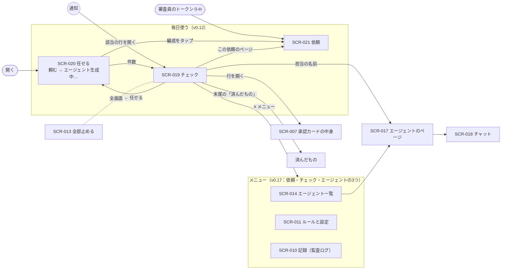
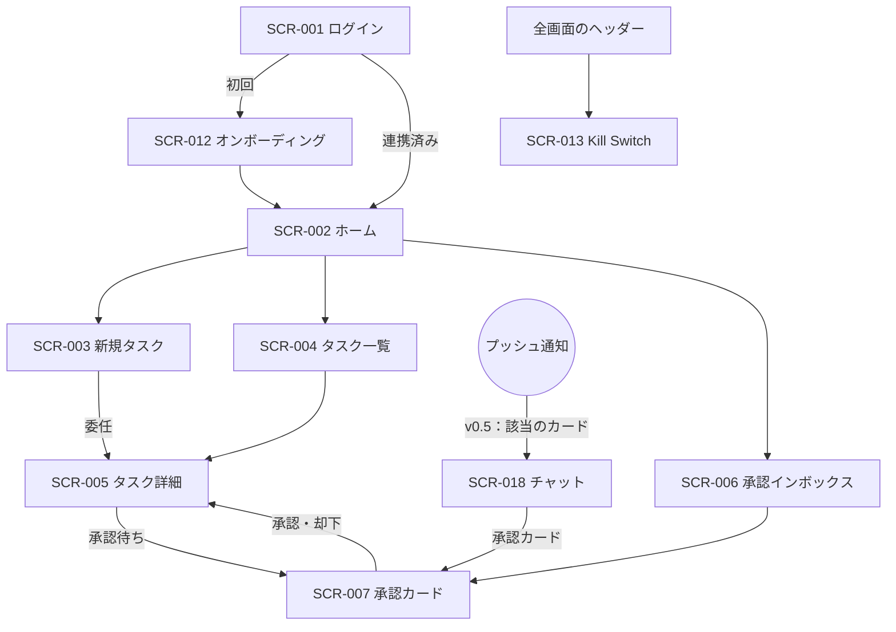
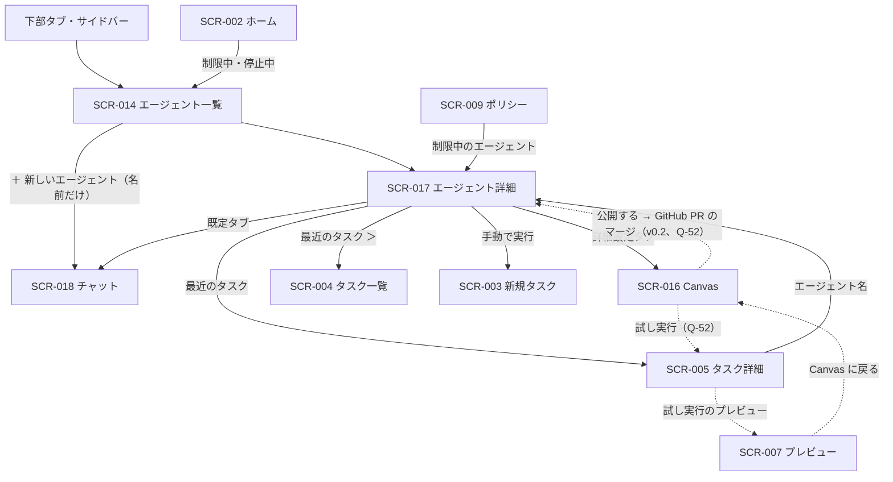
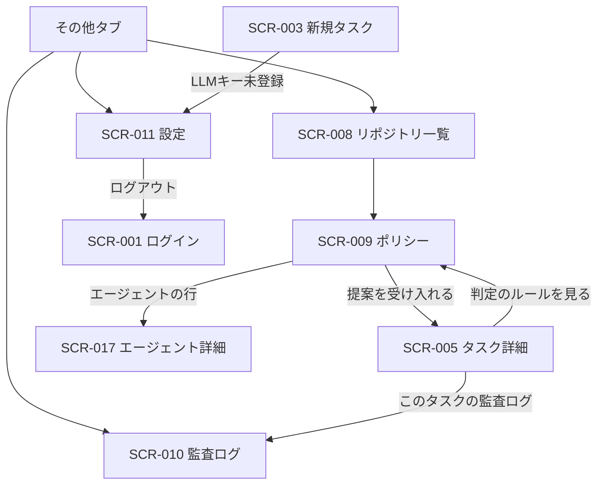

# 06. 画面・UX設計
- プロジェクト：open-team（仮称） ／ 版数：v0.14（2026-10-02） ／ インプット：[04 機能仕様](../04_functional_spec/README.md)、[05 非機能要件](../05_non_functional.md)、[02 ユーザーストーリー](../02_user_stories/README.md)、[09 API](../09_api/README.md)、[08 DB](../08_database/README.md)

> **3行で**
> 1. v0.12 から、毎日使う画面は2枚。開くといつも **SCR-020「任せる」**（真ん中に「仕事はエージェントに任せて」と入力欄だけ）。頼むと「エージェント生成中…」になり、合う担当を使い回すか新しく作る。こなしたことは **SCR-019「チェック」**（`/check`）で ○ を付ける（[ADR-036](../adr/ADR-036-ask-generates-formation.md)・[ADR-037](../adr/ADR-037-entrance-one-sentence.md)、v0.9 は [ADR-034](../adr/ADR-034-one-screen-ask-and-check.md)）。
> 2. 承認も同じ ○ で、押してから5秒は取り消せる。聞き返しには選択肢のボタンで答える。エージェントは各行に担当の名前として出し、一覧・設定・監査ログはメニューの奥に置く。
> 3. SCR-007 の承認カードの中身（宛先と中身を分ける・[以後も許可] の固定される値の確認）は、行を開いた中でそのまま使う。コネクタ・プロフィール・アクティビティなどの画面は未設計（Q-50・Q-51）。

## 🧭 判断してほしいこと
| # | 種類 | 論点 | 選択肢 | おすすめ（理由） | 決まらないと止まるもの |
|---|---|---|---|---|---|
| Q-50 | ✅決定 | 13 の画面（コネクタの一覧・登録・ツールの分類と引数の役割、プロフィール、レポート、スターターから作る導線）が未設計で SCR-ID もない（13 §既存ドキュメントへの影響、15 §既存ドキュメントへの影響）。あわせて、引数の役割を「カタログの推奨で配る」か「初回の承認カードで確定させる」か、読めない宛先の `labels` をどう付けるか（15 §未決事項） → **新しい ID を振る（UC-029〜・FR-041〜・SCR-019〜）。MCP の書き込みは UC-009・010 を拡張せず別 UC。本設計は T-1 の設計作業で書く**（[D-09](../decisions.md#d-09)）| A: 画面を新設して SCR-019 以降を採番 / B: SCR-011 設定の中に置く | —（元の記述なし） | REQ-042・048〜050、API-071、[未設計の画面](unassigned-screens.md) |
| Q-51 | 未決 | v0.3 の画面が未設計：アクティビティビュー（REQ-037、Must）、`handoff`（REQ-035）、アプリ内モードで「権限を広げる変更」の承認カード（REQ-033）、AI事前レビューの表示（REQ-036）（12 §競合機能の採用方針） | 個別に設計 | —（元の記述なし） | REQ-033・035〜037 |
| Q-52 | ✅決定 | SCR-016 を SCR-017 の「詳細設定」タブに移した後の URL・データ元・操作。下書き（TBL-021、API-043〜048・057・058）が廃止されたため、編集・試し実行・公開（PR）・「このやり方を Skill にする」（API-053）の行き先がない。12 §未決事項（v0.3）の「SCR-016 の見直し」も残る → **詳細設定で直接編集（アプリ内モード）。保存は設定変更（TBL-025）**（[D-13](../decisions.md#d-13)）| A: 詳細設定で定義を直接編集（アプリ内モード）/ B: 閲覧のみ | —（元の記述なし） | SCR-016・005・017、REQ-018・022 |
| Q-53 | 未決 | SCR-017 のタブ（チャット／仕事／変更履歴／詳細設定）に、v0.2 の中身（スコアカード・起動条件・メモリ・定義・最近のタスク・停止・信頼度の提案）をどう割り振るか。「仕事」「変更履歴」タブの画面詳細もない（14 §画面） | — | —（元の記述なし） | SCR-017、API-065 |
| Q-54 | ✅決定 | SCR-014 の v0.5 化。エージェントはワークスペース単位になった（13）が、v0.2 のリポジトリ切り替え（`owner/app ▼`）を残すか。v0.5 の表示項目のワイヤーフレームがない → **リポジトリ切り替えを外す。開発エージェントはリポジトリ名を小さく表示**（[D-25](../decisions.md#d-25)）| A: 切り替えを外す / B: 開発エージェントの絞り込みとして残す | —（元の記述なし） | SCR-014 |
| Q-55 | 未決 | 入口・ホーム・新規タスクが v0.4・v0.5 に未対応。①フェーズ0はサインインを省略（13 §フェーズ0）し GitHub も任意（13 §変わること「入口」）だが、SCR-001・012 は GitHub 前提。②SCR-012 の⑤（作り方のシート → SCR-015/016）は行き先が廃止された。③仕事はチャットから作るようになった（14）が、リポジトリ必須の SCR-003 と SCR-002 の「エージェントに任せる」を開発エージェント用に残すか（→ v0.9 で③は解決：依頼は SCR-019 の頼む欄に1本化。[D-42](../decisions.md#d-42)）。④フェーズ0で使う v0.2 の画面の範囲が 13 に明記がない | — | —（元の記述なし） | SCR-001・002・003・012 |
| Q-56 | 未決 | v0.6 で増えたタスク・Intent の状態（`completed`（`actions_declined`）、`failed`（`action_failed`）、MCP の Intent の `executed` / `unknown_outcome` / `expired`（`superseded`・`tool_changed`））の SCR-004・005・006 での表示が未設計（15 §タスクの終わり方、§Intent の状態） | — | —（元の記述なし） | SCR-004・005・006 |
| Q-57 | 未決 | 「以後も許可」のルールの一覧（API-068・069）と、ワークスペースのポリシー（アプリ内で編集、13）をどの画面に置くか | — | —（元の記述なし） | REQ-034・045 |
| Q-58 | 未決 | ブランドカラーとロゴ | — | プロダクト名が決まってから（元の記述） | デザイン方針の色 |
| Q-59 | 未決 | 差分が非常に大きい場合（例：5,000行以上）のスマホでの表示 | A: ファイル一覧だけにして PC を勧める / B: そのまま表示 | —（元の記述なし） | SCR-007 の DiffViewer |
| R-20 | リスク | 承認カードの [以後も許可] は `widen` だが、ユーザーの直接の操作なので確認カードを重ねない（BR-47 ①）。誤タップで権限が広がりうる | — | 確定前に「固定される値／毎回変わってよい値」を必ず表示（15 §承認カード） | SCR-007・018 |

## 全体図

見てほしいところ：入口は SCR-020 だけ（通知だけは SCR-019 の該当の行に直接入る）。ほかの画面へは「行を開く」「担当の名前」「メニュー」の3つの道からしか行かない。v0.6 までの5タブの図は[画面遷移図](#画面遷移図)に残す（SCR-019 に入った画面は日常の入口から外れた）。

## 要点
- 開くといつも SCR-020。頼むと編成（ひとり・並列・まとめ・順番）が生成される → [entrance.md](entrance.md)
- 1つの依頼の全体（編成・結果・送る前の確認・リハーサル）は SCR-021。ハッカソン版の審査員はここから入る → [ask-page.md](ask-page.md)
- チェックと質問への答えは SCR-019 → [ask-and-check.md](ask-and-check.md)
- デザイン方針は「引き算」。押せる所だけに色を使い、ルールによる判定と AI の出力は見分けられるようにする → [デザイン方針](#デザイン方針)
- 画面のつながりは領域ごとに3枚の図 → [画面遷移図](#画面遷移図)
- エージェントは名前を付けて作り、チャットで頼む（SCR-014・017・018）→ [agents.md](agents.md)
- MCP の書き込みの承認カード・[以後も許可]・`unknown_outcome` → [approvals.md](approvals.md)
- タスクの監視・試し実行・レポート（SCR-003〜005）→ [tasks.md](tasks.md)
- 共通部品とレスポンシブ・アクセシビリティ → [common-ui.md](common-ui.md)
- SCR-ID のない未設計の画面の要件（コネクタ・プロフィール・アクティビティほか）→ [unassigned-screens.md](unassigned-screens.md)

---

## 詳細

### デザイン方針
- **トーン**：静かで、することが一目で分かる。v0.6 までの「管制盤」（いま何が起きていて、何が許されているかを並べる）から、v0.9 で「頼む・チェック」（手の要ることだけを並べる）に変えた（[ADR-034](../adr/ADR-034-one-screen-ask-and-check.md)）。何が許されているかは、行を開いた中とメニューの奥で見せる。
- **見た目（v0.16）**：モノクロ基調・余白多め・線より面（ChatGPT / Grok 風）。実装は `prototype/src/styles.css` に揃える（[D-100](../decisions.md#d-100)）。ブランドカラー（Q-58）が決まるまでアクセントはモノクロ。
- **v0.9 で足した原則**：⓪ 画面に出すのはユーザーの手が要るものだけ。終わったことはチェックで消え、動いているものは灰色の1行にたたむ。色は押せる所にだけ使う。

| # | 原則 | 内容 |
|---|---|---|
| 1 | スマホで判断できる | 承認・キャンセル・Kill Switch は片手の親指で操作できる位置に置く（NFR-041：通知から3タップ以内で承認） |
| 2 | ランタイムの判断を見せる | 拒否・停止には、必ず当たったポリシールール（`matchedRule`）を添える |
| 3 | LLM の出力と決定論的な計算を区別する | LLM の要約には「AIによる要約（参考）」、リスク評価・コスト・判定には「ルールによる判定」と明記する |
| 4 | 止めるのは簡単に、再開は慎重に | Kill Switch は常に表示し、確認は1段階だけ。解除はワークスペースの owner だけが理由を入力して行う（エージェントの再開も同じ） |
| 5 | 破壊的な操作には確認を挟む | キャンセル・停止・削除は確認のボトムシートを出す。**承認は v0.9 で確認シートをやめ、押してから5秒の取り消し猶予にする**（D-43）。却下は行を開いた中で理由を任意に入れる |
| 6 | 境界が一目で分かる | 構成と境界を「起動条件 → エージェント → できること → 境界 → 外部作用」の順に一画面で並べる（PC は左から右、スマホは上から下） |
| 7 | ポリシーで制限された項目は鍵アイコン | ポリシーや Hard Ceiling より緩い値は選べない。🔒と「リポジトリのポリシーで制限されています」と制限している値を添える。公開後に切り詰められた（clamp）エージェントには ⚠「ポリシーにより制限中」を一覧・Canvas・タスク詳細に出す |
| 8 | AI が作ったものとルールで作ったものを区別する（3 の拡張） | 設計アシスタントの提案・自己レビューには「AI」のラベル。「このエージェントにできること」は実効ポリシーから固定の文テンプレートで生成し「ルールによる生成」と明記する |
| 9 | 試し実行は本番と見分けがつく | 試し実行のタスクとプレビューの承認カードには常に試し実行バナー。承認・PR を開くボタンは出さない |
| 10 | 権限を広げる操作は人を通す | v0.2：「公開する」は PR を作るだけで「マージすると有効になります」と明示。v0.5：エージェント自身の設定の変更も `widen` は確認カードで承認を待つ（[ADR-027](../adr/ADR-027-classify-widening-changes.md)） |

- 6〜10 は 12（v0.2）で追加。原則 9・10 の v0.2 部分（試し実行・公開）は SCR-016 の扱い（Q-52）に従う。
- **色の意味**（テキストでも状態を示し、色だけに頼らない）：実行中＝青、承認待ち＝琥珀、成功＝緑、停止・失敗・却下＝赤、キャンセル＝グレー。エージェントは有効＝緑、制限中＝琥珀（⚠）、無効（invalid）・停止中＝赤。試し実行＝紫（斜線の帯）。ブランドカラーは Q-58。
- 用語：v0.4 で「組織」は「ワークスペース」に改名した（13）。v0.2 のワイヤーフレームに残る `org`・「組織」はワークスペースと読む。

### 情報設計（サイトマップ）

```
/
├── /  ..................... SCR-020 任せる（v0.12。開くといつもここ）
├── /check ................. SCR-019 チェック（v0.12 で `/` から移動。`?item=` で行を開く）
├── /asks/:askId ........... SCR-021 依頼（v0.13。審査員はトークンの直後にここ）
├── /done .................. 済んだもの（SCR-019 のメニューから）
├── /login ................. SCR-001 ログイン（フェーズ0は省略、Q-55）
├── /onboarding ............ SCR-012 オンボーディング
├── （v0.9 で SCR-019 に統合）SCR-002 ホーム
├── /agents ................ SCR-014 エージェント一覧
│   └── /agents/:agentId ... SCR-017 エージェント詳細（タブの入れ物）
│       ├── （既定タブ）..... SCR-018 エージェントのチャット
│       ├── 仕事 / 変更履歴 .. SCR-017 のタブ（詳細は Q-53）
│       └── 詳細設定 ........ SCR-016 Harness Canvas（URL は Q-52）
├── /tasks ................. SCR-004 タスク一覧
│   ├── /tasks/new ......... SCR-003 新規タスク
│   └── /tasks/:taskId ..... SCR-005 タスク詳細
│       └── /tasks/:taskId/preview ... SCR-007 承認カード（試し実行のプレビュー）
├── /approvals ............. SCR-006 承認インボックス
│   └── /approvals/:approvalId ... SCR-007 承認カード
├── /repos ................. SCR-008 リポジトリ一覧
│   └── /repos/:repoId/policy .... SCR-009 ポリシー
├── /audit ................. SCR-010 監査ログ
├── /settings .............. SCR-011 設定
└── （全画面共通）........... SCR-013 Kill Switch モーダル
（廃止）/agent-drafts/:draftId/chat … SCR-015（v0.5、→ SCR-018）
```

- **v0.12**：`/` は SCR-020（任せる）、SCR-019 は `/check` に移した（D-66）。
- **v0.9**：下部タブはやめ、SCR-019（`/`）と右上のメニュー（エージェント・済んだもの・ルールと設定・記録）だけにする（D-42）。以下の下部タブ・サイドバーの記述は v0.6 までのもの。
- **下部タブ（スマホ、v0.6 まで）**：エージェント（制限中・無効があれば ⚠ のバッジ）/ ホーム / タスク / 承認（未処理件数のバッジ）/ その他（リポジトリ・監査ログ・設定）。v0.5 で「エージェント」を先頭にした（14 §画面）。
- v0.2 で「リポジトリ」タブを「エージェント」タブに置き換え、リポジトリ一覧は「その他」に移した（日常的に開くのはエージェントで、リポジトリはエージェント一覧の切り替えからも選べるため。A-49）。
- **PC（幅1024px以上）のサイドバー**：ホーム / タスク / 承認 / エージェント / リポジトリ / 監査ログ / 設定 をすべて並べる。
- エージェントの配下の画面（SCR-016〜018）では、タブの選択状態は「エージェント」のまま。

### 画面遷移図

**図1：入口・タスク・承認**

見てほしいところ：v0.2 ではプッシュ通知から SCR-007（承認待ち）・SCR-005（成功・停止・レポート完了）に入った。v0.5 では通知はエージェントのチャットの該当のカードを開く（14 §SCR-018）。

**図2：エージェント**

見てほしいところ：点線は v0.2 の下書き・公開の経路で、下書きの廃止により扱いが未決（Q-52）。試し実行のタスクは承認インボックス（SCR-006）に出ず、プレビュー（SCR-007P）と Canvas にだけ進める。

**図3：統制・設定**

見てほしいところ：コネクタ・プロフィール・ワークスペースのポリシー・ルールの一覧の画面はまだない（Q-50・Q-57）。

### 画面一覧

| ID | 画面名 | URL/パス | 対象ロール | 関連FR | フェーズ | 状態 | 定義 |
|---|---|---|---|---|---|---|---|
| SCR-001 | ログイン | `/login` | 未ログイン | FR-001 | 1（フェーズ0は省略） | 有効 | [entry-and-home.md](entry-and-home.md#scr-001ログイン) |
| SCR-002 | ホーム | —（`/` は SCR-019） | viewer 以上 | FR-011, FR-013, FR-015, FR-018, FR-032 | 1 | **統合（v0.9、→ SCR-019）** | [entry-and-home.md](entry-and-home.md#scr-002ホーム) |
| SCR-003 | 新規タスク | `/tasks/new`（`?agent=`） | maintainer 以上 | FR-003, FR-005 | 1 | **統合（v0.9、→ SCR-019 の頼む欄）** | [tasks.md](tasks.md#scr-003新規タスク) |
| SCR-004 | タスク一覧 | `/tasks` | viewer 以上 | FR-018 | 1 | 有効 | [tasks.md](tasks.md#scr-004タスク一覧) |
| SCR-005 | タスク詳細 | `/tasks/:taskId` | viewer 以上 | FR-013, FR-015, FR-018, FR-026, FR-030, FR-033 | 1 | 有効 | [tasks.md](tasks.md#scr-005タスク詳細) |
| SCR-006 | 承認インボックス | `/approvals` | maintainer 以上 | FR-011 | 1 | **統合（v0.9、→ SCR-019 の送る前の確認）** | [approvals.md](approvals.md#scr-006承認インボックス) |
| SCR-007 | 承認カード | `/approvals/:approvalId`、`/tasks/:taskId/preview` | maintainer 以上（操作は承認者のみ） | FR-011, FR-026, FR-029 | 0（MCP 版）/ 1（PR 版） | 有効 | [approvals.md](approvals.md#scr-007承認カード) |
| SCR-008 | リポジトリ一覧 | `/repos` | viewer 以上 | FR-002, FR-003 | 1 | 有効 | [governance.md](governance.md#scr-008リポジトリ一覧) |
| SCR-009 | ポリシー | `/repos/:repoId/policy` | viewer 以上 | FR-003, FR-021, FR-023 | 1 | 有効 | [governance.md](governance.md#scr-009ポリシー) |
| SCR-010 | 監査ログ | `/audit` | viewer 以上 | FR-016 | 0 | 有効 | [governance.md](governance.md#scr-010監査ログ) |
| SCR-011 | 設定 | `/settings` | viewer 以上（項目ごと） | FR-015, FR-017, FR-019, FR-020 | 1 | 有効 | [governance.md](governance.md#scr-011設定) |
| SCR-012 | オンボーディング | `/onboarding` | ログイン済み | FR-002, FR-017, FR-019 | 1 | 有効（Q-55） | [entry-and-home.md](entry-and-home.md#scr-012オンボーディング) |
| SCR-013 | Kill Switch モーダル | 全画面共通 | maintainer 以上 | FR-015 | 0 | 有効 | [entry-and-home.md](entry-and-home.md#scr-013kill-switch-モーダル全画面共通) |
| SCR-014 | エージェント一覧（ライブラリ） | `/agents` | viewer 以上（作成は maintainer 以上） | FR-022, FR-032, FR-034 | 0 | 有効（v0.9 でメニューの奥へ。v0.17 で「生成した担当のライブラリ」として実装） | [agents.md](agents.md#scr-014エージェント一覧) |
| SCR-015 | エージェント作成（会話） | — | — | — | — | **廃止（v0.5、→ SCR-018）** | [agents.md](agents.md#scr-015エージェント作成会話廃止) |
| SCR-016 | Harness Canvas | Q-52 | maintainer 以上 | FR-023, FR-025〜FR-027 | 1（Could） | **移動（v0.5、→ SCR-017 の詳細設定タブ）** | [agent-settings.md](agent-settings.md) |
| SCR-017 | エージェント詳細 | `/agents/:agentId` | viewer 以上（停止は maintainer 以上、再開は owner） | FR-021, FR-028, FR-031, FR-032, FR-037, FR-039 | 0 | 有効（v0.5 でタブ化） | [agents.md](agents.md#scr-017エージェント詳細) |
| SCR-018 | エージェントのチャット | `/agents/:agentId`（既定タブ） | —（14 に記載なし） | FR-034〜FR-040 | 0 | 有効（v0.5 新規） | [agents.md](agents.md#scr-018エージェントのチャット) |
| SCR-019 | チェック（v0.9 は「頼む・チェック」） | `/check`（`?item=`） | フェーズ0は owner（○ の承認は承認者だけ） | FR-011, FR-013, FR-015, FR-018, FR-034〜FR-040, FR-062, FR-063 | 0 | 有効（v0.12 で頼む欄を SCR-020 へ） | [ask-and-check.md](ask-and-check.md) |
| SCR-020 | 任せる | `/` | フェーズ0は owner | FR-061〜063 | 0 | 有効（v0.12 新規） | [entrance.md](entrance.md) |
| SCR-021 | 依頼 | `/asks/:askId` | フェーズ0は owner（0-H はゲストも） | FR-062〜064, FR-042〜045, FR-046 | 0（0-H は Must） | 有効（v0.13 新規、v0.14 で回答・やり取りを追加） | [ask-page.md](ask-page.md) |

- 試し実行の承認カードのプレビューは SCR-007 の表示モードで、別の画面 ID は設けない（A-51）。
- 共通UIコンポーネントの一覧は [common-ui.md](common-ui.md)。

### 前提・仮定
- A-22：通知から直接承認するアクションボタンは付けず、承認は必ずアプリの画面で行う（誤操作防止と intentHash の確認のため）。
- A-23：幅1024px以上では3カラムのレイアウトにする。
- 12 の仮定のうち画面にかかわるもの：A-33（テンプレートは3種）、A-34（1リポジトリ20エージェント・1エージェント20 Skill。v0.5 で「1ワークスペース20体」に読み替え、A-81）、A-35（設計アシスタントは下書き1件 $0.5）、A-36（試し実行は1回 $1）、A-37（`max_runs_per_day` は最大50）、A-38（メモリは200項目・各500文字）、A-39（レポートは GitHub に書き込まない）、A-41（メンションの書式）。
- 14・15 の仮定のうち画面にかかわるもの：A-80（会話の保存は90日）、A-81（1エージェントの仕事は10個まで）、A-85（1タスクの Intent は既定5件）。
- 本書で置いた仮定（仮番号。00 の仮定一覧に登録するときに採番し直す）：
  - A-49：下部タブの「リポジトリ」を「エージェント」に置き換え、リポジトリ一覧は「その他」に移す（12 v0.2 で採用）。
  - A-50：エージェント関連の URL は `/agents`、`/agents/:agentId`、`/agent-drafts/:draftId`、`/agent-drafts/:draftId/chat`、`/tasks/:taskId/preview`（12 v0.2 で採用。`/agent-drafts/*` は v0.5 で行き先が廃止、Q-52）。
  - A-51：試し実行の承認カードのプレビューは SCR-007 の表示モードとし、別の画面 ID は設けない。
  - A-52：エージェントの停止の理由は1〜500文字（Kill Switch の解除と同じ）。
  - A-53：既定エージェント（`default`）は SCR-003・SCR-014 の先頭に「既定」のラベルつきで表示し、`default.yaml` がなければ「組み込み」と表示する。

## このドキュメントで決まったこと
- [ADR-017](../adr/ADR-017-in-app-definition-default.md)：定義の既定はアプリ内。権限を広げる変更だけ承認を求める
- [ADR-026](../adr/ADR-026-name-and-ask.md)：名前を付けて頼むだけ。SCR-015 を廃止し SCR-018 に統合
- [ADR-027](../adr/ADR-027-classify-widening-changes.md)：`widen` の変更だけを確認カードで人に戻す
- [ADR-029](../adr/ADR-029-mcp-arg-roles-destination-fixed.md)：引数の役割と宛先の固定。承認カードで宛先と中身を分けて見せる
- [ADR-031](../adr/ADR-031-mcp-write-no-auto-retry.md)：MCP の書き込みは自動で再試行せず、`unknown_outcome` をカードで確定させる
- [ADR-034](../adr/ADR-034-one-screen-ask-and-check.md)：毎日使う画面を「頼む・チェック」の1枚にし、承認も同じチェックにする
- [ADR-036](../adr/ADR-036-ask-generates-formation.md)：頼むと編成（エージェント）が生成される。合えば使い回し、必要なら独立した複数のエージェントに分ける
- [ADR-037](../adr/ADR-037-entrance-one-sentence.md)：入口を「仕事はエージェントに任せて」と入力欄だけにし、チェックを別の画面に分ける
- 版ごとの変更は [changes/](../changes/) に置く
