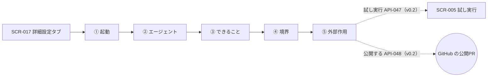

# 06. 画面詳細：詳細設定（SCR-016 Harness Canvas）
- 親：[06 画面・UX設計](README.md) ／ 版数：v0.6（2026-10-01）

> **3行で**
> 1. Harness Canvas は、エージェントに任せることと任せないことを「起動 → エージェント → できること → 境界 → 外部作用」の5つのノードで一画面に並べ、編集・試し実行・公開する画面。
> 2. v0.5 で SCR-017 の「詳細設定」タブに移り、見たい人だけが開く機能（REQ-018・022 は Could）になった。
> 3. 下書き（TBL-021、API-043〜048・057・058）が廃止されたため、本書の v0.2 の操作の多くは行き先がない（Q-52）。

## 🧭 判断してほしいこと
- Q-52（移動後の URL・データ元・試し実行・公開・Skill 化の扱い）。内容は [README](README.md#-判断してほしいこと)。
- 12 §未決事項（v0.3）：アプリ内モードを既定にしたことで、v0.2 の「PR での公開」を前提にした SCR-016 の見直しが要る（Q-52 に含める）。

## 全体図

見てほしいところ：ノードの並びは原則6（境界が一目で分かる）。点線は v0.2 の操作で、下書きの廃止により未決。

## 要点
- PC は左から右、スマホは上から下の縦のカード。ノードをタップすると編集シート → [ワイヤーフレーム](#ワイヤーフレーム)
- ポリシーより緩い値は 🔒 で選べない（PolicyLockBadge）→ [表示項目](#表示項目と操作)
- 検証エラーの間は「試し実行」「公開する」を押せない → [表示項目](#表示項目と操作)
- 公開は PR を作るだけで「マージすると有効になります」と出す（v0.2）→ [状態とエラー](#状態とエラー)
- viewer はこの画面を開けない

---

## 詳細

### 位置づけ
- v0.2：URL `/agent-drafts/:draftId`。SCR-014 のテンプレート選択・SCR-015 の会話・SCR-017 の「編集」から開く。
- v0.5（14 §画面）：SCR-017 の「詳細設定」タブに移す。Canvas と YAML は詳細設定に残し、見たい人だけが開く（14 §概要）。URL は 14 に記載がない（Q-52）。
- v0.3（12）：アプリ内モード（既定）では保存した時点で有効、権限を広げる変更だけ承認者の承認が要る。GitOps モードでは PR のマージで有効（v0.2 の動き）。本画面の「公開する」は GitOps モードの動きにあたる。

### ワイヤーフレーム

<details>
<summary>幅1024px以上（v0.2）</summary>

```
+--------------------------------------------------------------------------------------+
| ← deps-bot（下書き）   [Canvas] [YAML] [できること]       [試し実行] [公開する]       |
+--------------------------------------------------------------------------------------+
| 起動            エージェント           できること          境界               外部作用 |
| +----------+   +----------------+   +--------------+   +--------------+   +--------+ |
| | 毎週月   |-->| 依存更新係      |-->| read    auto |-->| 変更できる    |-->|open_pr | |
| | 9:00 JST |   | dev-coder      |   | edit    auto |   |  package*.json|   |approve | |
| +----------+   | Skill: 1       |   | tests   auto |   |  *.lock       |   | 承認者:| |
| +----------+   | メモリ: 有効    |   | network 🔒deny|   | コマンド      |   |  ren   | |
| | 手動     |-->| モデル:        |   | memory  auto |   |  npm test     |   +--------+ |
| +----------+   |  impl sonnet   |   +--------------+   | 予算 $1/回    |              |
|                |  review opus   |                      |      $5/日    |              |
|                +----------------+                      | 10回/日       |              |
|                                                        +--------------+              |
+--------------------------------------------------------------------------------------+
| 検証: ✓ 問題なし   実効ポリシー: policy a1b2c3d と合成   直近の試し実行: ✓ $0.42      |
+--------------------------------------------------------------------------------------+
```

</details>

<details>
<summary>スマホ（v0.2）：同じノードを上から下の縦のカードにする</summary>

```
+----------------------------------+
| ← deps-bot（下書き）      [💬会話] |
| [Canvas][YAML][できること]         |
+----------------------------------+
| ✓ 問題なし · policy a1b2c3d と合成 |
+----------------------------------+
| ① 起動                         ✎ |
|  毎週月 9:00 JST · 手動           |
+--------------- ↓ ----------------+
| ② エージェント                   ✎ |
|  依存更新係 · dev-coder           |
|  Skill 1 · メモリ 有効            |
|  モデル impl sonnet/review opus   |
+--------------- ↓ ----------------+
| ③ できること                     ✎ |
|  read auto     edit auto         |
|  tests auto    memory auto       |
|  network 🔒deny                   |
+--------------- ↓ ----------------+
| ④ 境界                          ✎ |
|  変更できる package*.json, *.lock |
|  コマンド npm test                |
|  予算 $1/回 · $5/日 · 10回/日     |
+--------------- ↓ ----------------+
| ⑤ 外部作用                       ✎ |
|  open_pr approve · 承認者 ren     |
+----------------------------------+
| 直近の試し実行 ✓ $0.42         >  |
+----------------------------------+
| [ 試し実行 ]      [ 公開する ]      |
+----------------------------------+
```

</details>

<details>
<summary>シート（v0.2）：ノードの編集・試し実行・公開の確認</summary>

ノードの編集シート（ポリシーで制限された値の例）：
```
+----------------------------------+
| できること: open_pr                |
| ( ) auto   🔒                     |
|     リポジトリのポリシーで           |
|     制限されています（approve）      |
| (●) approve                      |
| ( ) deny                         |
|      [ キャンセル ]  [ 保存 ]       |
+----------------------------------+
```

「試し実行」のシート：
```
+----------------------------------+
| 試し実行                          |
| [ Issue ] [ 指示文 ]              |
| 🔍 #128 Add unit tests ...        |
| 予算 $1.00 まで（試し実行の上限）    |
| 外部作用は行いません（PRは作られず、 |
| メモリにも書き込みません）           |
|          [ 開始する ]             |
+----------------------------------+
```

「公開する」の確認シート：
```
+----------------------------------+
| 公開PRを作成します                  |
| できること（ルールによる生成）        |
|  ・package*.json と *.lock を変更  |
|    できます                        |
|  ・PRを作るには ren の承認が必要です |
| 前の定義との差分  +12 / -0     >   |
| マージすると有効になります            |
|   [ キャンセル ]  [ PRを作成 ]      |
+----------------------------------+
```

</details>

### 表示項目と操作

<details>
<summary>表示項目（v0.2、8行）</summary>

| 項目 | データ元 | 備考 |
|---|---|---|
| 各ノードの値 | API-044 / TBL-021.definition_yaml | 下書きの値 |
| 実効値と鍵アイコン | API-046 の `effective` / `locked` | これ以上緩められない項目は鍵アイコンと、制限している Hard Ceiling（「上限」）またはポリシーの値。ノード上の項目名は表示上の略記（`network` = `autonomy.shell_network` など） |
| 切り詰めの警告 | API-046 の `clamped` | 既存エージェントの編集で、公開済みの定義が現在のポリシーで切り詰められている項目（ClampWarning）。下書きの値がポリシーより緩い場合は clamp ではなく検証エラー（`AGENT_EXCEEDS_POLICY`） |
| 変更点 | 前の版との差分 | 会話で変わったノードは3秒ハイライト |
| 検証結果 | API-046 の `errors` / `warnings` | エラーがある間は「試し実行」「公開する」を押せない |
| できること | API-046 の `summary` | 固定の文テンプレートで生成 |
| 直近の試し実行 | 下書きに紐づく試し実行のタスク（TBL-006.agent_draft_id） | 状態と費用。タップで SCR-005 |
| 公開の状態 | API-044 / TBL-021.status, pr_number, last_pr_number | `published` なら PR 番号（ブランチ `open-team/agent-config/<draftId の先頭8文字>`）と「マージ待ち」、`merged` なら「有効になりました」。マージされずにクローズされたら `drafting` に戻り「PR #n はクローズされました。もう一度公開できます」 |

</details>

<details>
<summary>操作・イベント（v0.2、9行）</summary>

| 操作 | 挙動 | 呼び出すAPI | 遷移先 |
|---|---|---|---|
| ノードの編集 | シートで値を変更 → 保存 | API-046 | — |
| YAML タブで編集 | 1秒入力が止まったら検証 | API-046 | — |
| 「できること」タブ | 「このエージェントにできること」を全文表示（ルールによる生成と明記） | — | — |
| 「会話」 | 設計アシスタントとの会話を開く（PC では右のパネル） | — | SCR-015（**廃止**） |
| 「試し実行」 | Issue または指示文を選ぶシート → 開始 | API-047 | SCR-005（試し実行） |
| 「公開する」 | 確認シート（実効ポリシーの要約と、前の定義との差分）→ 確定 | API-048 | PR のリンクを表示 |
| 直近の試し実行をタップ | — | — | SCR-005 |
| PR のリンク（公開済み） | GitHub の PR を開く | — | GitHub（外部） |
| 「下書きを破棄」（作成者または owner。メニュー内） | 確認シート → 破棄 | API-058 | SCR-014 |

API-043〜048・057・058 は v0.5 で廃止（14 §API）。代わりの API は未定（Q-52）。

</details>

### 状態とエラー
- 状態：初期 / 検証中 / エラーあり / 公開済み（PR のリンクとマージ待ちの表示）。ローディング・通信エラーは他の画面と同じ。
- 公開時のエラーは確認シートの中にインラインで表示する：422 `AGENT_DRAFT_INVALID`（デフォルトブランチのポリシーが変わって検証が通らない）、409 `AGENT_DRAFT_ALREADY_PUBLISHED`、502 `GITHUB_UPSTREAM_ERROR`。
- 編集の保存で 409 `AGENT_DRAFT_CONFLICT`（別の編集や設計アシスタントの反映で更新された）なら「下書きが更新されました。再読込してください」。409 `AGENT_DRAFT_NOT_EDITABLE`（マージ済み・破棄済み）なら編集部品を隠して閲覧だけにする。
- viewer はこの画面を開けない。
- バリデーション：
  - `AGENT_EXCEEDS_POLICY` は、どの項目がポリシーのどの値を超えたかを、該当ノードに赤枠と一緒に表示する（YAML タブでは行番号つき）。
  - `AGENT_TRIGGER_CONFLICT`（同じリポジトリの別のエージェントが同じラベルを使っている）は起動ノードに赤枠で表示する。

## このドキュメントで決まったこと
- [ADR-012](../adr/ADR-012-stricter-wins-composition.md)：実効ポリシーは厳しい方を取る合成（鍵アイコンの根拠）
- [ADR-015](../adr/ADR-015-dry-run-same-path.md)：試し実行は本番と同じ経路
- [ADR-017](../adr/ADR-017-in-app-definition-default.md)：アプリ内モードを既定にする
