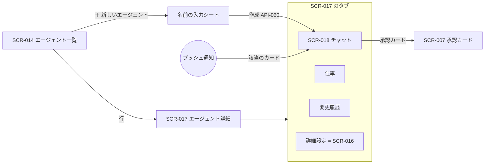

# 06. 画面詳細：エージェント（SCR-014・015・017・018）
- 親：[06 画面・UX設計](README.md) ／ 版数：v0.6（2026-10-01）

> **3行で**
> 1. エージェントは名前を付けるだけで作る（SCR-014）。作るとチャット（SCR-018）が開き、エージェントから「何をしましょう？」と話しかける。
> 2. 依頼・質問・接続・確認（`widen`）・承認・結果・変更の記録・任せ先の提案は、すべてチャットのカードとして流れる。聞くのは4つの場面だけ。
> 3. エージェント詳細（SCR-017）は「チャット（既定）／仕事／変更履歴／詳細設定」のタブになった。SCR-015 は廃止、SCR-016 は詳細設定タブへ移動。

## 🧭 判断してほしいこと
- Q-52（詳細設定タブの SCR-016）、Q-53（SCR-017 のタブの中身）、Q-54（SCR-014 の v0.5 化）、Q-57（ルールの一覧の置き場所）、R-20。内容は [README](README.md#-判断してほしいこと)。

## 全体図

見てほしいところ：作成の入力は名前だけ。チャットは SCR-017 の既定タブで、URL は同じ `/agents/:agentId`。

## 要点
- 一覧には名前・アイコン・状態・仕事の数・次の実行時刻を並べる → [SCR-014](#scr-014エージェント一覧)
- SCR-015（会話で下書き）は廃止。v0.2 の仕様は折りたたんで残す → [SCR-015](#scr-015エージェント作成会話廃止)
- v0.2 の SCR-017 の中身をどのタブに置くかは未決 → [SCR-017](#scr-017エージェント詳細)
- チャットのカード7種と、ユーザーに聞く4つの場面 → [SCR-018](#scr-018エージェントのチャット)
- 体験の流れ（名前を付けて作る・仕事を足す・役割外・名前なし）→ [体験の流れ](#体験の流れ)

---

## 詳細

### SCR-014：エージェント一覧
> **v0.17（2026-10-14、実装）**：「頼むと生まれた担当のライブラリ」として `/agents` に実装した（メニューの「エージェント」。[D-115](../decisions.md#d-115)）。
> 1体を1枚のカードにし、アイコン（Avatar。表情はいまの様子）・名前・役割の札（調べる係 など）・いまの様子の札（動いています／確認待ち／止めています／待機中）・
> 「依頼 N件 · 仕事 N件 · 最後に動いた …」と、その下に成長の1行 `growthLine`（使い回し N回 · 以後も許可にした N回 · 権限を絞った N回 · スキル N件。0 の項目は出さない。D-120）を出す。押すと開き、関わった依頼（頼んだ文・その依頼でしたこと・「ここで生まれた」「窓口」「まとめ役」の印・状態。押すと SCR-021）と仕事（調べる · 定期 など）、
> 名前の付け方（生成のときに付けた／自分で付けた）と作成日時が出る。並びは最後に動いた順。空のときは「まだエージェントはいません。入口で頼むと生まれます」と「任せるへ」。
> 「生まれた依頼」（`bornAskId`）は全期間から求める（関わった依頼の新しい順5件からは探さない）。20体（A-81）に達したら作れない旨を末尾に出す。「＋ 新しいエージェント」（FR-034）は付けていない（日常の作り方は FR-061：頼むと生まれる）。データ元は API-041（v0.17）。
> SSE の `ask.*` が届いたら取り直す（編成ができた・担当が動いた・終わった）。

> **v0.9**：ホームの入口から外し、SCR-019 の右上のメニューの奥に置く。エージェントは SCR-019 の各行に担当の名前として出す（[D-44](../decisions.md#d-44)）。

- 目的：ワークスペースのエージェントと、その状態・仕事を確認し、新しいエージェントを作る。
- v0.5（14 §画面）：名前・アイコン・状態・仕事の数・次の実行時刻を並べる。「＋ 新しいエージェント」は名前の入力だけのシートを開く（空でもよい）。アイコンは名前から自動で選ぶ（UC-025）。
- 廃止（v0.5）：作り方を選ぶシート（会話で作る／テンプレートから。API-054・API-043）と「下書き」の一覧（API-057・058、TBL-021）。
- v0.5 の画面のワイヤーフレームはまだない（Q-54）。下は v0.2 のもの。

<details>
<summary>ワイヤーフレーム（v0.2：一覧と、廃止した作り方のシート）</summary>

```
+----------------------------------+
| owner/app ▼        [+ 新規]       |
+----------------------------------+
| ● バグ修正係  bug-fixer   有効     |
|   dev-coder · ラベル/メンション     |
|   30日: 12件 承認率 83% 平均$0.74  |
+----------------------------------+
| ● 依存更新係  deps-bot    有効 ⚠   |
|   ポリシーにより制限中              |
|   毎週月 9:00 · 次回 10/06        |
+----------------------------------+
| ○ 週次レビュー weekly-review 停止中 |
|   停止: ren「誤検知が多い」         |
+----------------------------------+
| 下書き (2)                     >  |
+----------------------------------+
```

```
+----------------------------------+
| 新しいエージェント                  |
+----------------------------------+
| 💬 会話で作る（おすすめ）        >  |
|  やってほしいことを話すだけ         |
+----------------------------------+
| テンプレートから                    |
|  dev-coder  PRを出す            > |
|  reviewer   調査してレポート      > |
|  triager    Issueの振り分け案    > |
+----------------------------------+
```

</details>

<details>
<summary>表示項目（v0.2 の11行 ＋ v0.5 の追加）</summary>

| 項目 | データ元 | 備考 |
|---|---|---|
| 仕事の数・次の実行時刻（v0.5） | —（14 に記載なし） | 14 §画面 |
| リポジトリの切り替え | API-007 / TBL-004 | `active` のものだけ。v0.5 で残すかは Q-54 |
| エージェントの名前・ID・状態 | API-041 / TBL-018 | 有効（`active`）/ 無効（`invalid`）/ 停止中（`disabled`）。`removed` は出さない。状態は色＋テキストで示す。v0.5 で作成直後は `idle`（UC-025） |
| テンプレート・起動条件 | API-041 / TBL-019.definition | 起動条件は 手動 / ラベル / メンション / スケジュール の略記。v0.5 でテンプレート・トリガーは仕事ごと |
| 30日の実績 | API-041 / TBL-018.scorecard | タスク数・承認率・平均費用（レポート型はタスク数・平均費用） |
| 次回の起動 | API-041 / TBL-020.next_run_at | スケジュールがある場合のみ |
| ポリシーにより制限中 | API-041 / TBL-019.clamped | ⚠ と「ポリシーにより制限中」（BR-21） |
| 無効の理由 | API-041 / TBL-019.errors | `invalid` の場合、エラーコードの1件目（例：`AGENT_EXCEEDS_POLICY`） |
| 停止の情報 | API-041 / TBL-018.disabled_by, disabled_reason | 停止した人と理由 |
| 下書きの一覧と件数 | API-057 / TBL-021 | **廃止（v0.5）**。v0.2：「公開済み・マージ待ち」には PR 番号、クローズで `drafting` に戻ったものには「PR #n はクローズされました」 |
| 既定エージェント | API-041 / TBL-019.source | `default` は先頭に「既定」のラベル。`default.yaml` がない場合（`source = builtin`）は「組み込み」（BR-31） |
| テンプレートの一覧と説明 | API-054 | **廃止（v0.5）**。作り方を選ぶシート |

</details>

<details>
<summary>操作・イベント（v0.5 ＋ v0.2）</summary>

| 操作 | 挙動 | 呼び出すAPI | 遷移先 |
|---|---|---|---|
| 「＋ 新しいエージェント」（maintainer 以上、v0.5） | 名前の入力シート（空でもよい）→ 作成。挨拶のメッセージが返る | API-060 | SCR-018 |
| リポジトリの切り替え | 一覧を再取得 | API-041 | —（Q-54） |
| エージェントの行をタップ | — | — | SCR-017 |
| 「会話で作る」 | 空の下書きを作る | API-043（空） | **廃止（v0.5、→ API-060・SCR-018）** |
| テンプレートを選ぶ | テンプレートの既定値で下書きを作る | API-043（テンプレート） | **廃止（v0.5）** |
| 「下書き」 | 下書きの一覧 → 選ぶ | API-057 | **廃止（v0.5）** |
| 下書きの「破棄」（作成者または owner） | 確認シート → 破棄（`discarded`） | API-058 | **廃止（v0.5）** |

</details>

- 状態：初期 / ローディング / 空（v0.2：「まだエージェントがありません。やってほしいことを話すだけで作れます」と「会話で作る」ボタン）/ 上限（20体。既定エージェントは数えない。「＋ 新しいエージェント」を無効にして理由を表示。v0.5 では作成できない旨と、止まっているエージェントの一覧を出す（UC-025 E1））/ エラー（v0.2：409 `AGENT_SLUG_TAKEN` は「同じIDのエージェントがあります」。v0.5 では名前の重複は末尾に番号を付ける（「朝の交通係 2」））。viewer には「＋ 新しいエージェント」を出さない。

### SCR-015：エージェント作成（会話）（廃止）
- **廃止（v0.5、→ SCR-018）**。名前を付けて頼む作り方（[ADR-026](../adr/ADR-026-name-and-ask.md)）に置き換えた。設計アシスタント（FR-024）は設定プランナー（FR-035）に、API-044・045 はチャットの API-061・062 に置き換わった。

<details>
<summary>廃止前の仕様（v0.2、参考）</summary>

- 目的：設計アシスタントと会話して、エージェント定義の下書きを作る。YAML を書かなくても、テンプレート・起動条件・権限・予算が埋まった下書きができるようにする。URL は `/agent-drafts/:draftId/chat`。

```
+----------------------------------+
| ← 新しいエージェント   $0.04/$0.50 |
+----------------------------------+
| あなた:                           |
|  依存関係の更新PRを毎週月曜に出す  |
|  係がほしい。テストは npm test     |
+----------------------------------+
| アシスタント:                      |
|  dev-coder で作りました。          |
|  ・毎週月曜 9:00（Asia/Tokyo）     |
|  ・変更できるのは package*.json と |
|    lockfile だけにしました         |
|  ・PRは承認が必要です（ポリシー）   |
|  [変更点を Canvas で見る]          |
+----------------------------------+
| [ メッセージを入力...      ] [送信] |
+----------------------------------+
```

反映できなかった提案は、吹き出しの下に「提案を反映できませんでした（理由）」と赤で表示する。幅1024px以上では会話を左、Canvas（SCR-016）を右に並べ、変更点がその場でハイライトされる。

| 項目 | データ元 | 備考 |
|---|---|---|
| 会話の履歴 | API-044 / TBL-021.conversation_object_path | 30日で消える旨を最初に表示 |
| アシスタントの応答 | API-045（SSE） | `explanation` を表示。吹き出しに「AIによる提案」のラベル |
| 反映の結果 | API-045 の `patch` を検証した結果（FR-022, FR-023） | 反映されたら変わったノードの名前、されなければ理由（BR-30） |
| アシスタントの費用 | TBL-021.assistant_cost_usd | 下書き1件 $0.50 まで。80%で琥珀 |
| 入力の例 | — | 空の下書きのときだけ、例文のチップ |
| 会話の保存 | — | 秘密情報のパターンをマスクして保存する旨を最初の案内に添える（BR-32） |

| 操作 | 挙動 | 呼び出すAPI | 遷移先 |
|---|---|---|---|
| 「送信」 | メッセージを送り、応答をストリーミングで表示 | API-045 | — |
| 例文のチップをタップ | 入力欄に入れる | — | — |
| 「変更点を Canvas で見る」 | 変わったノードを3秒ハイライト | API-044 | SCR-016 |
| 「←」 | 下書きは保存済みのまま戻る | — | SCR-014 |

- 状態：初期 / 応答中（送信ボタンを無効にし「考えています…」）/ 反映できなかった / 上限到達（$0.50 で入力欄を無効にし「ここからは Canvas で直接編集できます」と SCR-016 へのボタン。422 `ASSISTANT_BUDGET_EXCEEDED`）/ 応答待ちの重複（409 `ASSISTANT_BUSY`）/ 編集できない下書き（409 `AGENT_DRAFT_NOT_EDITABLE`）/ LLM キー未登録（`LLM_CREDENTIAL_MISSING`、SCR-011 へ）/ エラー（再送ボタン）
- バリデーション：メッセージは1件4,000文字まで（残りの文字数を表示）。

</details>

### SCR-017：エージェント詳細
- 目的：エージェントとの会話・仕事・変更の記録・実績を確認し、問題があればこのエージェントだけを止める。
- v0.5（14 §画面）：タブを「**チャット（既定）／仕事／変更履歴／詳細設定**」にする。URL は `/agents/:agentId`。
  - チャット：[SCR-018](#scr-018エージェントのチャット)。
  - 仕事：仕事の一覧と、一時停止・再開・削除（API-065、FR-037）。1エージェント10個まで（A-81）。画面詳細は Q-53。
  - 変更履歴：すべての設定の変更に、分類（`narrow` / `neutral` / `widen`）・きっかけ・[元に戻す]（API-064）を付ける（US-044 AC2）。画面詳細は Q-53。
  - 詳細設定：Canvas と YAML（[SCR-016](agent-settings.md)、Q-52）。
- 下は v0.2 の SCR-017。どのタブに置くかは Q-53。停止（API-049）・再開（API-050）・メモリ（API-051・052）は v0.5 でもそのまま使う（14 §API）。

<details>
<summary>ワイヤーフレーム（v0.2）</summary>

```
+----------------------------------+
| ← バグ修正係 bug-fixer   [停止]    |
+----------------------------------+
| 30日のスコアカード                 |
|  タスク 12  PR到達 75%  承認 83%   |
|  平均 $0.74 / 41 steps            |
|  Breaker 1回（same_action_repeat） |
+----------------------------------+
| 起動条件                           |
|  手動 · ラベル agent:bug-fixer     |
|  メンション · 今日 3/10 回         |
+----------------------------------+
| メモリ (14)                     >  |
|  「テストは vitest。jest ではない」 |
|    task #8f2a · 9/28      [削除]   |
+----------------------------------+
| 定義  commit 9e1d2f · [編集]       |
| 最近のタスク                    >  |
+----------------------------------+
```

スコアカードの下に「このエージェントにできること（ルールによる生成）」を折りたたんで置き、「手動で実行」ボタン（SCR-003 へ）を起動条件の枠に置く。停止中は、上部に赤い帯（停止した人・理由・日時）を出し、owner には「再開」ボタンを出す。エージェント単位の信頼度の提案があれば、スコアカードの下に提案の枠を出す。

</details>

<details>
<summary>表示項目（v0.2、11行）</summary>

| 項目 | データ元 | 備考 |
|---|---|---|
| 名前・ID・状態・テンプレート・エージェント担当者 | API-042 / TBL-018, TBL-019.definition | StatusBadge。担当者は定義の `owner`（スケジュール起動の依頼者・通知先）で、ワークスペースの owner とは別 |
| スコアカード（直近30日） | API-042 / TBL-018.scorecard | タスク数、PR 到達率、承認率、平均費用、平均ステップ数、Breaker 作動回数、clamp の有無。毎時更新（集計時刻を表示） |
| 起動条件 | API-042 / TBL-019.definition, TBL-020 | 種類ごと。スケジュールは次回の時刻、ラベルはラベル名、メンションは書式 `@open-team <agent-id> <指示>`。v0.5 で起動条件は仕事ごと |
| 今日の起動回数 | API-042 の `runsToday` / `maxRunsPerDay` | `max_runs_per_day` に対する回数 |
| このエージェントにできること | API-042 の実効ポリシー | 固定の文テンプレートで生成（FR-025）。「ルールによる生成」のラベル |
| ポリシーにより制限中 | API-042 / TBL-019.clamped | 切り詰められた項目・定義の値・実効の値 |
| 無効の理由 | API-042 / TBL-019.errors | `invalid` の場合。エラーコードと内容 |
| メモリ | API-051 / TBL-022 | `active` の項目を新しい順に。各項目に出どころ（`source_task_ref`。例「task 8f2a / Issue #123」）と日付。`source_task_id` が残っていればタップで SCR-005（保持期間を過ぎたものはタップできない） |
| 定義 | API-042 / TBL-019.commit_sha | コミットはタップで GitHub（外部） |
| 最近のタスク | API-012（`agentId`）/ TBL-006.agent_id | 直近5件 |
| 信頼度の提案 | API-033 / TBL-015 | エージェント単位の提案（FR-032）がある場合だけ。ポリシーがすでに緩い値を許していれば「エージェント定義だけを変更」、許していなければ「policy.yaml とエージェント定義の両方を変更」と、変更するファイルを明記する（1つの PR） |

</details>

<details>
<summary>操作・イベント（v0.2、10行）</summary>

| 操作 | 挙動 | 呼び出すAPI | 遷移先 |
|---|---|---|---|
| 「停止」（maintainer 以上） | 確認シート（実行中・待機中のタスクの件数、理由の入力）→ 停止 | API-049 | 同じ画面（停止中） |
| 「再開」（owner のみ） | 確認シート → `active` に戻す（停止したタスクは再開しない） | API-050 | 同じ画面 |
| 提案を「受け入れる」（maintainer 以上） | 変更を含む1つの PR の作成 Intent を作る（通常の承認フロー） | API-034（`accept`） | SCR-005 |
| 提案を「見送る」 | 提案を閉じる | API-034（`dismiss`） | — |
| メモリの「削除」（maintainer 以上） | 確認シート → 削除（次のタスクから使われない） | API-052 | — |
| メモリ「>」 | 全件をページングして表示 | API-051 | — |
| 「編集」（maintainer 以上） | 現在の定義を複製した下書きを作る | API-043（**v0.5 で廃止**、Q-52） | SCR-016 |
| 「手動で実行」 | エージェントを選んだ状態で開く | — | SCR-003 |
| 最近のタスクの行 | — | — | SCR-005 |
| 「最近のタスク >」 | エージェントで絞り込む | API-012（`agentId`） | SCR-004 |

</details>

- 状態：初期 / ローディング / 有効 / 制限中（⚠ の帯）/ 無効（invalid。エラーの一覧と「編集」）/ 停止中（赤い帯。トリガーはどれも受け付けない旨を表示。停止中に定義が更新された場合は、停止のまま新しい定義（コミット）を表示する）/ 削除済み（`removed`。閲覧だけ）/ エラー。viewer には操作部品を出さない。
- バリデーション：停止の理由は必須（1〜500文字、A-52）。

### SCR-018：エージェントのチャット
- 目的：エージェントに話しかけて仕事を頼み、確認・承認・結果・変更の記録を1本の会話で扱う（v0.5 新規、FR-038、フェーズ0）。
- URL：`/agents/:agentId`（SCR-017 の既定のタブ）。
- 構成：
  - 上部：アイコン・名前（タップで変更）・状態・停止ボタン。
  - 本文：エージェントの発言、ユーザーの発言、カード。
  - 下部：入力欄・音声入力（PWA のブラウザの音声認識。ネイティブアプリは作らない、REQ-038）。入力欄の上に、役割に合わせた例文を3つまで出す（最初のお願いの前だけ）。
- プッシュ通知をタップすると、そのエージェントのチャットの該当のカードを開く。

**カードの種類**

| カード | 中身 | 操作 | 呼び出すAPI |
|---|---|---|---|
| こうします | 仕事の要約（いつ・何を・どこに届けるか） | [変える]（入力欄に「〜を変えて」を入れる） | — |
| 接続 | 必要なコネクタ | [〇〇をつなぐ]（フェーズ0は URL の登録画面へ、フェーズ1は OAuth。画面は Q-50） | — |
| 確認（`widen`） | このエージェントが新しくできるようになること（`widen` の項目だけを1行ずつ） | [許可] [やめる] | API-063 |
| 承認（Intent） | [SCR-007](approvals.md#scr-007承認カード) と同じ | [承認] [以後も許可] [やめる] | API-019 |
| 結果 | レポートの要約・出典 | 👍 / 👎（理由：長い・古い・関係ない・間違い） | API-067 |
| 変更の記録 | 何を・なぜ変えたか | [元に戻す] | API-064 |
| 任せ先の提案 | 移す先のエージェント | [任せる] [このまま] | API-066 |

- v0.6 で、実行後のカード（`unknown_outcome`・認証エラー・期限切れ・3回続けて置き換え）が加わった → [approvals.md](approvals.md#実行後のカード)。
- 名前なしで作った場合は「名前を『〇〇』にしました [名前を変える]」を出す。仕事を移したら両方のチャットに記録する。

**ユーザーに聞く場面**（この4つだけ。BR-49：1つのお願いに質問は1つまで。カードは数えない）

| 場面 | 出し方 |
|---|---|
| 推測できない情報が要る（通勤経路・テーマが曖昧など） | 質問を **1つだけ**。答えはプロフィールに保存し、公開範囲はこのエージェントだけ。答えがなければ仕事は `waiting_input` のまま |
| 必要なコネクタがつながっていない | 接続カード |
| `widen` の変更 | 確認カード |
| 書き込みの初回（Intent） | 承認カード |

- それ以外（時刻・件数・長さ・情報源）はエージェントが既定値で決め、「こうします」に書く。違えば同じチャットで言い直す。
- 送信は API-062（応答は SSE で、発言とカードを順に返す）、履歴は API-061（カーソルでページング）。会話の保存は90日（A-80）。

<details>
<summary>状態とエラー（14 §ユースケースから）</summary>

| 場面 | 表示 |
|---|---|
| 確認カードで [やめる] | 変更案を `rejected` にし、何も反映しない（UC-026 5a） |
| 変更案が Hard Ceiling・ワークスペースのポリシーを超える | 反映せず「この設定ではできないこと」と、ワークスペースのポリシーを変えれば可能かを説明（UC-026 E1） |
| 設定プランナーが3回続けて検証に通らない | お願いを言い換えてもらうよう返す（UC-026 E2） |
| 外部の内容を根拠にした変更案 | `neutral` でも自動では反映せず確認カードにする（BR-51） |
| 自動の調整 | 1つの仕事につき1日1回まで（BR-52）。[元に戻す] を押した種類は14日間自動で行わない（BR-54） |
| 役割外のお願い | 引き受けたうえで、役割の合う別のエージェントがいれば任せ先の提案。[このまま] を押した組み合わせでは以後出さない |

</details>

### 体験の流れ
14 §体験の流れのチャットの例。ワイヤーフレームの代わりに使う。

<details>
<summary>例1：名前を付けて作る（ニュースリサーチャー）</summary>

```
[ユーザー]  ＋ 新しいエージェント → 名前「ニュースリサーチャー」→ 作成

[ニュース   ニュースリサーチャーです。どんなニュースを、どのくらいの頻度で調べましょう？
 リサーチャー] 例：「毎朝、生成AIの規制のニュースをまとめて」

[ユーザー]  毎朝、AI規制と半導体のニュースをまとめて Slack に送って

[ニュース   こうします：
 リサーチャー]  ・毎朝 7:00（平日・休日とも）
              ・テーマ：AI規制、半導体。各3件、1行の要約と出典URL
              ・届け先：Slack の自分宛て DM
            ┌─────────────────────────────────┐
            │ Slack がまだつながっていません      │
            │ [Slack をつなぐ]                   │
            └─────────────────────────────────┘

[ユーザー]  （つなぐ）

[ニュース   つながりました。最初の1回を今から実行します。
 リサーチャー]  ┌─────────────────────────────────┐
            │ 承認：Slack に投稿（自分宛ての DM）   │
            │ 本文のプレビュー …                   │
            │ [承認] [以後も許可] [やめる]          │
            └─────────────────────────────────┘

[ユーザー]  以後も許可

[ニュース   明日から毎朝 7:00 に自動で送ります。
 リサーチャー]
```

</details>

<details>
<summary>例2〜4：仕事を足す・役割外のお願い・名前なしで作る</summary>

```
[ユーザー]  あと、TSMC の決算ページが更新されたら教えて

[ニュース   1時間ごとにページを確認して、変わったときだけ通知します（読むだけなので、すぐ始めます）。
 リサーチャー]
```
→ 「ニュースリサーチャー」に仕事が2つ並ぶ（毎朝のまとめ、決算ページの見張り）。

```
[ユーザー]  （エンジニアに）明日の朝のニュースも調べといて

[エンジニア] 引き受けます。明日の朝 7:00 に調べて、アプリに届けます。
            ニュースリサーチャーが同じ種類の仕事をしています。こちらに任せますか？
            [ニュースリサーチャーに任せる] [このまま]
```

```
[ユーザー]  ＋ 新しいエージェント →（名前は空のまま）作成

[新しい      こんにちは。何をしましょう？
 エージェント]

[ユーザー]  平日の朝、通勤経路の遅延を教えて

[新しい      平日 6:45 に、電車の運行情報と道路の渋滞を調べて通知します。
 エージェント] 通勤経路を教えてください（例：首里 → 県庁前、ゆいレール）。

[ユーザー]  首里から県庁前、ゆいレール

[朝の交通係] 名前を「朝の交通係」にしました。[名前を変える]
            明日の 6:45 から始めます。
```

</details>

## このドキュメントで決まったこと
- [ADR-026](../adr/ADR-026-name-and-ask.md)：名前を付けて頼む作り方。SCR-015 を廃止
- [ADR-027](../adr/ADR-027-classify-widening-changes.md)：`widen` だけ確認カードにする
- [ADR-028](../adr/ADR-028-jobs-as-unit-of-work.md)：仕事（jobs）を単位にし、SCR-017 に「仕事」タブを置く
