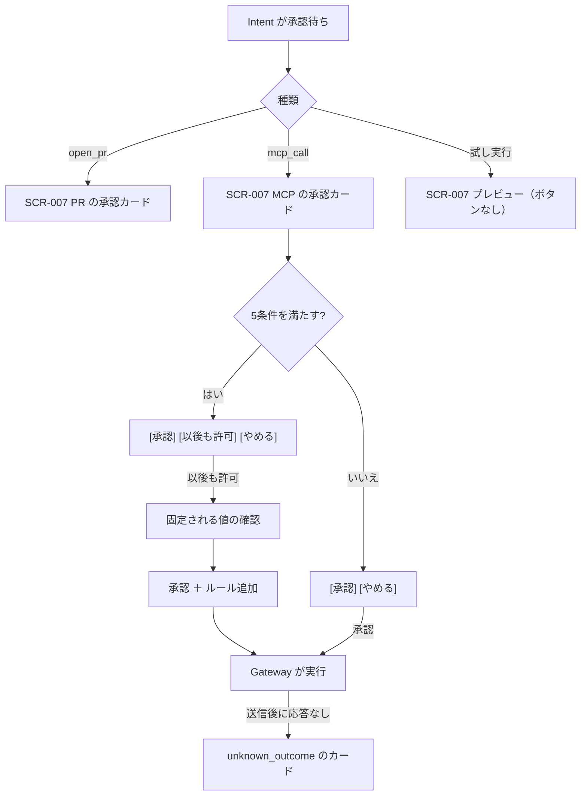

# 06. 画面詳細：承認（SCR-006・007、MCP の書き込みのカード）
- 親：[06 画面・UX設計](README.md) ／ 版数：v0.6（2026-10-01）

> **3行で**
> 1. 承認カード（SCR-007）は、スマホ1画面で判断に必要な情報をそろえる。ルールによる判定と AI の要約・自己レビューは枠を分ける。
> 2. MCP の書き込みでは、宛先（`destination`）を大きく、中身（`content`）・その他（`option`）を分けて見せ、[承認] [以後も許可] [やめる] を出す。[以後も許可] は5条件を満たすときだけ出し、固定される値を確認してから確定する。
> 3. 送信後に結果が分からない書き込みは `unknown_outcome` のカードで人が確定する。自動では再試行しない。

## 🧭 判断してほしいこと
- Q-51（アプリ内モードの「権限を広げる変更」の承認カード、`handoff`、AI事前レビューの表示が未設計）、Q-56（v0.6 の状態の表示）、Q-59（大きな差分のスマホ表示）、R-20（[以後も許可] の誤タップ）。内容は [README](README.md#-判断してほしいこと)。

## 全体図

見てほしいところ：カードは3つの見た目を持つ。[以後も許可] は条件つきで、押しても確認を1回はさむ。

## 要点
- 承認インボックスは自分が判断すべき Intent の一覧 → [SCR-006](#scr-006承認インボックス)
- PR の承認は確認シートで intentHash の先頭8文字を見せてから確定 → [SCR-007](#scr-007承認カード)
- MCP のカードの区画と [以後も許可] の5条件 → [MCP の書き込み](#mcp-の書き込みのカード)
- [以後も許可] の確認では「固定される値」と「毎回変わってよい値」を分ける → [以後も許可の確認](#以後も許可の確認)
- `unknown_outcome`・認証エラー・期限切れはチャットのカードで扱う → [実行後のカード](#実行後のカード)

---

## 詳細

### SCR-006：承認インボックス
> **v0.9**：承認待ちは [SCR-019](ask-and-check.md) の「送る前の確認」の行に統合した。承認は行の ○ ＋5秒の取り消し猶予で、確認シートは使わない（[D-43](../decisions.md#d-43)）。下の SCR-007 の中身は、行を開いた中でそのまま使う。

- 目的：自分が判断すべき Intent を一覧する。
- ワイヤーフレーム：
  ```
  +----------------------------------+
  | 承認待ち                          |
  +----------------------------------+
  | owner/app #123  risk: MEDIUM     |
  | 7 files +120/-30  $1.12  残り21h |
  +----------------------------------+
  | owner/api #45   risk: LOW        |
  | 1 file  +4/-1     $0.20  残り3h  |
  +----------------------------------+
  ```
- 表示項目：リポジトリ、Issue、リスクレベル、変更の規模、消費コスト、残り時間（API-017 / TBL-009, TBL-008）。MCP の Intent の行の表示は Q-56。
- 操作：行をタップすると SCR-007。試し実行の Intent はここに出さない。
- 状態：初期 / ローディング / 空（「承認待ちはありません」）/ エラー

### SCR-007：承認カード
- 目的：外部作用（PR の作成、MCP の書き込み）を承認するか判断する。スマホ1画面で必要な情報がそろうようにする。試し実行では、同じカードをプレビューとして表示し、本番でどう見えるかを確かめる。
- v0.5 以降、承認カードはエージェントのチャット（[SCR-018](agents.md#scr-018エージェントのチャット)）にもカードとして出る（中身は同じ）。
- ワイヤーフレーム（PR、v0.2）：
  ```
  +----------------------------------+
  | ← 承認: owner/app #123  残り21h   |
  | [bug-fixer] バグ修正係             |
  +----------------------------------+
  | PR: Fix login redirect loop      |
  | base: main ← open-team/task-8f.. |
  +----------------------------------+
  | リスク: MEDIUM（ルールによる判定）   |
  |  +2 依存ファイル変更(package.json) |
  |  +1 テストの変更なし                |
  +----------------------------------+
  | AIによる要約（参考）                |
  |  ログイン後のリダイレクト先の...      |
  +----------------------------------+
  | AIによる自己レビュー（参考）         |
  |  pass（修正 1回）                  |
  |  未解決の指摘 なし                 |
  +----------------------------------+
  | 変更 7 files  +120 / -30      >  |
  |  src/auth.ts        +40 -10      |
  |  package.json       +1  -1       |
  +----------------------------------+
  | テスト（エージェントの自己申告）       |
  |  npm test  ✓ passed              |
  +----------------------------------+
  | コスト $1.12 / $2.00  steps 61   |
  | 実効ポリシー: open_pr = approve    |
  |  bug-fixer × policy a1b2c3d   >  |
  +----------------------------------+
  | [  却下  ]          [  承認  ]     |
  +----------------------------------+
  ```

<details>
<summary>ワイヤーフレーム（試し実行のプレビュー）</summary>

```
+----------------------------------+
| ← プレビュー: deps-bot（下書き）    |
|▨▨ 試し実行 · このPRは作られません ▨▨|
+----------------------------------+
| PR: Bump dependencies (preview)  |
| 本番なら: 承認が必要（ren）         |
|  open_pr = approve（ルール）       |
+----------------------------------+
| リスク: LOW（ルールによる判定）      |
| AIによる要約（参考） ...            |
| AIによる自己レビュー（参考） pass    |
| 変更 2 files  +40 / -38       >  |
+----------------------------------+
| [ Canvas に戻る ]                 |
+----------------------------------+
```

</details>

<details>
<summary>表示項目（PR・プレビュー、11行）</summary>

| 項目 | データ元 | 備考 |
|---|---|---|
| エージェント | API-018 / TBL-006.agent_snapshot_id | AgentChip（タップで SCR-017） |
| PR のタイトル・本文・ブランチ | API-018 / TBL-008 | 本文は「もっと見る」で展開 |
| リスクレベルと理由 | API-018 / TBL-009.risk | ルールによる判定と明記 |
| 差分の要約 | API-018 / TBL-009.summary | 「AIによる要約（参考）」。生成できなかった場合は「要約なし」 |
| 自己レビュー | API-018 / TBL-008.self_review（`action_intents.self_review`） | dev-coder のみ。「AIによる自己レビュー（参考）」として、結果（pass / 修正点）、修正の回数（最大2回）、未解決の指摘を表示する。リスク評価（ルールによる判定）とは枠を分ける（REQ-028） |
| 変更ファイル・差分 | API-018 / TBL-008.diff | ファイルをタップすると、その差分を展開（シンタックスハイライト、横スクロールはその領域の中だけ）。巨大な差分は Q-59 |
| テスト結果 | API-018 / TBL-008.test_report | 「エージェントの自己申告」と明記 |
| コスト・ステップ数 | API-018 / TBL-006 | |
| 当たったポリシールール・スナップショット | API-018 / TBL-010, TBL-005, TBL-019 | **実効ポリシー**（エージェント定義 × ポリシーのスナップショット）の値として表示。タップで「このエージェントにできること」（SCR-017）。clamp 中は ⚠ |
| 期限 | API-018 / TBL-009.expires_at | 1時間を切ったら琥珀 |
| 試し実行のプレビュー | API-013 の `intent.preview` / TBL-008（`simulated` の Intent。自己レビューを含む） | 承認がないため API-018 は使わない。DryRunBanner。「本番なら」の判定（Kernel の判定結果）を表示する。期限・承認者の操作部品は出さない |

</details>

- 操作・イベント（PR・プレビュー）：

  | 操作 | 挙動 | 呼び出すAPI | 遷移先 |
  |---|---|---|---|
  | 「承認」 | 確認シート（「このPRを作成します」＋ intentHash の先頭8文字）→ 確定 | API-019（`decision=approve`、表示した `intentHash`） | SCR-005 |
  | 「却下」 | 確認シート（コメント入力欄つき）→ 確定 | API-019（`decision=reject`） | SCR-005 |
  | 実効ポリシーをタップ | — | — | SCR-017（「できること」の位置） |
  | 「Canvas に戻る」（プレビュー） | — | — | SCR-016（Q-52） |

- 状態：初期 / ローディング / 決定済み（ボタンを隠し、決定者と日時を表示）/ 期限切れ / 承認者でない（ボタンを隠し、「承認者: ren」と表示）/ エラー（`INTENT_CHANGED` の場合は「内容が変わりました。再読込してください」）/ プレビュー（試し実行。承認・却下のボタンを出さない）

### MCP の書き込みのカード
フェーズ0。15 §承認カード（MCP の書き込み）。ワイヤーフレームは元の設計にない（区画の表だけ）。

| 区画 | 中身 |
|---|---|
| 見出し | コネクタ名・ツール名。届け先（`deliver`）から作られたものは「結果の送信」と明示 |
| 宛先 | `destination` 引数を、ルールの `labels` があれば名前つきで、なければ値をそのまま、大きく表示 |
| 中身 | `content` 引数をそのまま。プロフィールの値を含む部分を強調（BR-41） |
| その他 | `option` 引数 |
| 汚染 | タスクが `tainted` なら、読んだ情報源（URL・コネクタ）の一覧 |
| ツールの説明 | 現在の説明文（ハッシュで固定したもの） |
| 操作 | [承認] [以後も許可] [やめる]（[以後も許可] は下の5条件を満たすときだけ） |

- 引数は承認カードに表示したものと同じ値が intentHash に入り、Gateway はその引数をそのまま実行する（BR-15 の MCP 版）。
- [承認] は API-019（`decision=approve`）、[やめる] は API-019（`decision=reject`）。

**[以後も許可] を出す条件**（どれか1つでも外れたら出さず、[承認] [やめる] だけにする）

| # | 条件 |
|---|---|
| 1 | ツールの分類が `write`（`unclassified` には出さない。先に分類してもらう） |
| 2 | ツールに `destination` 引数が1つ以上ある、または `scope: self` が明示されている |
| 3 | 実効ポリシーで、その操作の自律レベルが `approve` で、ワークスペースのポリシーの `rules.enabled` が `true` |
| 4 | Hard Ceiling で `handoff` だけを許す操作（BR-36：支払い・送金・パスワードの変更）でない |
| 5 | 試し実行でない |

- 12（v0.3）では、ポリシーや Hard Ceiling が `approve` を求める操作には [以後も許可] の代わりに「ポリシー変更の PR を作る」（信頼度提案）を出すとしていた。15 で「条件を外れたら [承認] [やめる] だけ」としたため、15 を採る。ボタン名も 12 の「今回だけ許可／却下／以後も許可」から 15 の [承認] [以後も許可] [やめる] に揃えた。

<details>
<summary>リスク評価（MCP の書き込み。PR のリスク評価の代わりに使う）</summary>

| 条件 | 加点 |
|---|---|
| タスクが `tainted` | +2 |
| 宛先がどのルールにも一致しない | +2 |
| 中身にプロフィールの値を含む | +2 |
| `assistant` でエージェントが直接呼んだ（`origin = agent`） | +1 |
| `scope: self` のツール | −1 |

合計が0〜1なら `low`、2〜3なら `medium`、4以上なら `high`。カードでは「ルールによる判定」と明記する（原則3）。

</details>

### 以後も許可の確認
- [以後も許可] を押すと、確定の前に次を表示する（1タップ増えるが、何を許したかを見せる）。
  - 「次の値は固定されます：宛先 = 自分宛ての DM」
  - 「次の値は毎回変わってよい：本文」
- 確定すると API-019 に `remember: true` を付けて送る。Intent を承認し、同時にルールを追加する。ルールの `match` は Intent の `destination` 引数すべてと `option` 引数すべての値、`labels` は表示名。
- この操作は `widen` だが、ユーザーの直接の操作なので確認カード（SCR-018）は重ねて出さない（BR-47 ①、R-20）。
- 条件を満たさないのに `remember: true` を送ると 422 `RULE_NOT_ALLOWED`。カードの中にインラインで表示する。
- ルールの一覧（API-068）と取り消し（API-069、`narrow` として即時）の画面の置き場所は Q-57。

### 実行後のカード
承認の後、Gateway の実行結果に応じてエージェントのチャットに出すカード（15 §Gateway での実行・§承認待ちと定期実行）。

| 場面 | カードの中身 | 操作 | 呼び出すAPI |
|---|---|---|---|
| `unknown_outcome`（送信後のタイムアウト・接続断・5xx） | 結果が分からないこと。承認者に通知する | [実行済みとして閉じる] [失敗として閉じる] [もう一度実行] | API-070（`executed` / `failed` / `retry`） |
| [もう一度実行] | 同じ引数で新しい Intent を作る。二重になるおそれがあることをカードに書く | 承認を求める（ルールがあっても `auto` にしない） | API-070 → API-019 |
| 認証エラー（`failed`（`auth_required`）） | つなぎ直しが要ること | [つなぎ直して再実行] | —（接続の画面は Q-50） |
| 期限切れ・置き換え（`expired`（`superseded`）） | カードを「期限切れ」に変える。通知は送らない | — | — |
| ツールの変更（`expired`（`tool_changed`）） | ツールが `needs_review` になり、承認待ちと未実行の Intent を無効にしたこと | — | — |
| 3回続けて承認されずに置き換えられた | 「承認が間に合っていません。[以後も許可] にするか、届け先を外しますか？」と1回だけ聞く | — | — |

- 定期実行の仕事の承認期限は `min(作成から24時間, 同じ仕事の次の実行の予定時刻)`。古いニュースを後から送らないため。
- `isError: true` の応答は `failed`（`tool_error`）で、自動で再試行しない（[ADR-031](../adr/ADR-031-mcp-write-no-auto-retry.md)）。

## このドキュメントで決まったこと
- [ADR-005](../adr/ADR-005-approval-bound-to-intent-hash.md)：承認は intentHash に紐づける
- [ADR-029](../adr/ADR-029-mcp-arg-roles-destination-fixed.md)：引数の役割と宛先の固定
- [ADR-031](../adr/ADR-031-mcp-write-no-auto-retry.md)：MCP の書き込みは自動で再試行しない
