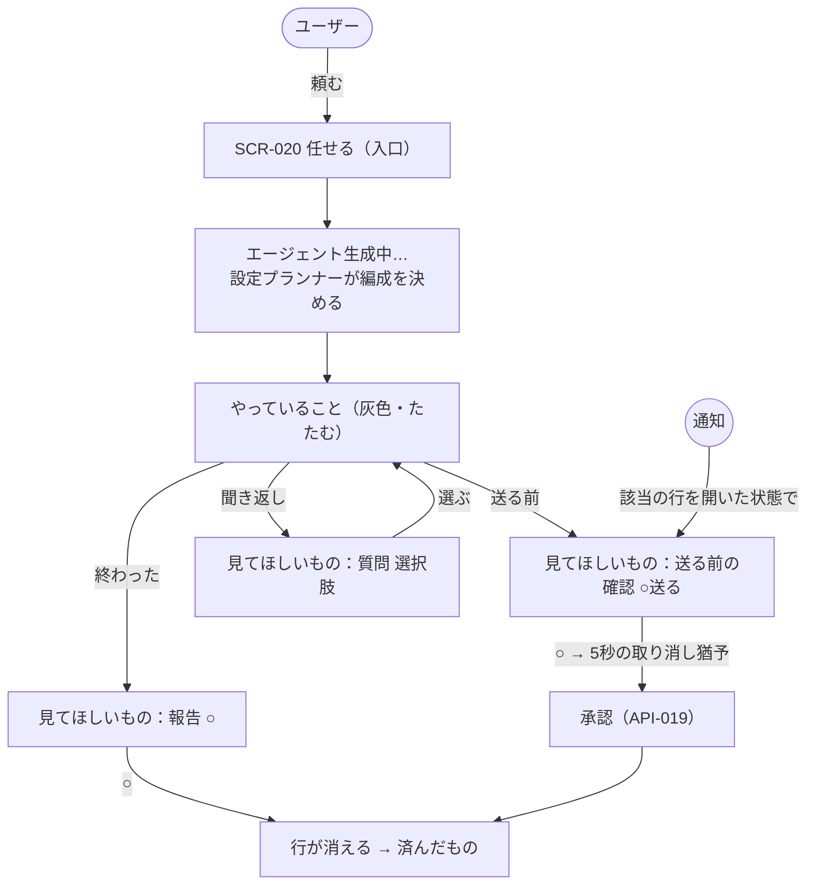

# 06. 画面詳細：チェック（SCR-019。v0.9 の「頼む・チェック」）
- 親：[06 画面・UX設計](README.md) ／ 版数：v0.14（2026-10-02） ／ 決定：[ADR-034](../adr/ADR-034-one-screen-ask-and-check.md)、[D-42〜45](../decisions.md#d-42)、[ADR-037](../adr/ADR-037-entrance-one-sentence.md)（v0.12 で頼む欄を SCR-020 に移した）

> **3行で**
> 1. エージェントがこなしたことを **チェックする**（右の ○）画面。v0.12 で、頼むのは入口の SCR-020「任せる」（`/`）に分け、この画面は `/check` に移した。入口の件数か通知から来る。
> 2. エージェントが終えたこと・送る前の確認・聞き返しは、すべて「見てほしいもの」の行になる。チェックした行は消える。承認も同じ ○ で、押してから5秒は取り消せる。
> 3. ホーム（SCR-002）・承認インボックス（SCR-006）・新規タスク（SCR-003）・エージェント一覧（SCR-014）の役目はここに入り、日常の入口からは外れる。エージェントは行に添える名前として毎回見える。

## 🧭 判断してほしいこと
- 取り消しの猶予を5秒にした（A-91）。短いと気づけず、長いと「送った」実感が遅れる。実機で触って決め直す。
- 「見てほしいもの」の並び順（A-92）。止まっているもの（送る前の確認・質問）を上にしたが、時刻順だけのほうが分かりやすい可能性がある。

## 全体図

見てほしいところ：ユーザーの操作は入口の「頼む」と、この画面の行の ○・選択肢だけ。仕組み側の流れ（担当決め・実行・承認の送信）は画面に出さない。

## 要点
- 画面は「見てほしいもの」「やっていること」の2段だけ（v0.12 で頼む欄を SCR-020 へ）。カード・区切り線・状態の色は使わず、余白と文字の太さで分ける → [レイアウト](#レイアウト)
- 行は3種類：報告（○）、送る前の確認（○送る）、質問（選択肢）→ [行の種類](#行の種類)
- 承認は確認シートをやめ、押してから5秒の取り消し猶予にする。実行は猶予が過ぎてから → [承認と取り消し](#承認と取り消し)
- 却下・[以後も許可]・詳細は行を開いた中に置き、一覧には出さない → [行を開いたとき](#行を開いたとき)
- エージェント一覧・履歴・設定・監査ログは右上のメニューの奥 → [メニュー](#メニュー)

---

## 詳細

### SCR-019：チェック
- 目的：エージェントがこなしたことをチェックし、送る前の確認と質問に答える。頼むのは SCR-020（v0.12）。
- URL：`/check`（`?item=<id>` で該当の行を開いた状態で表示。通知から来たとき）。v0.9〜0.11 は `/`
- 対象ロール：フェーズ0は owner だけ。承認の ○ は承認者だけに出す（それ以外は「〇〇さんの確認待ち」と表示だけ）。
- フェーズ：0（フェーズ0-H のハッカソン版でもこの画面を使う）

#### レイアウト
```
+----------------------------------+
| ← 任せる          全部止める  ≡ |  ← AppHeader。左は入口（SCR-020）へ
|                                  |
| 見てほしいもの  3                 |  ← 見出し。件数で残りの量が分かる
|                                  |
| 仕入れ先に発注メールを送る     ○  |  ← 送る前の確認
| → tanaka@example.com            |     宛先を2行目に大きく
| 仕入れ係                    送る |     ○の下に「送る」
|                                  |
| どちらの店舗ですか？              |  ← 質問
| [本店] [2号店]                   |
| 仕入れ係                         |
|                                  |
| 朝のまとめができました         ○  |  ← 報告
| ニュース係 · 7:02               |
|                                  |
| やっていること 2              ＞  |  ← 灰色・1行にたたむ
|                                  |
| 済んだもの                       |  ← 一番下の小さなリンク
+----------------------------------+
```

| 区画 | 内容 | 理由 |
|---|---|---|
| 見てほしいもの | ユーザーの手が要る行だけ。件数を見出しに添える | 「何をすればいいか」を1か所に集め、探す手間をなくす |
| やっていること | 動いている仕事の件数だけを灰色で1行。開くと「仕入れ係 · 在庫を確認中」の形で1件1行 | 手を出す必要のないものは目立たせない。止めたいときだけ開く |
| 済んだもの | チェックした行の履歴へのリンク（`/done`） | 終わったことを画面に残さず、見る量が増えないようにする |
| （頼む欄） | v0.12 で廃止。頼むのは SCR-020 だけ | 頼む所とチェックする所を1つずつにする（ADR-037） |

- **見た目の決まり**（v0.16：見た目は `prototype/src/styles.css` に揃える。[D-100](../decisions.md#d-100)）
  - 基調：モノクロ（ChatGPT / Grok 風）。背景・面（`--surface`）・持ち上げた面（`--elevated`）の3段で分け、角丸は 20px、影は浮かせるもの（シート・メニュー）だけ。ダークモードはプロトタイプの配色に従う。頼む欄・シート・行のカードもこの面と角丸で作る。
  - 押せる所だけに色（アクセント1色）を使う。○・選択肢・送信ボタン・「全部止める」。本文は濃いグレー、補足（担当・時刻・やっていること）は薄いグレー。
  - 行と行の間は余白（24px）で分け、線を引かない。1行目（何をしたか）は 17px の太字、2行目以降は 15px の標準。
  - ○ のタップ領域は 48×48px。行の右端に縦位置をそろえて置く（右手の親指が届き、目で縦に追える）。
  - 失敗の報告だけは1行目の頭に「失敗：」と書き、赤の文字にする（色だけに頼らない）。
- **空のとき**：「見てほしいものはありません」を見出しの位置に薄い色で1行。イラストや励ましの文は出さない。

#### 行の種類

| 種類 | 元になるもの | 1行目 | 2行目 | 操作 | ○の後 |
|---|---|---|---|---|---|
| 報告 | タスクの終了（`succeeded` / `completed` / `failed`）、レポート、リハーサルの結果 | 何をしたか（例：「朝のまとめができました」「仕入れ係の練習：5つ中2つで穴 → 締めました」） | 担当 · 時刻 | ○ | 行が消える |
| 送る前の確認 | 承認待ちの Intent（`mcp_call` / `open_pr`）、`widen` の設定変更（ADR-027） | 何を送るか（例：「仕入れ先に発注メールを送る」） | 宛先（`destination`）を大きく。設定変更は「できることが増えます：〇〇」 | ○（下に「送る」「許可」） | 5秒の取り消し猶予 → 行が消える |
| 質問 | エージェントの聞き返し（`waiting_input`）、担当外の依頼の提案（「〇〇に任せますか？」）、`unknown_outcome` の確定 | 質問文 | 選択肢のボタン（最大4つ）と担当 | 選ぶ | 行が消え、仕事が続く |

- 質問の選択肢は設定プランナーが作る。どうしても選択肢にならないときだけ「自分で書く」を出し、押すと行の中に入力欄が開く（D-45）。
- `unknown_outcome` は質問として「届いたか分かりません」と出し、選択肢は [届いていた] [届いていない] の2つに固定する（ADR-031 の確定をこの形で行う）。
- 試し実行（`isDryRun`）のプレビューは「送る前の確認」にしない。報告として「試しに走らせました（送っていません）」を出し、DryRunBanner を行の中に出す。

#### 並び順
- 送る前の確認 → 質問 → 報告。同じ種類の中は新しい順（A-92）。仕事を止めているものほど上に置く。

#### 承認と取り消し
```
| 仕入れ先に発注メールを送る        |
| 送ります…            取り消す 4 |  ← ○を押した直後。行の中で置き換わる
```
1. ○ を押すと、行が「送ります…」と取り消しボタン（残り秒数つき）に置き換わる。
2. 5秒（A-91）のあいだに「取り消す」を押せば元の行に戻る。サーバーにはまだ何も送っていない。
3. 猶予が過ぎたら、画面に表示していた `intentHash` を付けて API-019（`decision=approve`）を呼ぶ。ADR-005 の結びつき（見た内容と承認がずれない）はこの値で守る。
4. 呼び出しが失敗したら（期限切れ・内容の変更など）行を元に戻し、行の中に理由を1行出す。

- 猶予の間に画面を離れても、承認は送る（アプリ内のタイマー。画面を閉じた場合は送らずに行を残す）。
- 確認シート（intentHash の先頭8文字を見せる方式）は使わない。押す前に何が起きるかは、行の1行目（何を）・2行目（宛先）・○の下の「送る」で読める。

#### 行を開いたとき
行の ○ 以外の所を押すと、その場で下に広がる（別の画面に移らない）。

| 種類 | 開いたときに出すもの |
|---|---|
| 報告 | 結果の本文（レポート・リハーサルの3段の結果）、出典、「この依頼のページ」（SCR-021、v0.13）へのリンク |
| 送る前の確認 | SCR-007 の中身（宛先・中身・その他・汚染・ルールによる判定・AIの要約）。下に「送らない」（文字のリンク、理由は任意）と、条件を満たすときだけ [以後も許可]（固定される値の確認を挟む。R-20） |
| 質問 | 聞き返した理由（なぜ決められなかったか） |

- 却下と [以後も許可] を一覧に出さないのは、日常の操作を ○ 1つに絞るため。どちらも頻度が低く、押す前に中身を読むべき操作なので、開いた中に置く。

#### 危ない承認は開いて並べる（BR-70、[D-59](../decisions.md#d-59)）
操作は ○ と取り消しの猶予のまま変えない。変えるのは **押す前に目に入るもの** だけ。毎回すべてを開くと読まずに押す癖がつくので、開くのは次の4つに限る。

| きっかけ（`reasonCode` など） | 行の出し方 | 1行目の上に出す理由の例 |
|---|---|---|
| `guard_exceeded` | 開いた状態。超えた値を太字、上限を並べて出す | 「いつもの上限（20個）を超えています：200個」 |
| `unknown_outcome_pending` | 開いた状態。前の書き込みの行（届いたか分からないもの）へのリンク | 「前の発注が届いたか分かっていません」 |
| `widen` の設定変更 | 開いた状態。「できることが増えます」を1行ずつ | 「このエージェントができることが増えます」 |
| 初めての宛先（その仕事で承認したことのない宛先） | 開いた状態。宛先を太字 | 「初めての送り先です」 |
| 汚染されたタスクの書き込み（上の4つに当たらないもの） | 閉じたまま。2行目に読んだものを出す | （2行目）「〇〇さんのメールを読んだあとの送信です」 |

- 開いた状態の行も ○ は同じ位置にあり、同じ5秒の取り消しで送る。確認シートは使わない（ADR-034 を保つ）。
- 理由の文は `reasonCode` から決まった文で作る。LLM に書かせない（読ませたいものを LLM が言い換えないように）。
- 開いた状態の行が3つ以上あるときは、並び順（送る前の確認の中）でそれらを先に置く。

#### 頼んだ仕事の行（v0.12）
- 頼むのは SCR-020 だけ（[entrance.md](entrance.md)）。担当を指定したいときは SCR-020 で「@仕入れ係 …」と書くか、エージェントのページ（SCR-017・018）から頼む。
- 複数のエージェントに分けた依頼（FR-062）の行は、形で出し方を変える。

| 形 | やっていること | 見てほしいもの（報告） |
|---|---|---|
| ひとり | 担当の1行 | 回答の1行（担当の名前） |
| 並列 | 担当ごとに1行 | 回答の1行だけ（v0.14。担当ごとの報告は行を開いた中に見出しつきで） |
| まとめ | 担当ごとに1行 ＋「まとめ役 · 待っています（2/3）」 | 回答の1行だけ（まとめ役の名前）。各担当の結果は行を開いた中 |
| 順番 | 今動いている担当の1行（「受信箱係 → 仕入れ係（1/2）」） | 回答の1行だけ（最後の担当の名前）。途中の結果は行を開いた中 |

- v0.14 から、見てほしいものの報告は **依頼1件に1行**（FR-063 の回答）。行の1行目は回答の結論、2行目は窓口の名前と「N人で」。担当どうしのやり取り（FR-064）は行には出さず、SCR-021 で見る。

- 途中で失敗・停止した順番の依頼は、質問の行「受信箱係で止まりました」と選択肢 [やり直す] [ここまでで終える] にする（FR-062）。
- 担当の書き込み（送る前の確認）は、形に関係なくその担当の行として出す（まとめ役は書き込まない。BR-72）。
- 定期の仕事（「毎朝〜して」）は、作った後は毎回の結果が報告の行として届くだけにする。

#### メニュー
右上の ≡ から開く。日常では開かなくてよいものをここに集める。

| 項目 | 行き先 |
|---|---|
| エージェント | SCR-014 エージェント一覧 → SCR-017・018 |
| 済んだもの | `/done`（チェックした行の履歴。新しい順） |
| ルールと設定 | SCR-011 設定、ワークスペースのポリシー、以後も許可のルール（Q-57） |
| 記録 | SCR-010 監査ログ |

- 行に添えた担当の名前を押すと、そのエージェントのページ（SCR-017）に移る。

#### 表示項目
| 項目 | データ元 | 備考 |
|---|---|---|
| 見てほしいもの | 承認待ちの Intent（API-017）、`waiting_input` のタスク、終了してまだチェックしていないタスク・レポート・リハーサル | 「チェック済み」の記録の置き場は API・DB の設計で決める（T-1） |
| やっていること | `running` / `queued` のタスク | SSE（ADR-007）で更新 |
| 担当 | エージェントの表示名 | AgentChip の文字だけの形 |

#### 操作・イベント
| 操作 | 挙動 | 呼び出すAPI | 遷移先 |
|---|---|---|---|
| 報告の ○ | 行を消す | チェック済みの記録（T-1） | 同じ画面 |
| 送る前の確認の ○ | 5秒の取り消し猶予の後に承認 | API-019（`approve`、表示した `intentHash`） | 同じ画面 |
| 「送らない」（開いた中） | 理由を任意で入れて却下 | API-019（`reject`） | 同じ画面 |
| [以後も許可]（開いた中） | 固定される値の確認 → 承認＋ルール追加 | API-019（`remember`） | 同じ画面 |
| 質問の選択肢 | 答えを送り、仕事を続ける | チャットの返信と同じ API（SCR-018） | 同じ画面 |
| やっていることの行の「やめる」 | 確認シート → キャンセル | API-016 | 同じ画面 |
| 全部止める | SCR-013 | API-020 | — |

- 状態：通常 / 空 / 取り消しの猶予中 / Kill Switch 発動中（見出しの上に帯を出す）/ オフライン（○ を無効にし「つながっていません」）

#### NFR とのつながり
- NFR-041（通知から承認まで3タップ以内）：通知 → ○ の2タップ。
- A-22（通知から直接承認しない）はそのまま。通知はこの画面の該当の行を開くだけ。

### 前提・仮定（仮番号）
- A-91：取り消しの猶予は5秒。
- A-92：「見てほしいもの」は 送る前の確認 → 質問 → 報告 の順、同じ種類の中は新しい順。
- A-93：質問の選択肢は最大4つ。それを超える・選択肢にならない聞き返しは「自分で書く」にする。
