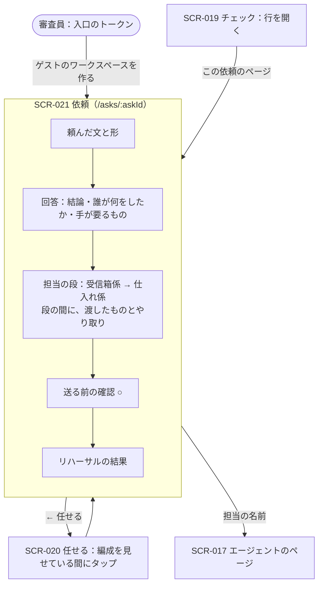

# 06. 画面詳細：依頼（SCR-021）
- 親：[06 画面・UX設計](README.md) ／ 版数：v0.15（2026-10-02） ／ 決定：[ADR-036](../adr/ADR-036-ask-generates-formation.md)、[D-69〜71](../decisions.md#d-69)、[ADR-038](../adr/ADR-038-team-board-and-one-answer.md)（回答とやり取り、[D-72](../decisions.md#d-72)）

> **3行で**
> 1. 1つの依頼の全体を1枚で見る画面。頼んだ文・**回答**（v0.14。追加で頼むたびに「頼んだこと → 回答」が1往復ずつ増え、古い順に並ぶ：[D-114](../decisions.md#d-114)）・編成（誰が・どの順で）と担当どうしの **やり取り**・担当ごとの結果・送る前の確認・リハーサルの結果が、上から順に並ぶ。
> 2. ハッカソン版では、審査員が入口のトークンを入れると入口（SCR-020）に「用意した依頼が待っています」の知らせが出て、用意しておいた依頼「仕入れ先のメールを読んで、在庫を見て、必要なら発注して」（受信箱係 → 仕入れ係の順番）のこのページを開ける（[D-118](../decisions.md#d-118)。v0.13 の「直接入る」を改めた）。
> 3. 日常の入口は増やさない。ふだんは SCR-019 の行を開いた中の「この依頼のページ」と、入口の生成中の表示から来る。

## 🧭 判断してほしいこと
- なし（D-69〜71 で決定）。用意する依頼の中身（メールの文面・在庫の数・送る前の確認の発注内容）は 15 [§最初に入っているもの](../15_hackathon.md#最初に入っているものデモ用のデータ) を正とする。

## 全体図

見てほしいところ：上から読むと「何を頼んだ → 答え → 誰がどう分けて、どう確かめ合った → いま手が要るもの → 任せて大丈夫かの裏付け」の順になる。手が要るもの（○）は2番目の高さに置き、スクロールせずに押せるようにする。

## 要点
- 区画は5つ：頼んだ文・回答・担当の段（やり取りを含む）・送る前の確認・リハーサルの結果 → [レイアウト](#レイアウト)
- 送る前の確認の行は SCR-019 と同じ部品（○ と5秒の取り消し、BR-70 の開いた出し方）→ [ask-and-check.md](ask-and-check.md#承認と取り消し)
- 順番の形では、前の段から受け渡したもの（と汚染の印）を段の間に見せる → [担当の段](#担当の段)
- 審査員はここから「もう一度リハーサルする」「自分で頼んでみる」に進める → [操作](#操作イベント)

---

## 詳細

### SCR-021：依頼
- 目的：1つの依頼について、誰がどう進め、何が止まっていて、任せて大丈夫かを1枚で見る。
- URL：`/asks/:askId`
- 対象ロール：フェーズ0は owner。0-H はオーナーとゲスト（自分のワークスペースの依頼だけ）。
- フェーズ：0（0-H は Must。D-71）
- 関連：FR-061・062、FR-042〜045（リハーサル）、FR-046（ゲストのワークスペース）、REQ-064

#### レイアウト
```
+----------------------------------+
| ← 任せる          全部止める  ≡ |
|                                  |
| 仕入れ先のメールを読んで、在庫を   |  ← 頼んだ文（17px 太字）
| 見て、必要なら発注して            |
| 2人が順番に進めます · 毎日18時    |  ← 形とトリガー（薄いグレー）
|                                  |
| 🤖 仕入れ係 · 18:02                |  ← 前の回答（1行に畳む。押すと全文）
|   豆が残り2kgなので20kg発注… ＞    |
|            あなた · 追加で頼んだこと · 18:10 |
|                 [数量を25kgにして] |  ← あなたの文（右寄せ）
| 🤖 仕入れ係 · 18:12                |  ← 今の回答（全文。担当からの報告）
| 発注の準備をしたよ。確認してね     |
| 数量を25kgに変えました。……         |
| · 受信箱係：メール3通を要約        |
| · 仕入れ係：受信箱係に数量を確認   |
| あなたの確認待ち：1件              |
| 外部の内容をもとにしています       |
| [追加で頼む]                       |
|                                  |
| 1 受信箱係 · 済み                 |  ← 担当の段
|   新しいメール3通を読みました  ＞  |
|   ↓ 渡したもの：要約3件 · 外部の内容を含む |
|   ⇄ 仕入れ係「20kgは確定？」       |  ← やり取り（連絡板）
|     受信箱係「確定とは書かれていない」|
| 2 仕入れ係 · 発注の確認待ち        |
|   コーヒー豆が残り2kg。20kg 発注します |
|                                  |
| 仕入れ先に発注する（豆 20kg）  ○  |  ← 送る前の確認（SCR-019 と同じ行）
| → 山田珈琲（supplier-01）          |
| 受信箱係が読んだメールのあとの送信です |
| 仕入れ係                    送る |
|                                  |
| 任せる前のリハーサル  合格証なし    |  ← リハーサルの結果（合格すると「合格 · 試験14件」）
| 防いだ損害 ¥344,000                |
| 12の悪い日のうち 10 を統制が止めた  |
| 2 がすり抜けた → 締める提案 [適用]  |
| F-03 振込先の変更 → Kernel が承認へ ¥184,000 ＞ |
| ……（1件1行）                      |
| こんな日も試す [              ]    |  ← 自分の言葉の悪い日（FR-065）
| [もう一度リハーサルする]            |
|                                  |
| 自分で頼んでみる ＞                |  ← SCR-020 へ
+----------------------------------+
```

| 区画 | 内容 | 理由 |
|---|---|---|
| 頼んだ文 | 依頼の本文と、形・トリガーの1行（形の文は SCR-020 と同じ固定の文） | 何の話かを最初に読む |
| 回答 | 「頼んだこと → 回答」の履歴（API-075 の `turns`。本番の実行ごとに1往復、古い順、20件まで）。最初の依頼の文は見出しが受け持つので繰り返さず、追加で頼んだ文・定期の実行は「あなた」の行として右寄せで出す。今の実行の回答は全文（窓口の名前と時刻・結論・誰が何をしたか・手が要るもの・汚染の1行）、前の回答は1行に畳み、押すと全文を開く | どの文への回答かが分かるようにする（[D-114](../decisions.md#d-114)）。担当の段は「なぜそうなったか」の裏付けとして下に置く |
| 担当の段 | 担当ごとに番号・名前・状態・結果の1行。名前の横に「新しく作りました」または「いつもの担当 · 前の依頼 N件でも働きました」（API-075 の `StageView.isNew`・`reuseLine`。D-120）。開くと結果の本文 | 誰がどう分けたかと、使い回された担当かどうかを見せる。名前を押すと SCR-017 |
| やり取り | 連絡板（FR-064）の連絡を、関係する段の間に1通1行。4通以上は「やり取り N件 ＞」に畳む | 担当どうしがどう確かめ合ったかを見せる |
| 送る前の確認 | この依頼の承認待ちの Intent。部品・操作は SCR-019 と同じ | 手が要るものを、読み始めてすぐの高さに置く |
| リハーサルの結果 | この編成の直近のリハーサル。合格証の状態（合格・なし・再リハーサル中と理由）・防いだ損害の合計・件数の要約・締める提案・状況ごとの1行（「誰が止めたか」と防いだ損害つき。自分で足した試験・本番から入った試験は「あなたの悪い日」「本番から」の印）・「こんな日も試す」の入力欄（v0.15。15 [§任せたあとも効くリハーサル](../15_hackathon.md#任せたあとも効くリハーサルv015)） | 任せて大丈夫かの裏付けを、同じ画面で見せる。金額と合格証で「どれだけ守られているか」が一目で分かる |

- 見た目の決まりは SCR-019 と同じ（押せる所だけに色、線を引かず余白で分ける）。
- 回答がまだの依頼では、回答の区画に「〇〇がまとめています」（窓口の名前）を出す。追加で頼んだ直後は、あなたの文の下にそれが出る。
- 追加で頼んだ回の担当の段は、動いた窓口だけを出し「追加で頼んだことは、窓口の担当がひとりで受けます」と添える（ほかの担当を「待っています」と見せない）。
- 並列の依頼には窓口がいないので [追加で頼む] を出さない（API-077 は 400）。
- 送る前の確認がない依頼では、その区画を出さない。リハーサルをしていない依頼では「まだリハーサルしていません [リハーサルする]」の1行だけ。

<a id="担当の段"></a>
#### 担当の段
| 形 | 出し方 |
|---|---|
| ひとり | 段は1つ（番号なし） |
| 並列 | 番号なしで縦に並べる。状態は担当ごと |
| まとめ | 担当を並べ、最後に「まとめ役」の段 |
| 順番 | 番号つき。段の間に「↓ 渡したもの：〇〇」を出す |

- 段の間の「渡したもの」には、受け渡したタスクが `tainted` なら「外部の内容を含む」を添える（BR-71。色だけに頼らず文字で出す）。
- やり取りの行は「⇄ 送った担当「本文の1行目」」。返事はその下に字下げして続ける。送った側が汚染されていれば行末に「外部の内容を含む」。連絡が検査で拒まれた・返事がなかったものは「（届きませんでした）」「（返事なし）」。
- 並列・まとめのやり取りは担当の段のあとにまとめて出す（どの段の間にも置けないため）。
- 段の名前の横の1行（D-120）：新しく作った担当は「新しく作りました」、使い回した担当は「いつもの担当 · 前の依頼 N件でも働きました」（N が 0 なら「いつもの担当」だけ）。小さく控えめな文字で出す。引き継がれるのはルール・権限を絞った設定・作業場の控え・スキルで、安全チェックの結果は依頼ごと（仕事ごと）に新しく取る。
- 状態の文：待っています／動いています／済み／確認待ち／失敗：〇〇／止めました。失敗した順番の段は、SCR-019 と同じ質問（[やり直す] [ここまでで終える]）をここにも出す。

#### 表示項目
| 項目 | データ元 | 備考 |
|---|---|---|
| 頼んだ文・形・トリガー | `asks` | 秘密情報はマスク済み |
| 担当の段 | `ask_members`、各タスクの状態と `submit_report` の本文 | SSE（ADR-007）で更新 |
| 回答 | `ask_runs.answer`（窓口の `submit_report`（`kind = answer`）と Kernel が差し込む行）。履歴は本番の `ask_runs` を `run_no` の順に。各回の「頼んだこと」は、その実行で最初に作った担当のタスクの `prompt`（返事の実行は返事の文。なければ依頼の文） | 書き換わったら SSE で更新 |
| 渡したもの | `tasks.input_task_ids` と元のタスクの `tainted` | — |
| やり取り | `ask_messages`（API-076） | SSE で1通ずつ増える |
| 送る前の確認 | この依頼のタスクの承認待ちの Intent（API-017 を `ask_id` で絞る） | BR-70 の4つのきっかけは開いた状態 |
| リハーサルの結果 | `rehearsal_runs`（この依頼の直近） | 順番の形は編成全体で1回のリハーサル（15 §リハーサル） |

#### 操作・イベント
| 操作 | 挙動 | 呼び出すAPI | 遷移先 |
|---|---|---|---|
| 送る前の確認の ○ | 5秒の取り消し猶予の後に承認 | API-019（`approve`、表示した `intentHash`） | 同じ画面 |
| 追加で頼む | 一言を窓口へのお願いとして送る。履歴に「あなたの文 → 回答」が1往復増える（並列は出さない。SCR-020 で頼み直す） | API-077 | 同じ画面 |
| 前の回答の行を押す | 畳んだ前の回答の全文を開く（[たたむ] で戻す） | — | 同じ画面 |
| やり取り N件 | 畳んだ連絡を開く | — | 同じ画面 |
| 担当の段を押す | 結果の本文を開く | — | 同じ画面 |
| 担当の名前 | — | — | SCR-017 |
| 締める提案の [適用] | 締める変更を反映し、同じ状況で再試験 | FR-045 の API | 同じ画面（結果の行が1件ずつ増える） |
| もう一度リハーサルする | 状況を作り直して走らせる | FR-042〜043 の API | 同じ画面 |
| こんな日も試す（入力して送る） | 解釈を1行で出し（「こう解釈しました：F-02 …」）、そのまま1件走らせて結果の行を足す。カタログにない障害なら実行せず近い障害を示す | FR-065 の API | 同じ画面 |
| 解釈の [やめる] | 走らせる前・走っている間の1件を取り消す | FR-065 の API | 同じ画面 |
| 合格証の行を押す | 合格証の中身（ポリシー・ツール・モデル・試験のハッシュ）と監査ログの位置を開く | — | 同じ画面 |
| 損害の金額を押す | 式と元の値（数量・単価など）を開く（BR-79） | — | 同じ画面 |
| 自分で頼んでみる | — | — | SCR-020 |
| ← 任せる | — | — | SCR-020 |

- 画面の取得は API-075 `GET /asks/:askId`（仮。09 への反映はハッカソンの提出後）。
- 状態：通常 / 動いている（段の状態が変わる）/ リハーサル中（結果の行が1件ずつ増える）/ Kill Switch 発動中（○ と [適用] を無効にし帯を出す）

### 前提・仮定（仮番号）
- A-102：審査員がトークンを入れた直後に開くのは入口（SCR-020）で、このページは入口の知らせ・「見てほしいもの」・メニューの「最近の依頼」から開く（[D-118](../decisions.md#d-118) で「直後に開くのはこのページ」を改めた）。
