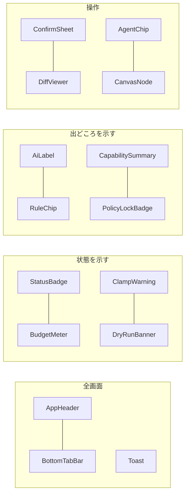

# 06. 共通UIコンポーネントとレスポンシブ・アクセシビリティ
- 親：[06 画面・UX設計](README.md) ／ 版数：v0.6（2026-10-01）

> **3行で**
> 1. 画面をまたいで使う部品は15種。状態は色＋アイコン＋テキストで示し、AI の出力には AiLabel、ルールで作った文には CapabilitySummary を使う。
> 2. スマホ優先（360px で横スクロールなし）。幅1024px以上ではサイドバー・一覧・詳細の3カラム。
> 3. WCAG 2.2 AA、ライト・ダークの両テーマ、PWA（オフラインではデータを出さない）。

## 🧭 判断してほしいこと
- Q-58（ブランドカラー・ロゴ）、Q-59（大きな差分のスマホ表示）。内容は [README](README.md#-判断してほしいこと)。

## 全体図

見てほしいところ：「出どころを示す」部品が原則3・8（AI とルールを区別する）を支える。

## 要点
- Kill Switch ボタンは AppHeader に常に出す（viewer には隠す）→ [コンポーネント](#コンポーネント)
- 確認はボトムシート（ConfirmSheet）で統一 → [コンポーネント](#コンポーネント)
- Canvas の矢印は装飾扱いで、スクリーンリーダーには見出しの順で伝える → [レスポンシブ・アクセシビリティ](#レスポンシブアクセシビリティ)

---

## 詳細

### コンポーネント

共通UIコンポーネント（15種）

| コンポーネント | 内容 | 使う画面 |
|---|---|---|
| AppHeader | ワークスペースの切り替え・Kill Switch ボタン（常に表示。viewer には隠す）・Kill Switch 発動中のバナー | 全画面 |
| BottomTabBar | 下部タブ（スマホ）／サイドバー（PC、幅1024px以上）。v0.5 で「エージェント」を先頭に。**v0.9 で廃止**（SCR-019 と AppHeader のメニューにする） | SCR-001・012 以外 |
| StatusBadge | タスク・Intent・エージェントの状態（色＋アイコン＋テキスト） | SCR-002, 004, 005, 006, 014, 017 |
| BudgetMeter | 消費額と上限のバー（80%で琥珀、100%で赤） | SCR-002, 005, 007 |
| RuleChip | 判定に当たったルール（例：`paths.deny[1]`）。タップで SCR-009 の該当キーへ | SCR-005, 007, 010 |
| DiffViewer | ファイル単位で折りたためる差分表示 | SCR-007 |
| UndoRow | ○ を押した行を「送ります…　取り消す（残り秒数）」に置き換え、猶予（A-91、5秒）が過ぎてから承認を送る（v0.9、D-43） | SCR-019 |
| ConfirmSheet | 下から出る確認シート（v0.9 から承認には使わない。キャンセル・削除・公開・下書きの破棄・エージェントの停止と再開・信頼度の提案） | SCR-005, 007, 011, 014, 016, 017 |
| AiLabel | 「AIによる要約（参考）」「AIによる自己レビュー（参考）」「AIによる提案」のラベル | SCR-005, 007, 015（廃止） |
| Toast | 操作結果の通知（スクリーンリーダーには `aria-live="polite"`） | 全画面 |
| AgentChip | エージェントの表示名と ID（例：`[bug-fixer]`）。状態を色＋テキストで添え、タップで SCR-017 へ。下書きの場合は「（下書き）」を付けて SCR-016 へ | SCR-002, 003, 004, 005, 007, 009 |
| PolicyLockBadge | 🔒＋「リポジトリのポリシーで制限されています」＋制限しているポリシーの値（Hard Ceiling の場合は「上限」）。SCR-016 では API-046 の `locked` を元に、選べない選択肢に付ける。スクリーンリーダーには理由ごと読み上げる | SCR-009, 016 |
| ClampWarning | ⚠「ポリシーにより制限中」と、切り詰められた項目（定義の値 → 実効の値） | SCR-002, 003, 005, 007, 009, 014, 016, 017 |
| DryRunBanner | 紫の斜線の帯と「試し実行 · 外部作用は行いません」。画面の上部に固定し、スクロールしても消さない | SCR-005, 007 |
| CapabilitySummary | 「このエージェントにできること」。実効ポリシーから固定の文テンプレートで生成した箇条書きに「ルールによる生成」のラベル（LLM を使わない） | SCR-003, 016, 017 |
| CanvasNode | Canvas のノード（起動・エージェント・できること・境界・外部作用）。変更点の3秒ハイライト、検証エラーの赤枠、タップで編集シート | SCR-016 |

- SCR-018 のカード（こうします・接続・確認・承認・結果・変更の記録・任せ先の提案）を共通部品にするかは元の設計に記載がない。カードの一覧は [agents.md](agents.md#scr-018エージェントのチャット)。

### レスポンシブ・アクセシビリティ
- スマホ優先で作り、360px 幅で横スクロールが出ないようにする（NFR-040）。差分表示だけは、その領域の中で横スクロールを許す。
- 幅1024px以上では、左にサイドバー、中央に一覧、右に詳細を並べる（例：SCR-006 と SCR-007 を並べる。A-23）。
- Harness Canvas（SCR-016）は、幅1024px以上でノードを左から右に並べ、会話を右のパネルとして開ける（v0.2。会話の SCR-015 は廃止）。1024px 未満では同じノードを同じ順で縦のカードにし、編集はボトムシートで行う。Canvas は open-agent の Canvas（React）を取り込む（12 §アーキテクチャへの影響）。
- Canvas のノードをつなぐ矢印は装飾として扱い、スクリーンリーダーには「① 起動 → ② エージェント → …」の見出しの順で伝える。キーボードではノードを Tab で順に移動し、Enter で編集シートを開く。
- WCAG 2.2 AA（NFR-042）：コントラスト比4.5:1以上、タップ領域44×44px以上、状態を色だけで示さない、キーボードですべての操作ができる、フォーカスを見えるようにする。
- ライトとダークの両方のテーマ（OS の設定に従う）。
- PWA：manifest（アイコン・`display: standalone`）と Service Worker（アプリの外枠をキャッシュし、プッシュを受け取る）。データはオフラインでは表示せず「オフラインです」と表示する。
- 音声入力は PWA のブラウザの音声認識を使う（REQ-038、SCR-018）。
- フェーズ0でスマホから使う場合は、Tailscale などのトンネルで PWA を開き、ホーム画面に追加してプッシュ通知を受ける（13 §フェーズ0、A-74）。

## このドキュメントで決まったこと
- 決定は [README](README.md#このドキュメントで決まったこと) にまとめる。
