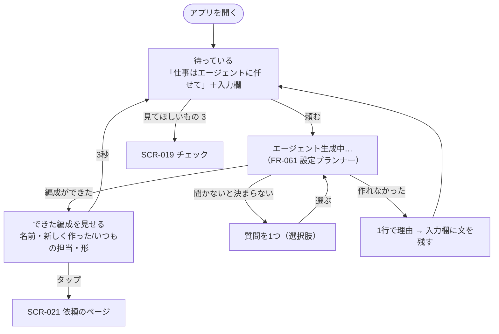

# 06. 画面詳細：任せる（SCR-020）
- 親：[06 画面・UX設計](README.md) ／ 版数：v0.14（2026-10-02） ／ 決定：[ADR-036](../adr/ADR-036-ask-generates-formation.md)、[ADR-037](../adr/ADR-037-entrance-one-sentence.md)、[D-63〜68](../decisions.md#d-63)

> **3行で**
> 1. アプリを開くと、いつもこの画面。真ん中に「仕事はエージェントに任せて」の1文、その下に入力欄があるだけ。
> 2. 頼むと「エージェント生成中…」になり、設定プランナーが担当を決める。合う担当がいれば使い回し、いなければ新しく作る。1体で足りなければ、独立した複数のエージェントに分けて作る（並列・まとめ役・順番の3つの形）。
> 3. 作り終えたら、誰が何をするかを3秒ほど見せて入口に戻る。確認の ○ は挟まず、そのまま動き出す。見てほしいものは、入力欄の下の小さな件数から SCR-019 で見る。

## 🧭 判断してほしいこと
- （✅決定）審査員が最初に見る画面（Q-109）は、用意した依頼のページ SCR-021（[D-69](../decisions.md#d-69)）。審査員もそこから「自分で頼んでみる」でこの画面に来る。
- 作り終えた編成を見せる時間（A-97、仮に3秒）。短いと誰ができたか読めず、長いと待たされる感じになる。実機で決め直す。

## 全体図

見てほしいところ：ユーザーの操作は「頼む」だけ。編成（誰を作るか・分けるか）を確かめる ○ はない。止まるのは、書き込みや権限が増える所（SCR-019 の送る前の確認）と、聞かないと決まらない所（質問1つ）だけ。

## 要点
- 待っているときに出すのは、1文・入力欄・その下の件数の3つだけ。件数が0なら件数も出さない → [レイアウト](#レイアウト)
- 頼むと、1文の位置が「エージェント生成中…」に変わり、決まった担当から1行ずつ現れる → [生成中](#生成中)
- 形は4つ：ひとり／並列（それぞれ報告）／まとめ（まとめ役が1つの報告に）／順番（前の結果を次が使う）。選ぶのは設定プランナー → [04 FR-061](../04_functional_spec/agents.md#fr-061)
- チェックは SCR-019（`/check`）に分けた。入口とチェックで、することを1つずつにする → [ask-and-check.md](ask-and-check.md)

---

## 詳細

### SCR-020：任せる
- 目的：やってほしいことを頼む。アプリを開いたときの最初の画面はいつもここ。
- URL：`/`
- 対象ロール：フェーズ0は owner だけ。
- フェーズ：0（フェーズ0-H のハッカソン版でもこの画面を入口にする。審査員がトークンを入れた直後だけは SCR-021。D-69）
- 関連：FR-061・FR-062、REQ-063〜065

#### レイアウト
```
+----------------------------------+
|                    全部止める  ≡ |  ← AppHeader。製品名も出さない
|                                  |
|                                  |
|                                  |
|     仕事はエージェントに任せて     |  ← 真ん中。24px・標準の太さ
|                                  |
|  +----------------------------+  |
|  | 例：在庫が減ったら発注して  ↑ |  |  ← 入力欄。1文のすぐ下
|  +----------------------------+  |
|                                  |
|    見てほしいもの 3 ・ 動いている 2  |  ← 件数があるときだけ。薄い色の小さな文字
|                                  |
|                                  |
+----------------------------------+
```

| 要素 | 内容 | 理由 |
|---|---|---|
| 1文 | 「仕事はエージェントに任せて」。縦横の中央 | することが1つだと一目で分かる |
| 入力欄 | 1文のすぐ下。複数行まで伸びる（最大5行）。プレースホルダーは例文を1つ（毎回入れ替える、A-96） | 何を書けばよいかを例で示す。担当・期限・種類の選択は置かない |
| 件数 | 「見てほしいもの N」「動いている N」。押すと SCR-019 | チェックは別の画面。入口には量だけを出す |
| AppHeader | 「全部止める」と ≡（メニュー）だけ | Kill Switch はどの画面からも押せる（原則4） |

- スマホではキーボードが開くと、1文と入力欄をいっしょに上へずらし、1文を隠さない。
- 「見てほしいもの」に送る前の確認があるときだけ、件数の数字をアクセントの色にする（止まっている仕事があることに気づけるように）。それ以外は薄いグレー。
- 例文・イラスト・「こんにちは」などの挨拶は出さない。

<a id="生成中"></a>
#### 生成中
```
|     エージェント生成中…           |  ← 1文の位置が置き換わる
|                                  |
|     在庫の守護神                  |  ← 決まった順に1人ずつ現れる（名前を見出しに）
|     在庫を見張って発注する         |  ← その担当がすること（小見出し）
|     新しく作りました               |
|                                  |
|     受信箱係                      |
|     仕入れ先のメールを読む         |
|     いつもの担当                   |
|                                  |
|  2人がそれぞれ動いて、答えを1つにして届けます |  ← 形を1行で
```
1. 送ると入力欄は空になり、1文の位置が「エージェント生成中…」に変わる。
2. 設定プランナー（FR-061）の結果が届いたら、担当を1人ずつ出す（見出し：名前、小見出し：その担当がすること、その下に「新しく作りました」か「いつもの担当」）。新しく作る担当の名前は、依頼の中身から付けた、ユーモアのある呼び名（ご飯を調べる依頼なら「グルメ探偵」など。「〇〇係」のような堅い名前にはしない。FR-061）。
3. 最後に形を1行で出す。

| 形 | 最後の1行 |
|---|---|
| ひとり | （出さない） |
| 並列 | 「N人がそれぞれ動いて、答えを1つにして届けます」 |
| まとめ | 「N人が調べて、まとめ役が1つにして届けます」 |
| 順番 | 「〇〇 → △△ の順に進めて、△△が答えます」 |

4. 3秒（A-97）たつと待っている状態に戻る。それまでに編成をタップすると、その依頼のページ（SCR-021）に移る。件数の「動いている」が増えている。
5. 生成中に「全部止める」以外の操作はない。取り消したいときは SCR-019 の「動いている」から止める（作ったエージェントは残る。消すのはメニューのエージェント一覧から）。

- 生成中が10秒を超えたら「まだ考えています」を下に1行足す。30秒を超えたら打ち切り、「Gemini が混み合っていて、時間内に決められませんでした。もう一度送ってください」を出し（時間切れは言い方のせいではないので、言い方を変えるよう促さない。2026-10-09）、入力欄に送った文を戻す（NFR-054 に準じる。A-98）。
- 質問が要るとき（BR-49 の4つの場面のうち「推測できない情報」）：生成中の位置に質問と選択肢のボタン（最大4つ）を出す。選ぶと生成中に戻る。選択肢にならないときだけ「自分で書く」（D-45 と同じ）。
- コネクタがつながっていない・権限が増える（`widen`）ときは、ここでは止めない。編成を作って動かし、その担当の仕事が SCR-019 の「送る前の確認」で止まる（作る所で聞くことを増やさない）。

#### 表示項目
| 項目 | データ元 | 備考 |
|---|---|---|
| 件数 | SCR-019 と同じ（見てほしいもの・動いている） | SSE（ADR-007）で更新 |
| 担当の行 | FR-061 の出力 `formation.members[]`（`summary`・`agentName`・`isNew`） | 名前は設定プランナーが付ける（REQ-058） |
| 形の1行 | `formation.shape` | 固定の文テンプレート。LLM に書かせない |

#### 操作・イベント
| 操作 | 挙動 | 呼び出すAPI | 遷移先 |
|---|---|---|---|
| 送る | 依頼を作り、生成中にする | API-072（依頼を作る。SSE で結果を返す） | 同じ画面 |
| 質問の選択肢 | 答えを送り、生成を続ける | API-073 | 同じ画面 |
| 件数 | — | — | SCR-019（`/check`） |
| 全部止める | SCR-013 | API-020 | — |

- 状態：待っている / 生成中 / 質問 / 編成を見せている / 作れなかった / Kill Switch 発動中（入力欄を無効にし、1文の位置に「全部止めています」） / オフライン（入力欄を無効にし「つながっていません」）
- API-072・073 は本書で仮に採番した（09 への反映はハッカソンの提出後）。

### 前提・仮定（仮番号）
- A-96：入力欄の例文は、そのワークスペースでまだ頼んでいない種類から選ぶ（固定の候補10個）。
- A-97：作り終えた編成を見せる時間は3秒。
- A-98：生成の打ち切りは30秒。
