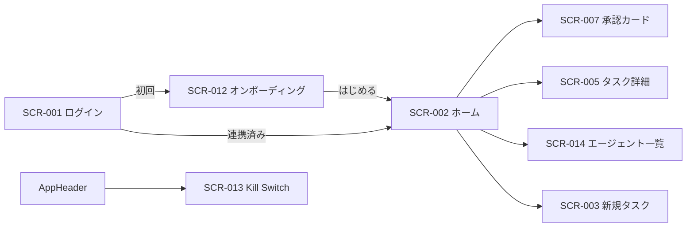

# 06. 画面詳細：入口・ホーム・Kill Switch（SCR-001・002・012・013）
- 親：[06 画面・UX設計](README.md) ／ 版数：v0.6（2026-10-01）

> **3行で**
> 1. GitHub でサインインし（SCR-001）、オンボーディング（SCR-012）で連携・API キー・通知を済ませ、ホーム（SCR-002）で「動いているもの・判断が要るもの・使ったお金」を見る。
> 2. Kill Switch（SCR-013）は全画面のヘッダーから1段階の確認で全エージェントを止める。
> 3. フェーズ0（サインイン省略）・GitHub 任意（13）には未対応で、SCR-012 の一部の行き先も廃止された（Q-55）。

## 🧭 判断してほしいこと
- Q-55（入口・ホームの v0.4・v0.5 への対応）、Q-58（ブランドカラー・ロゴ）。内容は [README](README.md#-判断してほしいこと)。

## 全体図

見てほしいところ：ホームは各領域への入口。Kill Switch はどの画面からでも開ける。

## 要点
- SCR-001 はフェーズ1。フェーズ0ではサインインを省略し、固定トークン（D-06）で画面を守る（13 §フェーズ0）→ [SCR-001](#scr-001ログイン)
- ホームの承認待ちは自分が承認者のものだけ。消費額は80%で琥珀、100%で赤 → [SCR-002](#scr-002ホーム)
- オンボーディングは①②が済めば「はじめる」を押せる。⑤は任意 → [SCR-012](#scr-012オンボーディング)
- Kill Switch は送信に失敗してもボタンを押せるままにする → [SCR-013](#scr-013kill-switch-モーダル全画面共通)

---

## 詳細

### SCR-001：ログイン
- 目的：GitHub アカウントでサインインする。
- フェーズ：1。フェーズ0ではこの画面を使わない（13 §フェーズ0）。GitHub を必須にしない入口（13）への対応は Q-55。
- ワイヤーフレーム：
  ```
  +----------------------------------+
  |            open-team             |
  |  Issueを任せる。ルールは任せない。   |
  |                                  |
  |  [  GitHubでサインイン  ]          |
  |                                  |
  |  (!) サインインがキャンセルされました |
  +----------------------------------+
  ```
- 表示項目：エラーメッセージ（クエリ `?error=`。FR-001 のエラー表）。
- 操作・イベント：

  | 操作 | 挙動 | 呼び出すAPI | 遷移先 |
  |---|---|---|---|
  | 「GitHubでサインイン」 | GitHub の認可画面へ | API-001 | GitHub → SCR-002 / SCR-012 |

- 状態：初期 / エラー

### SCR-002：ホーム
> **v0.9**：日常の入口から外し、[SCR-019 頼む・チェック](ask-and-check.md) に統合した（[D-42](../decisions.md#d-42)）。以下は v0.6 までの定義として残す。

- 目的：「今動いているもの」「判断が必要なもの」「使ったお金」を1画面で把握する。
- ワイヤーフレーム（v0.2）：
  ```
  +----------------------------------+
  | [org ▼]  open-team     [■ KILL] |  ← 共通ヘッダー
  +----------------------------------+
  | 承認待ち 2件                  >   |
  |  ┌ owner/app #123  risk:medium ┐ |
  |  └ owner/api #45   risk:low    ┘ |
  +----------------------------------+
  | 実行中 1件 / 待機中 1件        >   |
  |  [bug-fixer] owner/app #130      |
  |  implement 32/80                 |
  |  ▓▓▓▓░░░░ $0.84 / $2.00         |
  +----------------------------------+
  | ⚠ 制限中・停止中のエージェント 2件 > |
  +----------------------------------+
  | 本日の消費  $3.20 / $10.00 (32%) |
  | ▓▓▓░░░░░░░   今月 $41.70          |
  +----------------------------------+
  |      [ + エージェントに任せる ]      |
  +----------------------------------+
  | ホーム|タスク|承認②|エージェント|… |
  +----------------------------------+
  ```
  下部タブの並びは v0.5 で「エージェント」が先頭になった（[README](README.md#情報設計サイトマップ)）。`org` はワークスペース。

<details>
<summary>表示項目と操作（各5行）</summary>

| 項目 | データ元（TBL/API） | 備考 |
|---|---|---|
| 承認待ちの一覧（最大3件） | API-017 / TBL-009 | 自分が承認者のものだけ |
| 実行中・待機中のタスク | API-012 / TBL-006 | エージェント（AgentChip）、フェーズ、ステップ数、費用。試し実行には「試し」の印 |
| 制限中・停止中のエージェント | API-059（ワークスペース全体。`status` で絞り込み）/ TBL-018, TBL-019.clamped | ⚠ 制限中（clamp）・無効（invalid）・停止中の件数。0件なら行ごと隠す |
| 本日・今月の消費額 | API-022 / TBL-011 | 80%を超えたら琥珀、100%で赤 |
| Kill Switch の状態 | API-006 / TBL-002 | 発動中は全画面上部に赤いバナー |

| 操作 | 挙動 | 呼び出すAPI | 遷移先 |
|---|---|---|---|
| 承認待ちの行をタップ | — | — | SCR-007 |
| 実行中の行をタップ | — | — | SCR-005 |
| 制限中・停止中のエージェントの行 | 該当するものに絞って表示 | — | SCR-014 |
| 「エージェントに任せる」 | — | — | SCR-003（v0.5 での扱いは Q-55） |
| ワークスペースの切り替え | 表示を切り替え | API-005 | — |

</details>

- 状態：初期 / ローディング（スケルトン）/ 空（「まだタスクがありません。最初のIssueを任せてみましょう」。あわせて「自分用のエージェントを作る」→ SCR-014）/ エラー（再読込ボタン）

### SCR-012：オンボーディング
- 目的：初めてのユーザーが、最初のタスクを委任できる状態までを最短で進める。
- v0.5 以降の注意：①は GitHub 任意（13）と、⑤の行き先（作り方のシート・SCR-015/016）は下書きの廃止（14）と食い違う（Q-55）。
- ワイヤーフレーム（v0.2）：
  ```
  +----------------------------------+
  | ようこそ  ① ─ ② ─ ③ ─ ④           |
  +----------------------------------+
  | ① GitHub Appをインストール   ✓     |
  | ② LLMのAPIキーを登録        [登録] |
  | ③ ホーム画面に追加（iOS）    [手順] |
  | ④ 通知を許可               [許可] |
  | ⑤ 最初のエージェントを作る（任意）[作る]|
  +----------------------------------+
  | ヒント: .agent/policy.yaml を置くと |
  | エージェントのルールを決められます     |
  |          [ はじめる ]              |
  +----------------------------------+
  ```
- 表示項目：各ステップの完了状態（API-005, API-026, API-004）。⑤は、選んだリポジトリにエージェント（既定エージェントを除く）か下書きがあれば ✓（API-041、API-057。API-057 は v0.5 で廃止）。

<details>
<summary>操作・イベント（6行）</summary>

| 操作 | 挙動 | 呼び出すAPI | 遷移先 |
|---|---|---|---|
| ① インストール | GitHub App のインストール画面を開く | —（戻ってきたら API-005） | GitHub（外部） |
| ② 登録 | SCR-011 と同じ入力シート | API-027 | — |
| ③ 手順 | iOS の「ホーム画面に追加」の手順を表示（PWA として起動している場合は ✓） | — | — |
| ④ 許可 | 通知の許可 → 購読 | API-031 | — |
| ⑤ 作る | ①②が完了していれば有効。作り方を選ぶシート（v0.2 の SCR-014 と同じ）を開く | API-054 → API-043（API-043 は v0.5 で廃止、Q-55） | SCR-015（廃止）/ SCR-016 |
| 「はじめる」 | ①②が完了していれば有効（⑤は任意） | — | SCR-002 |

</details>

- 状態：初期 / 各ステップの完了 / エラー

### SCR-013：Kill Switch モーダル（全画面共通）
- 目的：ワークスペースのすべてのエージェントをすぐに止める。
- ワイヤーフレーム：
  ```
  +----------------------------------+
  |  ■ 全エージェントを停止しますか？     |
  |  実行中 2件・承認待ち 1件が停止され、  |
  |  再開はできません。                  |
  |  理由（任意）[                   ]   |
  |  [ キャンセル ]  [ ■ 停止する ]      |
  +----------------------------------+
  ```
- 表示項目：影響を受けるタスクの件数（API-012 の集計）。
- 操作・イベント：

  | 操作 | 挙動 | 呼び出すAPI | 遷移先 |
  |---|---|---|---|
  | 「停止する」 | 発動 | API-020 | 元の画面（上部に赤いバナー） |

- 状態：初期 / 送信中 / 完了（「停止しました」）/ エラー（「停止できませんでした。もう一度押してください」。ボタンは押せるままにする）
- 解除はワークスペースの owner が SCR-011 で理由を入力して行う。

## このドキュメントで決まったこと
- 決定は [README](README.md#このドキュメントで決まったこと) にまとめる。
