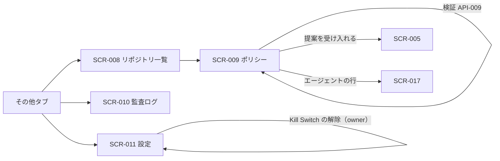

# 06. 画面詳細：統制・設定（SCR-008〜011）
- 親：[06 画面・UX設計](README.md) ／ 版数：v0.6（2026-10-01）

> **3行で**
> 1. リポジトリ一覧（SCR-008）とポリシー（SCR-009）で、開発エージェントにかかるリポジトリのポリシーを確認・検証し、信頼度の提案に答える。
> 2. 監査ログ（SCR-010）で何が起きたかを追い、改ざんされていないことを確かめる。設定（SCR-011）で API キー・通知・メンバー・ワークスペースを管理する。
> 3. v0.4 からポリシーの基本はワークスペース単位になったが、その画面はまだない（Q-57）。

## 🧭 判断してほしいこと
- Q-50（コネクタ・プロフィールの画面）、Q-57（ワークスペースのポリシー・ルールの一覧の置き場所）。内容は [README](README.md#-判断してほしいこと)。

## 全体図

見てほしいところ：どれも「その他」タブの配下。編集そのものは GitHub（`.agent/policy.yaml`）で行う。

## 要点
- リポジトリのポリシーは、v0.4 から開発エージェントにだけ追加でかかる上限（BR-43）→ [SCR-009](#scr-009ポリシー)
- ポリシーを厳しくすると、このポリシーで動くエージェントに警告が出る（BR-21）→ [SCR-009](#scr-009ポリシー)
- 監査ログの出力は owner だけ → [SCR-010](#scr-010監査ログ)
- 権限のない項目は操作部品を隠して閲覧だけ → [SCR-011](#scr-011設定)

---

## 詳細

### SCR-008：リポジトリ一覧
- 目的：連携中のリポジトリとポリシーの状態を確認する。
- ワイヤーフレーム：
  ```
  +----------------------------------+
  | リポジトリ     [+ リポジトリを追加]  |
  +----------------------------------+
  | owner/app   ✓ policy valid       |
  | owner/api   ⚠ 既定ポリシー         |
  | owner/infra ✕ policy invalid     |
  +----------------------------------+
  ```
- 表示項目：リポジトリ名、連携状態、ポリシーの状態（valid / 既定 / invalid）（API-007 / TBL-004, TBL-005）。
- 操作：行をタップすると SCR-009。「リポジトリを追加」は GitHub App の設定画面（外部）を開く。
- 状態：初期 / ローディング / 空 / エラー

### SCR-009：ポリシー
- 目的：有効なポリシーを確認し、編集中の内容を検証し、信頼度の提案に答える（v0.2 改訂）。
- v0.4：リポジトリのポリシーは、そのリポジトリを対象にするエージェントにだけ追加で効く（BR-43）。すべてのエージェントの上限はワークスペースのポリシー（画面は Q-57）。
- ワイヤーフレーム：
  ```
  +----------------------------------+
  | ← owner/app  ポリシー              |
  | ✓ valid  commit a1b2c3d  2h前    |
  | [有効なポリシー][検証][提案①]       |
  +----------------------------------+
  | 自律レベル                         |
  |  read        auto                |
  |  edit_code   auto                |
  |  run_tests   auto                |
  |  shell_net   deny  🔒上限          |
  |  open_pr     approve             |
  |  merge       deny  🔒上限          |
  | 予算  $2/タスク $10/日 80steps 45分|
  | Breaker  repeat5 files30 deny3.. |
  | 禁止パス  .github/workflows/** …   |
  | コマンド  npm ci, npm test …       |
  | 承認者   ren                      |
  | モデル   plan: claude-opus-5-5 … |
  +----------------------------------+
  | このポリシーで動くエージェント (3)   |
  |  bug-fixer      ✓                |
  |  deps-bot       ⚠ 制限中          |
  |   open_pr auto → approve         |
  |  weekly-review  停止中            |
  +----------------------------------+
  ```
  - 「検証」タブ：YAML の入力欄（policy / routing）と「検証」ボタン。結果は行番号つきで表示する。
  - 「提案」タブ：`open_pr: approve → auto（ドラフトPR）`、根拠（承認10回・却下0回）、「受け入れる」「見送る」ボタン。

<details>
<summary>表示項目（4行）と操作（5行）</summary>

| 項目 | データ元 | 備考 |
|---|---|---|
| 正規化されたポリシー・routing | API-008 / TBL-005 | 既定値で埋めたキーには「既定」ラベル |
| エラー・警告 | API-008, API-009 | |
| 提案 | API-033 / TBL-015 | |
| このポリシーで動くエージェント | API-041 / TBL-018, TBL-019.clamped | 各エージェントの状態。clamp されたものは ⚠ と、切り詰められた項目（定義の値 → 実効の値）。ポリシーを厳しくすると、ここに警告が出る（BR-21） |

| 操作 | 挙動 | 呼び出すAPI | 遷移先 |
|---|---|---|---|
| 「検証」 | 結果を表示（保存しない） | API-009 | — |
| 「GitHubで編集」 | `.agent/policy.yaml` の編集画面を開く | — | GitHub（外部） |
| 提案を「受け入れる」 | ポリシー変更タスクを作る | API-034（`accept`） | SCR-005 |
| 提案を「見送る」 | 提案を閉じる | API-034（`dismiss`） | — |
| エージェントの行をタップ | — | — | SCR-017 |

</details>

- 状態：初期 / ローディング / 既定ポリシー（「`.agent/policy.yaml` がないため既定値を使用中」とテンプレートのコピーボタン）/ invalid（エラー一覧）/ エラー

### SCR-010：監査ログ
- 目的：何が起きたかを追跡し、改ざんされていないことを確かめる。フェーズ0でも省略しない（13 §フェーズ0）。
- ワイヤーフレーム：
  ```
  +----------------------------------+
  | 監査ログ   [整合性を検証] [出力]     |
  | 期間[7日▼] 種類[すべて▼] task[  ]  |
  +----------------------------------+
  | #10233 12:07 decision.made       |
  |  deny path_denied paths.deny[1]  |
  | #10232 12:06 llm.called          |
  |  claude-sonnet-5-5 12k/1k $0.05  |
  | #10231 12:03 task.status_changed |
  +----------------------------------+
  | 検証結果: ✓ 10,233件 OK           |
  +----------------------------------+
  ```
- 表示項目：連番、日時、イベントの種類、実行者、ペイロードの要約（タップで全文の JSON）、ハッシュの先頭8文字（API-023 / TBL-012）。
- v0.5・v0.6 で増えたイベント（`agent.created`・`agent.config.widened`・`job.moved` など）も同じ一覧に出る（一覧は [04](../04_functional_spec/README.md)）。
- 操作・イベント：

  | 操作 | 挙動 | 呼び出すAPI | 遷移先 |
  |---|---|---|---|
  | 絞り込み | 再取得 | API-023 | — |
  | 「整合性を検証」 | 表示中の期間を検証 | API-024 | — |
  | 「出力」（owner のみ表示） | JSON Lines をダウンロード | API-025 | — |

- 状態：初期 / ローディング / 空 / 検証中 / 検証NG（破損箇所の連番を赤で表示）/ エラー

### SCR-011：設定
- 目的：ワークスペースと自分の設定を管理する。
- ワイヤーフレーム（v0.2。「組織」はワークスペース）：
  ```
  +----------------------------------+
  | 設定                              |
  +----------------------------------+
  | LLMのAPIキー（owner）              |
  |  anthropic  ****a1b2  [削除]      |
  |  openai     未登録    [登録]       |
  +----------------------------------+
  | 通知                              |
  |  この端末  [ON ]                   |
  |  iPhone (Safari)  [削除]          |
  +----------------------------------+
  | メンバー（owner は変更可）           |
  |  aoi  owner       [▼]            |
  |  sora maintainer  [▼]            |
  +----------------------------------+
  | 組織                              |
  |  タイムゾーン [Asia/Tokyo ▼]       |
  |  会話ログの保存 [ON]               |
  |  Kill Switch: 発動中 [解除する]     |
  +----------------------------------+
  | [ ログアウト ]                     |
  +----------------------------------+
  ```

<details>
<summary>表示項目（4行）と操作（8行）</summary>

| 項目 | データ元 | 備考 |
|---|---|---|
| API キー | API-026 / TBL-013 | 末尾4文字だけ |
| 通知の購読 | API-004 / TBL-014 | 自分の端末だけ |
| メンバー | API-029 / TBL-003 | |
| ワークスペースの設定・Kill Switch の状態 | API-006 / TBL-002 | |

| 操作 | 挙動 | 呼び出すAPI | 遷移先 |
|---|---|---|---|
| キーの登録 | 入力シート → 疎通確認 → 保存 | API-027 | — |
| キーの削除 | 確認 → 削除 | API-028 | — |
| 通知を ON にする | 許可ダイアログ → 購読 | API-031 | — |
| 端末の削除 | 購読を削除 | API-032 | — |
| ロールの変更 | 確認 → 変更 | API-030 | — |
| ワークスペースの設定を変更 | 保存 | API-040 | — |
| Kill Switch の解除（owner） | 理由を入力 → 解除 | API-021 | — |
| ログアウト | セッションを破棄 | API-003 | SCR-001 |

</details>

- 状態：初期 / ローディング / エラー。権限のない項目は、操作部品を隠して閲覧だけにする。
- バリデーション：API キーは空不可・512文字以内。解除の理由は1〜500文字。

## このドキュメントで決まったこと
- [ADR-021](../adr/ADR-021-workspace-policy.md)：ポリシーの基本はワークスペース単位。リポジトリのポリシーは開発用の追加の上限
