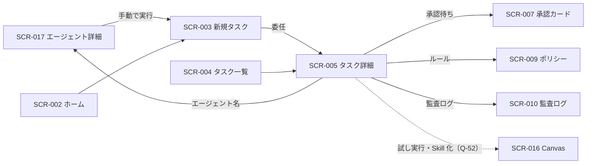

# 06. 画面詳細：タスク（SCR-003・004・005）
- 親：[06 画面・UX設計](README.md) ／ 版数：v0.6（2026-10-01）

> **3行で**
> 1. SCR-003 でエージェントを選び、Issue か指示文で仕事を任せる。SCR-004 で一覧し、SCR-005 で動きを見守って必要なら止める。
> 2. SCR-005 は通常・試し実行・レポート型の3つの見た目を持ち、拒否には当たったルールを、AI の自己レビューには「AI」ラベルを添える。
> 3. v0.5 で仕事はチャット（SCR-018）から作るようになり、SCR-003 の位置づけ（Q-55）と「このやり方を Skill にする」の行き先（Q-52）が未決。

## 🧭 判断してほしいこと
- Q-52（SCR-016 と Skill 化の行き先）、Q-55（SCR-003 の位置づけ）、Q-56（v0.6 の状態の表示）。内容は [README](README.md#-判断してほしいこと)。

## 全体図

見てほしいところ：SCR-005 が見守りの中心。点線は下書きの廃止で行き先が未決。

## 要点
- エージェントは `active` だけ選べ、停止中・無効は理由つきで灰色にする。既定エージェントは先頭 → [SCR-003](#scr-003新規タスク)
- 「委任する」のエラーはボタンの上にインラインで出す → [SCR-003](#scr-003新規タスク)
- 状態のフィルタの「終了」には `completed`（試し実行・レポート）を含める → [SCR-004](#scr-004タスク一覧)
- SSE が切れたら「再接続中…」と指数バックオフ → [SCR-005](#scr-005タスク詳細)
- 試し実行では承認・PR のボタンを出さない → [SCR-005](#scr-005タスク詳細)

---

## 詳細

### SCR-003：新規タスク
> **v0.9**：依頼は [SCR-019](ask-and-check.md) の頼む欄に1本化した（[D-42](../decisions.md#d-42)）。以下は v0.6 までの定義として残す。

- 目的：リポジトリとエージェントを選び、Issue または指示文で仕事を任せる（v0.2 改訂）。v0.5 での位置づけは Q-55。
- ワイヤーフレーム：
  ```
  +----------------------------------+
  | ← エージェントに任せる              |
  +----------------------------------+
  | リポジトリ [ owner/app        ▼ ] |
  | エージェント [ バグ修正係      ▼ ] |
  |  bug-fixer · dev-coder           |
  |  できること（ルールによる生成）  >  |
  |  PR作成=承認必須(ren) / $1/タスク   |
  +----------------------------------+
  | [ Issue ] [ 指示文 ]              |
  | 🔍 Issueを検索                     |
  | ( ) #130 Fix login redirect      |
  | (●) #128 Add unit tests for util |
  | ( ) #121 Bump eslint   実行中     |
  +----------------------------------+
  | 追加の指示（任意）                  |
  | [                              ] |
  +----------------------------------+
  |        [   委任する   ]            |
  +----------------------------------+
  ```
  「指示文」を選んだ場合は、Issue の一覧の代わりに指示文の入力欄（必須）を出し、「追加の指示」は隠す。

<details>
<summary>表示項目（5行）と操作（4行）</summary>

| 項目 | データ元 | 備考 |
|---|---|---|
| リポジトリ一覧 | API-007 / TBL-004 | `active` のものだけ |
| エージェント一覧 | API-041 / TBL-018 | `active` のものを選べる。停止中・無効（invalid）は理由を添えて灰色で表示し、選べない。既定エージェント（`default`、BR-31）は「既定」のラベルつきで先頭。SCR-017 の「手動で実行」から来た場合は選択済み（`?agent=`） |
| 実効ポリシーの要約（このエージェントにできること） | API-042 / TBL-019.effective_policy | 固定の文テンプレートによる要約（FR-025）。タップで全文。リポジトリのポリシーが invalid、またはエージェントが選べない場合は赤で表示し、「委任する」を無効にする。clamp 中は ⚠「ポリシーにより制限中」 |
| 起動の回数 | API-042 の `runsToday` / `maxRunsPerDay` | 今日の起動回数 / `max_runs_per_day`。上限に達したら「委任する」を無効にする |
| Issue 一覧 | API-010（GitHub） | Open のもの。**選んだエージェントで**未完了のタスクがある Issue には「実行中」のバッジを付けて選べなくする（BR-29）。指示文だけの委任は重複を判定しない |

| 操作 | 挙動 | 呼び出すAPI | 遷移先 |
|---|---|---|---|
| エージェントを選ぶ | 実効ポリシーの要約と、Issue の「実行中」バッジを更新 | API-042 | — |
| 「Issue」/「指示文」の切り替え | 入力欄を切り替える | — | — |
| 「委任する」 | タスクを作成（`agentId` と、`issueNumber` か `prompt` のどちらか） | API-011 | SCR-005 |
| 実効ポリシーの要約をタップ | — | — | SCR-017（「できること」の位置） |

</details>

- 状態：初期 / ローディング / 空（「Openのissueがありません」。「指示文」への切り替えを案内）/ 既定エージェントだけ（既定エージェントを選べる。`default.yaml` がなければ組み込みの既定エージェント。「自分用のエージェントを作る」→ SCR-014）/ エラー
- バリデーション・エラー表示：
  - 追加の指示・指示文は2,000文字まで（残りの文字数を表示）。指示文モードでは指示文は必須。
  - API のエラー（`KILL_SWITCH_ENGAGED`、`POLICY_INVALID`、`LLM_CREDENTIAL_MISSING`、`TASK_ALREADY_ACTIVE`、`ISSUE_NOT_OPEN`、`FORBIDDEN`、422 `AGENT_NOT_ACTIVE`、423 `AGENT_DISABLED`、429 `DAILY_RUN_LIMIT`）は、ボタンの上にインラインで表示する。`LLM_CREDENTIAL_MISSING` には SCR-011 へのリンクを付ける。

### SCR-004：タスク一覧
- 目的：過去と現在のタスクを状態で絞り込んで確認する。
- ワイヤーフレーム：
  ```
  +----------------------------------+
  | タスク                            |
  | [すべて][実行中][承認待ち][終了]     |
  +----------------------------------+
  | ● running   owner/app #130  2分前 |
  | ◐ awaiting  owner/app #123 10分前 |
  | ✓ succeeded owner/api #44   昨日  |
  | ■ halted    owner/app #99   昨日  |
  |   breaker: same_action_repeat    |
  +----------------------------------+
  |        [ さらに読み込む ]          |
  +----------------------------------+
  ```
- 表示項目：状態、リポジトリ、Issue 番号とタイトル（Issue がなければ指示文の1行目）、エージェント（AgentChip）・トリガー、試し実行の印、更新日時、停止・失敗の理由（API-012 / TBL-006）。
  - SCR-017 から来た場合はエージェントで絞り込む（API-012 の `agentId`）。
  - 状態のフィルタの「終了」には `completed`（試し実行・レポート）を含める。
- 操作・イベント：行をタップすると SCR-005。フィルタ（状態・エージェント）を変えると API-012 を再度呼ぶ（カーソル方式のページング）。
- 状態：初期 / ローディング / 空 / エラー

### SCR-005：タスク詳細
- 目的：エージェントの動きを見守り、必要なら止める。試し実行の結果やレポートを確認し、うまくいったやり方を Skill にする（v0.2 改訂）。
- ワイヤーフレーム（通常）：
  ```
  +----------------------------------+
  | ← owner/app #130 Fix login ...   |
  | [bug-fixer] ラベル · aoi が依頼    |
  | ● running  implement             |
  +----------------------------------+
  | 予算  $0.84/$2.00  steps 32/80   |
  |      ▓▓▓▓░░░░      ▓▓▓▓░░░░      |
  | 時間  12分/45分  拒否 1/3          |
  +----------------------------------+
  | タイムライン                       |
  | 12:03 plan 開始 (claude-opus-5-5)|
  | 12:05 read_file src/auth.ts  ✓   |
  | 12:06 write_file infra/x.tf  ✕   |
  |       拒否: paths.deny[1]  >     |
  | 12:07 run_command npm test   ✓   |
  | 12:09 review 修正点 2件（AI）      |
  | ...                              |
  +----------------------------------+
  | [この監査ログ]    [ キャンセル ]     |
  +----------------------------------+
  ```
  承認待ちの場合は、上部に「承認カードを開く」ボタンを出す。成功した場合は「PRを開く（GitHub）」ボタンを出す。

<details>
<summary>ワイヤーフレーム（試し実行・完了／レポート型・完了）</summary>

```
+----------------------------------+
| ← 試し: deps-bot（下書き）         |
|▨▨ 試し実行 · 外部作用は行いません ▨▨|
| ✓ 完了（試し実行）  $0.42/$1.00   |
+----------------------------------+
| 指示文                            |
|  依存関係を更新してPRを出して       |
+----------------------------------+
| タイムライン                       |
| 10:02 investigate 開始           |
| 10:08 run_command npm test   ✓   |
| 10:10 open_pr → simulated        |
|   本番なら: 承認が必要（approve）   |
+----------------------------------+
| [承認カードのプレビュー]            |
| [Canvas に戻る]                   |
+----------------------------------+
```

```
+----------------------------------+
| ← 週次レビュー  2026-10-01         |
| [weekly-review] スケジュール        |
| ✓ 完了（レポート）  $0.31           |
+----------------------------------+
| レポート                           |
|  ## 依存関係の脆弱性 2件           |
|  - lodash 4.17.20 (high) ...     |
|  ※GitHubには書き込んでいません      |
+----------------------------------+
| タイムライン                    >  |
+----------------------------------+
| [このやり方を Skill にする]         |
+----------------------------------+
```

</details>

<details>
<summary>表示項目（10行）</summary>

| 項目 | データ元 | 備考 |
|---|---|---|
| タスクの基本情報・状態・理由 | API-013 / TBL-006 | Issue がないタスクは、タイトルの代わりに指示文（`prompt`）の1行目。`completed` は `status_detail` により「完了（試し実行）」「完了（レポート）」と表示。エージェントの停止で止まったタスクは「停止（エージェントの停止）」（`halt_reason = agent_disabled`） |
| エージェント・トリガー・依頼者 | API-013 / TBL-006.agent_id, trigger_type | AgentChip（タップで SCR-017）。トリガーは 手動 / ラベル / メンション / スケジュール / 試し実行 |
| 指示文・追加の指示 | API-013 / TBL-006.prompt, instructions | `prompt`：スケジュールの `prompt`・指示文だけの委任。`instructions`：Issue に対する追加の指示（Web・メンション） |
| 試し実行の帯 | API-013 / TBL-006.is_dry_run | DryRunBanner。下書き名（タップで SCR-016）と予算の上限 $1 |
| ポリシーにより制限中 | API-013 / TBL-019.clamped | 開始時のスナップショットが clamp されていれば ⚠ と、切り詰められた項目 |
| 予算メーター（費用・ステップ・時間・拒否回数・変更ファイル数） | API-013 / TBL-006 のカウンタ | SSE の `budget_updated` で更新 |
| タイムライン | API-014（初回）＋ API-015（SSE）/ TBL-007 | 拒否には `matchedRule` へのリンク。dev-coder の `review` フェーズ（自己レビュー）は「AI」ラベル付き。試し実行の Intent は `simulated` と「本番ならどう判定されたか」 |
| レポート | API-013 / TBL-006.report | reviewer / triager のみ（v0.2）。Markdown で表示し、リンクは無害化する（FR-033） |
| PR の URL | API-013 / TBL-008 | 成功した場合のみ（試し実行では出さない） |
| 試し実行のプレビュー | API-013 の `intent.preview` / TBL-008（`simulated`） | 試し実行で Intent がある場合だけ「承認カードのプレビュー」ボタンを出す |

</details>

<details>
<summary>操作・イベント（9行）</summary>

| 操作 | 挙動 | 呼び出すAPI | 遷移先 |
|---|---|---|---|
| 「キャンセル」 | 確認シートの後にキャンセル | API-016 | 同じ画面（状態を更新） |
| 「承認カードを開く」 | — | — | SCR-007 |
| 「承認カードのプレビュー」（試し実行で Intent がある場合） | — | — | SCR-007（プレビュー） |
| 「Canvas に戻る」（試し実行） | — | — | SCR-016（Q-52） |
| エージェント名をタップ | — | — | SCR-017 |
| 「このやり方を Skill にする」（maintainer 以上。`succeeded` または `completed`（`report`）のタスク。試し実行を除く） | タスクの経過から `SKILL.md` の下書きを作る（設計アシスタント。秘密情報はマスク） | API-053 | SCR-016（Skill のノードをハイライト。下書きの廃止で行き先は Q-52） |
| 拒否のルールをタップ | 該当のキーを強調表示 | — | SCR-009 |
| 「この監査ログ」 | taskId で絞り込んで表示 | — | SCR-010 |

</details>

- 状態：初期 / ローディング / SSE 切断（「再接続中…」を表示し、指数バックオフで再接続）/ エラー / 終了（キャンセルボタンを隠す）/ 完了（レポート）/ 試し実行（実行中はキャンセルできる。承認・PR のボタンは出さない）/ 完了（試し実行）
- 「このやり方を Skill にする」は `succeeded`（PR 作成・検証済み）または `completed`（`report`）のタスクにだけ出す（試し実行には出さない）。対象外のタスクで API-053 が 409 `TASK_NOT_COMPLETED` を返したら、ボタンの下に「このタスクからは Skill を作れません」と表示する。
- v0.6 で `succeeded` は「外部作用がすべて実行された」に広がり、`completed` に `actions_declined`、`failed` に `action_failed` が加わった（15 §タスクの終わり方。定義は [04](../04_functional_spec/README.md)）。SCR-004・005 での表示は未設計（Q-56）。

## このドキュメントで決まったこと
- 決定は [README](README.md#このドキュメントで決まったこと) にまとめる。
