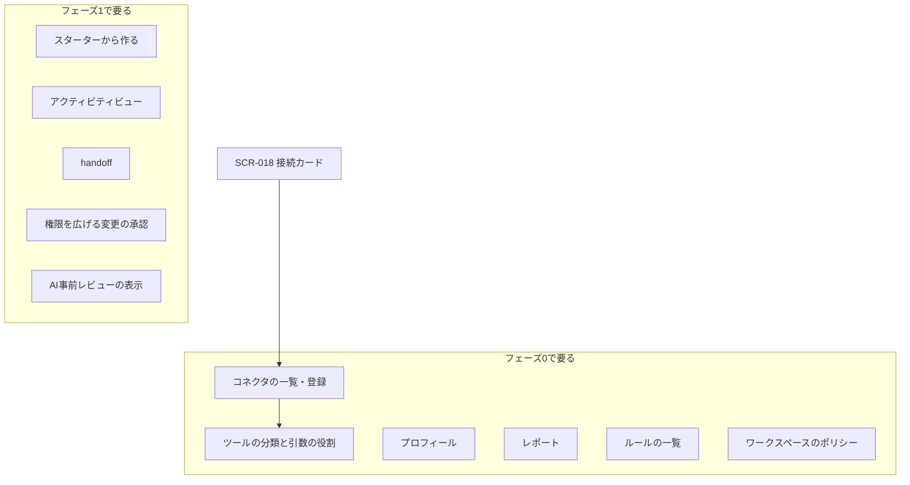

# 06. 未設計の画面（SCR-ID なし）の要件
- 親：[06 画面・UX設計](README.md) ／ 版数：v0.6（2026-10-01）

> **3行で**
> 1. 12〜15 が「06 に反映が要る」とした画面のうち、画面の詳細がまだないものを、元の文書に書かれた要件だけで集めた。
> 2. 設計（ワイヤーフレーム・SCR-ID・URL）は足していない。どれも Q-50・Q-51・Q-57 で決める。
> 3. いちばん要件が具体的なのは「ツールの分類と引数の役割」（13・15）で、ほかは要件の1行しかない。

## 🧭 判断してほしいこと
- Q-50（13 の画面）、Q-51（v0.3 の画面）、Q-57（ルールの一覧・ワークスペースのポリシー）。内容は [README](README.md#-判断してほしいこと)。

## 全体図

見てほしいところ：フェーズ0の完成条件（Slack への投稿を「以後も許可」で自動化）には、コネクタの登録と分類の画面が欠かせない。

## 要点
- コネクタは URL と認証情報で登録し（フェーズ0）、フェーズ1でカタログから OAuth で接続 → [コネクタ](#コネクタの一覧登録)
- 分類の既定は `unclassified`（＝書き込み扱い）。書き込みに分類するときに引数の役割も確定 → [分類](#ツールの分類と引数の役割)
- プロフィールは項目ごとに公開先のエージェントを選ぶ → [プロフィール](#プロフィール)
- ルールの一覧は API-068・069 があり、画面がない → [ルール](#ルールの一覧)
- v0.3 のアクティビティビュー（Must）は要件1行だけ → [v0.3 の画面](#v03-の画面)

---

## 詳細

### コネクタの一覧・登録
出典：13 §MCP コネクタの設計「登録と分類」、US-038、REQ-042（フェーズ0）・REQ-049（フェーズ1）。

| 段階 | 要件 |
|---|---|
| 登録 | フェーズ0：リモートの MCP サーバー（Streamable HTTP）を URL と認証情報（API キー or OAuth）で登録する。フェーズ1：カタログから OAuth でワンクリック接続し、推奨の分類が適用された状態になる（US-038 AC3） |
| ツールの取得 | Gateway が `tools/list` を呼び、ツール名・説明・入力スキーマ・注釈（`readOnlyHint` など）を保存する |
| 一覧の表示 | 各ツールを「読み取り / 書き込み / 未分類」で表示し、未分類は書き込みとして扱う（US-038 AC1） |
| 要再確認 | 説明文・入力スキーマ・`arg_roles` のハッシュが変わったツールは `needs_review` になり、確認されるまで使えない（US-038 AC2、BR-42）。再確認のときに、既存の「以後も許可」のルールを引き継ぐかを同じ画面で選ぶ（既定は引き継がない。15） |
| 認証情報 | Gateway だけが持つ。画面に値は出さない |

- チャットの接続カード（SCR-018）の [〇〇をつなぐ] の行き先。認証エラー時の [つなぎ直して再実行] も同じ（15）。
- GitHub をつないでいない場合、エージェントのテンプレートに開発系は出ない（US-039 AC1）。

### ツールの分類と引数の役割
出典：13 §登録と分類、15 §引数の役割、API-071（owner のみ）、BR-44・BR-56。

| 項目 | 要件 |
|---|---|
| 分類 | `read` / `write` / `unclassified`。既定は `unclassified`。注釈やカタログの推奨は**初期値の提案**として表示するだけで、ユーザーが確定するまで `read` にはならない |
| `read` への変更 | ワークスペースの owner だけ。「緩める変更」として監査ログに残す（BR-44） |
| 引数の役割 | `write` に分類するときに、入力スキーマの最上位の引数ごとに `destination`（宛先）/ `content`（中身）/ `option`（その他）を確定する。ネストした引数は最上位で `destination` |
| 役割の初期値 | 引数名から推測した役割を提案として出す（例：`channel`・`to`・`cc`・`bcc`・`recipient`・`email`・`url`・`share_with`・`calendar_id`・`path` → `destination`、`text`・`body`・`message`・`subject`・`title`・`description` → `content`、`unfurl_links`・`reply_broadcast`・`visibility`・`send_at` → `option`）。確定するまで効かない |
| 未確定・新しい引数 | `destination` として扱う |
| `content` への変更 | owner だけ。`destination` から `content` への変更は「緩める変更」として監査ログに残す（BR-56） |
| `scope: self` | `destination` が1つもない書き込みツール（例：`create_note`）に、ユーザーが明示した場合だけルールを付けられる。明示しなければ常に `approve` |
| 検証 | ツールごとに `none`（既定）/ `readback`（フェーズ1） |

- 引数の役割の確定は「名前を付けて頼むだけ」の体験に手間を足す。カタログで推奨を配るか、初回の承認カードで確定させるかは Q-50。

### プロフィール
出典：13 §概念モデル、REQ-048（Should、フェーズ0）、BR-41・BR-50、A-76。
- 自宅・職場・通勤経路・関心のあるテーマなど、ユーザーの個人的な前提を登録する。1ワークスペース50項目、各500文字まで（A-76）。
- 項目ごとに、どのエージェントに見せるかを選ぶ。エージェントに公開する変更は `neutral`（BR-50）。
- チャットの質問への答えはプロフィールに保存し、公開範囲はそのエージェントだけにする（14 §確認する場面を絞る）。
- プロフィールの値を含む書き込みの Intent は、承認カードでその部分を強調する（BR-41）。

### レポート
出典：13 §概念モデル・§想定する使い方、BR-45・BR-46、REQ-046。
- タスクの成果物（本文 ＋ 出典の URL）。アプリ内に保存する。出典のない主張は「出典なし」と表示する（BR-45）。
- チャットの「結果」カード（SCR-018）に要約と出典を出し、👍 / 👎 を受け付ける（API-067）。
- 前回と結果が同じ場合（`watcher`、`quiet_if_normal`）は通知しないが、レポートとアクティビティには残す（BR-46）。
- v0.2 のレポートの表示（SCR-005、reviewer / triager）との関係は Q-50。

### スターターから作る
出典：REQ-050（スターターはフェーズ1）、13 §既存ドキュメントへの影響。
- 用途別のスターター（朝の交通・ニュース・メールの整理など）から作り始められる。v0.5 の「名前を付けて頼む」入口とどうつなぐかは Q-50。

### ルールの一覧
出典：15 §ルールを作る・消す、API-068・069、REQ-034。
- エージェントごとのルールを、`labels`・有効かどうか・無効の理由とともに一覧する（API-068）。
- [取り消す] でルールを削除する。`narrow` として即時に反映し、監査ログに `agent.config.changed`（API-069）。
- ルールは承認カードからしか作れない（BR-57）。一覧から追加はしない。
- 置き場所（SCR-017 のどのタブか、など）は Q-57。

### ワークスペースのポリシー
出典：13 §概念モデル・§ワークスペースのポリシー、REQ-045。
- アプリ内で編集する、すべてのエージェントの上限。版の履歴を持ち、緩める変更は owner の承認が要る（個人は自分）。
- `rules.enabled`（false で「以後も許可」を出さず既存ルールも無効）と `rules.max_per_agent`（15）を含む。
- 画面は Q-57。

### v0.3 の画面
出典：12 §競合機能の採用方針。いずれも画面の詳細はない（Q-51）。

| 機能 | 要件 | 要件 ID | フェーズ |
|---|---|---|---|
| アクティビティビュー | ワークスペース全体の、全エージェントの実行・判定・外部作用を時系列で表示し、そこから停止できる。フェーズ0では取りこぼしたスケジュールを「未実行」として残す（A-75） | REQ-037（Must） | 1 |
| `handoff` | エージェントが一時停止し、ユーザーが自分で操作する。パスワードの変更・支払い・送金は Hard Ceiling で `handoff` のみ。その間のユーザーの操作は記録しない（BR-36） | REQ-035 | 1 |
| 権限を広げる変更の承認（アプリ内モード） | 承認カードに定義の差分を表示する。承認できる人（承認者か owner か）は 12 §未決事項（v0.3） | REQ-033 | 1 |
| AI事前レビュー | 外部作用の前にモデルが検査し、`auto` を `approve` に引き上げることにだけ使う（BR-34）。`tainted` のタスクでは常に実行 | REQ-036 | 1 |
| 見た目 | 定義に `appearance`（アイコン・色）。v0.5 ではアイコンは名前から自動で選ぶ（UC-025） | — | 1 |

## このドキュメントで決まったこと
- [ADR-022](../adr/ADR-022-mcp-unified-unclassified-is-write.md)：MCP に統一し、未分類は書き込み扱い
- [ADR-029](../adr/ADR-029-mcp-arg-roles-destination-fixed.md)：引数の役割を確定し、ルールは宛先をすべて固定する
