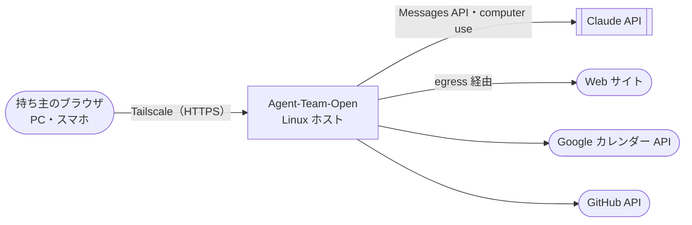
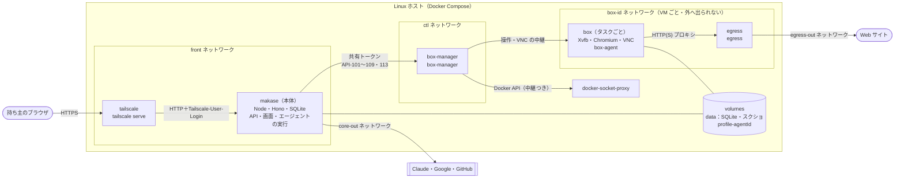
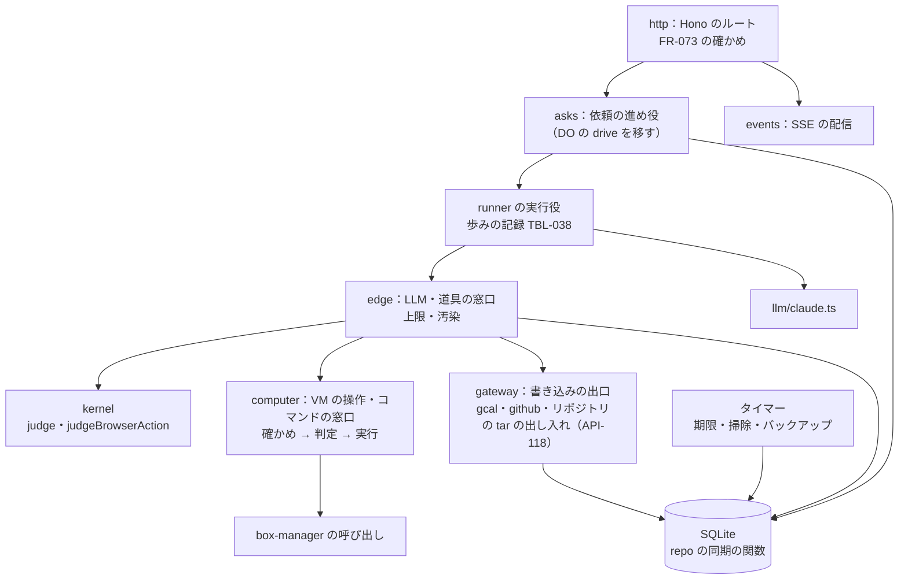

# 07. システムアーキテクチャ
- プロジェクト：Agent-Team-Open ／ 版数：v0.5（2026-10-24） ／ インプット：[04_functional_spec](04_functional_spec.md)、[05_non_functional](05_non_functional.md)

> **3行で**
> 1. 1台の Linux ホストの上で、Docker Compose で6種類のコンテナを動かす：Tailscale・本体・box-manager・Docker の中継・egress・VM（タスクごと）。
> 2. 本体は Node＋SQLite の1プロセス。Cloudflare 版の WorkspaceDO・Workflows・D1 は、SQLite のファイル1つ・歩みの記録・Tailscale の身元に置き換える。
> 3. 信頼の境界は2本：「本体の画面向けの口には Tailscale のコンテナしか届かない」「VM は1つずつ別の、外へ出られないネットワークにいて、外へは egress しか通れない」。

## 🧭 判断してほしいこと
| # | 種類 | 論点 | 選択肢 | おすすめ（理由） | 決まらないと止まるもの |
|---|---|---|---|---|---|
| R-79 | リスク | box-manager は Docker のソケットを（中継越しでも）書き込みつきで使うので、乗っ取られるとホストを握られる | — | 管理役は決まった操作しか受けない小さなコードにし、VM の中身（イメージ・マウント・権限）は管理役のコードで固定する。中継（docker-socket-proxy）は使う API の種類を絞るだけで、中身までは守れないことを前提にする（[ADR-044](adr/ADR-044-box-manager.md)） | — |
| R-80 | リスク | 本体に Tailscale 以外の道で届くと、ログイン名のヘッダーを偽れる | — | 本体の画面向けの口は front ネットワークの口だけで待ち受ける。front にいるのは Tailscale と本体だけ。本体は ctl では待ち受けない（呼ぶだけ） | — |

## 全体図

見てほしいところ：C4 レベル1。持ち主と外のサービスの間に Agent-Team-Open が1つあるだけ。中はレベル2で見る。

## 要点
- 置き先は Linux ホスト（[ADR-041](adr/ADR-041-linux-host.md)）。配り方は Compose 一式（[ADR-049](adr/ADR-049-docker-compose.md)）
- 本体は Node＋SQLite（[ADR-042](adr/ADR-042-node-sqlite.md)）。gateway も本体の中（[ADR-051](adr/ADR-051-gateway-in-core.md)）
- VM はコンテナ＋Xvfb＋Chromium＋VNC（[ADR-043](adr/ADR-043-box-container.md)）。起こすのは box-manager だけ（[ADR-044](adr/ADR-044-box-manager.md)）
- VM の通信は egress が見る。資格ごとに許可リストを分ける（Chromium：アドレスの判定だけ。ターミナル：`terminal.allow_hosts`）（[ADR-045](adr/ADR-045-egress.md)）。ログインは Tailscale の身元（[ADR-046](adr/ADR-046-tailscale-identity.md)）

---

## 詳細

### レベル2：コンテナ図

見てほしいところ：VM は自分だけのネットワークにいるので、ほかの VM・本体・家の LAN・tailnet には届かない。VM と話せるのは box-manager と egress だけ。本体と egress は、外への出口も別のネットワークにする（同じネットワークにいない）。

| コンテナ | 役割 | ネットワーク | 待ち受け | 常駐 |
|---|---|---|---|---|
| `tailscale` | tailnet に入り、`https://makase.<tailnet>.ts.net` を本体に中継する。利用者のログイン名をヘッダーに付ける | front・ts-out | tailnet だけ | はい |
| `makase`（本体） | API・画面の配信・エージェントの実行・Kernel・gateway・SQLite・タイマー | front・ctl・core-out | front の口の :8080 だけ | はい |
| `box-manager` | VM を起こす・止める・一覧。VM ごとのネットワークを作り、egress をつなぐ。操作・スクショ・VNC の中継 | ctl・sock・各 `box-<id>` | ctl の口の :7000 だけ | はい |
| `docker-socket-proxy` | Docker のソケットの中継。使う API の種類（コンテナ・ネットワーク・ボリュームの作成と削除、イメージの読み取り）だけ通す | sock | sock の口だけ | はい |
| `egress` | VM からの HTTP(S) を中継し、行き先のアドレスを確かめる。資格ごとに許可リストを分ける（Chromium：アドレスの判定だけ。ターミナル：`terminal.allow_hosts`）（D-178） | 各 `box-<id>`・egress-out | 各 `box-<id>` の口の :3128 だけ | はい |
| `box` | 仮想画面・ブラウザ・ターミナル（シェル）。タスクごとに起こす | `box-<id>` だけ | box-agent・VNC（box-manager からだけ。VM ごとのトークン） | いいえ |

- VM ごとのネットワークは `internal: true` で、VM・box-manager・egress の3つだけがいる。Docker の `internal` は外への道をなくすだけで、同じネットワークの中どうしは届くため、VM どうしを分けるのはネットワークを VM ごとにすることで行う
- 本体の待ち受けは、front ネットワークでのアドレスに結びつける（起動のときにそのアドレスを調べる）。ctl では待ち受けない
- docker-socket-proxy は API の種類を絞るだけで、作るコンテナの中身（イメージ・マウント・権限）は絞れない。中身を固定するのは box-manager のコード（[ADR-044](adr/ADR-044-box-manager.md)）

### レベル3：本体のコンポーネント図

見てほしいところ：Cloudflare 版の部品（drive・runner・edge・kernel・repo）をそのまま並べ直した形。新しいのは `computer`（VM の操作とコマンド）と、Workflows の代わりの「歩みの記録」だけ。

### VM の中身
| 部品 | 役割 |
|---|---|
| Xvfb | 1280×800 の仮想画面 |
| 軽いウィンドウマネージャ | Chromium を全画面にする |
| Chromium | キオスクの形（アドレスバー・タブの帯・メニューなし）で、画面いっぱいに1枚。表示の倍率は 1、ページの拡大は 100% に固定。プロフィールのボリュームをユーザーデータに使う。起動のときに、プロフィールのロックファイル（`SingletonLock`・`SingletonSocket`・`SingletonCookie`）を消してから起こす（D-171）。プロキシは egress。WebRTC・QUIC は切る。開発者ツール・ダウンロード・権限の求め（位置・カメラなど）は切る。リモートデバッグは VM の中の 127.0.0.1 だけ |
| x11vnc＋websockify | 画面の配信（VNC over WebSocket）。見るだけ・操作の2つの口 |
| シェル（bash）・git・Node・Python・よく使う CLI | ターミナル。コマンドは box-agent が実行する（D-178） |
| box-agent | 操作の実行（xdotool）・スクショ・操作の先の確かめ（CDP）・`open_url`（CDP の `Page.navigate`。`http`・`https` だけ受ける（D-158））。操作は1つずつ実行し、操作 ID と `control_epoch` を確かめる。コマンドの実行（API-117）・tar の出し入れ（API-118）。コマンドのプロセスには egress のターミナル用の資格を環境変数（`HTTPS_PROXY`）で渡す |

画面の座標と CDP の対応：
- キオスクで倍率 1 なので、画面の座標はそのまま、前に出ているタブのページの座標になる。box-agent は前に出ているタブを1つだけ扱う。新しいタブ・窓が開いたら、そのタブを前に出して Claude に知らせる
- `DOM.getNodeForLocation` で一番上のフレームの要素を引く。同じ出どころの iframe は中へたどる。ほかの出どころの iframe（別のプロセスのフレーム）は、そのフレームに CDP をつないでたどる。たどれなければ「分からない」（T-6）
- JS のダイアログ（alert・confirm・beforeunload）は CDP で拾い、Claude に文で知らせる。ダイアログへの操作は「分からない」（T-6）として確認に回す

起こすときの決まり（box-manager が固定で付ける。本体からは変えられない）：権限なしの利用者・capability をすべて外す・`no-new-privileges`・ルートは読み取りだけ（`/tmp` とプロフィールだけ書ける）・`/dev/shm` 512MB・メモリ 1.5GB・CPU 1.5・プロセス 512・その VM のネットワークだけ・DNS は持たせない（名前は egress が引く）。

### 技術スタック
| レイヤー | 採用技術 | 理由 | 代替案 |
|---|---|---|---|
| フロントエンド | React＋Vite（PWA）の `apps/web` | 今のもの | — |
| 画面の配信 | noVNC（画面の側）＋x11vnc | 見るだけ・操作の切り替えが簡単。arm64 で動く | CDP の screencast（ブラウザの中しか映らず、ダイアログが見えない） |
| バックエンド | Node 24 LTS・Hono（`@hono/node-server`）・TypeScript | Hono のルートをそのまま使える | workerd を自分で動かす（ADR-042） |
| DB | SQLite（`better-sqlite3`）、WAL | DO の同期の repo の関数をそのまま使える | PostgreSQL（ラズパイには重い） |
| 長い実行 | 本体の中の実行役＋歩みの記録（TBL-038） | Workflows の「やり直し・再開」を最小で置き換える | ジョブキューのライブラリ（依存が増える） |
| 認証 | Tailscale の身元（`tailscale serve` のヘッダー） | ログイン画面が要らない | パスキー・合言葉（ADR-046） |
| LLM | Claude（公式 SDK、computer use ツール。既定 `claude-opus-5-5`）。接続先は `.env` で Anthropic 直・Bedrock（`@anthropic-ai/bedrock-sdk`）・Vertex（`@anthropic-ai/vertex-sdk`）を選ぶ（FR-087） | 2026-10-23 の決定。企業導入で AWS・GCP の契約を使えるようにする（ADR-056） | 他社の LLM（computer use の前提が崩れる） |
| VM | Docker のコンテナ（Debian slim・Xvfb・Chromium） | ラズパイ・WSL2 でそのまま動く | microVM・QEMU（ADR-043） |
| 外への中継 | 小さな HTTP(S) プロキシ（CONNECT を受け、名前を引いてからアドレスを確かめる） | 家の LAN と tailnet を確実に外せる | iptables の規則（ホストの設定が環境ごとに違う） |
| 配り方 | Docker Compose v2、イメージは arm64・amd64 の両方 | どの Linux でも同じ手順 | 本体は systemd（ADR-049） |

### 移すもの・変えるもの
| Cloudflare 版 | Linux 版 |
|---|---|
| WorkspaceDO（SQLite・RPC） | 本体の中のモジュール。repo の同期の関数は使い続け、その下の `WsDb`（`db/sqlite.ts`。`SqlStorage` の `exec().toArray()`・`.one()` に依っている）を `better-sqlite3` の上に作り直す。接続の設定は [08 方針](08_database.md#方針) |
| RPC で値にして返していた失敗（`write.ts` の WriteResult・`edge/fault.ts` の EdgeOutcome） | 同じプロセスになるので、普通の例外に戻してよい（戻すかは移すときに決める） |
| LLM（`llm/claude.ts`・`edge/validate.ts`） | 会話の形を広げる：道具の結果に画像（スクショ）を入れられるようにし、computer use の専用の道具の宣言を足す。今は会話の中身も道具の結果も文字列だけで、道具はすべて `input_schema` の形で宣言している。画像の入力トークンも費用の見積もりに入れる。会話に残すスクショは直近 3 枚だけ（`browser.keep_screenshots`、既定 3）。古いものは「（スクショは省略）」の文に置き換える（D-161） |
| D1（users・memberships・sessions） | なくす。持ち主は `OWNER_LOGIN`（ADR-046） |
| Workflows（PlanAsk・TaskRun） | 本体の実行役＋歩みの記録。`step.do` の形をそのまま真似る（ADR-042） |
| DO の alarm・Cron Triggers | 本体のタイマー（毎分：期限切れ・止まった VM の片付け、毎時：掃除、毎日：バックアップ・スクショの消去） |
| Static Assets | 本体が `apps/web` のビルドを配る |
| Workers secrets | `.env` |
| Google ログイン（`auth/`） | なくす |
| Sandbox SDK（未定だった作業場） | VM のターミナル（FR-086）。旧 sandbox の tar の控えと道具名を再利用 |
| `pack_installs`・planner の pack | 用途ごとのパック（FR-085）。定義は JSON ファイル |

### デプロイ構成・環境
| 環境 | 中身 |
|---|---|
| 開発 | 開発者の WSL2 で同じ Compose（本体だけ `pnpm dev` に差し替える上書きファイルを用意） |
| 本番 | 持ち主のホスト1台ごと。ホストどうしは独立（D-130） |

ホストごとの下ごしらえ（手順書に書く）：
| ホスト | Linux | Docker |
|---|---|---|
| ラズパイ 4/5 | Raspberry Pi OS 64bit | Docker Engine |
| Win ノート | WSL2（Ubuntu）。WSL を自動で止めない設定 | WSL の中の Docker Engine か Docker Desktop |
| Mac | OrbStack か Colima の Linux | その中の Docker |
| Linux PC | そのまま | Docker Engine |

### 認証・認可方式
- 持ち主の確かめは FR-073。`tailscale serve` が付ける `Tailscale-User-Login` を、`OWNER_LOGIN` と比べる
- 本体 ↔ box-manager：起動のたびに作る共有トークン（`BOX_MANAGER_TOKEN`、`.env`）
- box-manager ↔ VM：VM ごとに作るトークンを、起こすときに環境変数で渡す
- 認可：持ち主1人なのでロールは持たない

### 外部連携
| 相手 | 使い方 | 通る道 |
|---|---|---|
| Claude API（Anthropic 直・Bedrock・Vertex のいずれか） | Messages API・computer use ツール。接続先で使えない道具は出さない（FR-087） | 本体から直接（core-out） |
| Google カレンダー | OAuth（戻り先は ts.net の URL）・予定の作成と削除 | 本体の gateway から |
| GitHub | GitHub App のインストールのトークン | 本体の gateway から |
| Web サイト | VM の Chromium・`web_fetch` | VM は egress 経由。`web_fetch` は本体から（今の汚染のルールのまま。egress と同じアドレスの判定をかけ、リダイレクト先も判定し直す：D-164） |
| Tailscale | tailnet・HTTPS の証明書・利用者の身元 | tailscale コンテナ |

### ログ・監視・エラー通知
- ログは JSON の行を標準出力に（NFR-079）。秘密はマスクする
- ホストの状態は SCR-023 と API-111 で見る。外の監視の仕組みは置かない
- 本体が落ちたら Compose の `restart: unless-stopped` で起こし直し、FR-084 で続ける

### 主要な設計判断（ADR）
| ADR | 決定 | 状態 |
|---|---|---|
| [ADR-041](adr/ADR-041-linux-host.md) | 置き先は Linux ホスト。Cloudflare はいったん外す | 承認 |
| [ADR-042](adr/ADR-042-node-sqlite.md) | 本体は Node＋SQLite、Workflows は歩みの記録に | 承認 |
| [ADR-043](adr/ADR-043-box-container.md) | VM はコンテナ＋仮想画面＋VNC | 承認 |
| [ADR-044](adr/ADR-044-box-manager.md) | VM を起こせるのは box-manager だけ | 承認 |
| [ADR-045](adr/ADR-045-egress.md) | VM の外への通信は egress だけ。資格ごとに許可リストを分ける | 承認 |
| [ADR-046](adr/ADR-046-tailscale-identity.md) | ログインは Tailscale の身元 | 承認 |
| [ADR-047](adr/ADR-047-risky-action-check.md) | こわい操作は申告＋合図で確認 | 承認 |
| [ADR-048](adr/ADR-048-profile-per-agent.md) | プロフィールはエージェントごと、VM はタスクごと | 承認 |
| [ADR-049](adr/ADR-049-docker-compose.md) | 配り方は Docker Compose 一式 | 承認 |
| [ADR-050](adr/ADR-050-one-agent-per-ask.md) | 1件の依頼はエージェント1人 | 承認 |
| [ADR-051](adr/ADR-051-gateway-in-core.md) | gateway は本体の中の部品 | 承認 |
| [ADR-052](adr/ADR-052-browser-checks-table.md) | ブラウザの確認は別の表 `browser_checks` | 承認 |
| [ADR-053](adr/ADR-053-pack-by-purpose.md) | パックは「用途」の単位 | 承認 |
| [ADR-054](adr/ADR-054-terminal-in-vm.md) | ターミナルは VM の中。確認は VM の外に効くものだけ | 承認 |

## このドキュメントで決まったこと
- 上の ADR-041〜054、D-122、D-123、D-132、D-136〜D-138、D-161、D-164、D-168、D-171、D-172、D-176、D-178、D-182
