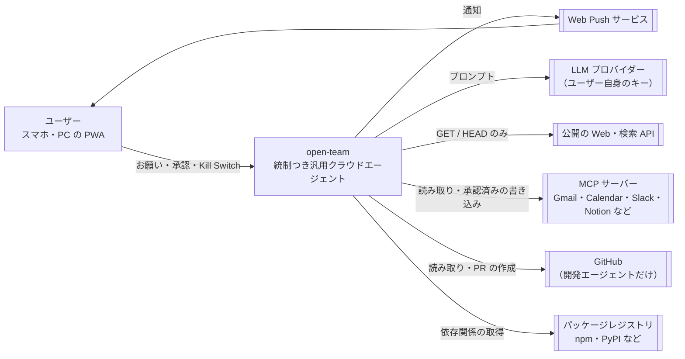
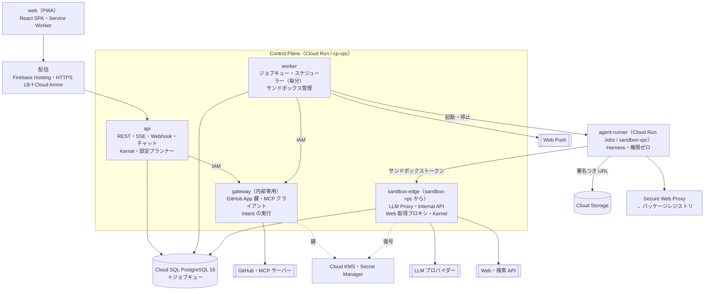
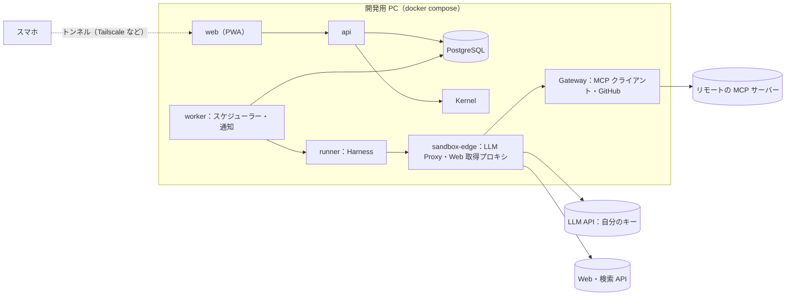
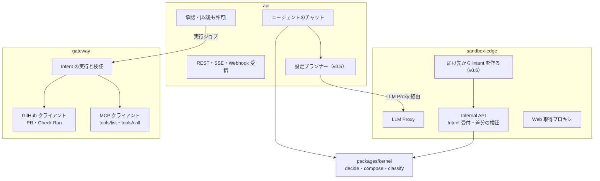
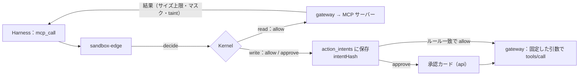

# 07. システムアーキテクチャ
- プロジェクト：open-team（仮称） ／ 版数：v0.6（2026-10-01、12〜15 を統合して書き直し） ／ インプット：[04 機能仕様](04_functional_spec/README.md)、[05 非機能要件](05_non_functional.md)、[06 画面・UX設計](06_ux_design/README.md)、docs/concept.md §4

> **3行で**
> 1. 外部作用（GitHub・MCP の書き込み）を実行できるのは `gateway` だけ、LLM と Web に出られるのは `sandbox-edge` だけ。判定は全サービス共通の純粋関数（Kernel）で、状態の正本は PostgreSQL。
> 2. フェーズ0はプロダクトオーナーの PC で docker compose（単一ユーザー）、フェーズ1以降は Google Cloud（Cloud Run・Cloud SQL・Cloud Run Jobs）。Kernel・監査ログ・Intent はどちらも同じものを使う。
> 3. サンドボックスには認証情報を置かず、通信先も絞る。技術選定の理由と代替案は [ADR-001〜031](#主要な設計判断adr)。

## 🧭 判断してほしいこと
| # | 種類 | 論点 | 選択肢 | おすすめ（理由） | 決まらないと止まるもの |
|---|---|---|---|---|---|
| Q-48 | 未決 | サービス間の経路の2点。① `cp-vpc` 側から LLM を呼ぶ経路：要約・設計アシスタント（`worker`）と v0.5 の設定プランナー（`api`）は LLM Proxy を通す前提だが、`sandbox-edge` は `sandbox-vpc` からだけ届く（旧 07・12 未決事項、14 §既存ドキュメントへの影響）。② `sandbox-edge` → `gateway`：13 の MCP の経路は `sandbox-edge` から `gateway` を呼ぶが、旧 07 は `gateway` を「`api` と `worker` からだけ呼べる」としている（13「呼び出しの経路」、旧 07「デプロイ単位」） | ①A: `cp-vpc` からの内部呼び出しを許す / ①B: 共通パッケージとして `worker`・`api` の中で動かす（BYOK の復号権限が `sa-worker`・`sa-api` にも要る）。② 本文に選択肢なし | —（元の記述なし） | NFR-021, NFR-022, ADR-002, ADR-010, 設定プランナー, MCP の読み取り |
| Q-49 | 未決 | サンドボックス基盤の比較検証（Cloud Run Jobs / E2B / Fly Machines で、起動時間・隔離の強さ・通信制限・費用を比べる）。あわせて、フェーズ2のブラウザのサンドボックスの基盤（Cloud Run Jobs で動かせるか、遠隔操作の画面配信の方式。12 未決事項 v0.3） | — | —（元の記述なし。ADR-008 は「ベータ前に検証」） | ADR-008, ADR-019, NFR-009, NFR-020 |
| Q-100 | トレードオフ | Cloud SQL を高可用性構成（HA）にするか。HA なしでは NFR-001（99.5%）を下回るおそれ、HA にすると NFR-048（$500/月）を圧迫する | — | —（元の記述なし。旧 07 未決事項） | NFR-001, NFR-048 |
| Q-101 | 未決 | YAML のコメントを保持した部分的な書き換え（FR-025。v0.5 で詳細設定の Canvas に移動）に使うライブラリが未定。定義を書き換えるとコメントが失われるおそれ | — | —（元の記述なし。旧 07 未決事項） | FR-025, SCR-016 |

- クラウド・複数ユーザー構成はフェーズ1から（[D-02](decisions.md#d-02)）。フェーズ0の鍵は `.env`、暗号化はフェーズ1から（[D-04](decisions.md#d-04)）。

## 全体図
C4 レベル1（コンテキスト）。open-team を1つの箱として、外とのつながりだけを描く。


見てほしいところ：エージェントの外部作用（書き込み）が出ていくのは MCP と GitHub の2本だけで、承認（またはルール）を通った Intent に限る。Web へは読み取りだけ。

## 要点
- 書き込みのチョークポイントは `gateway` の1つ。GitHub App の秘密鍵と MCP の認証情報を持つのも `gateway` だけ（[レベル2](#レベル2コンテナ図フェーズ1以降)、ADR-002、ADR-022）。
- サンドボックスには認証情報がなく、届くのは `sandbox-edge` と許可したレジストリだけ（NFR-018、NFR-019、ADR-003）。
- Web の読み取りは `sandbox-edge` の Web 取得プロキシ経由だけ（[Web 取得プロキシ](#web-取得プロキシ)、ADR-023）。
- 判定（`decide()`）・合成（`compose()`）・変更の分類（`classify()`）は `packages/kernel` の純粋関数で、どのサービスも同じものを使う（[レベル3](#レベル3コンポーネント図)、ADR-001・012・027）。
- フェーズ0は docker compose の単一ユーザー構成で、マルチテナント・RLS・Cloud Run・KMS 署名・SLA を省略する（[違いの表](#フェーズ0とフェーズ1以降の違い)、ADR-025）。
- 設定プランナー（v0.5）は `api` の中で動き、LLM Proxy を通す（[設定プランナーの位置](#設定プランナーの位置)）。

---

## 詳細

## レベル2：コンテナ図（フェーズ1以降）


見てほしいところ：`agent-runner` から出る矢印は `sandbox-edge`・Secure Web Proxy・署名つき URL の3本だけ。GitHub・MCP へは `gateway` からしか出ない。

- 図で省いた線：GitHub の Webhook は LB 経由で `api` へ。`api` は KMS で暗号化、`worker`・`gateway`・`sandbox-edge` は GCS に書き込む（詳細は [認証・認可方式](#認証認可方式) のサービスアカウント表）。
- `sandbox-edge` から MCP の読み取りは `gateway` を経由する（[MCP の呼び出しの経路](#mcp-の呼び出しの経路)。呼び出し元の制限との関係は Q-48 ②）。
- `gateway` が行うエージェント定義の PR（`.agent/` 配下のみ。BR-28）と、`.agent/**` を変更する PR（open-team が作ったものに限らない）への Check Run は、ユーザーの操作または検証結果の表示であり、エージェントの Intent ではない。

## レベル2：コンテナ図（フェーズ0・ローカル）


見てほしいところ：コンテナの分け方と経路（runner → sandbox-edge → Gateway）はフェーズ1以降と同じ。違うのは置き場所と、省略するもの（次の表）。

## フェーズ0とフェーズ1以降の違い

| 項目 | フェーズ0（単一ユーザー・ローカル） | フェーズ1以降（クラウド） |
|---|---|---|
| 実行場所・起動 | 開発用 PC。`docker compose up` の1コマンド。設定は `.env`（LLM の API キー、検索 API のキー、通知の VAPID 鍵） | Google Cloud（asia-northeast1）。Cloud Run・Cloud SQL・Cloud Run Jobs |
| ユーザー・認証 | 単一ユーザー。サインインは省略し、固定トークンで画面を守る（[D-06](decisions.md#d-06)）。DB には利用者1人・ワークスペース1つの行を初期投入する（[D-05](decisions.md#d-05)） | GitHub OAuth → サーバー側セッション（[認証・認可方式](#認証認可方式)） |
| タスクの実行環境 | 開発以外のタスクはコンテナ内のプロセス。開発タスクは使い捨てのコンテナ | タスクごとに Cloud Run Jobs（ADR-008） |
| スマホから使う | Tailscale などのトンネルで PWA を開き、ホーム画面に追加してプッシュ通知を受ける（A-74） | 公開の HTTPS |
| PC・サービスが止まっているとき | スケジュールは実行されない。次の起動時に取りこぼしたスケジュールは実行せず、アクティビティに「未実行」と残す（A-75） | NFR-001 の稼働率 |
| MCP サーバー | リモート（Streamable HTTP）。ローカルの stdio サーバーはコンテナ内での起動を許す（A-71） | リモートだけ（stdio は扱わない。A-71） |
| 統制 | フェーズ1と同じ Kernel・監査ログ・Intent（単一ユーザーでも省略しない） | 同左 |
| 省略するもの | マルチテナント・RLS・Cloud Run・KMS（エンベロープ暗号化・チェックポイントの署名）・SLA（設計は残す） | — |

- 開発者向けのローカル環境 `dev`（Fake の GitHub・スタブの LLM）とは別物。`dev` は [デプロイ構成・環境](#デプロイ構成環境)。

## レベル3：コンポーネント図

複雑な3つのコンテナ（`api`・`sandbox-edge`・`gateway`）の中の部品。Kernel はどれにも同じものが入る。


見てほしいところ：判定・合成・分類は Kernel の1か所だけ。実行（`EXE`）は承認を経た Intent しか受け取らない。

## MCP の呼び出しの経路


見てほしいところ：読み取りは結果がエージェントに戻る（タスクは `tainted` になる）。書き込みは Intent になり、エージェントは結果を待たない。

- 書き込みの Intent では引数をそのまま承認カードに表示し、承認は intentHash（コネクタ・ツール・引数・ツールのハッシュ・実効ポリシーのハッシュ）に紐づける（ADR-005）。
- 実行は自動で再試行しない。結果が分からなければ `unknown_outcome`。検証はツールごとに `none` / `readback`（ADR-031）。
- 判定の評価順・Gateway での実行の手順は 04、シーケンス図と状態遷移は [10](10_diagrams/README.md)。

## Web 取得プロキシ

- `web_search` は外部の検索 API（プロバイダーは設定で選ぶ。キーはユーザーのもの。A-72）、`web_fetch` は Web 取得プロキシを通す。サンドボックスから直接インターネットに出る経路は作らない（`shell_network` は deny のまま。ADR-023）。
- プロキシは GET / HEAD のみを通し、私的アドレス・メタデータのアドレス・`deny_domains` を拒否する。Cookie や認証ヘッダーは送らない。リダイレクト先も同じ規則で判定する。
- 取得した本文は HTML からテキストを抽出し、`<untrusted source="url">…</untrusted>` で囲んでモデルに渡す（本文は最大 200KB、1タスク30回まで。A-77）。
- ログインが要るページは対象外（フェーズ2の統制つきブラウザ、ADR-019）。

## 設定プランナーの位置

- 設定プランナー（v0.5、FR-024 の設計アシスタントを置き換え）は `api` の中で動き、エージェントのチャットから呼ばれる。LLM の呼び出しは LLM Proxy を通す（経路の実体は Q-48）。
- 入力は「お願い ＋ 現在の定義 ＋ ワークスペースのポリシー ＋ 使えるコネクタの一覧」、出力はエージェント定義の差分（JSON）だけ。FR-022 の検証を通らなければ反映しない。
- 差分は `api` から Kernel の `classify()` にかけ、`widen` は確認カードで承認を待つ。反映時に `compose()` でスナップショットを作り、スケジューラーにトリガーを登録する（ADR-027）。
- タスクとは別の呼び出しで、外部の内容を読まないので `tainted` にならない。会話に貼られた外部の文章は、ユーザーの発言として記録する。
- モデルは routing の `plan`（ワークスペースで最も性能の高いモデル）。1回 $0.05 程度（A-82）。

## 技術スタック

<details>
<summary>レイヤーごとの採用技術・理由・代替案（14行）</summary>

| レイヤー | 採用技術 | 理由 | 代替案 |
|---|---|---|---|
| フロントエンド | React 19 + TypeScript + Vite（SPA）、TanStack Query、Tailwind CSS、vite-plugin-pwa | SSR が不要（ログイン後のアプリだけ）。PWA と JS サイズの目標（NFR-044）を満たしやすい。open-agent の Canvas（React）を将来取り込める | Next.js（SSR が不要なため構成が重くなるだけ） |
| バックエンド | Node.js 22 + TypeScript、Hono、Zod（入力検証） | itiwoman と open-agent の TypeScript 資産をそのまま使える（A-02）。Hono は軽く、Cloud Run での起動が速い | Go（資産を再利用できない）、NestJS（MVP には重い） |
| 判定・ポリシー | 自作の Kernel（`packages/kernel`）＋ JSON Schema（Ajv）＋ micromatch | 判定と合成（`compose()`）を純粋関数として持ち、再現性（NFR-036）と速さ（NFR-007）を保証する | Cedar / OPA（ADR-009） |
| DB | Cloud SQL for PostgreSQL 16（フェーズ0はローカルの PostgreSQL） | 判定・状態遷移・監査ログを1トランザクションで書ける。RLS でテナントを分離できる（NFR-027） | Firestore（トランザクションと SQL での集計が弱い） |
| ジョブキュー | graphile-worker（PostgreSQL 上） | 状態の変更とジョブの登録を1トランザクションで行える（ADR-006） | Cloud Tasks / Pub/Sub（DB との二重書き込み） |
| リアルタイム配信 | SSE ＋ PostgreSQL の LISTEN/NOTIFY | 一方向で十分。HTTP のまま扱える（ADR-007） | WebSocket |
| 認証 | GitHub App の user-to-server OAuth ＋ サーバー側セッション（フェーズ0は省略） | GitHub のアカウントだけで使え、リポジトリ権限も確認できる | Auth0 / Firebase Auth（GitHub との権限連携が別に必要） |
| サンドボックス | Cloud Run Jobs（`SandboxProvider` で抽象化。フェーズ0はローカルの Docker） | タスク単位で起動・破棄でき、gVisor で隔離、VPC と Secure Web Proxy で通信先を制限できる（ADR-008） | E2B、Fly Machines、自前の Firecracker |
| 通信の制限 | Secure Web Proxy（ホスト名の許可リスト）＋ VPC のファイアウォール | ホスト名で許可でき、IP で管理しきれないレジストリに対応できる | Squid を自前で運用する |
| インフラ | Google Cloud（Cloud Run、Cloud SQL、Cloud Storage、KMS、Secret Manager） | マネージドでそろい、ベータのコスト（NFR-048）に収まる | AWS（Fargate + RDS）、Fly.io |
| 静的配信 | Firebase Hosting | CDN と HTTPS をすぐに使える | Cloud Storage + Cloud CDN |
| 通知 | Web Push（VAPID、`web-push` ライブラリ） | ネイティブアプリを作らない方針（制約） | FCM を直接使う |
| 監視 | Cloud Logging、Cloud Monitoring、Error Reporting、フロントエンドは Sentry | GCP 標準で揃う。フロントのエラーだけ Sentry | Datadog（コスト） |
| CI/CD | GitHub Actions ＋ Workload Identity Federation ＋ Artifact Registry | 長期間有効なクラウドの鍵を CI に置かない | Cloud Build |
| リポジトリ構成 | pnpm workspaces ＋ Turborepo のモノレポ | 共通パッケージ（kernel・db・policy-schema）を各サービスで共有する | 複数リポジトリ |

</details>

## コンポーネント構成と責務

デプロイ単位（apps/）6つと共有パッケージ（packages/）10個の責務・主な FR は [07_architecture/components.md](07_architecture/components.md)。要点だけ：

- `gateway`：GitHub App の鍵と MCP の認証情報を持ち、Intent を実行する唯一のサービス（内部専用）。
- `sandbox-edge`：LLM Proxy・Internal API・Web 取得プロキシ。`sandbox-vpc` からだけ届く。
- `packages/kernel`：`decide()`・`compose()`・`classify()`・intentHash・汚染の記録。

## デプロイ構成・環境

| 環境 | 用途 | 構成の違い |
|---|---|---|
| フェーズ0 | プロダクトオーナーの自己利用 | [フェーズ0の構成](#レベル2コンテナ図フェーズ0ローカル)。本物の LLM（自分のキー）・MCP サーバー |
| `dev` | 開発者のローカル | Docker Compose（PostgreSQL・MinIO）、`github` は Fake、`SandboxProvider` はローカルの Docker（`--network` で通信先を制限）、LLM は録画した応答を返すスタブ |
| `stg` | 結合確認 | GCP の別プロジェクト。本番と同じ構成で Cloud SQL は最小サイズ。GitHub App もステージング用に別に登録 |
| `prod` | 本番 | GCP の本番プロジェクト（asia-northeast1）。Cloud SQL は PITR を有効にする |

- GCP のプロジェクトを環境ごとに分け、サービスアカウントもサービスごと・環境ごとに分ける。
- コンテナイメージは同じものを `stg` から `prod` に昇格させる（ビルドし直さない）。

## 認証・認可方式

| 主体 | 認証 | 認可 |
|---|---|---|
| ユーザー（ブラウザ） | GitHub OAuth → サーバー側セッション（Cookie `ot_session`）＋ CSRF トークン。フェーズ0は固定トークン → Cookie（D-06） | ロール（memberships.role）と承認者の判定（BR-14）。GitHub 上の書き込み権限（タスクの作成時） |
| GitHub（Webhook） | HMAC-SHA256 の署名 | — |
| サンドボックス | サンドボックストークン（Bearer。DB にはハッシュだけ。タスクの終了で失効） | 自分のタスクのリソースだけ |
| サービス間（`api`/`worker` → `gateway`） | Google の ID トークン（Cloud Run の IAM 呼び出し元の制限） | 呼び出し元のサービスアカウントで制限する |
| DB | サービスごとの DB ユーザー | `audit_logs` は INSERT と SELECT だけ。RLS で `organization_id`（ワークスペースへの改名は 08）を強制する |

<details>
<summary>サービスアカウントと権限（最小権限、5つ）</summary>

| サービスアカウント | 持つ権限 |
|---|---|
| `sa-api` | Cloud SQL クライアント、KMS（`kek-credentials` の暗号化だけ・`kek-user-tokens` の暗号化と復号）、`gateway` の呼び出し |
| `sa-worker` | Cloud SQL クライアント、Cloud Run Jobs の実行とキャンセル、GCS（snapshots・audit-checkpoints の書き込み）、KMS（`checkpoint-signing` の署名）、`gateway` の呼び出し |
| `sa-gateway` | Cloud SQL クライアント、Secret Manager（GitHub App の秘密鍵）、GCS（snapshots の読み書き） |
| `sa-sandbox-edge` | Cloud SQL クライアント、KMS（`kek-credentials` の復号）、GCS（transcripts の書き込み、snapshots の署名つき URL の発行） |
| `sa-sandbox` | **なし** |

- エージェントビルダー（12）による IAM ロールの追加はない。Check Run の作成と `issue_comment`・`pull_request`（`opened` / `synchronize`）の購読は GitHub App 側の権限の追加（A-43）で、`sa-gateway` の秘密鍵をそのまま使う。
- 設計アシスタントは要約と同じく `sandbox-edge` の内部関数を経由するので、BYOK のキーを復号できるのは `sa-sandbox-edge` だけのまま（NFR-022）。設定プランナー（v0.5）の経路は Q-48。

</details>

## 外部連携

<details>
<summary>連携先ごとの方式と使う機能（7つ）</summary>

| 連携先 | 方式 | 使う機能 | 備考 |
|---|---|---|---|
| GitHub | GitHub App（REST API v3、Webhook）、OAuth（user-to-server） | ログイン、インストール、Issue・ファイル・tarball の取得、Git Data API（blob・tree・commit・ref）、PR の作成と取得。Webhook：`issue_comment`、デフォルトブランチへの `push`、`pull_request.opened` / `synchronize` / `closed`。エージェント定義の PR（`.agent/` のみ）、Check Run `open-team/agent-config` | インストールトークンは1時間で失効し、リポジトリと権限を絞って発行する。レート制限：インストールごとに 5,000回/時。`issue_comment` の購読と `checks: write` を追加（A-43）。v0.4 から開発エージェント用の連携の1つ |
| MCP サーバー（v0.4） | Streamable HTTP（`gateway` の MCP クライアント） | `tools/list`（ツール名・説明・入力スキーマ・注釈）、`tools/call` | フェーズ0は URL と認証情報（API キー or OAuth）で登録、フェーズ1はカタログから OAuth。認証情報は `gateway` だけが暗号化して持つ |
| 検索 API（v0.4） | HTTPS（`sandbox-edge`） | `web_search` | プロバイダーは設定で選ぶ。キーはユーザーのもの（A-72） |
| 公開の Web（v0.4） | HTTPS（Web 取得プロキシ） | `web_fetch`（GET / HEAD） | [Web 取得プロキシ](#web-取得プロキシ) |
| LLM プロバイダー | HTTPS（各社の API） | テキスト生成（ツール呼び出しを含む）、モデル一覧（キーの疎通確認） | BYOK。呼び出すのは `sandbox-edge` と、要約と設計アシスタントの変更案を作る `worker`（`sandbox-edge` の内部関数経由。`phase=design`）、設定プランナー（`api`、v0.5） |
| Web Push サービス | Web Push プロトコル（VAPID） | 通知の送信 | |
| パッケージレジストリ | HTTPS（Secure Web Proxy 経由） | 依存関係のインストール | 許可リスト（NFR-019） |

</details>

- **価格表**：LLM の単価は `packages/router/pricing.json`（プロバイダー・モデル・入力と出力の単価）で管理し、リリースと一緒に更新する。価格表にないモデルは routing で指定できない（検証エラー）。

## ログ・監視・エラー通知

- **構造化ログ**：全サービスが JSON で出す。必須フィールドは `severity`、`requestId`、`orgId`、`taskId`、`service`。秘密情報のパターン（`ghs_`、`sk-`、`Authorization`、`Cookie`）は出力前にマスクする（NFR-032）。
- **アラート**：NFR の目標を5分間下回ったら、運営チームのチャットに通知する（NFR-031）。`external_actions_after_kill_total > 0` と `audit_verify_failures_total > 0` は重大度 Critical として即時に通知する。
- **エラー通知**：バックエンドは Error Reporting、フロントエンドは Sentry。

<details>
<summary>メトリクス（Cloud Monitoring のカスタム指標）と NFR の対応（14行）</summary>

| 指標 | 対応する NFR |
|---|---|
| API のレイテンシ（p95・p99）、エラー率 | NFR-006 |
| `kernel_decision_duration_ms` | NFR-007 |
| `task_start_latency_seconds`（queued → running） | NFR-009 |
| `push_delivery_latency_seconds` | NFR-010 |
| `killswitch_stop_latency_seconds` | NFR-012 |
| `external_actions_after_kill_total`（常に0であるべき） | NFR-013 |
| `sandbox_concurrent`、`sandbox_cost_usd` | NFR-014, NFR-049 |
| `audit_verify_failures_total` | NFR-028 |
| `agent_definition_apply_seconds`（push 受信 → `active`） | NFR-051 |
| `schedule_trigger_lag_seconds`（`next_run_at` → タスク作成） | NFR-052 |
| `agent_disable_stop_latency_seconds`（停止の押下 → 全タスク停止） | NFR-053 |
| `design_assistant_first_event_seconds`、`design_assistant_patch_seconds` | NFR-054（扱いは 11 Q-94） |
| `agent_draft_validate_duration_ms`（API-046） | NFR-055（扱いは 05 Q-42） |
| `dry_run_cost_usd`、`design_assistant_cost_usd`（下書きごと） | NFR-059（設計アシスタントの部分は 11 Q-94） |

</details>

## フェーズ2の構成の概要

フェーズ1の仕組み（エージェント定義・実効ポリシー・Intent・Gateway）をそのまま広げる。詳細はフェーズ1の実装の後に設計する（12「フェーズ2の設計概要」の時点の内容）。

- **コントロールリポジトリ（REQ-031）**：置き換え済み（v0.4、→ REQ-045 ワークスペースのポリシー、ADR-021）。元の設計：組織に `<org>/.open-team` リポジトリを置き、`policy.yaml` を組織共通の上限として `compose(ceilings, orgPolicy, repoPolicy, agentDef)` に加え、`agents/*.yaml` にコードリポジトリに属さないエージェントを置き、空の作業領域で起動する。
- **Slack（REQ-029）**：Slack App を追加し、`slack` トリガー（メンション・DM）とスレッドへの進捗の投稿を行う。Slack ユーザーとの紐づけは Slack 上のリンクから Web でサインインして行う。承認はこれまでどおり Web の承認カード（A-22）。Slack から承認する場合の再認証の方式は未決（04 側で扱う）。
- **エージェント間の委任（REQ-032）**：`delegate` の Intent とし、`delegation.allow: [agent-id]` の相手にだけ委任できる。委任先の予算は委任元の残りから切り出し、深さは2まで。委任先は `parent_task_id` を持ち、委任元の停止で一緒に止まる。
- 永続ワークスペース（ADR-020）、統制つきブラウザ（ADR-019）もフェーズ2。

<details>
<summary>連携先とその作用（REQ-030）：v0.3 時点のアダプター方式の設計（v0.4 で MCP に置き換え、ADR-022）</summary>

```yaml
# エージェント定義への追加（フェーズ2、v0.3 時点）。read_channel は読み取り、post_message は外部作用
connectors:
  slack:  { actions: { read_channel: auto, post_message: approve }, scope: { channels: ["#dev-announce"] } }
  notion: { actions: { create_page: approve }, scope: { parent_pages: ["Weekly Reports"] } }
```

| 要素 | 内容 |
|---|---|
| 操作の種類 | `<connector>.<action>`。読み取り（`read`）と外部作用（`write`）に分け、外部作用はすべて Intent になる |
| 認証情報 | 組織単位の OAuth トークンを Gateway だけが持つ。エージェントには `scope` で絞った利用権だけを付ける。サンドボックスには渡さない |
| 読み取りの経路 | サンドボックス → sandbox-edge（判定）→ Gateway → 連携先。結果だけをサンドボックスに返す |
| プレビュー | アダプターごとに、承認カードに出す固定の表示（投稿先・本文・添付）を定義する |
| 検証 | 実行後に、作成されたもの（メッセージ・ページ）を取得して、intentHash の対象と一致するかを確かめる |
| 最初の連携先 | Slack（入口と出力を兼ねる）→ Linear → Notion → Google Drive（A-40） |

</details>

## 主要な設計判断（ADR）

<details>
<summary>ADR-001〜031 の一覧（31件）</summary>

| ADR | 決定 | 状態 |
|---|---|---|
| [ADR-001](adr/ADR-001-pure-decision-engine.md) | 判定エンジンを純粋関数にし、状態は DB だけに持つ | 承認 |
| [ADR-002](adr/ADR-002-gateway-holds-github-key.md) | GitHub App の秘密鍵を `gateway` だけに置き、読み取りも経由させる | 承認（v0.2 追記） |
| [ADR-003](adr/ADR-003-cooperative-enforcement-in-sandbox.md) | サンドボックス内は協調的な強制、最終防御は境界と差分の検証 | 承認 |
| [ADR-004](adr/ADR-004-destroy-sandbox-on-intent.md) | Intent を出したらサンドボックスを破棄し、差分をサーバーに保存 | 承認 |
| [ADR-005](adr/ADR-005-approval-bound-to-intent-hash.md) | 承認を intentHash に結びつけ、実行後に tree SHA で検証 | 承認 |
| [ADR-006](adr/ADR-006-postgres-job-queue.md) | ジョブキューを PostgreSQL（graphile-worker）で持つ | 承認 |
| [ADR-007](adr/ADR-007-sse-realtime.md) | リアルタイム配信は SSE | 承認 |
| [ADR-008](adr/ADR-008-cloud-run-jobs-sandbox.md) | サンドボックスは Cloud Run Jobs、`SandboxProvider` で抽象化 | 承認（要検証） |
| [ADR-009](adr/ADR-009-own-policy-evaluator.md) | 判定器は自作（Cedar / OPA を使わない） | 承認 |
| [ADR-010](adr/ADR-010-byok-envelope-encryption.md) | BYOK のキーはエンベロープ暗号化、復号は `sandbox-edge` だけ | 承認 |
| [ADR-011](adr/ADR-011-agent-definition-in-repo.md) | 定義はリポジトリに置き、PR のマージで有効にする | 改訂（v0.3、GitOps モードとして有効 → ADR-017） |
| [ADR-012](adr/ADR-012-stricter-wins-composition.md) | 実効ポリシーは「厳しい方を取る」純粋関数の合成 | 承認 |
| [ADR-013](adr/ADR-013-template-fixed-runtime.md) | ランタイムはテンプレートに固定、ユーザーはコードを書かない | 承認 |
| [ADR-014](adr/ADR-014-server-side-memory.md) | メモリはサーバー側、完了したタスクの書き込みだけ有効 | 承認 |
| [ADR-015](adr/ADR-015-dry-run-same-path.md) | 試し実行は本番と同じ経路、外部作用だけ手前で止める | 承認 |
| [ADR-016](adr/ADR-016-integrations-as-gateway-adapters.md) | 連携先は Gateway のアダプター、ブラウザ操作は不採用（フェーズ2） | 置き換え済み（→ ADR-019 / ADR-022） |
| [ADR-017](adr/ADR-017-in-app-definition-default.md) | 定義の既定はアプリ内、権限を広げる変更だけ承認 | 承認（v0.3） |
| [ADR-018](adr/ADR-018-model-only-tightens.md) | モデルの判断は厳しくする方向にだけ使う | 承認（v0.3） |
| [ADR-019](adr/ADR-019-browser-via-write-blocking-proxy.md) | ブラウザ操作は書き込みの通信をプロキシで止めて採用（フェーズ2） | 承認（v0.3） |
| [ADR-020](adr/ADR-020-ephemeral-compute-persistent-disk.md) | 計算資源は使い捨て、エージェント単位の永続ディスク（フェーズ2） | 承認（v0.3） |
| [ADR-021](adr/ADR-021-workspace-policy.md) | ポリシーの基本はワークスペース、リポジトリは開発用の追加の上限 | 承認（v0.4） |
| [ADR-022](adr/ADR-022-mcp-unified-unclassified-is-write.md) | 連携は MCP に統一、未分類＝書き込み | 承認（v0.4） |
| [ADR-023](adr/ADR-023-builtin-web-read-proxy.md) | Web の読み取りは組み込み、専用プロキシ経由 | 承認（v0.4） |
| [ADR-024](adr/ADR-024-taint-tracking-against-injection.md) | インジェクション対策は汚染の追跡で行う | 承認（v0.4） |
| [ADR-025](adr/ADR-025-phase0-single-user-local.md) | 最初の到達点は単一ユーザー・ローカルのフェーズ0 | 承認（v0.4） |
| [ADR-026](adr/ADR-026-name-and-ask.md) | 作り方は「名前を付けて頼む」、設定はエージェント自身 | 承認（v0.5） |
| [ADR-027](adr/ADR-027-classify-widening-changes.md) | 設定の変更は `classify()` で広げる変更だけ人に戻す | 承認（v0.5） |
| [ADR-028](adr/ADR-028-jobs-as-unit-of-work.md) | トリガー・テンプレート・指示を「仕事」にまとめる | 承認（v0.5） |
| [ADR-029](adr/ADR-029-mcp-arg-roles-destination-fixed.md) | MCP の引数に役割を付け、ルールは宛先をすべて固定 | 承認（v0.6） |
| [ADR-030](adr/ADR-030-declarative-deliver.md) | 届け先は仕事の定義に宣言（ツール `deliver` の廃止） | 承認（v0.6） |
| [ADR-031](adr/ADR-031-mcp-write-no-auto-retry.md) | MCP の書き込みは自動再試行なし・`unknown_outcome`・検証 `none` / `readback` | 承認（v0.6） |

</details>

## 前提・仮定
- A-24：クラウドは Google Cloud を使う（A-19）。
- A-25：サンドボックスは Cloud Run Jobs で、NFR-009（起動 p95 < 60秒）を満たせるものとする（要検証、Q-49）。
- A-26：モノレポ（pnpm workspaces ＋ Turborepo）にし、itiwoman と open-agent のコアをパッケージとして移植する（concept.md の未決事項の推奨案を採用）。
- A-27：LLM の単価はプラットフォームが管理する価格表を使い、プロバイダーの請求額とは突き合わせない（BYOK のため、差は利用者の請求で見える）。
- A-43：GitHub App の権限に `issue_comment` の購読と `checks: write` を追加する。GCP の IAM ロールは増やさない。
- A-54：スケジューラーは `worker` の定期処理として動かし、複数インスタンスでも `FOR UPDATE SKIP LOCKED` で二重に起動しない。
- このほか本書が参照する仮定：A-71（MCP はリモート、stdio はフェーズ0だけ）、A-72（検索 API）、A-74（トンネル）、A-75（取りこぼしたスケジュールは実行しない）、A-77（Web 取得の上限）、A-82（設定プランナーのモデル）。一覧は [00](00_overview.md)。

## このドキュメントで決まったこと
- [ADR-001〜031](#主要な設計判断adr)：上の一覧のとおり。v0.4〜v0.6 の追加は ADR-021〜031。
- 解決済みとして扱った旧未決事項：「コードを書かない利用者（P-5）向けに、PR のマージを経ずに公開する経路を許すか」（旧 07・12 未決事項）→ アプリ内モードを既定にした [ADR-017](adr/ADR-017-in-app-definition-default.md) で決着。
