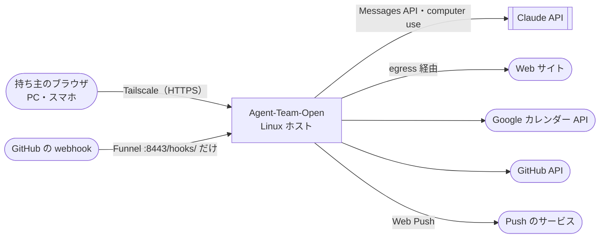
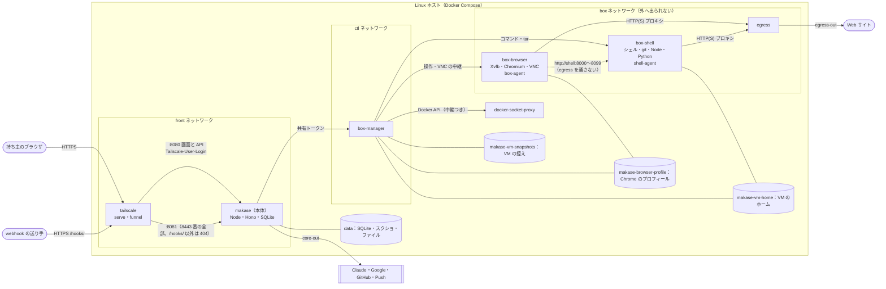
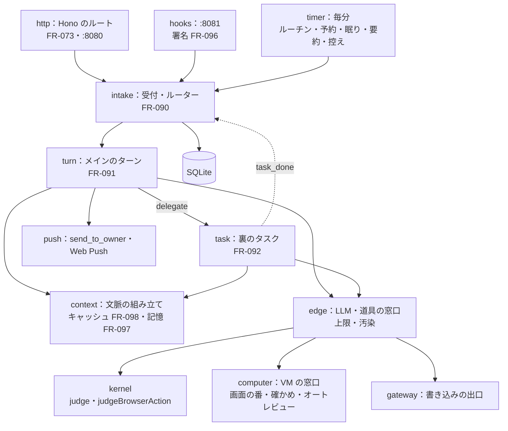

# 07. システムアーキテクチャ
- プロジェクト：Agent-Team-Open ／ 版数：v1.5（2026-10-25） ／ インプット：[04_functional_spec](04_functional_spec/README.md)、[05_non_functional](05_non_functional.md)

> **3行で**
> 1. 1台の Linux ホストの上で、Docker Compose で 7 種類のコンテナを動かす：Tailscale・本体・box-manager・Docker の中継・egress・box-browser・box-shell（この2つの組が VM。持ち主に 1 台。止めても残るホームのボリュームつき）。
> 2. 本体は Node＋SQLite の1プロセスで、受付・ルーター・メインのターン・裏のタスク・タイマー・記憶・文脈の組み立て・オートレビュー・Web Push を持つ。ループと状態はすべて本体にあり、VM には状態を置かない。
> 3. 信頼の境界は3本：「画面と API の口には Tailscale のコンテナしか届かない」「webhook の口は `/hooks/` だけで、署名で確かめる」「VM（2 つのコンテナ）は外へ出られないネットワークにいて、外へは egress しか通れない」。

## 🧭 判断してほしいこと
| # | 種類 | 論点 | 選択肢 | おすすめ（理由） | 決まらないと止まるもの |
|---|---|---|---|---|---|
| R-79 | リスク | box-manager は Docker のソケットを（中継越しでも）書き込みつきで使うので、乗っ取られるとホストを握られる | — | 管理役は決まった操作しか受けない小さなコードにし、VM の中身（イメージ・マウント・権限）は管理役のコードで固定する。中継（docker-socket-proxy）は使う API の種類を絞るだけで、中身までは守れないことを前提にする（[ADR-044](adr/ADR-044-box-manager.md)） | — |
| R-80 | リスク | 本体に Tailscale 以外の道で届くと、ログイン名のヘッダーを偽れる | — | 画面と API の口は front ネットワークの口だけで待ち受ける。front にいるのは Tailscale と本体だけ。webhook の口（:8081）には `/hooks/` しか置かず、身元のヘッダーを読まない | — |
| R-88 | リスク | VM が残るので、前のタスクが残したファイル・Cookie・入れたツールに、ページの仕掛けが残る | — | VM で読んだものは汚染（BR-06）。資格情報を置かない。毎日の控えから戻す・作り直す（FR-100、[ADR-061](adr/ADR-061-vm-no-judge-restore.md)） | — |
| R-89 | リスク | Funnel で公開した webhook の口が攻撃される | — | 別のポート（8443）・別の口・`/hooks/` だけ・128 bit の `hookId`・署名・本文と件数の上限。受け口を作らなければ公開しない（[ADR-065](adr/ADR-065-webhook-funnel.md)） | — |

## 全体図

見てほしいところ：C4 レベル1。入ってくる道は Tailscale（持ち主）と Funnel（webhook）の 2 本だけ。中はレベル2で見る。

## 要点
- 置き先は Linux ホスト（[ADR-041](adr/ADR-041-linux-host.md)）。配り方は Compose 一式（[ADR-049](adr/ADR-049-docker-compose.md)）
- 本体は Node＋SQLite（[ADR-042](adr/ADR-042-node-sqlite.md)）。常駐の仕組み（受付・ターン・タイマー）も本体の中（[ADR-058](adr/ADR-058-resident-agent.md)）
- VM は持ち主に 1 台で、`box-browser` と `box-shell` の 2 つのコンテナの組。止めてもホームが残る（[ADR-060](adr/ADR-060-one-persistent-vm.md)・[ADR-068](adr/ADR-068-browser-shell-split.md)）。起こすのは box-manager だけ（[ADR-044](adr/ADR-044-box-manager.md)）
- VM の通信は egress が見る。送り元のコンテナごとに許可リストを分ける（[ADR-045](adr/ADR-045-egress.md)）。ログインは Tailscale の身元（[ADR-046](adr/ADR-046-tailscale-identity.md)）
- webhook の口は別の待ち受けで、Funnel は 8443 番だけを公開してそこに流す。画面と API の 443 番は公開しない（[ADR-065](adr/ADR-065-webhook-funnel.md)・D-241）

---

## 詳細

### レベル2：コンテナ図

見てほしいところ：VM は自分だけのネットワークにいるので、本体・家の LAN・tailnet には届かない。VM（`box-browser` と `box-shell`）と話せるのは box-manager と egress だけ。ブラウザとターミナルは別のコンテナなので、コマンドからブラウザの X・CDP・プロフィールには届かない。webhook の口も front の上だが、身元のヘッダーを読まない別の待ち受け。控えは本体のデータと別のボリュームで、box-manager はデータのボリュームをつながない（SQLite の暗号化したトークンに届かない：D-309）。

| コンテナ | 役割 | ネットワーク | 待ち受け | 常駐 |
|---|---|---|---|---|
| `tailscale` | tailnet に入り、`https://makase.<tailnet>.ts.net` の 443 番を本体の :8080 に中継する（`tailscale serve`。tailnet だけ）。受け口があれば 8443 番を Funnel で公開し、`/` ごと :8081 に流す（`tailscale funnel --https=8443`。パスで切り分けると転送のときにパスの頭が落ちるかもしれない（たぶん）ので、パスの絞り込みは :8081 に任せる：D-305。手順書で確かめる）。Funnel の公開はポート単位なので、443 番は Funnel にしない（D-241）。利用者のログイン名をヘッダーに付ける | front・ts-out | tailnet と Funnel | はい |
| `makase`（本体） | API・画面の配信・受付・ルーター・メインのターン・裏のタスク・Kernel・gateway・オートレビュー・記憶・Web Push・タイマー・SQLite | front・ctl・core-out | front の口の :8080（画面と API）と :8081（webhook）だけ | はい |
| `box-manager` | VM（2 つのコンテナの組）を起こす・止める。ホームのボリュームの控え・戻す・作り直す（どちらも裏で動かし、本体は終わりを問い合わせる：D-294・D-295）。ホームの大きさとホストの空きを毎分測る（測るのはここだけ：D-309）。操作・スクショ・VNC の中継。つなぐボリュームは `makase-browser-profile`・`makase-vm-home`・`makase-vm-snapshots` だけ（データのボリュームはつながない） | ctl・sock・box | ctl の口の :7000 だけ | はい |
| `docker-socket-proxy` | Docker のソケットの中継。使う API の種類（コンテナ・ネットワーク・ボリュームの作成と削除、イメージの読み取り）だけ通す | sock | sock の口だけ | はい |
| `egress` | VM からの HTTP(S) を中継し、行き先のアドレスを確かめる。送り元のコンテナで許可リストを分ける：`box-browser` からはアドレスの判定だけ（グローバルでないアドレスを断る）、`box-shell` からは `terminal.allow_hosts` の許可リスト。知らない送り元は断る。box-manager が世代を起こすとき、2 つのコンテナの box ネットワーク上のアドレスを egress に伝える（egress の内部 API、または固定アドレス。実装で決める） | box・egress-out | box の口の :3128 だけ | はい |
| `box-browser` | 仮想画面・ブラウザ（Chromium）・VNC・box-agent。VM の片方。使うときに起き、10 分使わなければ止まる | box だけ | box-agent・VNC（box-manager からだけ。世代ごとのトークン） | いいえ（眠る） |
| `box-shell` | ターミナル（bash・git・Node・Python・CLI）・shell-agent。VM のもう片方。`box-browser` と一緒に起き、一緒に止まる | box だけ | shell-agent（box-manager からだけ。世代ごとのトークン） | いいえ（眠る） |

- box ネットワークは `internal: true` で、`box-browser`・`box-shell`・box-manager・egress の4つだけがいる。VM は 1 台（2 つのコンテナの組）なので、ネットワークは 1 本
- box ネットワークからホストへの入りは、手順書に次を書くだけにする（VM は確かめずに起きる）：Docker のゲートウェイの `isolated` モードが使える版なら Compose に書く（既定で書いておく）。使えない版では、box ネットワークのブリッジからホストへの入りを捨てる規則を 1 行入れることを勧める（任意）。Docker Desktop・OrbStack・Colima でも動く。隔離の試験（11 §11）で確かめる
- 本体の :8080 の待ち受けは front ネットワークでのアドレスに結びつける。:8081 には `POST /hooks/:hookId` だけを置き、ほかは 404。ctl では待ち受けない
- docker-socket-proxy は API の種類を絞るだけで、作るコンテナの中身（イメージ・マウント・権限）は絞れない。中身を固定するのは box-manager のコード（[ADR-044](adr/ADR-044-box-manager.md)）

### レベル3：本体のコンポーネント図

見てほしいところ：Cloudflare 版の部品（runner・edge・kernel・repo）はそのまま使い、その前に受付・ターン・タイマーを置いた。メインのターンと裏のタスクは同じ runner の上で、渡す道具と文脈だけが違う。

| 部品 | 中身 |
|---|---|
| intake | `wakes` に入れる・重複を捨てる・行き先を決める・まとめる（FR-090） |
| turn | メインのターンを 1 つずつ回す。歩みの記録（`owner_kind = 'turn'`） |
| task | 裏のタスクを同時数まで回す（今の runner）。報告で閉じて `task_done` を入れる |
| context | 先頭（①〜⑤）を `context_snapshots` から組み、履歴と最新を足す。キャッシュの外れを記録。ターンの開始時の要約（FR-098） |
| memory | 2 層（プロフィール・検索）の読み書き・記憶の更新の歩み・FTS5 の検索（FR-097） |
| computer | VM を起こす・画面の番・確かめ → 判定 → 行き先（人・オートレビュー）→ 実行（FR-074〜077・099） |
| push | `chat_messages` と `push_outbox` に同じトランザクションで入れ、SSE の合図を出す。送り手が `push_outbox` から Web Push を送り、失敗したら送り直す（FR-093・017・D-267） |
| timer | 毎分：ルーチン・予約・VM の眠り・box-manager の測った値を読む（API-109。自分では測らない：D-309）・`vm_op` の時間の上限（D-294）・期限切れ・送り待ちの再送・費用の上限で待っている `chat` のきっかけの再評価（D-322）。毎時：掃除。毎日：バックアップ・VM の控え・スクショの消去 |

### VM の中身
| 部品 | 役割 |
|---|---|
| Xvfb（`box-browser`） | 1280×800 の仮想画面。`-nolisten tcp`。X は `box-browser` の中にしかなく、`box-shell` のコマンドからは届かない |
| 軽いウィンドウマネージャ（`box-browser`） | Chromium を全画面にする |
| Chromium（`box-browser`） | 利用者 `browser` で動く。キオスクの形（アドレスバー・タブの帯・メニューなし）で、画面いっぱいに1枚。表示の倍率は 1、ページの拡大は 100% に固定。ユーザーデータは `/home/browser`（ボリューム `makase-browser-profile`）。起動のときに、ロックファイル（`SingletonLock`・`SingletonSocket`・`SingletonCookie`）を消してから起こす（D-171）。プロキシは egress。WebRTC・QUIC は切る。開発者ツール・ダウンロード・権限の求め（位置・カメラなど）は切る。リモートデバッグは TCP では開かず、box-agent が Chromium を起こすときのパイプ（`--remote-debugging-pipe`）だけ。`--proxy-bypass-list` に `shell` を書き、box ネットワーク上の `box-shell` のコンテナ名 `shell` だけ egress を通さない（VM の中で作ったページの点検は `http://shell:8000`〜`8099`。簡易サーバーは `box-shell` の中で立てる）。`box-shell` の shell-agent の管理の口はトークンで守られているので、Chromium から届いても何もできない。サンドボックスは下の「Chromium のサンドボックス」 |
| x11vnc＋websockify（`box-browser`） | 画面の配信（VNC over WebSocket）。見るだけ・操作の2つの口。box ネットワークのアドレスにだけ結び、世代ごとのトークンで確かめる（127.0.0.1 では待ち受けない） |
| box-agent（`box-browser`） | 操作の実行（xdotool）・スクショ・操作の先の確かめ（CDP）・`open_url`（CDP の `Page.navigate`。`http`・`https` だけ）・`read_page`。操作は1つずつ実行し、操作 ID と `control_epoch` を確かめる（`screen_epoch` は本体が確かめる：D-299）。box ネットワークのアドレスにだけ結ぶ |
| シェル（bash）・git・Node・Python・よく使う CLI（`box-shell`） | ターミナル。コマンドは利用者 `agent` で動く（D-178）。入れたツールは `/home/agent`（ボリューム `makase-vm-home`）に残る。`box-browser` のプロフィール・X・CDP には別のコンテナなので届かない |
| shell-agent（`box-shell`） | コマンドの実行（API-117。同時に 2 本まで）・tar の出し入れ（API-118。利用者 `agent` で作る：D-306）。box ネットワークのアドレスにだけ結び、世代ごとのトークンで確かめる。コマンドのプロセスは egress の `terminal.allow_hosts` の許可リストを通る |

画面の座標と CDP の対応：
- キオスクで倍率 1 なので、画面の座標はそのまま、前に出ているタブのページの座標になる。box-agent は前に出ているタブを1つだけ扱う。新しいタブ・窓が開いたら、そのタブを前に出して Claude に知らせる
- `DOM.getNodeForLocation` で一番上のフレームの要素を引く。同じ出どころの iframe は中へたどる。ほかの出どころの iframe は、そのフレームに CDP をつないでたどる。たどれなければ「分からない」（T-6）
- JS のダイアログ（alert・confirm・beforeunload）は CDP で拾い、Claude に文で知らせる。ダイアログへの操作は「分からない」（T-6）として確認に回す

起こすときの決まり（box-manager が固定で付ける。本体からは変えられない）：
- 2 つのコンテナは共通で、capability なし・`no-new-privileges`・ルートは読み取りだけ（ホームと `/tmp` だけ書ける）・box ネットワーク（`internal: true`）だけ・外の名前は引かない（名前は egress が引く。box ネットワークの中のコンテナ名 `shell` だけは Docker の内蔵 DNS で引ける。両立するかは実装のときに確かめる）・Docker の既定の seccomp（`box-browser` だけ Chromium 用のプロファイルを足す。下）
- `box-browser`：メモリ 1.5GB・CPU 1.5・プロセス 512・`/dev/shm` 512MB。ボリューム `makase-browser-profile`（`/home/browser`）。利用者は権限なしの `browser`
- `box-shell`：メモリ 1GB・CPU 1・プロセス 256。ボリューム `makase-vm-home`（`/home/agent`）。利用者は権限なしの `agent`
- 2 つは 1 つの世代（`boxes` の 1 行）として box-manager が一緒に起こし、一緒に止める。どちらかが落ちたら世代ごと `failed`
- ホーム（`makase-browser-profile` と `makase-vm-home` の合計）が 4GB を超えたら box-manager が VM を止める（`stop_reason = 'disk_quota'`）。Docker のボリュームには容量の上限がないので、box-manager が毎分測る（D-265・D-300・D-309）。超えている間はタスクのために VM を起こさず、持ち主は「ブラウザのデータを消す」「控えに戻す」「作り直す」で戻る

Chromium のサンドボックス：
- `box-browser` には Chromium 用の seccomp プロファイル（`CLONE_NEWUSER` を許すもの。Playwright などが配る形。リポジトリに `makase-browser-seccomp.json` として置く）を box-manager が付ける
- サンドボックスが使えないホストでは `--no-sandbox` で起こし、API-111 とホストの状態欄（SCR-023）に「ブラウザのサンドボックスなし」を出す。境界はコンテナの隔離（権限なし・読み取りだけのルート・内部ネットワーク）。残る危険は R-100（[11 技術仕様書](11_tech_spec.md)）
- 専用の AppArmor プロファイルやホストの設定の確かめは求めない

### 技術スタック
| レイヤー | 採用技術 | 理由 | 代替案 |
|---|---|---|---|
| フロントエンド | React＋Vite（PWA）の `apps/web`。Service Worker で Web Push を受ける | 今のもの | — |
| 画面の配信 | noVNC（画面の側）＋x11vnc | 見るだけ・操作の切り替えが簡単。arm64 で動く | CDP の screencast（ダイアログが見えない） |
| バックエンド | Node 24 LTS・Hono（`@hono/node-server`）・TypeScript | Hono のルートをそのまま使える | workerd を自分で動かす（ADR-042） |
| DB | SQLite（`better-sqlite3`）、WAL、FTS5（`trigram`） | 同期の repo の関数をそのまま使える。記憶の検索も同じファイル（D-225） | PostgreSQL（ラズパイには重い）、別の検索エンジン |
| 長い実行・常駐 | 本体の中の受付・ターン・タスクの実行役＋歩みの記録（TBL-038）＋毎分のタイマー | Workflows の「やり直し・再開」を最小で置き換える（ADR-042・058） | Temporal（ラズパイに重い）、ジョブキューのライブラリ |
| 通知 | Web Push（VAPID。`web-push` のライブラリ） | PWA だけで届く（ADR-067） | メール・Slack（窓口が増える） |
| 認証 | Tailscale の身元（`tailscale serve` のヘッダー）。webhook は HMAC の署名 | ログイン画面が要らない | パスキー・合言葉（ADR-046） |
| LLM | Claude（公式 SDK、computer use ツール。既定 `claude-opus-5-5`、オートレビューは `claude-sonnet-5-5`）。接続先は Anthropic の API 直だけ | 2026-10-23 の決定（ADR-056）。クライアントの作成は `llm/claude.ts` の 1 か所 | 他社の LLM（computer use の前提が崩れる） |
| VM | Docker のコンテナ 2 つの組（`box-browser`：Xvfb・Chromium、`box-shell`：シェル・CLI）＋名前つきボリューム | ラズパイ・WSL2 でそのまま動く。ホームが残る | Firecracker・QEMU（ADR-043）、Docker のチェックポイント（不安定） |
| 外への中継 | 小さな HTTP(S) プロキシ（CONNECT を受け、名前を引いてからアドレスを確かめる） | 家の LAN と tailnet を確実に外せる | iptables の規則 |
| 配り方 | Docker Compose v2、イメージは arm64・amd64 の両方 | どの Linux でも同じ手順 | 本体は systemd（ADR-049） |

### 移すもの・変えるもの
| Cloudflare 版・v0.6 | v1.0 |
|---|---|
| WorkspaceDO（SQLite・RPC） | 本体の中のモジュール。repo の同期の関数は使い続け、その下の `WsDb`（`db/sqlite.ts`）を `better-sqlite3` の上に作り直す。接続の設定は [08 方針](08_database/README.md#方針) |
| RPC で値にして返していた失敗（WriteResult・EdgeOutcome） | 同じプロセスになるので、普通の例外に戻してよい（戻すかは移すときに決める） |
| LLM（`llm/claude.ts`・`edge/validate.ts`） | 道具の結果に画像を入れられるようにし、computer use の道具の宣言を足す。`cache_control` を付け、キャッシュのトークンを記録する（FR-098）。古いスクショはサーバー側の context editing で消し、履歴は追記だけ（D-256） |
| D1（users・memberships・sessions） | なくす。持ち主は `OWNER_LOGIN`（ADR-046） |
| Workflows（PlanAsk・TaskRun） | 本体の実行役＋歩みの記録。PlanAsk（依頼の生成）は使わず、メインのターンに置き換える（D-235） |
| 依頼（`asks`・`ask_pending_replies`・`ask_members`）と依頼の API・画面 | チャット（`chat_messages`）・きっかけ（`wakes`）・ターン（`turns`）・タスク（`tasks`）（ADR-059） |
| DO の alarm・Cron Triggers | 本体のタイマー（毎分・毎時・毎日） |
| v0.6 の VM（タスクごと・プロフィールはエージェントごと） | VM は 1 台・ホームが残る・画面の番（ADR-060） |
| Static Assets | 本体が `apps/web` のビルドを配る |
| Workers secrets | `.env` |
| Google ログイン（`auth/`） | なくす |
| Sandbox SDK（未定だった作業場） | VM のターミナル（FR-086）。旧 sandbox の tar の控えと道具名を再利用 |
| `pack_installs`・planner の pack | 用途ごとのパック（FR-085）。メインの振り分け先の一覧に載せる |

### デプロイ構成・環境
| 環境 | 中身 |
|---|---|
| 開発 | 開発者の WSL2 で同じ Compose（本体だけ `pnpm dev` に差し替える上書きファイルを用意） |
| 本番 | 持ち主のホスト1台ごと。ホストどうしは独立（D-130） |

ホストごとの下ごしらえ（手順書に書く）：
| ホスト | Linux | Docker |
|---|---|---|
| ラズパイ 4/5 | Raspberry Pi OS 64bit | Docker Engine |
| Win ノート | WSL2（Ubuntu）。WSL を自動で止めない設定 | WSL のディストリの中に入れた Docker Engine（手順書の推奨）。Docker Desktop も可 |
| Mac | OrbStack か Colima | OrbStack・Colima の Docker（Docker Desktop も可） |
| Linux PC | そのまま | Docker Engine |

webhook を使うときは、tailnet の ACL で `makase` に `funnel` の属性を許す（手順書の任意の節）。公開するのは 8443 番だけで、受け口の URL は `https://makase.<tailnet>.ts.net:8443/hooks/<hookId>`（D-241）。8443 番は `/` ごと :8081 に流し、:8081 が `POST /hooks/:hookId` 以外を 404 にする（D-305。手順書で `curl` を送り、:8081 に `/hooks/<hookId>` のまま届くことを確かめる）。

ホスト側の手順（手順書に書く。VM は確かめずに起きる）：
| 手順 | 中身 | 確かめ |
|---|---|---|
| ホストへの入り（既定） | Docker のゲートウェイの `isolated` モードが使える版なら Compose に書く（既定で書いておく） | — |
| ホストへの入り（任意） | `isolated` モードが使えない版では、box ネットワークのブリッジからホストへの入りを捨てる規則を 1 行入れることを勧める | 隔離の試験（11 §11） |

### 認証・認可方式
- 復元/作り直し/消去の操作ID・running/done/failed・ACK/broken印は `makase-vm-snapshots` 内のmanager専用 `.operations/` に原子的置換＋永続化して保持する。控えの世代整理・ホーム消去では触らず、VMにはマウントしない。ACK済みIDは再POST実行を防ぐため小さな墓標として保持し、結果削除後の同ID POSTは409 OPERATION_CONFLICT。新しい操作IDだけを受ける（IMP-005・006）。
- 持ち主の確かめは FR-073。`tailscale serve` が付ける `Tailscale-User-Login` を、`OWNER_LOGIN` と比べる（:8080 だけ）
- webhook の口（:8081）：受け口ごとの署名の秘密で HMAC を確かめる（FR-096）
- 本体 ↔ box-manager：共有トークン（`BOX_MANAGER_TOKEN`、`.env`）
- box-manager ↔ VM：世代ごとに独立な `BROWSER_TOKEN` と `SHELL_TOKEN` を生成。前者はbox-browserのbox-agent/VNCとmanagerだけ、後者はbox-shellのshell-agentとmanagerだけに渡す。相互利用・旧世代は拒否。環境変数削除は境界とみなさず、シェルから初期環境が読めてもブラウザ資格は存在しない（IMP-001）
- VM ↔ egress：送り元のコンテナのアドレスで分ける。box-manager が世代を起こすとき、2 つのコンテナのアドレスを egress に伝える。知らない送り元は断る
- 認可：持ち主1人なのでロールは持たない。エージェントの道具の範囲は役（メイン・振り分け先）で分ける（[04 権限マトリクス](04_functional_spec/README.md#権限マトリクス)）

### 外部連携
| 相手 | 使い方 | 通る道 |
|---|---|---|
| Claude API | Messages API・computer use ツール・プロンプトキャッシュ。オートレビュー・記憶の更新・要約も同じ接続先 | 本体から直接（core-out） |
| Google カレンダー | OAuth（戻り先は ts.net の URL）・予定の作成と削除 | 本体の gateway から |
| GitHub | GitHub App のインストールのトークン（API）・リポジトリの webhook（受け口） | 本体の gateway から・Funnel から :8081 へ |
| Web サイト | VM の Chromium・`web_fetch` | VM は egress 経由（`box-browser` からも `box-shell` からも）。`web_fetch` は本体から（egress と同じアドレスの判定：D-164） |
| Push のサービス（Apple・Google・Mozilla） | Web Push の送信 | 本体から直接（core-out） |
| Tailscale | tailnet・HTTPS の証明書・利用者の身元・Funnel | tailscale コンテナ |

### ログ・監視・エラー通知
- ログは JSON の行を標準出力に（NFR-079）。秘密はマスクする
- ホストの状態は SCR-023 と API-111 で見る（キャッシュの当たり率・今日の費用を含む）。外の監視の仕組みは置かない
- 本体が落ちたら Compose の `restart: unless-stopped` で起こし直し、FR-084 で続ける

### 主要な設計判断（ADR）
| ADR | 決定 | 状態 |
|---|---|---|
| [ADR-041](adr/ADR-041-linux-host.md) | 置き先は Linux ホスト。Cloudflare はいったん外す | 承認 |
| [ADR-042](adr/ADR-042-node-sqlite.md) | 本体は Node＋SQLite、Workflows は歩みの記録に | 承認 |
| [ADR-043](adr/ADR-043-box-container.md) | VM はコンテナ＋仮想画面＋VNC | 承認（v1.4 で ADR-068 の追記あり） |
| [ADR-044](adr/ADR-044-box-manager.md) | VM を起こせるのは box-manager だけ | 承認 |
| [ADR-045](adr/ADR-045-egress.md) | VM の外への通信は egress だけ。送り元のコンテナごとに許可リストを分ける | 承認（v1.4 で ADR-068 の追記あり） |
| [ADR-046](adr/ADR-046-tailscale-identity.md) | ログインは Tailscale の身元 | 承認 |
| [ADR-049](adr/ADR-049-docker-compose.md) | 配り方は Docker Compose 一式 | 承認 |
| [ADR-051](adr/ADR-051-gateway-in-core.md) | gateway は本体の中の部品 | 承認 |
| [ADR-058](adr/ADR-058-resident-agent.md) | 常駐型（ループと状態は本体・きっかけで起き・眠る） | 承認 |
| [ADR-059](adr/ADR-059-main-agent-delegates.md) | 1 本のチャットでメインと話し、メインが振り分ける | 承認 |
| [ADR-060](adr/ADR-060-one-persistent-vm.md) | VM は持ち主に 1 台・残り続け・画面は順番 | 一部置き換え済み（→ ADR-068。1 台は 2 コンテナの組） |
| [ADR-061](adr/ADR-061-vm-no-judge-restore.md) | VM の中は判定せず、資格情報を置かず、控えで戻す | 承認（v1.4 で ADR-068 の追記あり） |
| [ADR-068](adr/ADR-068-browser-shell-split.md) | ブラウザとターミナルを別のコンテナにする | 承認 |
| [ADR-065](adr/ADR-065-webhook-funnel.md) | webhook は Funnel で受け口だけ公開 | 承認 |
| [ADR-066](adr/ADR-066-prompt-cache-layout.md) | 文脈はキャッシュの先頭を変えない形に組む | 承認 |
| [ADR-067](adr/ADR-067-web-push-first.md) | Web Push を最初の版に | 承認 |

ほかの ADR（こわい操作・確認の表・パック・ターミナル・ライセンス・接続先・`send_to_owner`・記憶・オートレビュー）は [README](README.md#主要な設計判断adr) の一覧にある。

## このドキュメントで決まったこと
- 上の ADR、D-122、D-123、D-132、D-136〜D-138、D-161、D-164、D-171、D-172、D-178、D-182、D-200、D-202、D-205、D-208、D-209、D-214〜D-217、D-225、D-226、D-231、D-241、D-244、D-265、D-267、D-294、D-295、D-299、D-300、D-305、D-306、D-309
- v1.4：D-315（LLM の接続先は Anthropic 直だけ）、D-319（box-manager は掃除のために起こさない。ホームの測りは残す）、D-321（Chromium のキャッシュの置き場は実装で決める）、D-323（要約はターンの開始時の 1 経路）、D-324（ターン途中の差し込みなし）、D-325（記憶は 2 層）、D-326（VM は `box-browser` と `box-shell` の 2 コンテナの組。egress は送り元のコンテナで分ける。ADR-068）、D-327（本体の再起動では新しい世代で起こし直す）
