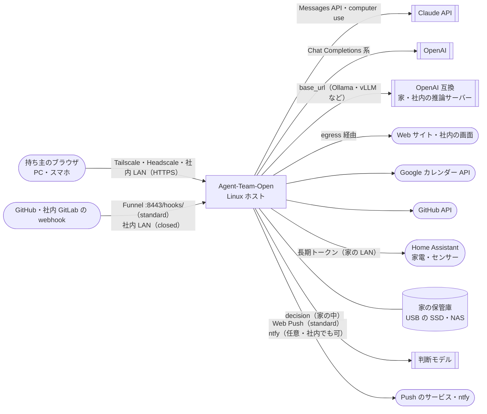
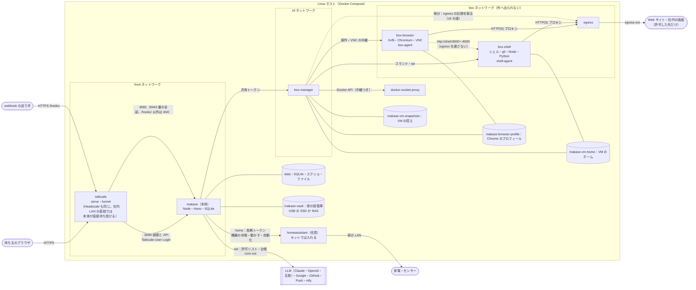
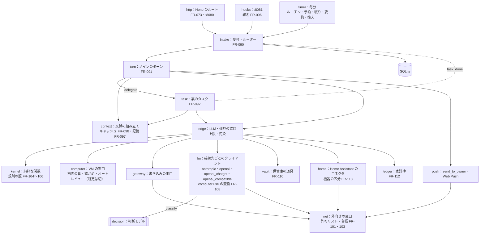

# 07. システムアーキテクチャ
- プロジェクト：Agent-Team-Open ／ 版数：v1.8（2026-10-26） ／ インプット：[04_functional_spec](04_functional_spec/README.md)、[05_non_functional](05_non_functional.md)

> **3行で**
> 1. 1台の Linux ホスト（家に置くセットアップ済みのラズパイ「キット」も同じ）の上で、Docker Compose で 7 種類のコンテナを動かす：Tailscale・本体・box-manager・Docker の中継・egress・box-browser・box-shell（この2つの組が VM。持ち主に 1 台。止めても残るホームのボリュームつき）。キットではもう 1 つ、任意のサービスとして Home Assistant を入れる（v1.7）。
> 2. 本体は Node＋SQLite の1プロセスで、受付・ルーター・メインのターン・裏のタスク・タイマー・記憶・文脈の組み立て・オートレビュー・Web Push を持つ。ループと状態はすべて本体にあり、VM には状態を置かない。
> 3. 信頼の境界は3本：「画面と API の口には入口（Tailscale・Headscale・社内 LAN の直結）しか届かない」「webhook の口は `/hooks/` だけで、署名で確かめる」「VM（2 つのコンテナ）は外へ出られないネットワークにいて、外へは egress しか通れない」。v1.6 では、本体の外向きも窓口 `net` を通して許可リストと台帳に載せ、閉域モード（`network.mode = closed`。家の中だけで動かす）では許可した先にしか出ない。v1.7 では、家の保管庫（`makase-vault`）は本体だけがつなぎ、VM にはつながない。

## 成長機構（v1.8）
本体のNodeプロセスへTrace Recorder・Candidate Compiler・Validator・Program Registry・IR Executor・Hole Resolverを追加する。[レベル3の追加部品と接続](11_learning.md#全体図)を参照。
レベル1・2の配置は既存ローカル構成を継承し、新しいサービスは増やさない。同期実行は同時1、検証はcheckpointでyieldし、32ノード・資源上限でラズパイを対象にする（NFR-099・100）。
IRからの操作も既存Kernel・Intent・コネクタを経由する。Validatorは外部書込クライアントを持たない。候補生成LLMはIR候補のみ返し、検証oracle・採用状態を書けない。
選定理由と代替案：[ADR-085](adr/ADR-085-learning-ir.md)・[ADR-086](adr/ADR-086-learning-activation.md)・[ADR-087](adr/ADR-087-learning-holes.md)。

## 🧭 判断してほしいこと
| # | 種類 | 論点 | 選択肢 | おすすめ（理由） | 決まらないと止まるもの |
|---|---|---|---|---|---|
| R-79 | リスク | box-manager は Docker のソケットを（中継越しでも）書き込みつきで使うので、乗っ取られるとホストを握られる | — | 管理役は決まった操作しか受けない小さなコードにし、VM の中身（イメージ・マウント・権限）は管理役のコードで固定する。中継（docker-socket-proxy）は使う API の種類を絞るだけで、中身までは守れないことを前提にする（[ADR-044](adr/ADR-044-box-manager.md)） | — |
| R-80 | リスク | 本体に Tailscale 以外の道で届くと、ログイン名のヘッダーを偽れる | — | 画面と API の口は front ネットワークの口だけで待ち受ける。front にいるのは Tailscale と本体だけ。webhook の口（:8081）には `/hooks/` しか置かず、身元のヘッダーを読まない | — |
| R-88 | リスク | VM が残るので、前のタスクが残したファイル・Cookie・入れたツールに、ページの仕掛けが残る | — | VM で読んだものは汚染（BR-06）。資格情報を置かない。毎日の控えから戻す・作り直す（FR-100、[ADR-061](adr/ADR-061-vm-no-judge-restore.md)） | — |
| R-89 | リスク | Funnel で公開した webhook の口が攻撃される | — | 別のポート（8443）・別の口・`/hooks/` だけ・128 bit の `hookId`・署名・本文と件数の上限。受け口を作らなければ公開しない（[ADR-065](adr/ADR-065-webhook-funnel.md)） | — |

## 全体図

見てほしいところ：C4 レベル1。入ってくる道は入口（持ち主）と webhook の 2 本だけ（キットの初回は Tailscale の招待）。家の機械（Home Assistant・保管庫・判断モデル）は本体だけがつなぐ。外へ出る道は、すべて許可リストと台帳（`egress_events`）を通る。`closed` では `network.allow_hosts` の先だけ（全部を社内の推論サーバーにすれば外向き 0：D-356）。中はレベル2で見る。

## 要点
- 置き先は Linux ホスト（[ADR-041](adr/ADR-041-linux-host.md)）。配り方は Compose 一式（[ADR-049](adr/ADR-049-docker-compose.md)）
- 本体は Node＋SQLite（[ADR-042](adr/ADR-042-node-sqlite.md)）。常駐の仕組み（受付・ターン・タイマー）も本体の中（[ADR-058](adr/ADR-058-resident-agent.md)）
- VM は持ち主に 1 台で、`box-browser` と `box-shell` の 2 つのコンテナの組。止めてもホームが残る（[ADR-060](adr/ADR-060-one-persistent-vm.md)・[ADR-068](adr/ADR-068-browser-shell-split.md)）。起こすのは box-manager だけ（[ADR-044](adr/ADR-044-box-manager.md)）
- VM の通信は egress が見る。送り元のコンテナごとに許可リストを分ける（[ADR-045](adr/ADR-045-egress.md)）。ログインは Tailscale の身元（[ADR-046](adr/ADR-046-tailscale-identity.md)）。社内 LAN の直結はパスキー（D-358）
- webhook の口は別の待ち受けで、Funnel は 8443 番だけを公開してそこに流す。画面と API の 443 番は公開しない（[ADR-065](adr/ADR-065-webhook-funnel.md)・D-241）
- 閉域・台帳（v1.6）：`closed` では外向きが許可リストの先だけ。外に出た通信は台帳に残る。本体の外向きは窓口 `net`、VM の外向きは egress が受け持つ（[ADR-074](adr/ADR-074-closed-network.md)・D-340〜344・359）
- 判定の確かめ（v1.6）：Kernel は純粋な関数。規則は版つき、監査ログは鎖。オートレビューは既定で切る（[ADR-076](adr/ADR-076-verifiable-decisions.md)・[ADR-077](adr/ADR-077-auto-review-off-by-default.md)・D-347〜351）
- LLM は役割ごとに Claude・OpenAI・ChatGPT でサインイン（v1.7）・OpenAI 互換から選ぶ。接続先の違いは `llm/` の中で吸収する（[ADR-078](adr/ADR-078-llm-by-role.md)・D-352〜357）
- 家に置く（v1.7）：Home Assistant を任意のサービスとして同じホストに入れ、本体のコネクタ `home` から呼ぶ（D-377）。保管庫 `makase-vault` は本体だけがつなぎ、VM と box-manager はつながない（D-373）。仕分けの役割 `classify` は判断モデル（接続先 `decision`）を使い、Kernel の判定には使わない（D-379・BR-16）。ラズパイ 8GB では、VM を起こしている間は 4B の生成モデルを止める（D-380）。ADR-079〜083

---

## 詳細

### レベル2：コンテナ図

見てほしいところ：Home Assistant は家の LAN で機器につながる任意のサービスで、本体だけが長期トークンで呼ぶ（トークンは VM に置かない）。保管庫のボリューム `makase-vault` は本体だけがつなぎ、VM と box-manager はつながない（VM で要るファイルは本体がホームにコピーして渡す：D-373）。VM は自分だけのネットワークにいるので、本体・box-manager・tailnet・ホスト自身・クラウドのメタデータには、どんな設定でも届かない（固定の除外）。家や社内の LAN は、持ち主が `network.internal_hosts` に書いた内部ホストだけ egress が通す（既定は空。v1.6：D-343）。VM（`box-browser` と `box-shell`）と話せるのは box-manager と egress だけ。ブラウザとターミナルは別のコンテナなので、コマンドからブラウザの X・CDP・プロフィールには届かない。webhook の口も front の上だが、身元のヘッダーを読まない別の待ち受け。外向きの記録は、egress が自分の中に溜め（最大 1 万件）、box-manager が毎分取りに行って本体に渡す。VM のネットワークから本体へは戻らない（ctl の道。D-359）。控えは本体のデータと別のボリュームで、box-manager はデータのボリュームをつながない（SQLite の暗号化したトークンに届かない：D-309）。

| コンテナ | 役割 | ネットワーク | 待ち受け | 常駐 |
|---|---|---|---|---|
| `tailscale` | tailnet に入り、`https://makase.<tailnet>.ts.net` の 443 番を本体の :8080 に中継する（`tailscale serve`。tailnet だけ）。受け口があれば 8443 番を Funnel で公開し、`/` ごと :8081 に流す（`tailscale funnel --https=8443`。パスで切り分けると転送のときにパスの頭が落ちるかもしれない（たぶん）ので、パスの絞り込みは :8081 に任せる：D-305。手順書で確かめる）。Funnel の公開はポート単位なので、443 番は Funnel にしない（D-241）。利用者のログイン名をヘッダーに付ける。Headscale のときは調整サーバーだけ社内のものに替える（`closed` では Tailscale の SaaS と Funnel を使わない：D-341）。社内 LAN の直結のときはこのコンテナを使わず、本体が社内 CA の TLS で待ち受ける | front・ts-out | tailnet と Funnel | はい |
| `makase`（本体） | API・画面の配信・受付・ルーター・メインのターン・裏のタスク・Kernel・gateway・オートレビュー（既定は切）・記憶・Web Push・タイマー・SQLite・外向きの窓口 `net` | front・ctl・core-out | front の口の :8080（画面と API）と :8081（webhook）だけ | はい |
| `box-manager` | VM（2 つのコンテナの組）を起こす・止める。ホームのボリュームの控え・戻す・作り直す（どちらも裏で動かし、本体は終わりを問い合わせる：D-294・D-295）。ホームの大きさとホストの空きを毎分測る（測るのはここだけ：D-309）。egress の記録を毎分取りに行き、本体に渡す（D-359）。操作・スクショ・VNC の中継。つなぐボリュームは `makase-browser-profile`・`makase-vm-home`・`makase-vm-snapshots` だけ（データのボリュームはつながない） | ctl・sock・box | ctl の口の :7000 だけ | はい |
| `docker-socket-proxy` | Docker のソケットの中継。使う API の種類（コンテナ・ネットワーク・ボリュームの作成と削除、イメージの読み取り）だけ通す | sock | sock の口だけ | はい |
| `egress` | VM からの HTTP(S) を中継し、行き先のアドレスを確かめる。送り元のコンテナで許可リストを分ける：`box-browser` からはアドレスの判定だけ（グローバルでないアドレスを断る）、`box-shell` からは `terminal.allow_hosts` の許可リスト。知らない送り元は断る。どちらも `network.internal_hosts` の内部ホストだけは通す（本体・box-manager・tailnet・ホスト自身・クラウドのメタデータは固定で断る：D-343）。`closed` では `network.allow_hosts` にない先へ出さない（`terminal.allow_hosts` は `network.allow_hosts` と `internal_hosts.terminal` に入っている先だけが効く：D-366）。通信ごとに送り元・宛先・目的・バイト数・許可/拒否を自分の中に溜め（最大 1 万件。中身は残さない）、box-manager が取りに行く。満杯のときは `closed` では新しい外向きを断り、`standard` では通して欠けた件数を数える（D-360）。box-manager が世代を起こすとき、2 つのコンテナの box ネットワーク上のアドレスを egress に伝える（egress の内部 API、または固定アドレス。実装で決める） | box・egress-out | box の口の :3128 だけ | はい |
| `homeassistant`（任意） | 家電・センサーの状態を読み・動かし・自動化を持つ。キットでは入れる。本体のコネクタ `home` が API を長期トークンで呼ぶ。内部ホスト（家の機械）として自動で登録する（D-377）。区分の確かめは本体の Kernel で行い、HA には任せない（D-378） | home・家の LAN | HA の口（本体からだけ） | はい |
| `box-browser` | 仮想画面・ブラウザ（Chromium）・VNC・box-agent。VM の片方。使うときに起き、10 分使わなければ止まる | box だけ | box-agent・VNC（box-manager からだけ。世代ごとのトークン） | いいえ（眠る） |
| `box-shell` | ターミナル（bash・git・Node・Python・CLI）・shell-agent。VM のもう片方。`box-browser` と一緒に起き、一緒に止まる | box だけ | shell-agent（box-manager からだけ。世代ごとのトークン） | いいえ（眠る） |

- ボリューム（v1.7）：`makase-vault`（保管庫。USB の SSD か NAS の SMB。**本体だけ**がつなぐ。VM と box-manager はつながない：D-373）。`写真`・`書類`・`レシート`・`書き出し`・`ゴミ箱` の決まったフォルダと、上書き前の版を残す `.versions`。ほかのボリュームは本体のデータ `data`、VM の `makase-browser-profile`・`makase-vm-home`、控えの `makase-vm-snapshots`
- box ネットワークは `internal: true` で、`box-browser`・`box-shell`・box-manager・egress の4つだけがいる。VM は 1 台（2 つのコンテナの組）なので、ネットワークは 1 本
- box ネットワークからホストへの入りは、手順書に次を書くだけにする（VM は確かめずに起きる）：Docker のゲートウェイの `isolated` モードが使える版なら Compose に書く（既定で書いておく）。使えない版では、box ネットワークのブリッジからホストへの入りを捨てる規則を 1 行入れることを勧める（任意）。Docker Desktop・OrbStack・Colima でも動く。隔離の試験（11 §11）で確かめる
- 本体の :8080 の待ち受けは front ネットワークでのアドレスに結びつける。:8081 には `POST /hooks/:hookId` だけを置き、ほかは 404。ctl では待ち受けない
- docker-socket-proxy は API の種類を絞るだけで、作るコンテナの中身（イメージ・マウント・権限）は絞れない。中身を固定するのは box-manager のコード（[ADR-044](adr/ADR-044-box-manager.md)）

### レベル3：本体のコンポーネント図

見てほしいところ：Cloudflare 版の部品（runner・edge・kernel・repo）はそのまま使い、その前に受付・ターン・タイマーを置いた。メインのターンと裏のタスクは同じ runner の上で、渡す道具と文脈だけが違う。

| 部品 | 中身 |
|---|---|
| intake | `wakes` に入れる・重複を捨てる・行き先を決める・まとめる（FR-090） |
| turn | メインのターンを 1 つずつ回す。歩みの記録（`owner_kind = 'turn'`） |
| task | 裏のタスクを同時数まで回す（今の runner）。報告で閉じて `task_done` を入れる |
| context | 先頭（①〜⑤）を `context_snapshots` から組み、履歴と最新を足す。キャッシュの外れを記録。ターンの開始時の要約（FR-098） |
| memory | 2 層（プロフィール・検索）の読み書き・記憶の更新の歩み・FTS5 の検索（FR-097） |
| computer | VM を起こす・画面の番・確かめ → 判定 → 行き先（人・オートレビュー）→ 実行（FR-074〜077・099）。確かめと実行は、接続先によらない同じ作動の形で受ける（下の `llm`） |
| llm | `llm/` に接続先ごとのクライアント（`anthropic`・`openai`・`openai_compatible`。v1.7：`openai_chatgpt`）。役割（`main`・`worker`・`computer`・`review`・`summary`・`classify`）ごとに接続先とモデルを引き、`llm_models` の能力に合うかを確かめる（FR-107。D-352・353）。v1.7：`classify` は接続先 `decision`（Kev の `/v1/systemone` 互換、または OpenAI 互換で選択肢の確率を返すもの）の判断モデルを呼び、自信が下限（既定 0.8）より低ければ上の役割（LLM）に回す。使うのは間違えても困らない仕分けだけで、Kernel の判定・こわい操作・機器の区分には使わない（FR-115。D-379・BR-16）。ラズパイのローカル生成モデル（4B 級）は `summary` と短い文章の役割に限り、8GB では本体がメモリを見て、VM を起こしている間は止める（排他。16GB は同時に動かせる：D-380）。v1.7：`openai_chatgpt`（Sign in with ChatGPT。D-385〜390）は Responses API だけを `store: false`・`stream: true` で呼ぶ。`temperature`・`max_output_tokens` と、保存した会話や提供元のサーバー側の道具（ファイル検索・Code Interpreter など）は使わず、道具の宣言にサーバー側の道具を出さない（FR-087）。サインインは OAuth 2.0 の認可コード＋PKCE（手元のブラウザ）またはデバイスコード（`client_id=dynamic_agent_client`。秘密の鍵はない）で、アクセスのトークン（1 時間）は期限の前に、リフレッシュのトークン（30 日。使うたびに入れ替わる）で本体が取り直す。使えるモデルはトークンで一覧を取り、`llm_models` に写す（固定しない）。403・429・ストリームの途中の `response.failed`・`invalid_grant`・401 では、ほかの支払いに切り替えず、止めて持ち主に知らせる。能力は `tools` だけを宣言し、`vision`・`computer_use` は確かめてから足す。自動のきっかけでは `llm.chatgpt_allow_auto = true` のときだけ使う（既定は切）。非公式の OAuth（ほかのアプリの client を借りるもの）は使わない（FR-116）。Claude・OpenAI の computer use は、本体の中で同じ作動の形（クリック・入力・スクロール・スクショなど）に直してから確かめ・Kernel に渡す。Kernel・box-agent・確かめは接続先を知らない（FR-108。D-354）。`openai_compatible` の `generic`（スクショ＋座標の本体の道具）は試し扱いで、`llm.experimental_generic_computer = true` のときだけ。古いスクショを消す context editing と思考ブロックの署名は Anthropic のときだけで、ほかでは送るときの投影で古い画像を外す（履歴の原本は追記だけ。D-364）。要約を始める長さと呼び出し前の上限はモデルの文脈の長さに合わせる（D-363）。接続先ごとの違いで確かめた先と実行した先がずれないよう、作動は接続先ごとに試験ページで確かめる（R-104） |
| net | 本体の外向き（LLM・カレンダー・GitHub・Push・ntfy。家の機械 Home Assistant・判断モデルも通る）の窓口。許可リスト（`network.allow_hosts`）で絞り、外に出るたびに `egress_events` に書く（目的・バイト数・許可/拒否・LLM のトークン数。中身は残さない）。`closed` では許可リスト外を断る。台帳に書けないときは `closed` で断り、`standard` では通して欠けた件数を記録する（D-359・360）。VM の外向きは egress が受け持ち、その記録は box-manager が毎分本体に渡し、`net` が同じ台帳に書く（FR-103） |
| vault | 保管庫の道具 `vault_list`・`vault_read`・`vault_write`・`vault_move`・`vault_trash`。Kernel が判定する。消す＝`ゴミ箱` へ移す（30 日）、上書き＝前の版を `.versions` に残す（30 日）。ゴミ箱を空にするのは人。索引は `vault_files`（TBL-060）。写真の並べ替え・重複の検出・縮小版は LLM なし（FR-110・111。D-373・374） |
| home | Home Assistant のコネクタ。機器の状態を読む・動かす・自動化を作る/直す/消す。長期トークンは暗号化して本体に置く。機器の写しは `home_devices`（TBL-062）。機器の区分（BR-15：`lock`・`climate`・`water_heater`・`valve`・`alarm_control_panel`・`cover`・持ち主が印を付けた家電）に触る操作は必ず人。区分は Kernel の規則で、判断モデルや LLM は決めない（FR-113。D-377・378） |
| ledger | 家計簿。レシートの画像を読む役割が店・日付・品目・金額・支払い方法を読み、費目は `classify`（自信が低ければ LLM）。`ledger_entries`（TBL-061）に入れ、カレンダーの同じ日の予定と照らす。自信が低い読み取りは確認のカードで直してもらう（FR-112。D-375） |
| kernel | 判定の本体。純粋な関数で、時刻・乱数・LLM・ネットワークを使わない（時刻は入力に入れる）。規則は正規化した JSON で、版（`policy_versions`）と SHA-256 を判定ごとに記録する。判定の入力を保存し、再実行で同じ結果になる（D-347〜349。NFR-090）。判定ごとに `decided_by`（`kernel`・`human`・`llm_review`）を残す |
| audit | 監査ログの鎖。各行に `prev_hash`・`row_hash`（SHA-256）を持ち、毎日 0 時の末尾を `audit_anchors` に残して書き出す。検査（API-151）で 1 行の書き換え・消去・差し込みを見つける（D-350。NFR-091）。root を取られた場合に守れるのは外に控えた先頭より後だけ（R-103） |
| push | `chat_messages` と `push_outbox` に同じトランザクションで入れ、SSE の合図を出す。送り手が `push_outbox` から Web Push を送り、失敗したら送り直す（FR-093・017・D-267） |
| timer | 毎分：ルーチン・予約・VM の眠り・box-manager の測った値と egress の記録を読む（API-109。自分では測らない：D-309）・`vm_op` の時間の上限（D-294）・期限切れ・送り待ちの再送・費用の上限で待っている `chat` のきっかけの再評価（D-322）。毎時：掃除。毎日：バックアップ・VM の控え・スクショの消去・0 時の監査ログの末尾の記録 |

### VM の中身
| 部品 | 役割 |
|---|---|
| Xvfb（`box-browser`） | 1280×800 の仮想画面。`-nolisten tcp`。X は `box-browser` の中にしかなく、`box-shell` のコマンドからは届かない |
| 軽いウィンドウマネージャ（`box-browser`） | Chromium を全画面にする |
| Chromium（`box-browser`） | 利用者 `browser` で動く。キオスクの形（アドレスバー・タブの帯・メニューなし）で、画面いっぱいに1枚。表示の倍率は 1、ページの拡大は 100% に固定。ユーザーデータは `/home/browser`（ボリューム `makase-browser-profile`）。起動のときに、ロックファイル（`SingletonLock`・`SingletonSocket`・`SingletonCookie`）を消してから起こす（D-171）。プロキシは egress。WebRTC・QUIC は切る。開発者ツール・ダウンロード・権限の求め（位置・カメラなど）は切る。リモートデバッグは TCP では開かず、box-agent が Chromium を起こすときのパイプ（`--remote-debugging-pipe`）だけ。`--proxy-bypass-list` に `shell` を書き、box ネットワーク上の `box-shell` のコンテナ名 `shell` だけ egress を通さない（VM の中で作ったページの点検は `http://shell:8000`〜`8099`。簡易サーバーは `box-shell` の中で立てる）。`box-shell` の shell-agent の管理の口はトークンで守られているので、Chromium から届いても何もできない。サンドボックスは下の「Chromium のサンドボックス」 |
| x11vnc＋websockify（`box-browser`） | 画面の配信（VNC over WebSocket）。見るだけ・操作の2つの口。box ネットワークのアドレスにだけ結び、世代ごとのトークンで確かめる（127.0.0.1 では待ち受けない） |
| box-agent（`box-browser`） | 操作の実行（xdotool）・スクショ・操作の先の確かめ（CDP）・`open_url`（CDP の `Page.navigate`。`http`・`https` だけ）・`read_page`。操作は1つずつ実行し、操作 ID と `control_epoch` を確かめる（`screen_epoch` は本体が確かめる：D-299）。box ネットワークのアドレスにだけ結ぶ |
| シェル（bash）・git・Node・Python・よく使う CLI（`box-shell`） | ターミナル。コマンドは利用者 `agent` で動く（D-178）。入れたツールは `/home/agent`（ボリューム `makase-vm-home`）に残る。`box-browser` のプロフィール・X・CDP には別のコンテナなので届かない |
| shell-agent（`box-shell`） | コマンドの実行（API-117。同時に 2 本まで）・tar の出し入れ（API-118。利用者 `agent` で作る：D-306）。box ネットワークのアドレスにだけ結び、世代ごとのトークンで確かめる。コマンドのプロセスは egress の `terminal.allow_hosts` の許可リストを通る |

画面の座標と CDP の対応：
- キオスクで倍率 1 なので、画面の座標はそのまま、前に出ているタブのページの座標になる。box-agent は前に出ているタブを1つだけ扱う。新しいタブ・窓が開いたら、そのタブを前に出して Claude に知らせる
- `DOM.getNodeForLocation` で一番上のフレームの要素を引く。同じ出どころの iframe は中へたどる。ほかの出どころの iframe は、そのフレームに CDP をつないでたどる。たどれなければ「分からない」（T-6）
- JS のダイアログ（alert・confirm・beforeunload）は CDP で拾い、Claude に文で知らせる。ダイアログへの操作は「分からない」（T-6）として確認に回す

起こすときの決まり（box-manager が固定で付ける。本体からは変えられない）：
- 2 つのコンテナは共通で、capability なし・`no-new-privileges`・ルートは読み取りだけ（ホームと `/tmp` だけ書ける）・box ネットワーク（`internal: true`）だけ・外の名前は引かない（名前は egress が引く。box ネットワークの中のコンテナ名 `shell` だけは Docker の内蔵 DNS で引ける。両立するかは実装のときに確かめる）・Docker の既定の seccomp（`box-browser` だけ Chromium 用のプロファイルを足す。下）
- `box-browser`：メモリ 1.5GB・CPU 1.5・プロセス 512・`/dev/shm` 512MB。ボリューム `makase-browser-profile`（`/home/browser`）。利用者は権限なしの `browser`
- `box-shell`：メモリ 1GB・CPU 1・プロセス 256。ボリューム `makase-vm-home`（`/home/agent`）。利用者は権限なしの `agent`
- 2 つは 1 つの世代（`boxes` の 1 行）として box-manager が一緒に起こし、一緒に止める。どちらかが落ちたら世代ごと `failed`
- ホーム（`makase-browser-profile` と `makase-vm-home` の合計）が 4GB を超えたら box-manager が VM を止める（`stop_reason = 'disk_quota'`）。Docker のボリュームには容量の上限がないので、box-manager が毎分測る（D-265・D-300・D-309）。超えている間はタスクのために VM を起こさず、持ち主は「ブラウザのデータを消す」「控えに戻す」「作り直す」で戻る

Chromium のサンドボックス：
- `box-browser` には Chromium 用の seccomp プロファイル（`CLONE_NEWUSER` を許すもの。Playwright などが配る形。リポジトリに `makase-browser-seccomp.json` として置く）を box-manager が付ける
- サンドボックスが使えないホストでは `--no-sandbox` で起こし、API-111 とホストの状態欄（SCR-023）に「ブラウザのサンドボックスなし」を出す。境界はコンテナの隔離（権限なし・読み取りだけのルート・内部ネットワーク）。残る危険は R-100（[11 技術仕様書](11_tech_spec.md)）
- 専用の AppArmor プロファイルやホストの設定の確かめは求めない

### 技術スタック
| レイヤー | 採用技術 | 理由 | 代替案 |
|---|---|---|---|
| フロントエンド | React＋Vite（PWA）の `apps/web`。Service Worker で Web Push を受ける | 今のもの | — |
| 画面の配信 | noVNC（画面の側）＋x11vnc | 見るだけ・操作の切り替えが簡単。arm64 で動く | CDP の screencast（ダイアログが見えない） |
| バックエンド | Node 24 LTS・Hono（`@hono/node-server`）・TypeScript | Hono のルートをそのまま使える | workerd を自分で動かす（ADR-042） |
| DB | SQLite（`better-sqlite3`）、WAL、FTS5（`trigram`） | 同期の repo の関数をそのまま使える。記憶の検索も同じファイル（D-225） | PostgreSQL（ラズパイには重い）、別の検索エンジン |
| 長い実行・常駐 | 本体の中の受付・ターン・タスクの実行役＋歩みの記録（TBL-038）＋毎分のタイマー | Workflows の「やり直し・再開」を最小で置き換える（ADR-042・058） | Temporal（ラズパイに重い）、ジョブキューのライブラリ |
| 通知 | Web Push（VAPID。`web-push` のライブラリ）。`closed` では切り、画面の中の通知（SSE）と任意の社内 ntfy（D-342） | PWA だけで届く（ADR-067）。Push のサービスには宛先と時刻が出る（R-102） | メール・Slack（窓口が増える） |
| 認証 | Tailscale・Headscale の身元（`tailscale serve` のヘッダー）。社内 LAN の直結は本体のパスキー（WebAuthn。12 時間のセッション Cookie。最初の登録は `makase owner-enroll`）。webhook は HMAC の署名 | Tailscale では画面が要らない。直結だけパスキー（ADR-046・D-358） | 合言葉 |
| LLM | 役割（`main`・`worker`・`computer`・`review`・`summary`・`classify`）ごとに接続先を選ぶ：`anthropic`（公式 SDK、computer use ツール）・`openai`・`openai_chatgpt`（v1.7：ChatGPT のアカウントの枠。Responses API。API キー不要：D-385）・`openai_compatible`（`base_url`。Ollama・vLLM など）。既定は `main`・`worker`・`computer` が `claude-opus-5-5`、`review`・`summary` が `claude-sonnet-5-5`（v1.6：D-352・362。D-315 を置き換え） | 接続先ごとのクライアントを `llm/` に置き、computer use は同じ作動の形に直す（ADR-078・D-354）。`openai_chatgpt` はサインインだけで始められるので非エンジニアの壁が低い（D-385〜390）。Bedrock・Vertex は次の版 | 接続先を Anthropic 直だけにする（v1.5 まで。ADR-056） |
| 家電・IoT（v1.7） | Home Assistant（コンテナ。任意。キットでは入れる）。本体の `home` が REST の長期トークンで呼ぶ | 機器の種類が多く、すでに家で使っている人が多い。機器ごとのコネクタを自分で作らずに済む（D-377） | 機器ごとに自前のコネクタ |
| 判断モデル（v1.7） | Jev 型（選択・点数・はい/いいえを型つきで返す）。候補は Von・Laya（mmBERT は多言語）・Rizzo Flow。日本語の精度・速さ・ライセンスを実機で確かめてから既定にする（R-109）。接続先 `decision` | 間違えても困らない仕分けを、API 代なしで家の中で行える（D-379） | 仕分けも LLM に任せる（遅く、費用がかかる） |
| 画像の縮小（v1.7） | 本体で長辺 1568px に縮める。HEIC を読めるライブラリ（libvips/`sharp` など。AGPL と両立するもの）を実機で確かめて選ぶ | スマホの写真は HEIC が多い。読めないと添付できない（D-376） | クラウドに元の画像を送る（費用と通信が大きい） |
| VM | Docker のコンテナ 2 つの組（`box-browser`：Xvfb・Chromium、`box-shell`：シェル・CLI）＋名前つきボリューム | ラズパイ・WSL2 でそのまま動く。ホームが残る | Firecracker・QEMU（ADR-043）、Docker のチェックポイント（不安定） |
| 外への中継 | 小さな HTTP(S) プロキシ（CONNECT を受け、名前を引いてからアドレスを確かめる。許可リスト・内部ホストの例外・記録も持つ） | 本体・tailnet・ホスト自身を確実に外し、内部ホストだけを通せる（D-343） | iptables の規則 |
| 配り方 | Docker Compose v2、イメージは arm64・amd64 の両方 | どの Linux でも同じ手順 | 本体は systemd（ADR-049） |

### 移すもの・変えるもの
| Cloudflare 版・v0.6 | v1.0 |
|---|---|
| WorkspaceDO（SQLite・RPC） | 本体の中のモジュール。repo の同期の関数は使い続け、その下の `WsDb`（`db/sqlite.ts`）を `better-sqlite3` の上に作り直す。接続の設定は [08 方針](08_database/README.md#方針) |
| RPC で値にして返していた失敗（WriteResult・EdgeOutcome） | 同じプロセスになるので、普通の例外に戻してよい（戻すかは移すときに決める） |
| LLM（`llm/claude.ts`・`edge/validate.ts`） | 道具の結果に画像を入れられるようにし、computer use の道具の宣言を足す。`cache_control` を付け、キャッシュのトークンを記録する（FR-098）。古いスクショはサーバー側の context editing で消し、履歴は追記だけ（D-256）。v1.6：`llm/` を接続先ごとのクライアントに分け（D-352）、computer use を同じ作動の形に直す（D-354） |
| D1（users・memberships・sessions） | なくす。持ち主は `OWNER_LOGIN`（ADR-046） |
| Workflows（PlanAsk・TaskRun） | 本体の実行役＋歩みの記録。PlanAsk（依頼の生成）は使わず、メインのターンに置き換える（D-235） |
| 依頼（`asks`・`ask_pending_replies`・`ask_members`）と依頼の API・画面 | チャット（`chat_messages`）・きっかけ（`wakes`）・ターン（`turns`）・タスク（`tasks`）（ADR-059） |
| DO の alarm・Cron Triggers | 本体のタイマー（毎分・毎時・毎日） |
| v0.6 の VM（タスクごと・プロフィールはエージェントごと） | VM は 1 台・ホームが残る・画面の番（ADR-060） |
| Static Assets | 本体が `apps/web` のビルドを配る |
| Workers secrets | `.env` |
| Google ログイン（`auth/`） | なくす |
| Sandbox SDK（未定だった作業場） | VM のターミナル（FR-086）。旧 sandbox の tar の控えと道具名を再利用 |
| `pack_installs`・planner の pack | 用途ごとのパック（FR-085）。メインの振り分け先の一覧に載せる |

### デプロイ構成・環境
| 環境 | 中身 |
|---|---|
| 開発 | 開発者の WSL2 で同じ Compose（本体だけ `pnpm dev` に差し替える上書きファイルを用意） |
| 本番 | 持ち主のホスト1台ごと。ホストどうしは独立（D-130） |

ホストごとの下ごしらえ（手順書に書く）：
| ホスト | Linux | Docker |
|---|---|---|
| ラズパイ 4/5 | Raspberry Pi OS 64bit | Docker Engine |
| キット（ラズパイ 5 の 8GB・16GB・SSD つき） | イメージ書き込み済み（運用契約：[11_operations](11_operations.md)） | 入っている。Home Assistant も入っている |
| Win ノート | WSL2（Ubuntu）。WSL を自動で止めない設定 | WSL のディストリの中に入れた Docker Engine（手順書の推奨）。Docker Desktop も可 |
| Mac | OrbStack か Colima | OrbStack・Colima の Docker（Docker Desktop も可） |
| Linux PC | そのまま | Docker Engine |

webhook を使うときは、tailnet の ACL で `makase` に `funnel` の属性を許す（手順書の任意の節）。公開するのは 8443 番だけで、受け口の URL は `https://makase.<tailnet>.ts.net:8443/hooks/<hookId>`（D-241）。8443 番は `/` ごと :8081 に流し、:8081 が `POST /hooks/:hookId` 以外を 404 にする（D-305。手順書で `curl` を送り、:8081 に `/hooks/<hookId>` のまま届くことを確かめる）。

ホスト側の手順（手順書に書く。VM は確かめずに起きる）：
| 手順 | 中身 | 確かめ |
|---|---|---|
| ホストへの入り（既定） | Docker のゲートウェイの `isolated` モードが使える版なら Compose に書く（既定で書いておく） | — |
| ホストへの入り（任意） | `isolated` モードが使えない版では、box ネットワークのブリッジからホストへの入りを捨てる規則を 1 行入れることを勧める | 隔離の試験（11 §11） |

### 認証・認可方式
- 復元/作り直し/消去の操作ID・running/done/failed・ACK/broken印は `makase-vm-snapshots` 内のmanager専用 `.operations/` に原子的置換＋永続化して保持する。控えの世代整理・ホーム消去では触らず、VMにはマウントしない。ACK済みIDは再POST実行を防ぐため小さな墓標として保持し、結果削除後の同ID POSTは409 OPERATION_CONFLICT。新しい操作IDだけを受ける（IMP-005・006）。
- 持ち主の確かめは FR-073。入口は 3 択（D-341・358）。Tailscale・Headscale は、`tailscale serve` が付ける `Tailscale-User-Login` を `OWNER_LOGIN` と比べる（:8080 だけ。Headscale でも同じヘッダーが付く）。社内 LAN の直結は、本体のパスキー（WebAuthn）でログインし、HttpOnly・Secure・SameSite=Strict のセッション Cookie（12 時間）を出す。最初のパスキーは `docker compose exec makase makase owner-enroll` が出す 1 回限りの URL で登録する
- webhook の口（:8081）：受け口ごとの署名の秘密で HMAC を確かめる（FR-096）
- 本体 ↔ Home Assistant：長期トークン（本体に暗号化して置き、VM には置かない：D-377）。保管庫は本体のプロセスだけがつなぐ
- 本体 ↔ box-manager：共有トークン（`BOX_MANAGER_TOKEN`、`.env`）
- box-manager ↔ VM：世代ごとに独立な `BROWSER_TOKEN` と `SHELL_TOKEN` を生成。前者はbox-browserのbox-agent/VNCとmanagerだけ、後者はbox-shellのshell-agentとmanagerだけに渡す。相互利用・旧世代は拒否。環境変数削除は境界とみなさず、シェルから初期環境が読めてもブラウザ資格は存在しない（IMP-001）
- box-manager ↔ egress：記録を毎分取りに行く（ctl の道。egress から本体へは戻らない：D-359）
- VM ↔ egress：送り元のコンテナのアドレスで分ける。box-manager が世代を起こすとき、2 つのコンテナのアドレスを egress に伝える。知らない送り元は断る
- 認可：持ち主1人なのでロールは持たない。エージェントの道具の範囲は役（メイン・振り分け先）で分ける（[04 権限マトリクス](04_functional_spec/README.md#権限マトリクス)）

### 外部連携
| 相手 | 使い方 | 通る道 |
|---|---|---|
| LLM（Claude API・OpenAI・OpenAI 互換） | 役割ごとに接続先を選ぶ。Claude は Messages API・computer use ツール・プロンプトキャッシュ。OpenAI・互換は Chat Completions 系（互換は `base_url`）。キーは `ANTHROPIC_API_KEY`・`OPENAI_API_KEY`・`OPENAI_COMPATIBLE_API_KEY`（任意）。`closed` では接続先を `network.allow_hosts` に明示する | 本体の `net` から（core-out）。台帳に書く |
| ChatGPT のサインインと API（v1.7） | `auth.openai.com`（OAuth・デバイスコード・トークンの取り直し）と `api.openai.com`（Responses API・モデルの一覧）。`closed` では、使うなら両方を `network.allow_hosts` に入れる許可先として明示する（D-385・386） | 本体の `net` から（core-out）。台帳に書く |
| Google カレンダー | OAuth（戻り先は ts.net の URL）・予定の作成と削除。`closed` では使えない（D-356） | 本体の gateway から |
| GitHub | GitHub App のインストールのトークン（API）・リポジトリの webhook（受け口） | 本体の gateway から・Funnel から :8081 へ |
| Web サイト | VM の Chromium・`web_fetch` | VM は egress 経由（`box-browser` からも `box-shell` からも）。`web_fetch` は本体から（egress と同じアドレスの判定：D-164） |
| Push のサービス（Apple・Google・Mozilla）・ntfy | Web Push の送信（`standard`。宛先と時刻は外に出る）。`closed` は切り、任意の社内 ntfy | 本体の `net` から（core-out） |
| Tailscale・Headscale | tailnet・HTTPS の証明書・利用者の身元・Funnel（Funnel は `standard` の Tailscale だけ） | tailscale コンテナ |
| Home Assistant（v1.7） | 機器の状態・動かす・自動化。キットでは同じホストに入れる。家の機械（内部ホスト）として自動で登録 | 本体の `home` から（`net` を通り台帳に書く） |
| 判断モデル（v1.7） | `classify` の仕分け。接続先 `decision`。家の中で動く | 本体の `llm` から（`net`） |
| 家の機械・社内システム（家の LAN・社内 LAN） | VM の Chromium・ターミナルで家や社内の画面・Git に届く。`network.internal_hosts` に書いた先だけ。社内の GitHub Enterprise Server・GitLab のコネクタは次の版で、初版は `git` で扱う（D-367） | egress 経由 |

### ログ・監視・エラー通知
- ログは JSON の行を標準出力に（NFR-079）。秘密はマスクする
- 外に出た通信は SCR-027 と API-148 で見る（台帳の書き出しは CSV）。ホストの状態は SCR-023 と API-111 で見る（キャッシュの当たり率・今日の費用を含む）。台帳に書けなかった件数も状態欄に出す（D-360）。外の監視の仕組みは置かない
- 本体が落ちたら Compose の `restart: unless-stopped` で起こし直し、FR-084 で続ける

### 主要な設計判断（ADR）
| ADR | 決定 | 状態 |
|---|---|---|
| [ADR-041](adr/ADR-041-linux-host.md) | 置き先は Linux ホスト。Cloudflare はいったん外す | 承認 |
| [ADR-042](adr/ADR-042-node-sqlite.md) | 本体は Node＋SQLite、Workflows は歩みの記録に | 承認 |
| [ADR-043](adr/ADR-043-box-container.md) | VM はコンテナ＋仮想画面＋VNC | 承認（v1.4 で ADR-068 の追記あり） |
| [ADR-044](adr/ADR-044-box-manager.md) | VM を起こせるのは box-manager だけ | 承認 |
| [ADR-045](adr/ADR-045-egress.md) | VM の外への通信は egress だけ。送り元のコンテナごとに許可リストを分ける | 承認（v1.4 で ADR-068 の追記あり） |
| [ADR-046](adr/ADR-046-tailscale-identity.md) | ログインは Tailscale の身元 | 承認 |
| [ADR-049](adr/ADR-049-docker-compose.md) | 配り方は Docker Compose 一式 | 承認 |
| [ADR-051](adr/ADR-051-gateway-in-core.md) | gateway は本体の中の部品 | 承認 |
| [ADR-058](adr/ADR-058-resident-agent.md) | 常駐型（ループと状態は本体・きっかけで起き・眠る） | 承認 |
| [ADR-059](adr/ADR-059-main-agent-delegates.md) | 1 本のチャットでメインと話し、メインが振り分ける | 承認 |
| [ADR-060](adr/ADR-060-one-persistent-vm.md) | VM は持ち主に 1 台・残り続け・画面は順番 | 一部置き換え済み（→ ADR-068。1 台は 2 コンテナの組） |
| [ADR-061](adr/ADR-061-vm-no-judge-restore.md) | VM の中は判定せず、資格情報を置かず、控えで戻す | 承認（v1.4 で ADR-068 の追記あり） |
| [ADR-068](adr/ADR-068-browser-shell-split.md) | ブラウザとターミナルを別のコンテナにする | 承認 |
| [ADR-065](adr/ADR-065-webhook-funnel.md) | webhook は Funnel で受け口だけ公開 | 承認 |
| [ADR-066](adr/ADR-066-prompt-cache-layout.md) | 文脈はキャッシュの先頭を変えない形に組む | 承認 |
| [ADR-067](adr/ADR-067-web-push-first.md) | Web Push を最初の版に | 承認 |
| [ADR-074](adr/ADR-074-closed-network.md) | 閉域で動かせるようにし、社内システムへの到達と外に出た通信の台帳を持つ | 承認（v1.6） |
| [ADR-075](adr/ADR-075-team-sharing-proposal.md) | チームで 1 台を共有する案と、ホストごとの容量の目安 | **不採用**（v1.7：D-383。容量の表は NFR-092 の「キットの選び方」に作り直した） |
| [ADR-076](adr/ADR-076-verifiable-decisions.md) | 判定の規則を版つきで持ち、試験・再実行・監査ログの鎖で確かめる | 承認（v1.6） |
| [ADR-077](adr/ADR-077-auto-review-off-by-default.md) | オートレビューは既定で切る（ADR-064 を一部置き換え） | 承認（v1.6） |
| [ADR-078](adr/ADR-078-llm-by-role.md) | LLM を役割ごとに選ぶ（Claude・OpenAI・OpenAI 互換） | 承認（v1.6） |
| [ADR-079](adr/ADR-079-home-agent-kit.md) | 家に置く常駐エージェントにし、非エンジニアにはセットアップ済みのラズパイ（キット）で届ける。API キーは最初は持ち主が取る | 承認（v1.7） |
| [ADR-080](adr/ADR-080-home-vault.md) | 家の保管庫（写真・書類）は本体の道具で扱い、消すのはゴミ箱へ。チャットの画像の添付 | 承認（v1.7） |
| [ADR-081](adr/ADR-081-home-assistant.md) | 家電・IoT は Home Assistant 経由にし、こわい機器は規則で必ず人に聞く | 承認（v1.7） |
| [ADR-082](adr/ADR-082-household-ledger.md) | レシートの写真から家の中だけの家計簿を作る | 承認（v1.7） |
| [ADR-083](adr/ADR-083-classify-and-local-on-pi.md) | 仕分けは判断モデルで家の中で行い、ラズパイでは 4B 級までの生成モデルを軽い役割に使う（D-357 を置き換え） | 承認（v1.7） |

ほかの ADR（こわい操作・確認の表・パック・ターミナル・ライセンス・接続先・`send_to_owner`・記憶・オートレビュー）は [README](README.md#主要な設計判断adr) の一覧にある。

## このドキュメントで決まったこと
- 上の ADR、D-122、D-123、D-132、D-136〜D-138、D-161、D-164、D-171、D-172、D-178、D-182、D-200、D-202、D-205、D-208、D-209、D-214〜D-217、D-225、D-226、D-231、D-241、D-244、D-265、D-267、D-294、D-295、D-299、D-300、D-305、D-306、D-309
- v1.4：D-315（LLM の接続先は Anthropic 直だけ）（v1.6：D-352 で置き換え）、D-319（box-manager は掃除のために起こさない。ホームの測りは残す）、D-321（Chromium のキャッシュの置き場は実装で決める）、D-323（要約はターンの開始時の 1 経路）、D-324（ターン途中の差し込みなし）、D-325（記憶は 2 層）、D-326（VM は `box-browser` と `box-shell` の 2 コンテナの組。egress は送り元のコンテナで分ける。ADR-068）、D-327（本体の再起動では新しい世代で起こし直す）
- v1.6：D-340〜D-370（閉域・社内への到達・台帳 D-340〜346・358〜360・365〜368、判定の確かめ D-347〜351・369、役割ごとの LLM D-352〜357・361〜364、オートレビューの優先度 D-370）
- v1.7：D-371〜D-384（家の人に広げる・キット D-371・372、保管庫 D-373・374、家計簿と画像の添付 D-375・376、Home Assistant と機器の区分 D-377・378、判断モデルとラズパイの 4B の排他 D-379・380、言葉 D-381、OSS 方針 D-382、ADR-075 不採用 D-383、API キー D-384。ADR-079〜083）
