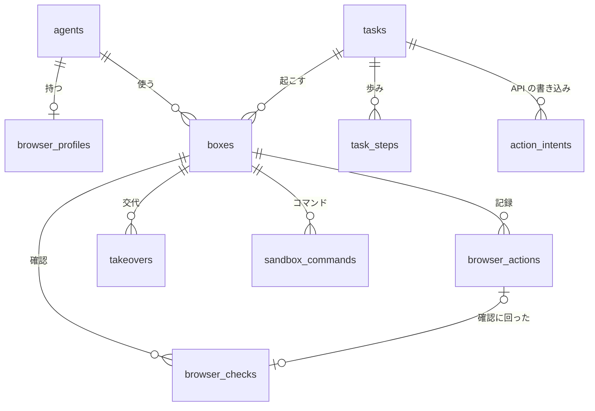

# 08. DB設計
- プロジェクト：Agent-Team-Open ／ 版数：v0.5（2026-10-24） ／ インプット：[04_functional_spec](04_functional_spec.md)、`apps/worker/src/db/schema.ts`

> **3行で**
> 1. DB は本体の SQLite のファイル1つ（`/data/makase.db`）。Cloudflare 版の WorkspaceDO のスキーマ（`schema.ts`）を使い、表を6つ足して4つを変える（`sandbox_commands` は VM に付け替える）。
> 2. 足す表：`boxes`・`browser_actions`・`browser_checks`・`takeovers`・`browser_profiles`・`task_steps`。通知の購読（`push_subscriptions`）は作らない（次の版：D-179）。
> 3. ブラウザの確認は MCP の書き込み用の `action_intents` に乗せず、別の表 `browser_checks` にする（必須の列が合わないため。[ADR-052](adr/ADR-052-browser-checks-table.md)）。

## 🧭 判断してほしいこと
| # | 種類 | 論点 | 選択肢 | おすすめ（理由） | 決まらないと止まるもの |
|---|---|---|---|---|---|
| R-81 | リスク | プロフィールのボリュームは暗号化しないので、ホストのディスクを読まれると Cookie が漏れる | — | ホストのディスクの暗号化を手順書で勧める。消す操作を用意する（FR-079） | — |

## 全体図

見てほしいところ：新しい表はすべて `tasks` と `agents` にぶら下がる。ブラウザの確認（`browser_checks`）と API の書き込み（`action_intents`）は別の表。

## 要点
- 決めごとは Cloudflare 版のまま：ID は TEXT、時刻は ISO 8601 の TEXT、金額はマイクロドルの整数、`workspace_id` の列なし（[方針](#方針)）
- VM の1回の起動が `boxes` の1行で、これが「VM の世代」（[TBL-032](#tbl-032boxesVM)）
- 操作は全部 `browser_actions` に残す。判定と結果は別の列（[TBL-033](#tbl-033browser_actions操作の記録)）
- 確認は `browser_checks`。中身のハッシュで承認と実行を結びつける（[TBL-039](#tbl-039browser_checksブラウザの確認)）
- ターミナルのコマンドは `sandbox_commands` に1行ずつ残す。`session_id` を `box_id` に変えて使う（[TBL-040](#tbl-040sandbox_commandsターミナルの記録)）
- 上限は今のポリシーの `budget` のキーを使い、`browser` 欄・`terminal` 欄を足す（[TBL-035](#tbl-035workspace_policiesポリシー)）

---

## 詳細

### 方針
| 項目 | 決め |
|---|---|
| DB | SQLite、ファイル1つ。`better-sqlite3` で同期に読み書き |
| 接続の設定 | `journal_mode=WAL`・`synchronous=FULL`（確定した歩みを失わない：NFR-071）・`foreign_keys=ON`・`busy_timeout=5000` |
| 書き込み | 1つのプロセスだけが書く。読んで判断して書く処理は `db.transaction` で包み、中で外を呼ばない（今の G-14 の決まり） |
| アダプター | `db/sqlite.ts` の `WsDb`（`SqlStorage` の `exec(...).toArray()`・`.one()` に合わせたもの）を、`better-sqlite3` の `prepare().all()`・`.get()`・`.run()` の上に作り直す。例外の型（制約違反の見分け）も合わせる |
| ID | TEXT。新しい表は UUIDv7（時刻の順に並ぶ） |
| 時刻 | ISO 8601（UTC）の TEXT。既定値は `schema.ts` の `NOW` |
| 金額 | `*_micro_usd` の INTEGER |
| 削除 | エージェントは論理削除（`status = 'removed'`）。記録の表は消さない（スクショの画像だけ消す） |
| 守り | 今のトリガー（監査ログは追記だけ など）をそのまま使う |
| マイグレーション | `schema.ts` の版を上げ、起動のときに流す（前にバックアップ） |

### テーブル一覧
| ID | テーブル名 | 論理名 | 概要 | 関連FR | 区分 |
|---|---|---|---|---|---|
| TBL-007 | `task_events` | タスクの事象 | タイムライン（VM・交代の事象を足す） | FR-018 | 今のまま |
| TBL-031 | `workspace` | ワークスペース | 1行。`owner_login`・`max_boxes` を足す | FR-073, FR-074 | 変える |
| TBL-032 | `boxes` | VM | VM の1回の起動（世代） | FR-074, FR-078 | 新規 |
| TBL-033 | `browser_actions` | 操作の記録 | エージェントの1操作 | FR-075, FR-076 | 新規 |
| TBL-034 | `takeovers` | 交代 | 交代の頼みと交代 | FR-078 | 新規 |
| TBL-035 | `workspace_policies` | ポリシー | `budget` に操作の回数を、`browser` 欄・`terminal` 欄を JSON に足す | FR-013, FR-076, FR-086 | 変える |
| TBL-036 | `browser_profiles` | プロフィール | エージェントごとのブラウザのデータ | FR-079 | 新規 |
| TBL-037 | `push_subscriptions` | 通知の購読 | Web Push の宛先 | FR-017 | 作らない（次の版。D-179） |
| TBL-038 | `task_steps` | 歩みの記録 | タスク・依頼の生成の1歩の結果 | FR-084, FR-013 | 新規 |
| TBL-039 | `browser_checks` | ブラウザの確認 | こわい操作の ○ / × | FR-077 | 新規 |
| TBL-040 | `sandbox_commands` | ターミナルの記録 | VM の中のコマンド1つ。`session_id` を `box_id` に変える | FR-086 | 変える |
| — | `pack_installs`・`agent_skills` | パックの記録・手で書いたスキル | パックを入れた記録（D-176）。スキルは `origin = pack` だけ使う（D-177） | FR-085 | 今のまま使う（D-176・D-177） |
| — | そのほか | — | `agents`・`asks`・`tasks`・`action_intents`・`approvals`・`audit_logs`・`usage_records`・`connectors` など | — | 今のまま |

### テーブル定義

### TBL-031：workspace（ワークスペース）
今の1行の表に2列を足す。`owner_user_id`（D1 の利用者）は使わなくなり、`owner_login` で持ち主を表す。

<details>
<summary>足す列（2列）</summary>

| カラム | 型 | NULL | デフォルト | 説明 |
|---|---|---|---|---|
| owner_login | TEXT | NO | — | Tailscale のログイン名。起動のとき `OWNER_LOGIN` と比べ、違えば止まる。`.env` に `OWNER_LOGIN_REPLACE=1` があるときだけ上書きして起動する（D-170） |
| max_boxes | INTEGER | NO | 1 | VM の同時数。CHECK 1〜4 |

</details>

### TBL-032：boxes（VM）
VM の1回の起動。主なカラム：`id`, `agent_id`, `task_id`, `status`, `control`

<details>
<summary>カラム定義（12列）</summary>

| カラム | 型 | NULL | デフォルト | キー | 説明 |
|---|---|---|---|---|---|
| id | TEXT | NO | — | PK | UUIDv7。VM の世代 |
| agent_id | TEXT | NO | — | FK agents | |
| task_id | TEXT | NO | — | FK tasks | |
| status | TEXT | NO | `'starting'` | | `starting`・`running`・`stopping`・`stopped`・`failed` |
| control | TEXT | NO | `'agent'` | | `agent`・`handing_over`・`human` |
| control_epoch | INTEGER | NO | 0 | | `control` を変えるたびに1増やす。box-agent は古い番号の操作を断る |
| container_name | TEXT | YES | — | | box-manager が付けた名前 |
| stop_reason | TEXT | YES | — | | `task_ended`・`idle`・`owner`・`approval_expired`・`start_timeout`・`crashed`・`host_restart` |
| started_at | TEXT | NO | NOW | | |
| last_activity_at | TEXT | NO | NOW | | 最後の操作（人・エージェント） |
| stopped_at | TEXT | YES | — | | |
| created_at | TEXT | NO | NOW | | |

</details>

- 制約：`status IN ('stopped','failed')` ⇔ `stopped_at IS NOT NULL`。止まっていない VM はエージェントごとに1つ（部分 UNIQUE：`agent_id WHERE status NOT IN ('stopped','failed')`）
- 同時数の確保：`starting` の行を入れる前に、止まっていない行の数を同じトランザクションで数える
- 想定：1日に数十行

### TBL-033：browser_actions（操作の記録）
エージェントの1操作。主なカラム：`box_id`, `seq`, `kind`, `verdict`, `outcome`

<details>
<summary>カラム定義（15列）</summary>

| カラム | 型 | NULL | デフォルト | キー | 説明 |
|---|---|---|---|---|---|
| id | TEXT | NO | — | PK | UUIDv7。box-agent に渡す操作 ID も兼ねる |
| box_id | TEXT | NO | — | FK boxes | |
| task_id | TEXT | NO | — | FK tasks | |
| seq | INTEGER | NO | — | | VM の中の通し番号。UNIQUE(box_id, seq) |
| kind | TEXT | NO | — | | computer use の操作名（`left_click`・`type`・`key`・`scroll` など）か `open_url` |
| args | TEXT | NO | `'{}'` | | JSON。座標・キー・文字（秘密の欄なら `***`） |
| page_url | TEXT | YES | — | | 操作のときのページ（クエリは外す） |
| target | TEXT | YES | — | | JSON。タブ・フレーム・要素の種類・`type`・`autocomplete`・見えている名前・枠。分からなければ NULL |
| tripwires | TEXT | NO | `'[]'` | | JSON の配列。当たった合図（`declared`・`T-1`〜`T-6`） |
| verdict | TEXT | NO | — | | 判定：`allowed`・`checked` |
| check_id | TEXT | YES | — | FK browser_checks | 確認に回ったとき |
| outcome | TEXT | NO | `'pending'` | | 結果：`pending`・`executed`・`not_executed`・`unknown`・`failed` |
| screenshot_path | TEXT | YES | — | | 操作のあとのスクショ。7日で消して NULL に |
| created_at | TEXT | NO | NOW | | |
| finished_at | TEXT | YES | — | | |

</details>

- 制約：`verdict = 'checked'` ⇔ `check_id IS NOT NULL`（結果が `unknown` でも確認への参照は残る）
- 想定：1タスクで最大 300 行

### TBL-034：takeovers（交代）
<details>
<summary>カラム定義（9列）</summary>

| カラム | 型 | NULL | デフォルト | キー | 説明 |
|---|---|---|---|---|---|
| id | TEXT | NO | — | PK | |
| box_id | TEXT | NO | — | FK boxes | |
| task_id | TEXT | NO | — | FK tasks | |
| status | TEXT | NO | — | | `requested`・`active`・`ended`・`expired` |
| reason | TEXT | YES | — | | エージェントが頼んだときの理由（200字まで） |
| requested_at | TEXT | YES | — | | 頼まれた時刻（持ち主が自分から代わったときは NULL） |
| started_at | TEXT | YES | — | | |
| ended_at | TEXT | YES | — | | |
| end_screenshot_path | TEXT | YES | — | | 返したときのスクショ |

</details>

- 制約：動いている交代（`requested`・`active`）は VM ごとに1つ
- `requested` は 30 分、`active` は操作なし 15 分で `expired`（D-167）

### TBL-035：workspace_policies（ポリシー）
今の版つきの JSON（Kernel の `policy.ts` の形）を使う。上限は今の `budget` のキーのまま値を変え、`max_browser_actions` を足す。こわい操作の決まりは `browser` 欄に、ターミナルの決まりは `terminal` 欄に足す。Kernel の型（`policy.ts` の `budget` と、新しい `browser`）も合わせて足す。

<details>
<summary>JSON の欄（変えるところ）</summary>

```json
{
 "budget": { "per_task_usd": 3, "per_day_usd": 10, "max_steps": 200, "max_minutes": 55, "max_browser_actions": 300 },
 "terminal": { "allow_hosts": ["github.com", "registry.npmjs.org", "pypi.org", "files.pythonhosted.org"], "max_commands": 200, "command_timeout_sec": 120 },
 "browser": {
  "confirm_domains": [],
  "skip_unresolved_domains": [],
  "confirm_words": ["購入", "注文", "支払", "決済", "送信", "投稿", "削除", "退会", "解約", "申し込", "確定", "Buy", "Purchase", "Pay", "Checkout", "Place order", "Send", "Post", "Delete", "Submit", "Confirm"],
  "approval_minutes": 30,
  "keep_screenshots": 3
 }
}
```

</details>

- `max_steps`（runner の歩み）と `max_browser_actions`（VM の操作）は別に数える。1タスクの時間の上限は、外側の 60 分の打ち切りより前に切れるよう `max_minutes = 55`（今の M-59 の決まり）
- 効くのは次のタスクから。タスクは始まるときのポリシーを固定して使う（今の `edge/inputs.ts` の形）
- `max_steps`・`max_minutes` の初期値は設計書の値で確定（D-175。今の既定の 40 歩・15 分とは違う）。1タスクの時間は確認待ち・交代待ちを除いて数える（`tasks.paused_ms`：D-174）。`terminal` 欄はターミナルの決まり（D-178）：`allow_hosts` は VM のコマンドの通信の許可リスト、`max_commands` は1タスクのコマンド数、`command_timeout_sec` は1コマンドの時間の上限。`keep_screenshots` は Claude との会話に残すスクショの枚数（D-161）

### TBL-036：browser_profiles（プロフィール）
<details>
<summary>カラム定義（6列）</summary>

| カラム | 型 | NULL | デフォルト | キー | 説明 |
|---|---|---|---|---|---|
| agent_id | TEXT | NO | — | PK, FK agents | |
| volume_name | TEXT | NO | — | UNIQUE | `makase-profile-<agentId>` |
| size_bytes | INTEGER | NO | 0 | | VM を止めたときに測る |
| last_used_at | TEXT | YES | — | | |
| cleared_at | TEXT | YES | — | | 最後に消した時刻 |
| created_at | TEXT | NO | NOW | | |

</details>

### TBL-037：push_subscriptions（通知の購読）
最初の版では作らない（Web Push は次の版：D-179）。通知は PWA を開いているときの SSE（FR-018）だけ。

### TBL-038：task_steps（歩みの記録）
<details>
<summary>カラム定義（9列）</summary>

| カラム | 型 | NULL | デフォルト | キー | 説明 |
|---|---|---|---|---|---|
| owner_kind | TEXT | NO | — | PK | `task`・`ask`（依頼の生成） |
| owner_id | TEXT | NO | — | PK | タスクか依頼の ID |
| step_key | TEXT | NO | — | PK | 歩みの名前（`llm:<n>`・`tool:<callId>`・`box:<actionId>`） |
| status | TEXT | NO | — | | `started`・`done`（`done` の結果に `aborted`（交代で中止）がある） |
| result | TEXT | YES | — | | JSON。`done` のとき必須。画像は入れず、スクショのパスだけ |
| repeatable | INTEGER | NO | 1 | | 0 なら、`started` のまま残っても繰り返さない（VM の操作・書き込み） |
| reserved_micro_usd | INTEGER | NO | 0 | | LLM の歩みの見積もりの費用。`started` の間は日次の残りから引いて数える |
| started_at | TEXT | NO | NOW | | |
| finished_at | TEXT | YES | — | | |

</details>

- 日次の上限の確かめは「使った額（`usage_records`）＋ `started` の歩みの予約の合計」で行い、予約は `started` の行を入れるのと同じトランザクションで入れる
- 終わったタスクの歩みは 7日で消す（監査に要るものは `audit_logs` と `browser_actions` にある）
- 交代で中止した `llm:<n>` は `done`（結果 `aborted`）で閉じ、予約を精算する（D-163）。`started` を残さない

### TBL-039：browser_checks（ブラウザの確認）
こわい操作の ○ / ×。主なカラム：`box_id`, `status`, `content_hash`

<details>
<summary>カラム定義（16列）</summary>

| カラム | 型 | NULL | デフォルト | キー | 説明 |
|---|---|---|---|---|---|
| id | TEXT | NO | — | PK | UUIDv7 |
| task_id | TEXT | NO | — | FK tasks | |
| box_id | TEXT | NO | — | FK boxes | VM の世代 |
| action_id | TEXT | NO | — | UNIQUE | 実行する操作の ID（`browser_actions.id`） |
| status | TEXT | NO | `'pending'` | | `pending`・`executing`・`executed`・`rejected`・`expired`・`unknown_outcome` |
| summary | TEXT | NO | — | | カードの要約（200字まで） |
| action | TEXT | NO | — | | JSON。操作の引数（秘密は `***`） |
| content | TEXT | NO | — | | JSON。タブ・フレーム・ページの URL・操作の先・フォームの値の要約（秘密の欄はハッシュ） |
| content_hash | TEXT | NO | — | | `action`・`content`・`box_id` からの sha256 |
| tripwires | TEXT | NO | `'[]'` | | 当たった合図 |
| screenshot_path | TEXT | YES | — | | 押す場所の印つきのスクショ |
| policy_hash | TEXT | NO | — | | 判定に使ったポリシー |
| expires_at | TEXT | NO | — | | 作ってから 30分 |
| expire_reason | TEXT | YES | — | | `approval_timeout`・`page_changed`・`taken_over`・`box_restarted` |
| decided_at | TEXT | YES | — | | |
| created_at | TEXT | NO | NOW | | |

</details>

- 制約：`status = 'expired'` ⇔ `expire_reason IS NOT NULL`。`pending` からの変更は条件つきの UPDATE（`WHERE status = 'pending'`）だけ
- 中身が変わったとき（`page_changed`）は新しい確認を作らず、Claude に決め直させる（D-159）。同じ操作に2つ目の確認はできない（`action_id` の UNIQUE）
- `browser_actions.check_id` と `browser_checks.action_id` は相互参照なので、`foreign_keys=ON` では操作の行（`check_id` NULL）→ 確認の行 → 操作の行の `check_id` を UPDATE の順で入れる
- 監査ログに `browser.checked`（作った・決めた・結果）を残す

### TBL-040：sandbox_commands（ターミナルの記録）
VM の中のコマンド1つ。今の表の `session_id`（`sandbox_sessions`）を `box_id`（`boxes`）に変える。`sandbox_sessions` は使わない。主なカラム：`box_id`, `task_id`, `tool`, `status`, `output`

<details>
<summary>カラム定義（12列）</summary>

| カラム | 型 | NULL | デフォルト | キー | 説明 |
|---|---|---|---|---|---|
| id | TEXT | NO | — | PK | UUIDv7。API-117 の `actionId` も兼ねる |
| box_id | TEXT | NO | — | FK boxes | VM の世代（今の `session_id` を変える） |
| task_id | TEXT | NO | — | FK tasks | |
| tool | TEXT | NO | — | | `run_command`・`list_files`・`read_file`・`search`・`write_file`・`delete_file` |
| args | TEXT | NO | — | | JSON のオブジェクト（`cwd`・`command`・`timeoutSec` など） |
| status | TEXT | NO | `'queued'` | | `queued`・`running`・`done`・`expired` |
| ok | INTEGER | YES | — | | 0 / 1。`done` のとき必須 |
| output | TEXT | YES | — | | コマンドの出力。64KB まで（超えた分は切る）。外の内容として汚染扱い（BR-06） |
| exit_code | INTEGER | YES | — | | |
| created_at | TEXT | NO | NOW | | |
| started_at | TEXT | YES | — | | |
| finished_at | TEXT | YES | — | | |

</details>

- 制約：`status = 'done'` ⇔ `ok IS NOT NULL`。`length(output) <= 65536`（今の 200000 から変える）。索引は `(box_id, created_at)`
- `running` のまま VM が落ちた・時間を超えたコマンドは `expired`。再開のときはやり直さず、Claude に「前のコマンドが実行されたか分からない」と伝える（FR-084）
- 想定：1タスクで最大 200 行（`terminal.max_commands`：NFR-080）

### 変える表
| 表 | 変えるところ |
|---|---|
| `tasks` | `status_detail` の値に `waiting_box`・`taken_over`・`waiting_takeover`（列の制約は今の形で通る）。`status` の値は今のまま。列 `paused_ms`（INTEGER NOT NULL DEFAULT 0）を足す：確認待ち・交代待ち（`awaiting_approval`・`waiting_takeover`・`taken_over`）で待った時間の合計。上限の判定は「経過時間 − `paused_ms`」（D-174） |
| `sandbox_commands` | `session_id` を `box_id`（FK `boxes`）に変え、`output` を 64KB までにする（TBL-040） |
| `task_events` | 事象の種類に `box_started`・`box_stopped`・`browser_checked`・`takeover_started`・`takeover_ended` |
| `action_intents`・`approvals` | 変えない（API の書き込みだけに使う） |

### 使わなくなるもの
| 表 | 理由 | 扱い |
|---|---|---|
| D1 の `users`・`memberships`・`sessions` | Tailscale の身元にした（ADR-046） | 作らない |
| `skill_proposals`・`agent_evolution_events` | 育つ仕組みを入れない（ADR-050）。`agent_skills.origin` の `learned` も使わない（D-177） | 落とす |
| `sandbox_sessions` | VM（`boxes`）に置き換わった（D-178）。`sandbox_commands` は `box_id` に付け替えて使う（TBL-040） | 使わない |
| `pack_installs`・`agent_skills` | パックを残す（D-176）。手で書いたスキルは残す（D-177） | 今のまま使う |

### データ保持・削除ポリシー
| もの | 保持 |
|---|---|
| 監査ログ | 無期限（NFR-078） |
| スクショの画像 | 7日（NFR-073）。行は残す。秘密の欄の領域は塗りつぶしてから保存する（D-162）。スクショは DB の外のファイルなので、バックアップには入らない |
| 歩みの記録 | 終わったタスクから 7日 |
| バックアップ | 毎日1回・7世代（NFR-070）。秘密の欄の文字は DB のどこにも平文で残らない |
| プロフィール | エージェントを消すか、持ち主が消すまで |

## このドキュメントで決まったこと
- [ADR-052](adr/ADR-052-browser-checks-table.md)：ブラウザの確認は別の表
- D-144、D-145、D-147、D-151、D-153、D-159、D-161、D-162、D-163、D-167、D-170、D-174（待ちを除く時間：`tasks.paused_ms`）、D-175（初期値は設計書の値）、D-176（パックを残す）、D-177（`learned` は使わない）、D-178（ターミナル：TBL-040）、D-179（通知の購読は作らない）（[00 決定事項ログ](00_overview.md#決定事項ログ)）
