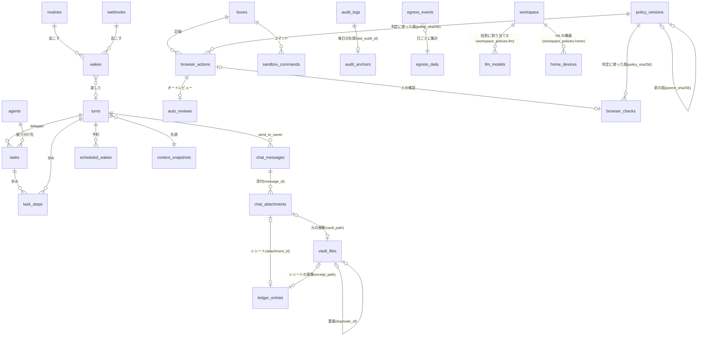

# 08. DB設計
- プロジェクト：Agent-Team-Open ／ 版数：v1.7（2026-10-26） ／ インプット：[04_functional_spec](../04_functional_spec/README.md)、`apps/worker/src/db/schema.ts`

> **3行で**
> 1. DB は本体の SQLite のファイル1つ（`/data/makase.db`）。Cloudflare 版の WorkspaceDO のスキーマ（`schema.ts`）を使い、v0.6 の表（TBL-031〜040）を引き継ぎ、常駐の表（TBL-041〜055。TBL-048・049 は作らない）を足す。v1.6 で、TBL-056〜059（外に出た通信の台帳・規則の版・監査ログの毎日の先頭・モデルの能力と単価）を足した。v1.7 で、家の保管庫の索引・家計簿・Home Assistant の機器の写し・チャットの添付（TBL-060〜063）を足した。
> 2. 常駐の中心は `wakes`（きっかけ）・`turns`（メインのターン）・`chat_messages`（チャット）。依頼（`asks` まわり）は使わない（D-235）。記憶は 2 層：プロフィールの `memory_facts` と検索の `memory_search`（FTS5。ADR-070）。
> 3. `boxes` は持ち主に 1 台の VM の世代（2 つのコンテナの組）で、画面の番を持つ。ブラウザの確認は今までどおり `browser_checks`（[ADR-052](../adr/ADR-052-browser-checks-table.md)）。判定には使った規則の版（`policy_sha256`）と入力（`verdict_input`）、誰が決めたか（`decided_by`）を残し、監査ログは鎖（`prev_hash`・`row_hash`）で改ざんを見つける。表の定義は [resident.md](resident.md)（新しい表）と [vm.md](vm.md)（引き継ぐ表）。

## 🧭 判断してほしいこと
| # | 種類 | 論点 | 選択肢 | おすすめ（理由） | 決まらないと止まるもの |
|---|---|---|---|---|---|
| R-81 | リスク | VM の 2 つのボリューム（ブラウザのプロフィールとホーム）と控えは暗号化しないので、ホストのディスクを読まれると Cookie が漏れる | — | ホストのディスクの暗号化を手順書で勧める。ブラウザのデータを消す・作り直す操作を用意する（FR-079・100） | — |

## 全体図

見てほしいところ：v1.7 の 4 つの表は、写真→保管庫の索引→家計簿の流れでつながる（添付の元の画像は保管庫に置き、レシートは家計簿の 1 行になる）。HA の機器は他の表とは独立で、本体のコネクタが写す。どのきっかけも `wakes` を通ってターンに入り、ターンがタスクを作る。VM の表（`boxes` 以下）はタスクから使われる（画面の番は `boxes.screen_task_id`）。

## 要点
- 決めごとは Cloudflare 版のまま：ID は TEXT、時刻は ISO 8601 の TEXT、金額はマイクロドルの整数、`workspace_id` の列なし（[方針](#方針)）
- きっかけは `wakes` の 1 行。`source_key` の UNIQUE で重複を捨てる（[TBL-041](resident.md#tbl-041wakesきっかけ)）
- メインのターンは `turns`。動いているのは 1 行だけ（[TBL-042](resident.md#tbl-042turnsメインのターン)）
- 記憶のプロフィールは 100 個・4,000 字まで。検索は FTS5（[TBL-047](resident.md#tbl-047memory_factsプロフィール)・[TBL-050](resident.md#tbl-050memory_search記憶の検索)）
- VM の世代は `boxes` の 1 行。止まっていない世代は 1 つだけ（[TBL-032](vm.md#tbl-032boxesvm-の世代)）
- 上限・言葉・オートレビューの設定はポリシーの JSON（[TBL-035](vm.md#tbl-035workspace_policiesポリシー)）。v1.6 で、`network`（閉域モード・許可リスト・内部ホスト）・`review.auto.enabled`（既定は切）・`llm`（役割ごとのモデル）の欄を足した
- 外に出た通信は台帳 `egress_events` に残す。中身は残さず、行は 90 日、日ごとの集計 `egress_daily` は無期限（[TBL-056](resident.md#tbl-056egress_events外に出た通信の台帳)）
- 判定の規則は `policy_versions` に版・SHA-256 つきで足していく。今の値は `workspace_policies` に置いたまま、保存のたびに同じトランザクションで版を足す（[TBL-057](vm.md#tbl-057policy_versions判定の規則の版)）
- 監査ログは 1 行ごとに `prev_hash`・`row_hash` でつなぎ、毎日 0 時の末尾を `audit_anchors` に残す（[TBL-058](vm.md#tbl-058audit_anchors毎日の監査ログの先頭のハッシュ)）
- モデルの能力と単価は `llm_models`。能力が足りない役割には割り当てられず、単価が空なら動かさない（[TBL-059](resident.md#tbl-059llm_modelsモデルの能力と単価)）。v1.7：接続先 `decision`・能力 `decision` を足した。さらに接続先 `openai_chatgpt`（ChatGPT でサインイン：D-385）を足した。ChatGPT のトークンは新しい表を作らず `workspace.chatgpt_auth`（暗号化した列）に置く（D-386）
- v1.7：保管庫の索引は `vault_files`。消す＝ゴミ箱へ移す（30 日）、上書き＝前の版を残す（30 日）。ゴミ箱を空にするのは人（[TBL-060](vm.md#tbl-060vault_files保管庫の索引)）
- v1.7：家計簿の 1 行は `ledger_entries`。読み取りの自信が低い行に印を付け、確認のカードで直してもらう（[TBL-061](resident.md#tbl-061ledger_entries家計簿の-1-行)）
- v1.7：HA の機器の写しは `home_devices`。機器の区分とこわいの印を持つ（[TBL-062](vm.md#tbl-062home_devicesha-の機器の写し)）
- v1.7：チャットの添付は `chat_attachments`。縮めた版と元の画像（保管庫）への参照を持ち、汚染の印が付く（[TBL-063](resident.md#tbl-063chat_attachmentsチャットの添付)）
- v1.7：ポリシーの JSON の `llm` 欄に `chatgpt_allow_auto`（既定 false：D-389）を足した。ChatGPT のトークンは新しい TBL を振らず `workspace.chatgpt_auth` に持つ（D-386）
- v1.7：ポリシーの JSON に `vault`・`home`・`classify` の欄を足した（[TBL-035](vm.md#tbl-035workspace_policiesポリシー)）

---

## 詳細

### 方針
| 項目 | 決め |
|---|---|
| DB | SQLite、ファイル1つ。`better-sqlite3` で同期に読み書き |
| 接続の設定 | `journal_mode=WAL`・`synchronous=FULL`（確定した歩みを失わない：NFR-071）・`foreign_keys=ON`・`busy_timeout=5000` |
| 書き込み | 1つのプロセスだけが書く。読んで判断して書く処理は `db.transaction` で包み、中で外を呼ばない（今の G-14 の決まり） |
| アダプター | `db/sqlite.ts` の `WsDb`（`SqlStorage` の `exec(...).toArray()`・`.one()` に合わせたもの）を、`better-sqlite3` の `prepare().all()`・`.get()`・`.run()` の上に作り直す。例外の型（制約違反の見分け）も合わせる |
| ID | TEXT。新しい表は UUIDv7（時刻の順に並ぶ） |
| 時刻 | ISO 8601（UTC）の TEXT。既定値は `schema.ts` の `NOW` |
| 金額 | `*_micro_usd` の INTEGER |
| 削除 | エージェントは論理削除（`status = 'removed'`）。記録の表は消さない（スクショの画像だけ消す） |
| 守り | 今のトリガー（監査ログは追記だけ など）をそのまま使う |
| マイグレーション | `schema.ts` の版を上げ、起動のときに流す（前にバックアップ） |

### テーブル一覧
| ID | テーブル名 | 論理名 | 概要 | 関連FR | 区分 | 定義 |
|---|---|---|---|---|---|---|
| TBL-007 | `task_events` | タスクの事象 | タイムライン（VM・画面の番・オートレビューの事象を足す） | FR-018 | 今のまま | — |
| TBL-031 | `workspace` | ワークスペース | 1行。`owner_login`・`max_tasks`・`snapshot_hour` を足す。v1.6：パスキー（`owner_passkeys`・`owner_enroll`・`session_epoch`。D-358）。v1.7：`chatgpt_auth`（ChatGPT のトークン。暗号化。D-386） | FR-073, FR-092 | 変える | [vm](vm.md#tbl-031workspaceワークスペース) |
| TBL-032 | `boxes` | VM の世代 | 2 つのコンテナの組の 1 世代。持ち主に 1 台。画面の番 | FR-074, FR-078 | 変える | [vm](vm.md#tbl-032boxesvm-の世代) |
| TBL-033 | `browser_actions` | 操作の記録 | エージェントの1操作 | FR-075, FR-076 | 変える | [vm](vm.md#tbl-033browser_actions操作の記録) |
| TBL-034 | `takeovers` | 交代 | 交代の頼みと交代 | FR-078 | 変える | [vm](vm.md#tbl-034takeovers交代) |
| TBL-035 | `workspace_policies` | ポリシー | `budget`・`browser`・`terminal` 欄の JSON。v1.6：`network`・`review`・`llm` 欄を足す。v1.7：`vault`・`home`・`classify` 欄を足す | FR-013, FR-076, FR-086, FR-099, FR-101, FR-102, FR-107, FR-110, FR-113, FR-115 | 変える | [vm](vm.md#tbl-035workspace_policiesポリシー) |
| TBL-036 | `browser_profiles` | プロフィール | 使わない（VM に 1 つ） | — | 使わない | [vm](vm.md#tbl-036browser_profilesプロフィール) |
| TBL-037 | `push_subscriptions` | 通知の購読 | Web Push の宛先 | FR-017 | 新規（v1.0 で作る） | [vm](vm.md#tbl-037push_subscriptions通知の購読) |
| TBL-038 | `task_steps` | 歩みの記録 | ターン・タスクの1歩の結果 | FR-084, FR-013 | 変える | [vm](vm.md#tbl-038task_steps歩みの記録) |
| TBL-039 | `browser_checks` | ブラウザの確認 | 人に回ったこわい操作の ○ / × | FR-077 | 変える | [vm](vm.md#tbl-039browser_checksブラウザの確認) |
| TBL-040 | `sandbox_commands` | ターミナルの記録 | VM の中のコマンド1つ | FR-086 | 今のまま（v0.6） | [vm](vm.md#tbl-040sandbox_commandsターミナルの記録) |
| TBL-041 | `wakes` | きっかけ | 受けたきっかけ 1 件 | FR-090 | 新規 | [resident](resident.md#tbl-041wakesきっかけ) |
| TBL-042 | `turns` | ターン | メインの 1 ターン | FR-091 | 新規 | [resident](resident.md#tbl-042turnsメインのターン) |
| TBL-043 | `chat_messages` | チャット | 持ち主とメインのメッセージ。v1.7：`body` に `attachmentIds` | FR-093, FR-114 | 新規 | [resident](resident.md#tbl-043chat_messagesチャット) |
| TBL-044 | `routines` | ルーチン | プロンプトと時刻 | FR-094 | 新規 | [resident](resident.md#tbl-044routinesルーチン) |
| TBL-045 | `scheduled_wakes` | 予約した確認 | 次に起きる時刻と覚え書き | FR-095 | 新規 | [resident](resident.md#tbl-045scheduled_wakes予約した確認) |
| TBL-046 | `webhooks` | 受け口 | webhook の口と署名の秘密 | FR-096 | 新規 | [resident](resident.md#tbl-046webhooks受け口) |
| TBL-047 | `memory_facts` | プロフィール | 持ち主についての事実 | FR-097 | 新規 | [resident](resident.md#tbl-047memory_factsプロフィール) |
| TBL-048 | `memory_log` | ログ | 使わない（v1.4：D-325） | — | 使わない | — |
| TBL-049 | `memory_notes` | メモ | 使わない（v1.4：D-325） | — | 使わない | — |
| TBL-050 | `memory_search` | 記憶の検索 | FTS5 の仮想表。チャットと報告を索引する | FR-097 | 新規 | [resident](resident.md#tbl-050memory_search記憶の検索) |
| TBL-051 | `auto_reviews` | オートレビュー | 1 操作の判断 | FR-099 | 新規 | [resident](resident.md#tbl-051auto_reviewsオートレビュー) |
| TBL-052 | `vm_snapshots` | VM の控え | ホームの tar | FR-100 | 新規 | [resident](resident.md#tbl-052vm_snapshotsvm-の控え) |
| TBL-053 | `context_snapshots` | 文脈の先頭 | ①〜⑤とハッシュ・要約 | FR-098 | 新規 | [resident](resident.md#tbl-053context_snapshots文脈の先頭) |
| TBL-055 | `push_outbox` | Web Push の送り待ち | 送る通知と再送の状態 | FR-017 | 新規 | [resident](resident.md#tbl-055push_outboxweb-push-の送り待ち) |
| TBL-054 | `routine_proposals` | ルーチンの提案 | メインの提案（承認待ち） | FR-094 | 新規 | [resident](resident.md#tbl-054routine_proposalsルーチンの提案) |
| TBL-056 | `egress_events`（付属 `egress_daily`） | 外に出た通信の台帳 | 外向きの通信 1 件（中身は残さない）。欠けの件数の行（`kind = 'gap'`）。日ごとの集計は付属の表（D-368） | FR-103, FR-101 | 新規（v1.6） | [resident](resident.md#tbl-056egress_events外に出た通信の台帳) |
| TBL-057 | `policy_versions` | 判定の規則の版 | 正規化した規則・SHA-256・変えた人・理由・試験の例 | FR-104, FR-105 | 新規（v1.6） | [vm](vm.md#tbl-057policy_versions判定の規則の版) |
| TBL-058 | `audit_anchors` | 監査ログの毎日の先頭 | 毎日 0 時の末尾のハッシュ | FR-106 | 新規（v1.6） | [vm](vm.md#tbl-058audit_anchors毎日の監査ログの先頭のハッシュ) |
| TBL-059 | `llm_models` | モデルの能力と単価 | 接続先ごとのモデル・能力・単価。v1.7：接続先 `decision`・能力 `decision`・接続先 `openai_chatgpt` を足す | FR-107, FR-108, FR-115 | 新規（v1.6）／変える（v1.7） | [resident](resident.md#tbl-059llm_modelsモデルの能力と単価) |
| TBL-060 | `vault_files` | 保管庫の索引 | 家の保管庫のファイル 1 つ（パス・SHA-256・種類・撮影日・場所・タグ・ゴミ箱に入った時刻・前の版） | FR-110, FR-111 | 新規（v1.7） | [vm](vm.md#tbl-060vault_files保管庫の索引) |
| TBL-061 | `ledger_entries` | 家計簿の 1 行 | 日付・店・品目・金額・費目・支払い方法・レシートの画像・読み取りの自信・照らした予定・確認の状態 | FR-112 | 新規（v1.7） | [resident](resident.md#tbl-061ledger_entries家計簿の-1-行) |
| TBL-062 | `home_devices` | HA の機器の写し | `entity_id`・区分・こわいの印・最後の状態。自動化も持つ | FR-113 | 新規（v1.7） | [vm](vm.md#tbl-062home_devicesha-の機器の写し) |
| TBL-063 | `chat_attachments` | チャットの添付 | メッセージ・保管庫のパス・縮小版・大きさ・汚染の印 | FR-114 | 新規（v1.7） | [resident](resident.md#tbl-063chat_attachmentsチャットの添付) |
| — | `pack_installs`・`agent_skills` | パックの記録・手で書いたスキル | パックを入れた記録（D-176）。スキルは `origin = pack` だけ使う（D-177） | FR-085 | 今のまま使う | — |
| — | そのほか | — | `agents`・`tasks`・`action_intents`・`approvals`・`audit_logs`・`usage_records`・`connectors` など | — | 今のまま（変えるところは下） | — |

### 変える表
| 表 | 変えるところ |
|---|---|
| `tasks` | 今の `schema.ts` に合わせる（D-254）。列を足す：`turn_id`（作ったターン、FK `turns`）・`tool_call_id`（UNIQUE）・`title`（40 字）・`brief`（4,000 字）・`delegate_reason`（100 字）・`budget_class`（生んだターンの区分を引き継ぐ：D-322）。`report`・`report_meta`（成果物と報告の状態を入れる）・`tainted`・`taint_sources` は今の列を使う（報告は 2,000 字までを本体で守る。CHECK は今の 50,000 のまま）。`job_id` は NULL を許し（振り分けのタスクは job を持たない）、`trigger_type` に `delegate` を足す。`ask_id` は NULL のまま使わない（D-235）。今の NOT NULL と CHECK は変えずに満たす（D-283）：`requester_id` はメインのエージェントの ID、`agent_snapshot_id` は作るときに振り分け先の今の設定のスナップショット（`agent_snapshots`）を作って入れ、`report` を入れるときは `report_kind = 'normal'`（CHECK `(report IS NULL) = (report_kind IS NULL)`）。`status` の値は今の CHECK のまま（`completed` などを使う）。`halt_reason` に `vm_replaced` を足す。`status_detail` の値に `waiting_vm`・`waiting_screen`・`taken_over`・`waiting_takeover`・`running_command`・`auto_review`（列の制約は今の形で通る）。列 `paused_ms`（INTEGER NOT NULL DEFAULT 0）を足す：確認待ち・交代待ち（`awaiting_approval`・`waiting_takeover`・`taken_over`）で待った時間の合計。上限の判定は「経過時間 − `paused_ms`」（D-174） |
| `sandbox_commands` | `session_id` を `box_id`（FK `boxes`）に変え、`output` を 64KB までにする（TBL-040） |
| `task_events` | 事象の種類に `box_started`・`box_stopped`・`screen_acquired`・`screen_released`・`browser_checked`・`auto_reviewed`・`takeover_started`・`takeover_ended`・`steered`・`reported` |
| `agents` | 列を足す：`kind`（`main`・`worker`。`main` は 1 行だけ：部分 UNIQUE）・`description`（「いつ使うか」200 字）・`created_by`（`owner`・`main`・`pack`）・`instruction_addendum`（メインの指示の手直し 2,000 字） |
| `usage_records` | 列を足す：`turn_id`（FK `turns`）・`budget_class`（`chat`・`auto`。集計のための印。タスク・オートレビュー・要約の費用は生んだターンの区分を引き継ぐ：D-322）・`cache_read_tokens`・`cache_write_5m_tokens`・`cache_write_1h_tokens`（D-263）・`cache_expected`（0/1：当たるはずだった）。呼び出しの目的は `purpose` の列を作らず、`phase` に `turn`・`task`・`review`・`memory`・`summary` を足して使う（今の値は古い行のために残す）。SQLite は CHECK を ALTER できないので、`phase` の CHECK は版 3（`USAGE_OWNER_RELAX`）と同じく表を作り直して変える。`task_id` は今も NULL 可。メインの呼び出し（ターン・記憶の更新・要約）は `agent_id` にメインの ID を入れ、今の持ち主の CHECK を満たす（D-283）。要約は `turn_id` が NULL（ターンの外の仕事：D-323）。v1.6：`provider`（`anthropic`・`openai`・`openai_compatible`。v1.7：`openai_chatgpt`・`decision`）・`role`（`main`・`worker`・`computer`・`review`・`summary`）を足し、費用は `llm_models` の単価で計算する（D-352・353）。v1.7：`openai_chatgpt` は費用 0 を明示し、呼び出し回数とトークンは残す（D-388） |
| `audit_logs` | 事象の種類に `wake.received`・`wake.dropped`・`turn.halted`・`auto_review.decided`・`routine.created`・`webhook.rejected`・`memory.changed`・`vm.snapshot`・`vm.restored`・`vm.rebuilt`・`cache.miss`、v1.6：`policy.changed`・`policy.imported`・`audit.verified`・`audit.chain_broken`・`egress.gap`・`llm.role_changed`・`network.mode_changed`、v1.7：`vault.trashed`・`vault.restored`・`vault.emptied`・`vault.overwritten`・`home.called`・`home.automation_changed`・`home.flag_changed`・`ledger.corrected`・`setup.api_key_set`・`setup.completed`・`classify.fallback`（自信が下限より低くて LLM に回した。件数だけ）、`llm.chatgpt_connected`・`llm.chatgpt_disconnected`・`llm.chatgpt_limit`（ChatGPT の枠の上限・対象外で止めた。トークンは書かない：D-386・388）。列を足す：`prev_hash`（前の行の `row_hash`。最初の行は固定の初期値）・`row_hash`（SHA-256。行の中身と `prev_hash` から。D-350）。UPDATE・DELETE を断るトリガーは今のまま。v1.6 より前の行は、移行のときに順に `row_hash` を計算して鎖につなぐ |
| `action_intents` | `turn_id`（FK `turns`）と `tool_call_id`（UNIQUE。メインのターンの書き込みのとき、再起動で探す：D-287）を足し、`task_id` と `job_id` を NULL 可にする。CHECK：`task_id` と `turn_id` のどちらか一方だけ（D-248）。`expire_reason` の `task_cancelled` は今の CHECK にあるので、それを使う（D-250） |
| `approvals` | `turn_id`（FK `turns`）を足し、`task_id` を NULL 可にする（`job_id` の列はない）。CHECK：`task_id` と `turn_id` のどちらか一方だけ（D-248） |
| `policy_decisions` | `turn_id`（FK `turns`）を足し、`task_id` を NULL 可にする。CHECK：`task_id` と `turn_id` のどちらか一方だけ。gateway・edge が書く判定の記録を、メインのターンでも残す（D-275）。v1.6：`policy_sha256`（判定に使った規則の版）・`verdict_input`・`decided_by` を足す（`browser_actions`・`browser_checks` と同じ。D-347・349） |

### 使わなくなるもの
| 表 | 理由 | 扱い |
|---|---|---|
| D1 の `users`・`memberships`・`sessions` | Tailscale の身元にした（ADR-046） | 作らない |
| `skill_proposals`・`agent_evolution_events` | スキルが育つ仕組みを入れない（01 §7）。`agent_skills.origin` の `learned` も使わない（D-177） | 落とす |
| `sandbox_sessions` | VM（`boxes`）に置き換わった（D-178）。`sandbox_commands` は `box_id` に付け替えて使う（TBL-040） | 使わない |
| `asks`・`ask_pending_replies`・`ask_members`・`ask_messages` | チャット・きっかけ・ターン・タスクに置き換えた（D-235）。v0.6 から上げるときは、`asks` の文を `chat_messages` に写してから使わなくする | 使わない（落とすのは次のマイグレーション） |
| TBL-036 `browser_profiles` | プロフィールは専用のボリュームに 1 つ（ADR-060・ADR-068） | 作らない |
| `pack_installs`・`agent_skills` | パックを残す（D-176）。手で書いたスキルは残す（D-177） | 今のまま使う |

### データ保持・削除ポリシー
| もの | 保持 |
|---|---|
| 監査ログ | 無期限（NFR-078）。鎖の検査は全行を通す（100 万行を 60 秒以内：NFR-091） |
| 外に出た通信の行（`egress_events`） | 90 日（D-344）。日ごとの集計（`egress_daily`）は無期限 |
| 規則の版（`policy_versions`）・監査ログの毎日の先頭（`audit_anchors`） | 無期限 |
| 家計簿（`ledger_entries`）・保管庫の索引（`vault_files`） | 無期限（v1.7）。持ち主が消すまで |
| 保管庫のゴミ箱・上書き前の版（`.versions`） | 30 日（v1.7：D-373）。ゴミ箱を空にする・30 日より前に消すのは必ず人。保管庫の控え（毎週・別のディスクか NAS へ）は任意（NFR-095） |
| チャットの添付の縮小版（`chat_attachments`） | メッセージと同じ（消さない）。元の画像は保管庫にあり、ゴミ箱に入れたら 30 日（v1.7） |
| HA の機器の写し（`home_devices`） | 無期限。状態の履歴は持たない（v1.7） |
| モデルの能力と単価（`llm_models`） | 無期限（持ち主が消すまで） |
| スクショの画像 | 7日（NFR-073）。行は残す。秘密の欄の領域は塗りつぶしてから保存する（D-162）。スクショは DB の外のファイルなので、バックアップには入らない |
| 歩みの記録 | 終わったタスクから 7日。ターンの歩みは要約に取り込まれてから 7 日（D-262） |
| チャット・プロフィール | 消さない（持ち主が消すまで。プロフィールは `deleted_at` を入れる） |
| きっかけ（`wakes`） | 30 日 |
| 文脈の先頭（`context_snapshots`） | 参照するターンが残っている間（最新は残す。D-262） |
| Web Push の送り待ち | 終わってから 7 日 |
| VM の控え | 3 世代（控え専用のボリューム `makase-vm-snapshots` の中。box-manager だけがつなぐ。バックアップには入れない：D-309） |
| バックアップ | 毎日1回・7世代（NFR-070）。秘密の欄の文字は DB のどこにも平文で残らない |
| VM の 2 つのボリューム（ブラウザのプロフィール `makase-browser-profile`・ホーム `makase-vm-home`） | 持ち主が消す・戻す・作り直すまで（BR-07） |

## このドキュメントで決まったこと
- [ADR-052](../adr/ADR-052-browser-checks-table.md)：ブラウザの確認は別の表
- ADR-068：ブラウザとターミナルを別のコンテナにする／ADR-069：費用は自動のきっかけ用の別上限で守る／ADR-070：記憶は 2 層（プロフィールと検索）
- v1.7：D-385〜D-390（`openai_chatgpt`・`workspace.chatgpt_auth`・`chatgpt_allow_auto`・監査の事象・費用 0 の記録）
- v1.7：D-371〜D-384 のうち D-373〜D-380（TBL-060〜063・`workspace_policies` の欄・`llm_models` の `decision`・保持）
- D-144、D-145、D-147、D-151、D-153、D-159、D-161〜D-163、D-167、D-170、D-174〜D-178、D-205、D-207、D-215、D-217、D-221〜D-227、D-232、D-235、D-245、D-246、D-248〜D-251、D-254、D-256、D-261〜D-263、D-267、D-275〜D-277、D-283、D-287〜D-289、D-318〜D-320、D-322〜D-328、v1.6：D-340〜D-370（TBL-056〜059・`audit_logs` の鎖・`workspace_policies` の欄・パスキーの列。[00 決定事項ログ](../00_overview.md#決定事項ログ)）
