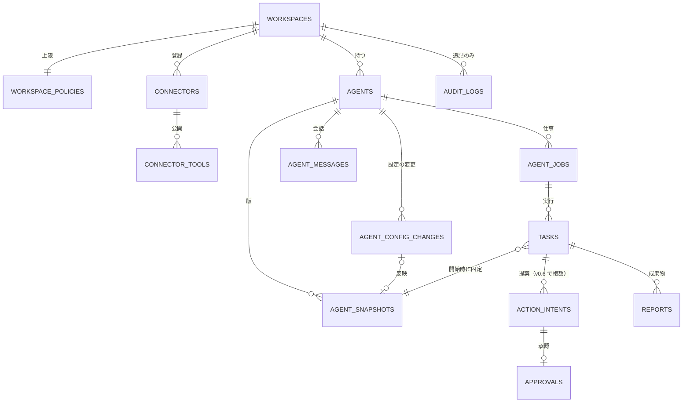

# 08. DB設計
- プロジェクト：open-team（仮称） ／ 版数：v0.6（2026-10-01） ／ インプット：[04_functional_spec](../04_functional_spec/README.md)、[05_non_functional](../05_non_functional.md)、[07_architecture](../07_architecture.md)

> **3行で**
> 1. PostgreSQL 16 に30テーブル（うち1つ廃止）。中心は「ワークスペース → エージェント → 仕事 → タスク → Intent → 承認」で、判定・費用・監査ログをすべて記録する。
> 2. 監査ログは追記のみ・スナップショットは変更しない・秘密情報はアプリ層で暗号化。テナント分離は RLS（フェーズ0は実装しない）。
> 3. v0.4〜0.6 で足したテーブル（ワークスペースのポリシー・コネクタ・プロフィール・レポート）は**カラム未設計**。下の Q-62〜Q-69 が決まるまで DDL は書けない。

## 🧭 判断してほしいこと

| # | 種類 | 論点 | 選択肢 | おすすめ（理由） | 決まらないと止まるもの |
|---|---|---|---|---|---|
| Q-60 | 未決 | 監査ログのパーティション分割（月単位）をどの時点で導入するか（旧 08 §未決事項） | A: 最初から / B: 件数が増えてから | —（元の記述なし） | TBL-012 |
| Q-61 | 未決 | ワークスペースの削除（旧：GitHub App のアンインストール）後のデータの扱い（旧 08 §未決事項・§データ保持の agents 行） | A: すぐ削除 / B: 保持期間まで残す | —（元の記述なし） | 保持ポリシー全体 |
| Q-62 | ✅決定 | organizations → workspaces 改名の範囲。13 が明言するのはテーブルの改名と「GitHub App はつなぐ連携の1つ」だけ（13 §既存ドキュメントへの影響・A-78）。外部キー `organization_id`、RLS の `app.org_id`、`github_installation_id` 等の NOT NULL、`account_type`・`status = disconnected` の扱いは未記述 → **列名も workspace_id、RLS は app.workspace_id に改名。GitHub 関連列は別テーブル（連携の1つ）へ**（[D-21](../decisions.md#d-21)）| A: 列名も `workspace_id` に改名 / B: 列名は据え置き。GitHub 列は NULL 可にするか別テーブルへ | —（元の記述なし） | TBL-002 と全テーブルの外部キー、RLS |
| Q-63 | ✅決定 | フェーズ0で使うテーブルの範囲。13 §フェーズ0は「サインイン・マルチテナント・RLS を実装しない」とだけ書く。users・memberships・sessions・task_events の扱いが未記述 → **テーブルは作り、利用者1人・ワークスペース1つの行を初期投入して使う。RLS だけ無効**（[D-05](../decisions.md#d-05)）| A: 行は作り単一ユーザーで使う / B: フェーズ0では作らない | —（元の記述なし） | テーブル一覧のフェーズ列、承認者（`approver_ids`） |
| Q-64 | ✅決定 | リポジトリのないエージェント・タスク（13 REQ-045・US-039）と、`repository_id`・`base_commit_sha`・`policy_snapshot_id` が NOT NULL の列（旧 08 TBL-006・011・018・019）、`(repository_id, slug)` の UQ が矛盾 → **repository_id・base_commit_sha・policy_snapshot_id を NULL 可にし、開発テンプレートでは必須を CHECK で守る。UQ は (workspace_id, slug)**（[D-12](../decisions.md#d-12)）| A: NULL 可にする / B: 別の仕組み | —（元の記述なし） | TBL-006・011・018・019 |
| Q-65 | 未決 | 13 の新テーブルのカラムが未設計（13 §既存ドキュメントへの影響「08」）：workspace_policies（版の持ち方）・connectors（認証情報の暗号化）・connector_tools・profiles（公開範囲）・reports（`tasks.report` との関係・フィードバックの保存先）、`tasks.tainted` の型 | — | —（元の記述なし） | TBL-026〜030、API（09）のコネクタ・レポート |
| Q-66 | 未決 | 14 の新テーブル・変更の未記述部分：TBL-023〜025 に `organization_id` がない（RLS 方針と不一致）。agents の `template` 削除（列がもともとない）。名前だけで作るときの `slug`（ファイル名由来）の決め方。アプリ内で作った版の `agent_snapshots.source` の値。`agent_schedules.trigger_index` と `job_id` の関係。`watch` の仕事の展開先と `tasks.trigger_type` の値（14 §データベース、13 §使い方） | — | —（元の記述なし） | TBL-018〜020・023〜025 |
| Q-67 | ✅決定 | 下書き（TBL-021）廃止（14）の波及：`tasks.agent_draft_id` と試し実行の CHECK、`agent_snapshots.source = 'draft'`、`usage_records.agent_draft_id` と「task か draft のどちらか一方」の CHECK。14 FR-035 は設定プランナーの費用を「`agent_id` つき・`task_id` は NULL」で記録するとするが、usage_records に `agent_id` 列はない。`phase = 'design'` の扱い → **agent_draft_id 列を削除。試し実行は tasks.is_dry_run＋config_change_id。snapshots.source は in_app / gitops。usage_records に agent_id を足し、task_id か agent_id の一方を必須に。phase design → planner**（[D-17](../decisions.md#d-17)）| — | —（元の記述なし） | TBL-006・011・019 |
| Q-68 | 未決 | 15 の値の保存先：Intent の `expired` の理由（`superseded` / `tool_changed`）を入れる列がない。MCP の失敗理由（`tool_error` 等）を `fail_reason` に入れるか。`decide()` の `handoff`（12 v0.3・15）を `decision` の値に加えるか。[以後も許可] の `origin = approval_rule`（15）が TBL-025 の `origin` の値にない | — | —（元の記述なし） | TBL-008・010・025 |
| Q-69 | 未決 | 未設計の DB：v0.3（12 §競合機能の採用方針）のアプリ内 / GitOps モードの設定・AI事前レビューの結果・`handoff` 中の状態、フェーズ2の永続ワークスペース・ブラウザの資格情報の保管庫・委任の `parent_task_id`（12 §エージェント間の委任）。v0.4〜0.5 の新テーブルの保持期間、`agent_messages` の要約の保存先 | — | —（元の記述なし） | 保持ポリシー、フェーズ1〜2 |

リスク：なし（元の記述なし）。

## 全体図（主要テーブル。全体の ER 図は [10_diagrams](../10_diagrams/README.md)）

見てほしいところ：タスクは開始時のスナップショットに固定される（定義の変更は次のタスクから）。Intent と承認が分かれていて、承認は Intent のハッシュに紐づく。

## 要点
- 方針：UUID 主キー・UTC の `timestamptz`・論理削除なし・秘密情報はエンベロープ暗号化（[方針](#方針)）。
- タスクと Intent：1タスクに複数の Intent、MCP の書き込みは `unknown_outcome` で止めて再試行しない（[tasks-and-intents.md](tasks-and-intents.md)、[ADR-031](../adr/ADR-031-mcp-write-no-auto-retry.md)）。
- エージェント：担当者（TBL-018）・仕事（TBL-023）・会話（TBL-024）・設定の変更（TBL-025）。下書きは廃止（[agents.md](agents.md)）。
- ワークスペースのポリシーとコネクタは項目だけ決まっていてカラム未設計（[connectors-and-reports.md](connectors-and-reports.md)、Q-65）。
- ワークスペース（旧称 組織）・ユーザー・リポジトリ（[workspace-and-users.md](workspace-and-users.md)、Q-62）。
- 監査ログは追記のみ、保持は1年。タスク系は90日（[ddl-and-retention.md](ddl-and-retention.md)）。

---

## 詳細

### 方針

| 項目 | 方針 |
|---|---|
| DBの種類 | PostgreSQL 16（Cloud SQL。フェーズ0は docker compose 上の PostgreSQL。13 §フェーズ0） |
| 命名規則 | テーブル名は snake_case の複数形。カラム名は snake_case。外部キーは `{単数形}_id`。タイムスタンプは `_at` で終える |
| 主キー | `uuid`（`gen_random_uuid()`。v4）。例外：`audit_logs` は `(organization_id, seq)`、`task_events` は `bigint`（identity）、`webhook_deliveries` は GitHub の配信ID |
| タイムゾーン | すべて `timestamptz` で UTC で保存する。表示するときにワークスペースのタイムゾーンに変換する |
| 金額 | `numeric(12,6)`（USD。1ステップの費用が小さいため、小数点以下6桁まで持つ） |
| 論理削除 | 使わない（`users` の退会だけは、仮名化したうえで `deleted_at` を入れる）。保持期限を過ぎたデータは物理削除する |
| テナント分離 | ユーザー以外のすべての業務テーブルに `organization_id` を持たせ、RLS のポリシー `organization_id = current_setting('app.org_id')::uuid` をかける（NFR-027）。フェーズ0は実装しない（13）。改名は Q-62 |
| 監査ログの保護 | アプリのDBロールには `audit_logs` の INSERT と SELECT の権限だけを付け、UPDATE と DELETE を禁止するトリガーを付ける（保持期限による削除は専用のメンテナンス用ロール） |
| 暗号化 | 秘密情報（トークン・APIキー・MCP の認証情報）はアプリ層でエンベロープ暗号化し、`bytea` で保存する（NFR-023、[ADR-010](../adr/ADR-010-byok-envelope-encryption.md)） |
| ジョブキュー | graphile-worker が `graphile_worker` スキーマを自動で作る（この文書では定義しない。[ADR-006](../adr/ADR-006-postgres-job-queue.md)） |
| 状態の値 | 各テーブルの `status` の値は 04 のステータス定義と一致させる（[04_functional_spec](../04_functional_spec/README.md)） |

### テーブル一覧（TBL の索引）
フェーズ：0＝単一ユーザー・ローカル／1＝MVP／2。根拠は各定義ファイルの見出し下に書いた。

全30テーブル（TBL-001〜030）

| ID | テーブル名 | 論理名 | 概要 | 関連FR | フェーズ | 定義 |
|---|---|---|---|---|---|---|
| TBL-001 | `users` | ユーザー | GitHub のユーザーと OAuth トークン | FR-001 | 0〜（フェーズ0は1行。D-05） | [workspace-and-users](workspace-and-users.md) |
| TBL-002 | `workspaces`（旧 `organizations`） | ワークスペース | Kill Switch とワークスペースの設定。v0.4 で改名 | FR-002, FR-015, FR-016 | 0 | [workspace-and-users](workspace-and-users.md) |
| TBL-003 | `memberships` | メンバーシップ | ユーザーとワークスペースの関係とロール | FR-002, FR-020 | 0〜（フェーズ0は1行・owner。D-05） | [workspace-and-users](workspace-and-users.md) |
| TBL-004 | `repositories` | リポジトリ | 連携しているリポジトリ（開発用） | FR-002, FR-003 | 1 | [workspace-and-users](workspace-and-users.md) |
| TBL-005 | `policy_snapshots` | ポリシースナップショット | リポジトリのポリシー（変更しない） | FR-003 | 1 | [workspace-and-users](workspace-and-users.md) |
| TBL-006 | `tasks` | タスク | 実行の単位。状態とカウンタ | FR-005〜009, FR-013〜015, FR-026, FR-028, FR-033, FR-037 | 0 | [tasks-and-intents](tasks-and-intents.md) |
| TBL-007 | `task_events` | タスクイベント | タイムライン（UX用） | FR-018 | 0〜（D-05） | [tasks-and-intents](tasks-and-intents.md) |
| TBL-008 | `action_intents` | 作用の意図 | 外部作用の提案と実行・検証の結果（PR・MCP） | FR-010, FR-012 | 0 | [tasks-and-intents](tasks-and-intents.md) |
| TBL-009 | `approvals` | 承認 | 承認依頼とその決定 | FR-011 | 0 | [tasks-and-intents](tasks-and-intents.md) |
| TBL-010 | `policy_decisions` | 判定記録 | 判定エンジンの入力と出力 | FR-004, FR-009, FR-010 | 0 | [tasks-and-intents](tasks-and-intents.md) |
| TBL-011 | `usage_records` | 利用記録 | LLM 呼び出しごとのトークン数と費用 | FR-009, FR-013, FR-035 | 0 | [tasks-and-intents](tasks-and-intents.md) |
| TBL-012 | `audit_logs` | 監査ログ | ハッシュチェーンつきの追記専用ログ | FR-016 | 0 | [tasks-and-intents](tasks-and-intents.md) |
| TBL-013 | `llm_credentials` | LLMの認証情報 | BYOK のキー（暗号化済み） | FR-019 | 1（0 は `.env`） | [workspace-and-users](workspace-and-users.md) |
| TBL-014 | `push_subscriptions` | 通知の購読 | Web Push の購読情報 | FR-017 | 0 | [workspace-and-users](workspace-and-users.md) |
| TBL-015 | `trust_proposals` | 信頼度提案 | 自律レベル引き上げの提案 | FR-021 | 1 | [tasks-and-intents](tasks-and-intents.md) |
| TBL-016 | `sessions` | セッション | ログインセッション | FR-001 | 1 | [workspace-and-users](workspace-and-users.md) |
| TBL-017 | `webhook_deliveries` | Webhook受信記録 | 冪等処理のための配信ID | FR-002 | 1 | [workspace-and-users](workspace-and-users.md) |
| TBL-018 | `agents` | エージェント | 名前のある担当者と状態 | FR-022, FR-032, FR-034 | 0 | [agents](agents.md) |
| TBL-019 | `agent_snapshots` | エージェントスナップショット | 検証・合成した定義（変更しない） | FR-022, FR-023, FR-026 | 0 | [agents](agents.md) |
| TBL-020 | `agent_schedules` | スケジュール | スケジュールトリガーの展開（仕事ごと） | FR-028, FR-037 | 0 | [agents](agents.md) |
| TBL-021 | `agent_drafts` | 下書き | 廃止（v0.5、→ TBL-024・TBL-025） | FR-024〜027 | — | [agents](agents.md) |
| TBL-022 | `agent_memories` | メモリ | エージェントのメモリの項目 | FR-031 | 1 | [agents](agents.md) |
| TBL-023 | `agent_jobs` | 仕事 | お願いから作る実行の単位（v0.5） | FR-037 | 0 | [agents](agents.md) |
| TBL-024 | `agent_messages` | 会話 | エージェントのチャット（v0.5） | FR-038 | 0 | [agents](agents.md) |
| TBL-025 | `agent_config_changes` | 設定の変更 | 差分・分類・状態（v0.5） | FR-035, FR-036, FR-039 | 0 | [agents](agents.md) |
| TBL-026 | `workspace_policies` | ワークスペースのポリシー | すべてのエージェントの上限（v0.4。カラム未設計） | — | 0 | [connectors-and-reports](connectors-and-reports.md) |
| TBL-027 | `connectors` | コネクタ | 登録した MCP サーバー（v0.4。カラム未設計） | — | 0 | [connectors-and-reports](connectors-and-reports.md) |
| TBL-028 | `connector_tools` | コネクタのツール | 分類・引数の役割・固定のハッシュ（v0.4・v0.6） | — | 0 | [connectors-and-reports](connectors-and-reports.md) |
| TBL-029 | `profiles` | プロフィール | ユーザーの個人的な前提（v0.4。カラム未設計） | — | 0 | [connectors-and-reports](connectors-and-reports.md) |
| TBL-030 | `reports` | レポート | タスクの成果物（本文＋出典。v0.4。カラム未設計） | FR-033 | 0 | [connectors-and-reports](connectors-and-reports.md) |

- TBL-026〜030 の ID は書き直しで付けた（13 はテーブル名だけ）。関連FR の「—」は、13 の FR が 04 で未定義のため。
- DDL・RLS・前提（A-28〜30、A-55〜60）は [ddl-and-retention.md](ddl-and-retention.md)。

### データ保持ポリシー（要約）
全体は [ddl-and-retention.md](ddl-and-retention.md#データ保持削除ポリシー)。

| 対象 | 保持 |
|---|---|
| 監査ログ・そのチェックポイント | 1年（チェックポイントは保持ロック） |
| タスク・イベント・Intent・承認・判定記録・レポート本文 | 終了から90日 |
| 利用記録 | 13か月 |
| エージェント | 削除しない（`removed` でも残す） |
| メモリ | 有効な間は無期限。破棄・期限切れ・削除から30日で物理削除 |
| 会話（v0.5） | 90日（要約を残す） |
| プロンプトと応答の全文・Webhook 受信記録 | 30日 |
| リポジトリの tarball | タスク終了から24時間 |
| 退会したユーザー | 30日以内に仮名化 |
| v0.4〜0.5 の新テーブル | 未設計（Q-69） |

## このドキュメントで決まったこと
- [ADR-005](../adr/ADR-005-approval-bound-to-intent-hash.md)：承認は intentHash に紐づく（approvals と action_intents を分ける）。
- [ADR-014](../adr/ADR-014-server-side-memory.md)：メモリはサーバー側に置き、出どころを残す。
- [ADR-021](../adr/ADR-021-workspace-policy.md)：ポリシーの基本はワークスペース単位。
- [ADR-028](../adr/ADR-028-jobs-as-unit-of-work.md)：仕事（agent_jobs）を実行の単位にする。
- [ADR-029](../adr/ADR-029-mcp-arg-roles-destination-fixed.md)・[ADR-031](../adr/ADR-031-mcp-write-no-auto-retry.md)：引数の役割を connector_tools に持ち、MCP の書き込みは自動で再試行しない。
- 解決済み（v0.2）：`agent_memories.source_task_id` は NULL 可・ON DELETE SET NULL とし、表示用の `source_task_ref` を残す。tasks が参照する `agent_snapshots`・`agent_drafts` はタスクより先に消さない。
- 解決済み（v0.2）：スラッグ `default` を予約し、`.agent/agents/default.yaml` があればその定義、なければ組み込みの定義（`source = 'builtin'`）を使う（BR-31）。
- 解決済み（v0.2）：公開PRがマージされずにクローズされた下書きは `drafting` に戻し、`pr_number` を `last_pr_number` に移す（UC-019 4a）。
- 解決済み（v0.2）：エージェント停止で止めたタスクの `halt_reason` に `agent_disabled` を追加（UC-022）。
- 解決済み（v0.6）：1タスクの Intent は複数（A-30 を廃止 → A-85）。ルールは定義の `rules` に置き、テーブルを作らない（15）。
