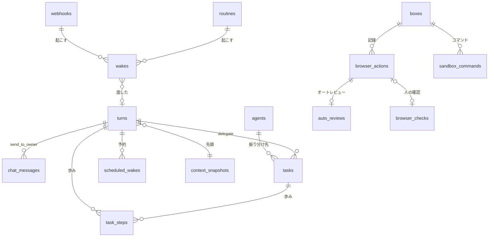

# 08. DB設計
- プロジェクト：Agent-Team-Open ／ 版数：v1.1（2026-10-24） ／ インプット：[04_functional_spec](../04_functional_spec/README.md)、`apps/worker/src/db/schema.ts`

> **3行で**
> 1. DB は本体の SQLite のファイル1つ（`/data/makase.db`）。Cloudflare 版の WorkspaceDO のスキーマ（`schema.ts`）を使い、v0.6 の表（TBL-031〜040）を引き継ぎ、常駐の表（TBL-041〜055）を足す。
> 2. 常駐の中心は `wakes`（きっかけ）・`turns`（メインのターン）・`chat_messages`（チャット）。依頼（`asks` まわり）は使わない（D-235）。記憶は `memory_facts`・`memory_log`・`memory_notes`・`memory_search`（FTS5）。
> 3. `boxes` は持ち主に 1 台の VM の世代で、画面の番を持つ。ブラウザの確認は今までどおり `browser_checks`（[ADR-052](../adr/ADR-052-browser-checks-table.md)）。表の定義は [resident.md](resident.md)（新しい表）と [vm.md](vm.md)（引き継ぐ表）。

## 🧭 判断してほしいこと
| # | 種類 | 論点 | 選択肢 | おすすめ（理由） | 決まらないと止まるもの |
|---|---|---|---|---|---|
| R-81 | リスク | VM のホームと控えは暗号化しないので、ホストのディスクを読まれると Cookie が漏れる | — | ホストのディスクの暗号化を手順書で勧める。ブラウザのデータを消す・作り直す操作を用意する（FR-079・100） | — |

## 全体図

見てほしいところ：どのきっかけも `wakes` を通ってターンに入り、ターンがタスクを作る。VM の表（`boxes` 以下）はタスクから使われる（画面の番は `boxes.screen_task_id`）。

## 要点
- 決めごとは Cloudflare 版のまま：ID は TEXT、時刻は ISO 8601 の TEXT、金額はマイクロドルの整数、`workspace_id` の列なし（[方針](#方針)）
- きっかけは `wakes` の 1 行。`source_key` の UNIQUE で重複を捨てる（[TBL-041](resident.md#tbl-041wakesきっかけ)）
- メインのターンは `turns`。動いているのは 1 行だけ（[TBL-042](resident.md#tbl-042turnsメインのターン)）
- 記憶のプロフィールは 100 個・4,000 字まで。検索は FTS5（[TBL-047](resident.md#tbl-047memory_factsプロフィール)・[TBL-050](resident.md#tbl-050memory_search記憶の検索)）
- VM の世代は `boxes` の 1 行。止まっていない世代は 1 つだけ（[TBL-032](vm.md#tbl-032boxesvm-の世代)）
- 上限・言葉・オートレビューの設定はポリシーの JSON（[TBL-035](vm.md#tbl-035workspace_policiesポリシー)）

---

## 詳細

### 方針
| 項目 | 決め |
|---|---|
| DB | SQLite、ファイル1つ。`better-sqlite3` で同期に読み書き |
| 接続の設定 | `journal_mode=WAL`・`synchronous=FULL`（確定した歩みを失わない：NFR-071）・`foreign_keys=ON`・`busy_timeout=5000` |
| 書き込み | 1つのプロセスだけが書く。読んで判断して書く処理は `db.transaction` で包み、中で外を呼ばない（今の G-14 の決まり） |
| アダプター | `db/sqlite.ts` の `WsDb`（`SqlStorage` の `exec(...).toArray()`・`.one()` に合わせたもの）を、`better-sqlite3` の `prepare().all()`・`.get()`・`.run()` の上に作り直す。例外の型（制約違反の見分け）も合わせる |
| ID | TEXT。新しい表は UUIDv7（時刻の順に並ぶ） |
| 時刻 | ISO 8601（UTC）の TEXT。既定値は `schema.ts` の `NOW` |
| 金額 | `*_micro_usd` の INTEGER |
| 削除 | エージェントは論理削除（`status = 'removed'`）。記録の表は消さない（スクショの画像だけ消す） |
| 守り | 今のトリガー（監査ログは追記だけ など）をそのまま使う |
| マイグレーション | `schema.ts` の版を上げ、起動のときに流す（前にバックアップ） |

### テーブル一覧
| ID | テーブル名 | 論理名 | 概要 | 関連FR | 区分 | 定義 |
|---|---|---|---|---|---|---|
| TBL-007 | `task_events` | タスクの事象 | タイムライン（VM・画面の番・オートレビューの事象を足す） | FR-018 | 今のまま | — |
| TBL-031 | `workspace` | ワークスペース | 1行。`owner_login`・`max_tasks`・`snapshot_hour` を足す | FR-073, FR-092 | 変える | [vm](vm.md#tbl-031workspaceワークスペース) |
| TBL-032 | `boxes` | VM の世代 | 持ち主に 1 台の VM の 1 回の起動。画面の番 | FR-074, FR-078 | 変える | [vm](vm.md#tbl-032boxesvm-の世代) |
| TBL-033 | `browser_actions` | 操作の記録 | エージェントの1操作 | FR-075, FR-076 | 変える | [vm](vm.md#tbl-033browser_actions操作の記録) |
| TBL-034 | `takeovers` | 交代 | 交代の頼みと交代 | FR-078 | 変える | [vm](vm.md#tbl-034takeovers交代) |
| TBL-035 | `workspace_policies` | ポリシー | `budget`・`browser`・`terminal` 欄の JSON | FR-013, FR-076, FR-086, FR-099 | 変える | [vm](vm.md#tbl-035workspace_policiesポリシー) |
| TBL-036 | `browser_profiles` | プロフィール | 使わない（VM に 1 つ） | — | 使わない | [vm](vm.md#tbl-036browser_profilesプロフィール) |
| TBL-037 | `push_subscriptions` | 通知の購読 | Web Push の宛先 | FR-017 | 新規（v1.0 で作る） | [vm](vm.md#tbl-037push_subscriptions通知の購読) |
| TBL-038 | `task_steps` | 歩みの記録 | ターン・タスクの1歩の結果 | FR-084, FR-013 | 変える | [vm](vm.md#tbl-038task_steps歩みの記録) |
| TBL-039 | `browser_checks` | ブラウザの確認 | 人に回ったこわい操作の ○ / × | FR-077 | 変える | [vm](vm.md#tbl-039browser_checksブラウザの確認) |
| TBL-040 | `sandbox_commands` | ターミナルの記録 | VM の中のコマンド1つ | FR-086 | 今のまま（v0.6） | [vm](vm.md#tbl-040sandbox_commandsターミナルの記録) |
| TBL-041 | `wakes` | きっかけ | 受けたきっかけ 1 件 | FR-090 | 新規 | [resident](resident.md#tbl-041wakesきっかけ) |
| TBL-042 | `turns` | ターン | メインの 1 ターン | FR-091 | 新規 | [resident](resident.md#tbl-042turnsメインのターン) |
| TBL-043 | `chat_messages` | チャット | 持ち主とメインのメッセージ | FR-093 | 新規 | [resident](resident.md#tbl-043chat_messagesチャット) |
| TBL-044 | `routines` | ルーチン | プロンプトと時刻 | FR-094 | 新規 | [resident](resident.md#tbl-044routinesルーチン) |
| TBL-045 | `scheduled_wakes` | 予約した確認 | 次に起きる時刻と覚え書き | FR-095 | 新規 | [resident](resident.md#tbl-045scheduled_wakes予約した確認) |
| TBL-046 | `webhooks` | 受け口 | webhook の口と署名の秘密 | FR-096 | 新規 | [resident](resident.md#tbl-046webhooks受け口) |
| TBL-047 | `memory_facts` | プロフィール | 持ち主についての事実 | FR-097 | 新規 | [resident](resident.md#tbl-047memory_factsプロフィール) |
| TBL-048 | `memory_log` | ログ | 日付つきの出来事 | FR-097 | 新規 | [resident](resident.md#tbl-048memory_logログ) |
| TBL-049 | `memory_notes` | メモ | 60 分で消える短期の情報 | FR-097 | 新規 | [resident](resident.md#tbl-049memory_notesメモ) |
| TBL-050 | `memory_search` | 記憶の検索 | FTS5 の仮想表 | FR-097 | 新規 | [resident](resident.md#tbl-050memory_search記憶の検索) |
| TBL-051 | `auto_reviews` | オートレビュー | 1 操作の判断 | FR-099 | 新規 | [resident](resident.md#tbl-051auto_reviewsオートレビュー) |
| TBL-052 | `vm_snapshots` | VM の控え | ホームの tar | FR-100 | 新規 | [resident](resident.md#tbl-052vm_snapshotsvm-の控え) |
| TBL-053 | `context_snapshots` | 文脈の先頭 | ①〜⑤とハッシュ | FR-098 | 新規 | [resident](resident.md#tbl-053context_snapshots文脈の先頭) |
| TBL-055 | `push_outbox` | Web Push の送り待ち | 送る通知と再送の状態 | FR-017 | 新規 | [resident](resident.md#tbl-055push_outboxweb-push-の送り待ち) |
| TBL-054 | `routine_proposals` | ルーチンの提案 | メインの提案（承認待ち） | FR-094 | 新規 | [resident](resident.md#tbl-054routine_proposalsルーチンの提案) |
| — | `pack_installs`・`agent_skills` | パックの記録・手で書いたスキル | パックを入れた記録（D-176）。スキルは `origin = pack` だけ使う（D-177） | FR-085 | 今のまま使う | — |
| — | そのほか | — | `agents`・`tasks`・`action_intents`・`approvals`・`audit_logs`・`usage_records`・`connectors` など | — | 今のまま（変えるところは下） | — |

### 変える表
| 表 | 変えるところ |
|---|---|
| `tasks` | 今の `schema.ts` に合わせる（D-254）。列を足す：`turn_id`（作ったターン、FK `turns`）・`tool_call_id`（UNIQUE）・`title`（40 字）・`brief`（4,000 字）・`delegate_reason`（100 字）・`budget_class`。`report`・`report_meta`（成果物と報告の状態を入れる）・`tainted`・`taint_sources` は今の列を使う（報告は 2,000 字までを本体で守る。CHECK は今の 50,000 のまま）。`job_id` は NULL を許し（振り分けのタスクは job を持たない）、`trigger_type` に `delegate` を足す。`ask_id` は NULL のまま使わない（D-235）。`status` の値は今の CHECK のまま（`completed` などを使う）。`halt_reason` に `vm_replaced` を足す。`status_detail` の値に `waiting_vm`・`waiting_screen`・`taken_over`・`waiting_takeover`・`running_command`・`auto_review`（列の制約は今の形で通る）。列 `paused_ms`（INTEGER NOT NULL DEFAULT 0）を足す：確認待ち・交代待ち（`awaiting_approval`・`waiting_takeover`・`taken_over`）で待った時間の合計。上限の判定は「経過時間 − `paused_ms`」（D-174） |
| `sandbox_commands` | `session_id` を `box_id`（FK `boxes`）に変え、`output` を 64KB までにする（TBL-040） |
| `task_events` | 事象の種類に `box_started`・`box_stopped`・`screen_acquired`・`screen_released`・`browser_checked`・`auto_reviewed`・`takeover_started`・`takeover_ended`・`steered`・`reported` |
| `agents` | 列を足す：`kind`（`main`・`worker`。`main` は 1 行だけ：部分 UNIQUE）・`description`（「いつ使うか」200 字）・`created_by`（`owner`・`main`・`pack`）・`instruction_addendum`（メインの指示の手直し 2,000 字） |
| `usage_records` | 列を足す：`turn_id`（FK `turns`）・`purpose`（`turn`・`task`・`review`・`memory`・`summary`・`prewarm`）・`budget_class`（`chat`・`auto`）・`cache_read_tokens`・`cache_write_5m_tokens`・`cache_write_1h_tokens`（D-263）・`cache_expected`（0/1：当たるはずだった）。`task_id` は NULL を許す |
| `audit_logs` | 事象の種類に `wake.received`・`wake.dropped`・`turn.halted`・`auto_review.decided`・`routine.created`・`webhook.rejected`・`memory.changed`・`vm.snapshot`・`vm.restored`・`vm.rebuilt`・`cache.miss` |
| `action_intents`・`approvals` | `turn_id`（FK `turns`）を足し、`task_id` と `job_id` を NULL 可にする。CHECK：`task_id` と `turn_id` のどちらか一方だけ（D-248）。`expire_reason` 相当の値に `task_cancelled`（D-250） |

### 使わなくなるもの
| 表 | 理由 | 扱い |
|---|---|---|
| D1 の `users`・`memberships`・`sessions` | Tailscale の身元にした（ADR-046） | 作らない |
| `skill_proposals`・`agent_evolution_events` | スキルが育つ仕組みを入れない（01 §7）。`agent_skills.origin` の `learned` も使わない（D-177） | 落とす |
| `sandbox_sessions` | VM（`boxes`）に置き換わった（D-178）。`sandbox_commands` は `box_id` に付け替えて使う（TBL-040） | 使わない |
| `asks`・`ask_pending_replies`・`ask_members`・`ask_messages` | チャット・きっかけ・ターン・タスクに置き換えた（D-235）。v0.6 から上げるときは、`asks` の文を `chat_messages` に写してから使わなくする | 使わない（落とすのは次のマイグレーション） |
| TBL-036 `browser_profiles` | プロフィールは VM に 1 つ（ADR-060） | 作らない |
| `pack_installs`・`agent_skills` | パックを残す（D-176）。手で書いたスキルは残す（D-177） | 今のまま使う |

### データ保持・削除ポリシー
| もの | 保持 |
|---|---|
| 監査ログ | 無期限（NFR-078） |
| スクショの画像 | 7日（NFR-073）。行は残す。秘密の欄の領域は塗りつぶしてから保存する（D-162）。スクショは DB の外のファイルなので、バックアップには入らない |
| 歩みの記録 | 終わったタスクから 7日。ターンの歩みは要約に取り込まれてから 7 日（D-262） |
| チャット・ログ・プロフィール | 消さない（持ち主が消すまで。プロフィールは `deleted_at` を入れる） |
| メモ | 60 分 |
| きっかけ（`wakes`） | 30 日 |
| 文脈の先頭（`context_snapshots`） | 参照するターンが残っている間（最新は残す。D-262） |
| Web Push の送り待ち | 終わってから 7 日 |
| VM の控え | 3 世代（データのボリュームの中。バックアップと書き出しには入れない） |
| バックアップ | 毎日1回・7世代（NFR-070）。秘密の欄の文字は DB のどこにも平文で残らない |
| VM のホーム（Chrome のプロフィールを含む） | 持ち主が消す・戻す・作り直すまで（BR-07） |

## このドキュメントで決まったこと
- [ADR-052](../adr/ADR-052-browser-checks-table.md)：ブラウザの確認は別の表
- D-144、D-145、D-147、D-151、D-153、D-159、D-161〜D-163、D-167、D-170、D-174〜D-178、D-205、D-207、D-215、D-217、D-221〜D-227、D-230、D-232、D-235、D-245〜D-251、D-254、D-256、D-259〜D-263、D-267（[00 決定事項ログ](../00_overview.md#決定事項ログ)）
