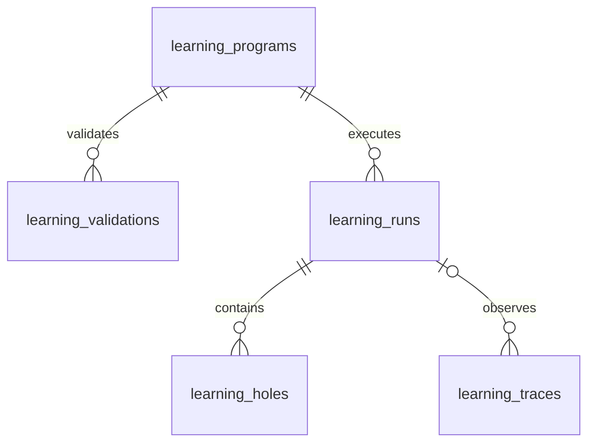

# 08. 成長機構のDB
- 版数：v1.8（2026-10-26） ／ インプット：[FR-117〜122](../04_functional_spec/learning.md)

> **3行で**
> 1. 本体のSQLiteに観測・プログラム版・検証・実行・穴を保存する。
> 2. プログラムの中身は不変、状態変更と採用はトランザクションで確定する。
> 3. 外部操作の記録は既存Intentと接続し、再起動で重複送信しない。

## 🧭 判断してほしいこと
[R-114〜116](../00_learning.md#-判断してほしいこと)。

## 全体図

見てほしいところ：通常AI実行からの観測はrun_idがNULLでも記録できる。

## 要点
- [定義](#テーブル定義)でJSONの中身まで型を固定する。
- [整合性](#整合性と再開)はDB制約とトランザクションで守る。
- [保持](#保持と削除)は検証根拠の欠落を失効に結びつける。

## 詳細
### 共通規約
既存[DB方針](README.md#方針)を継承。単一持ち主・workspace_id列なし。idはUUIDv7 TEXT PK、日時はISO 8601 UTC TEXT、金額はマイクロドルINTEGER。
新規5表すべて`id TEXT NOT NULL PRIMARY KEY`、`created_at TEXT NOT NULL`を持つ。以下の`?`だけNULL可。他はNOT NULLで、既定値を記した列以外は作成時に必須。
JSON列はTEXT＋`CHECK(json_valid(...))`、schemaはアプリ側でバージョン別に検証。外部キーを有効にし、原則ON DELETE RESTRICT。実装コードではなくスキーマ契約を定義する。

### テーブル定義

TBL-064〜068の列・制約

| ID・表 | 列（共通列以外） | 制約・索引 |
|---|---|---|
| TBL-064 `learning_traces`〔FR-117〕 | task_id TEXT FK tasks.id、run_id TEXT? FK learning_runs.id、node_id TEXT、sequence INTEGER、scope_key TEXT、input_json TEXT、observations_json TEXT、output_json TEXT?、dependencies_json TEXT、eligible INTEGER DEFAULT 0、ineligible_reason TEXT?、expires_at TEXT | UNIQUE(task_id,sequence)、INDEX(scope_key,eligible,created_at)、eligible IN(0,1)。eligible=1ならoutput必須 |
| TBL-065 `learning_programs`〔FR-118・119・122〕 | scope_key TEXT、version INTEGER、parent_id TEXT? FK self.id、digest TEXT、ir_json TEXT、bindings_json TEXT、dependencies_json TEXT、source_trace_ids_json TEXT、status TEXT、status_reason TEXT?、active_validation_id TEXT? FK learning_validations.id、activated_at TEXT?、expires_at TEXT、updated_at TEXT | UNIQUE(scope_key,version)、INDEX(scope_key,digest)、部分UNIQUE(scope_key) WHERE status='active'。statusは機能仕様の8値のみ |
| TBL-066 `learning_validations`〔FR-119〕 | program_id TEXT FK learning_programs.id、suite_version TEXT、validator_version TEXT、stage TEXT、status TEXT、cases_json TEXT、source_trace_ids_json TEXT、counts_json TEXT、oracle_digest TEXT、cost_microusd INTEGER DEFAULT 0、started_at TEXT?、finished_at TEXT? | INDEX(program_id,created_at)。stage=static/replay/counterexample/shadow/final、status=pending/running/passed/failed。finalは全先行段階への参照をcases_jsonに持つ |
| TBL-067 `learning_runs`〔FR-120・122〕 | task_id TEXT FK tasks.id、program_id TEXT FK learning_programs.id、input_json TEXT、dependencies_json TEXT、status TEXT、checkpoint_json TEXT、metrics_json TEXT、stop_reason TEXT?、lease_until TEXT?、lease_epoch INTEGER DEFAULT 0、updated_at TEXT | UNIQUE(task_id)、INDEX(status,lease_until)。status=running/waiting_hole/waiting_approval/needs_owner/succeeded/failed/blocked/unknown_outcome/cancelled |
| TBL-068 `learning_holes`〔FR-121〕 | run_id TEXT FK learning_runs.id、node_id TEXT、contract_json TEXT、evidence_refs_json TEXT、status TEXT、attempts INTEGER DEFAULT 0、resolution_json TEXT?、resolver_task_id TEXT? FK tasks.id、updated_at TEXT | UNIQUE(run_id,node_id)、status=open/resolving/resolved/needs_owner/cancelled、attempts BETWEEN 0 AND 2。resolvedならresolutionと根拠が必須 |

- `scope_key`は正規化したoperation・入力schema digest・接続identity・calendarRefs集合・設定版のSHA-256。bindingsは実カレンダー参照と仮名slotの対応で、認証情報を含まない。
- `observations_json`：配列`{id, source, toolVersion, schemaDigest, observedAt, value, tainted, dependencyNodeIds}`。source=tool/owner/hypothesis。
- `dependencies_json`：`{irVersion, operatorVersions, toolSchemas, accountIdentity, policyDigest, preferenceVersion}`。policy変更も失効対象とする。
- `cases_json`：固定ケースID、入力、期待値・根拠、実測値、pass、失敗理由、段階参照。候補LLMは書けない。
- `counts_json`：`{total, passed, failed, distinctRequests}`。各段階の件数を曖昧なスコアにまとめない。
- `checkpoint_json`：`{nodes:{nodeId:{state,inputDigest,output,evidenceRefs,intentId,effectKey,sentAt,result}}, nextNodeIds}`。未使用フィールドはNULL。state=pending/running/completed/invalidated/unknown_outcome。
- `metrics_json`：`{llmCalls, inputTokens, outputTokens, llmCostMicrousd, elapsedMs, holeCount, contractPassed, outcome}`。全runで記録する。通常経路は既存task使用量から同じ定義へ射影する。
- `contract_json`はIRのhole契約を固定したコピー。`resolution_json`は型付き値と取得元の参照で、任意コードを含まない。

### 整合性と再開
- candidate作成時はactive_validation_id=NULL。final passed後、同一programの検証であることと依存版を確認して、状態・参照・旧版superseded・監査を同じトランザクションで更新する。
- 検証結果は完了後不変。IR・bindings・scope・依存版・元履歴参照も不変。変更は新program行とし、状態更新はupdated_at付きCASで行う。
- runリースは30秒、10秒ごと更新。取得時にlease_epochを増やし、すべてのノード状態更新をepochの一致で制約する。単一executorだけが副作用を発行する。
- 外部送信中にリースが失効した場合も、新executorは同じeffectKeyの送信記録を確認して照合待ちにし、二重送信しない。ネットワークを含むexactly-onceは保証しない。
- ノード完了・hole状態・checkpoint更新は同一トランザクション。Intent作成もeffectKeyを一意キーとして既存の冪等規約へ接続する。
- 既存TBL-035の設定JSONに`learning`を追加する。値は[NFR-099](../05_non_functional.md#成長機構v18)と[運用](../11_learning.md#設定と運用)を正とする。

### 保持と削除
- 観測・検証ケース・run・holeは30日。active版の有効期限は採用から最大30日か、必要根拠の最短expires_atの早い方。期限前に再検証した新しい版へ切り替える。
- 根拠が期限切れ／手動削除される場合、依存active版を先にinvalidatedにする。期限切れデータを参照する非終端候補はrejectedにする。
- 保持削除は依存版を無効化した後、同一トランザクションで古いhole→trace→run→validation→programの順に処理する。削除対象を参照するactive_validation_idとparent_idを先にNULLへ戻し、親のID・digestを監査へ残す（履歴の保持削除時だけ参照の不変制約の例外）。進行中runや未確定Intentが参照する行は照合完了まで削除しない。
- 保持例外はUIに理由を表示。秘密やカレンダー本文は最初から保存しない。停止版も即時物理削除せず、既存監査にはID・digest・理由・集計のみを残す。
- 学習領域は512MiB目安の上限。満杯なら学習記録をeligible=falseにし、新規学習を停止。既存データや未確定結果を容量確保のため黙って消さない。

## このドキュメントで決まったこと
[D-400・401・402](../00_learning.md#決定事項ログ)。
