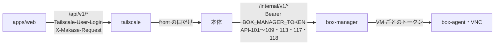

# 09. API設計
- プロジェクト：Agent-Team-Open ／ 版数：v0.5（2026-10-24） ／ インプット：[04_functional_spec](04_functional_spec.md)、[06_ux_design](06_ux_design.md)、`apps/worker/src/routes`

> **3行で**
> 1. 画面向けの API は `/api/v1`。今の依頼・エージェントの API は旧 ID のまま移し、VM・確認・パック・設定・引っ越しの API を足す。
> 2. 本体と box-manager の間は内部 API（API-101〜109・113・117・118）。共有トークンで確かめ、決まった操作だけを受ける（VM のコマンド・ファイルの出し入れを含む）。
> 3. ブラウザの確認の ○ / × は、API の書き込みの承認（API-019）とは別の口（API-110）。実行は1回だけで、中身が同じときだけ。

## 🧭 判断してほしいこと
なし

## 全体図

見てほしいところ：画面からは Tailscale を通って本体の front の口にしか届かない。VM の画面も本体が box-manager に中継する。

## 要点
- 認証は Tailscale の身元。GET 以外は `Origin` と `X-Makase-Request: 1` が要る（[共通仕様](#共通仕様)）
- 依頼・エージェントの API は今の入出力のまま（API-041・072〜081）。新しい一覧の API だけ共通のページングを使う
- VM：一覧・状態・画面・代わる・返す・止める（API-086・088〜091・099）
- パック：一覧・入れる（更新も同じ口）・外す（API-114〜116）
- 確認の一覧は API-087。○ / × は API の書き込みが API-019、ブラウザが API-110
- 内部 API は box-manager の決まった操作だけ（[内部 API](#内部-apibox-manager)）

---

## 詳細

### 共通仕様
- ベース URL：`https://makase.<tailnet>.ts.net/api/v1`（`/api/health` だけ版なし）
- 認証：FR-073。ヘッダー `Tailscale-User-Login` は `tailscale serve` が付ける。本体の画面向けの口は front ネットワークだけで待ち受ける
- CSRF：GET 以外は `Origin` が自分の URL、かつ `X-Makase-Request: 1`。GET で状態を変えるのは API-094（`state` を作る）と API-095（つなぐときの戻り先）の2つだけで、`state` と Cookie で守る（FR-081）
- 冪等：POST の作成系は `Idempotency-Key` を受ける（今のまま）
- 形式：JSON、キーは camelCase、時刻は ISO 8601
- ページング：新しい一覧（API-023・086）は `?cursor=` と `?limit=`（既定 20、最大 100）。応答に `nextCursor`。今の一覧（API-041・084）は今の形（`limit` 最大 50・cursor なし）のまま
- エラーの形：
 ```json
 { "error": { "code": "BOX_RUNNING", "message": "VM が動いている間は消せません", "details": {} } }
 ```

<details>
<summary>エラーコード（足すもの。今のコードはそのまま）</summary>

| code | HTTP | 意味 |
|---|---|---|
| `NOT_OWNER` | 403 | 持ち主のログイン名でない |
| `CSRF_REJECTED` | 403 | Origin・専用ヘッダーが違う |
| `CONNECT_STATE_INVALID` | 400 | つなぐときの `state`・Cookie・PKCE が合わない |
| `BOX_NOT_FOUND` | 404 | VM がない |
| `BOX_NOT_RUNNING` | 409 | VM が止まっている |
| `BOX_RUNNING` | 409 | VM が動いている（プロフィールを消せない） |
| `NOT_TAKEN_OVER` | 409 | 人が操作する状態でないのに操作の形でつなごうとした・返そうとした |
| `ALREADY_TAKEN_OVER` | 409 | もう交代中か、渡す準備中 |
| `CONTROL_IN_USE` | 409 | 操作の形の画面がもう1つつながっている |
| `CHECK_NOT_PENDING` | 409 | 確認がもう決まっている（二重の ○） |
| `IMPORT_INVALID` | 422 | 取り込むファイルの形が違う |
| `IMPORT_VERSION_UNSUPPORTED` | 422 | 形式の版が新しすぎる |
| `PACK_NOT_FOUND` | 404 | パックがない |
| `PACK_INVALID` | 422 | パックのファイルの形が違う |
| `PACK_ALREADY_INSTALLED` | 409 | 同じ版がもう入っている |
| `BOX_CAPACITY` | 503 | （内部）VM の同時数がいっぱい |
| `STALE_CONTROL` | 409 | （内部）VM の世代・`control_epoch` が古い操作 |
| `CONTENT_CHANGED` | 409 | （内部）承認した中身と今の画面が違う |
| `COMMAND_TIMEOUT` | 504 | （内部）コマンドが `timeoutSec` を超えた。本体は Claude に `ok = false` と打ち切りを返す（FR-086） |

</details>

### エンドポイント一覧
| ID | メソッド | パス | 概要 | 関連FR/SCR |
|---|---|---|---|---|
| API-082 | GET | `/api/health` | `ok` と版だけ（確かめなし） | FR-083 |
| API-111 | GET | `/api/v1/host` | ホストの状態（版・DB・box-manager・VM の数・空きメモリ・空きディスク・`llm: { provider, model }`） | FR-083, FR-087 / SCR-023 |
| API-083 | GET | `/api/v1/session` | 持ち主のログイン名・表示名 | FR-073 / 全画面 |
| API-085 | GET | `/api/v1/events` | SSE（依頼・タスク・VM・確認の変化） | FR-018 / SCR-020, 021, 022 |
| API-100 | GET | `/api/v1/counts` | 確認待ちなどの件数 | FR-018 / SCR-020 |
| API-041 | GET | `/api/v1/agents` | エージェントの一覧（プロフィールの大きさを足す） | FR-072 / SCR-014 |
| API-080 | POST | `/api/v1/agents` | したいことから1人作る | FR-072 / SCR-014 |
| API-081 | DELETE | `/api/v1/agents/:agentId` | 論理削除。プロフィールも消す | FR-072, FR-079 / SCR-014 |
| API-092 | DELETE | `/api/v1/agents/:agentId/profile` | ブラウザのデータを消す | FR-079 / SCR-014 |
| API-084 | GET | `/api/v1/asks` | 依頼の一覧 | FR-061 / SCR-020 |
| API-072 | POST | `/api/v1/asks` | 依頼を作る | FR-061 / SCR-020 |
| API-073 | POST | `/api/v1/asks/:askId/answer` | 生成中の質問に答える | FR-061 / SCR-020 |
| API-075 | GET | `/api/v1/asks/:askId` | 依頼のページ（VM の欄を足す） | FR-063 / SCR-021 |
| API-076 | GET | `/api/v1/asks/:askId/messages` | 依頼の会話 | FR-063 / SCR-021 |
| API-077 | POST | `/api/v1/asks/:askId/reply` | 回答への返事（旧 Node 版から移す） | FR-063 / SCR-020 |
| API-016 | POST | `/api/v1/tasks/:taskId/cancel` | タスクを取り消す（VM も止める） | FR-074 / SCR-021 |
| API-086 | GET | `/api/v1/boxes` | 動いている VM の一覧 | FR-074 / SCR-020, 023 |
| API-088 | GET | `/api/v1/boxes/:boxId` | VM の状態・操作する人・依頼・交代の頼み・最新のスクショ | FR-078 / SCR-022 |
| API-089 | GET（WebSocket） | `/api/v1/boxes/:boxId/screen?mode=view\|control` | 画面（VNC）。`control` は人が操作する状態のときだけ・1本だけ | FR-078 / SCR-022 |
| API-090 | POST | `/api/v1/boxes/:boxId/takeover` | 代わる | FR-078 / SCR-022 |
| API-091 | POST | `/api/v1/boxes/:boxId/handback` | 返す | FR-078 / SCR-022 |
| API-099 | POST | `/api/v1/boxes/:boxId/stop` | VM を止め、タスクを取り消す | FR-074 / SCR-022 |
| API-112 | GET | `/api/v1/shots/:file` | スクショの画像（7日を過ぎたら 404） | FR-075, FR-077 / SCR-019, 021, 022 |
| API-087 | GET | `/api/v1/check` | 確認の一覧（API の書き込み・ブラウザ・交代の頼み） | FR-077, FR-078, FR-081 / SCR-019 |
| API-019 | POST | `/api/v1/approvals/:approvalId/decision` | API の書き込みの ○ / ×（今のまま） | FR-081 / SCR-019 |
| API-110 | POST | `/api/v1/browser-checks/:checkId/decision` | ブラウザの確認の ○ / × | FR-077 / SCR-019 |
| API-023 | GET | `/api/v1/audit-logs` | 監査ログ（旧 Node 版から移す） | FR-016 / SCR-010 |
| API-093 | GET | `/api/v1/connectors` | つながりの一覧 | FR-081 / SCR-023 |
| API-094 | GET | `/api/v1/connect/:kind/start` | つなぎ始める（`state` を作り、Google の同意・GitHub App のインストールへ送る） | FR-081 / SCR-023 |
| API-095 | GET | `/api/v1/connect/:kind/callback` | 戻り先（`state`・Cookie・PKCE を確かめる） | FR-081 |
| API-107 | DELETE | `/api/v1/connect/:kind` | つながりを外す | FR-081 / SCR-023 |
| API-096 | GET・PATCH | `/api/v1/settings` | `budget`・`browser` 欄・VM の同時数 | FR-013, FR-076 / SCR-023 |
| API-097 | GET | `/api/v1/export` | 書き出し（JSON のファイル） | FR-082 / SCR-023 |
| API-098 | POST | `/api/v1/import` | 取り込み | FR-082 / SCR-023 |
| API-114 | GET | `/api/v1/packs` | 入れられるパックと入っているパックの一覧 | FR-085 / SCR-024 |
| API-115 | POST | `/api/v1/packs/:packId/install` | パックを入れる（版が上がっていれば更新も同じ口） | FR-085 / SCR-024 |
| API-116 | DELETE | `/api/v1/packs/:packId` | パックを外す | FR-085 / SCR-024 |
| API-031 | POST | `/api/v1/push-subscriptions` | 通知の購読（次の版：D-179。最初の版では作らない） | FR-017 |
| API-032 | DELETE | `/api/v1/push-subscriptions/:subscriptionId` | 購読の削除（次の版：D-179。最初の版では作らない） | FR-017 |

今の依頼・エージェントの API（API-041・072〜076・080・081）の中身は Cloudflare 版の `routes/` と `views/` のとおり。ここでは差分だけ書く。

画面は今 `/api/v1/workspaces/w1/stream` を呼んでいるので、API-085 `/api/v1/events` への差し替えが画面側の変更になる。

### エンドポイント詳細

### API-114：GET /api/v1/packs
- 概要：置き場（イメージの `/opt/makase/packs/*.json` と、データのボリュームの `/data/packs/*.json`）にあるパックと、入っているパック（`pack_installs`）の一覧
- レスポンス（200）：
<details>
<summary>例</summary>

```json
{
 "installed": [
  { "id": "web-research", "version": 2, "name": "調べもの", "purpose": "Web で調べてまとめる", "agentCount": 3, "installedVersion": 2 }
 ],
 "available": [
  { "id": "code-fix", "version": 1, "name": "コードの修正", "purpose": "リポジトリを VM で動かして直す", "agentCount": 2, "installedVersion": null }
 ]
}
```

</details>

- 置き場の版が `installedVersion` より新しければ、`installed` の中でも更新できる印として `version` が大きく出る

### API-115：POST /api/v1/packs/:packId/install
- 処理：`pack_installs` に記録 → `agents[]` からエージェントを作る → `skills[]` を `agent_skills`（`origin = pack`）に入れる → `browser` の追加分をポリシーに足す
- 更新：同じ `id` が入っていて版が上がっていれば、パックのエージェントの設定を作り直す（持ち主が手で変えた設定は失われる）
- レスポンス（200）：`{ "agentIds": ["0193..."], "updated": true | false }`
- エラー：404 `PACK_NOT_FOUND`、422 `PACK_INVALID`、同じ版がもう入っていれば 409 `PACK_ALREADY_INSTALLED`

### API-116：DELETE /api/v1/packs/:packId
- 処理：パックのエージェントを論理削除し、プロフィールも消す。`agent_skills` と `pack_installs` の行を消し、ポリシーに足した `browser` の分を戻す
- エラー：パックのエージェントが動いていれば 409 `AGENT_BUSY`、404 `PACK_NOT_FOUND`

### API-087：GET /api/v1/check
- 概要：確認待ちのもの。今の書き込みのカードに、`kind: "browser"` と `kind: "takeover"` を足す
- レスポンス（200）：
<details>
<summary>例</summary>

```json
{
 "items": [
  {
   "kind": "browser",
   "checkId": "0193...",
   "askId": "0193...",
   "summary": "購入ボタンを押します",
   "domain": "example.jp",
   "target": { "role": "button", "name": "予約を確定する" },
   "point": { "x": 812, "y": 604 },
   "screenshotUrl": "/api/v1/shots/0193....png",
   "reasons": ["T-3"],
   "declared": false,
   "expiresAt": "2026-10-23T10:30:00Z"
  },
  { "kind": "takeover", "boxId": "0193...", "askId": "0193...", "reason": "ログインしてください", "requestedAt": "2026-10-23T10:00:00Z" }
 ]
}
```

</details>

### API-110：POST /api/v1/browser-checks/:checkId/decision
- リクエスト：`{ "decision": "approve" | "reject" }`
- 処理：1つのトランザクションで `pending → executing`（approve）か `pending → rejected`（reject）に変える。0行なら 409 `CHECK_NOT_PENDING`。approve なら、その外で API-103 に `actionId` と `expect: contentHash` を付けて頼む
- レスポンス（200）：`{ "result": "executed" | "page_changed" | "rejected" | "unknown_outcome" }`
- `page_changed`（承認のあと中身が変わっていた）のときは、新しい確認は作らない。確認を `expired`（`page_changed`）にし、Claude に新しいスクショと「画面が変わったので実行しなかった」を返して操作を決め直させる（D-159）

### API-089：WebSocket /api/v1/boxes/:boxId/screen
- 開始のとき `Origin` を確かめる。`mode=view` は VM が動いていればいつでも。`mode=control` は `boxes.control = 'human'` のときだけで、同時に1本だけ（違えば 409 `NOT_TAKEN_OVER`・`CONTROL_IN_USE` で閉じる）
- 中身は RFB（VNC）をそのまま流す。本体は box-manager（API-106）に中継し、`view` のときは入力のメッセージを捨てる
- `control` が `human` でなくなったら、本体が `control` の接続を閉じる

### API-090：POST /api/v1/boxes/:boxId/takeover
- 処理：`control` を `handing_over` にし、`control_epoch` を1増やす → API-113 で `handing_over` と新しい epoch を VM に伝える（D-160） → 動いている Claude の呼び出しを中止する → その `llm:<n>` の歩みを `done`（結果 `aborted`）で閉じ、予約した費用を精算する（実際の請求額が取れなければ見積もりのまま確定。`started` のまま残さない：D-163） → その VM の世代の `pending` の確認を `expired`（`taken_over`）にする → box-agent の動いている操作が終わるのを待つ → `control = human`、`takeovers` を `active`（頼みがあればそれを、なければ新しく）、タスクの `status_detail = 'taken_over'` にして 200
- エラー：409 `ALREADY_TAKEN_OVER`・`BOX_NOT_RUNNING`

### API-091：POST /api/v1/boxes/:boxId/handback
- リクエスト：`{ "note": "ログインしました" }`（任意、200字まで。Claude に渡す）
- 処理：`control` の接続を閉じ、`control = agent`・`control_epoch` を1増やし、API-113 で `agent` と新しい epoch を VM に伝える（D-160）。交代を `ended`、スクショを撮って残す。タスクを続ける
- エラー：409 `NOT_TAKEN_OVER`

### API-092：DELETE /api/v1/agents/:agentId/profile
- 副作用：box-manager にボリュームを消させ（API-108）、`browser_profiles.cleared_at` を入れる。監査ログ `profile.cleared`
- エラー：409 `BOX_RUNNING`

### API-094・095：つなぐ
- API-094：期限 10分・1回限りの `state` を作り、HttpOnly・Secure・SameSite=Lax の Cookie にも入れる。Google は PKCE の `code_challenge` を付ける
- API-095：`state`・Cookie・PKCE（Google）、インストールの ID（GitHub）を確かめる。合わなければ 400 `CONNECT_STATE_INVALID`。使った `state` は消す

### API-096：GET・PATCH /api/v1/settings
- PATCH のボディ：`{ "budget": {...}, "browser": { "confirmDomains": [...], "skipUnresolvedDomains": [...], "confirmWords": [...] }, "maxBoxes": 2 }`（部分）
- 副作用：ポリシーの新しい版を作る（`workspace_policies`）。効くのは次のタスクから（動いているタスクは始まるときのポリシーのまま）

### API-097・098：書き出し・取り込み
- 書き出しの形：`{ "formatVersion": 1, "exportedAt": "...", "agents": [...], "skills": [...], "policy": { "budget": {...}, "browser": {...} } }`
- 取り込みの応答：`{ "imported": ["..."], "skipped": [{ "name": "...", "reason": "same_name" }] }`

### 内部 API（box-manager）
認証は `Authorization: Bearer <BOX_MANAGER_TOKEN>`。box-manager は ctl ネットワークでだけ待ち受け、VM のネットワークでは待ち受けない。

| ID | メソッド | パス | 概要 |
|---|---|---|---|
| API-101 | POST | `/internal/v1/boxes` | 起こす。`{ boxId, agentId }` だけを受ける（イメージ・上限・ネットワークは固定） |
| API-102 | DELETE | `/internal/v1/boxes/:boxId` | 止める（VM のネットワークも消す） |
| API-103 | POST | `/internal/v1/boxes/:boxId/actions` | 操作を1つ、確かめてから実行する |
| API-104 | POST | `/internal/v1/boxes/:boxId/inspect` | 確かめだけ（確認カードを作るとき） |
| API-105 | GET | `/internal/v1/boxes/:boxId/screenshot` | PNG（1280×800） |
| API-106 | GET（WebSocket） | `/internal/v1/boxes/:boxId/vnc` | VNC の中継 |
| API-108 | DELETE | `/internal/v1/profiles/:agentId` | プロフィールのボリュームを消す（その VM が止まっているときだけ） |
| API-109 | GET | `/internal/v1/boxes` | 動いている VM の一覧（本体の起動のときの突き合わせ） |
| API-117 | POST | `/internal/v1/boxes/:boxId/commands` | VM でコマンドを1つ実行する。`{ actionId, controlEpoch, tool, args, timeoutSec }` → `{ ok, exitCode, output, truncated }`。VM の中のコマンドは判定しない（D-178）。`output` は 64KB まで。`actionId` が実行済みなら前の結果を返す。古い `controlEpoch` は 409 `STALE_CONTROL`、時間切れは `COMMAND_TIMEOUT` |
| API-118 | PUT・GET | `/internal/v1/boxes/:boxId/files` | tar でファイルを入れる（PUT）・取り出す（GET）。`path` クエリで場所を指す。リポジトリの出し入れに使う |
| API-113 | PATCH | `/internal/v1/boxes/:boxId/control` | 操作する人と `control_epoch` を VM に伝える。`{ control: "agent"｜"handing_over"｜"human", controlEpoch }`。box-agent はこれ以降、違う `controlEpoch` の操作を 409 `STALE_CONTROL` で断る（D-160） |

<details>
<summary>API-103 のリクエストと応答の例</summary>

```json
{
 "actionId": "0193...",
 "controlEpoch": 4,
 "action": { "kind": "left_click", "x": 812, "y": 604 },
 "expect": null
}
```

- box-agent は、同じ VM の中では操作を1つずつ実行する。`controlEpoch` が今の値と違えば 409 `STALE_CONTROL`。`actionId` が実行済みなら、前の結果をそのまま返す（2回目は実行しない）
- `open_url` は `http`・`https` だけ受ける（`javascript:`・`file:`・`chrome:` などは 400 `VALIDATION_ERROR` で断る：D-158）
- `expect` があれば、確かめた中身のハッシュと比べ、違えば実行せずに 409 `CONTENT_CHANGED`
- 応答：`{ "executed": true, "inspect": {...}, "screenshot": "<path>" }`。`inspect` は判定の材料（下）。判定が要る操作は、本体が先に `dryRun: true` で確かめだけを頼み、判定のあとに実行を頼む（そのときは `expect` に確かめたハッシュを入れる）

</details>

<details>
<summary>inspect の結果の例</summary>

```json
{
 "url": "https://example.jp/reserve/confirm",
 "domain": "example.jp",
 "tab": "T1", "frame": "main",
 "target": { "tag": "button", "type": "submit", "autocomplete": null, "role": "button", "name": "予約を確定する", "clickable": true, "inForm": true, "formSubmitName": "予約を確定する", "rect": [760, 588, 104, 32] },
 "form": { "fields": [{ "name": "date", "value": "2026-11-03" }, { "name": "card", "valueHash": "sha256:..." }] },
 "contentHash": "sha256:...",
 "resolved": true
}
```

`clickable` は要素に `cursor: pointer` か click のリスナーがあるとき true。`div` に処理を付けただけの擬似ボタンも T-3 の対象にするため、`clickable` の要素の見えている名前も決まった言葉と照合する（D-173）。

`resolved: false` のときは要素が分からなかった（canvas・ほかの出どころの iframe・JS のダイアログ）。判定は T-6 に当たる。

</details>

## このドキュメントで決まったこと
- D-148、D-151、D-156、D-158、D-159、D-160、D-163、D-173（`clickable`）、D-176（パックの API）、D-178（VM のコマンド・ファイルの内部 API）、D-179（通知の API は次の版）（[00 決定事項ログ](00_overview.md#決定事項ログ)）
