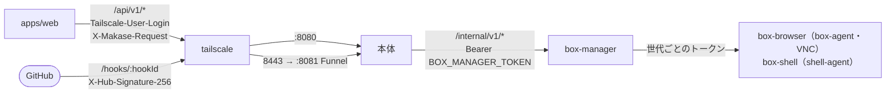

# 09. API設計
- プロジェクト：Agent-Team-Open ／ 版数：v1.8（2026-10-26） ／ インプット：[04_functional_spec](../04_functional_spec/README.md)、[06_ux_design](../06_ux_design.md)、`apps/worker/src/routes`

> **3行で**
> 1. 画面向けの API は `/api/v1`（:8080・tailnet だけ）。依頼の API（API-072〜077・084）はやめ、チャット・タスク・きっかけ・記憶・VM・通知の API を足した。詳細は [resident.md](resident.md)（新しい API）と [vm.md](vm.md)（引き継ぐ API）。v1.6 で、外に出た通信・判定の規則・再実行・監査ログの検査・モデルの API（API-148〜152）を足した。v1.7 で、保管庫・家計簿・Home Assistant・チャットの添付・初回設定（API-153〜157）を足した。
> 2. webhook の口は別の待ち受け（:8081）に `POST /hooks/:hookId`（API-129）だけ。Funnel で 8443 番だけを公開してそこに流し、身元ではなく署名で確かめる。画面と API の 443 番は公開しない（D-241）。「家の中だけで動かす」（`closed`）では Funnel を使わず、家や社内の GitLab・GHES から LAN の中で受ける（v1.6：D-341）。
> 3. 本体と box-manager の間は内部 API（API-101〜109・113・117・118・143・144）。VM は 1 台（`box-browser`・`box-shell` の 2 つのコンテナの組）で、パスの `:boxId` は VM の世代。

## 成長機構（v1.8）
[API-158〜162：学習一覧・詳細・停止・実行詳細・設定](learning.md)。API-122のtask詳細にlearningRunIdを追加する。共通エラー定義に[LEARNING_*と冪等競合](learning.md#エラーコード)を含む。

## 🧭 判断してほしいこと
なし

## 全体図

見てほしいところ：画面からは 443 → :8080（tailnet だけ）、webhook は 8443 → :8081（Funnel）にだけ届く。VM の画面も本体が box-manager に中継する。

## 要点
- 認証は Tailscale の身元。GET 以外は `Origin` と `X-Makase-Request: 1` が要る（[共通仕様](#共通仕様)）
- 送る：`POST /messages`（API-119）。画面が ID を作り、`Idempotency-Key` に入れる。読む：`GET /messages`（API-120）
- タスク：一覧・中身・言い直し・取り消し（API-122〜124・016）
- きっかけ：ルーチン（API-125・126・136・142）・予約（API-127・139）・受け口（API-128・140）
- 記憶（API-130・131・141）・VM（API-088〜091・099・133〜135・138）・通知（API-031・032・137）
- SSE（API-085）は合図だけ。中身は REST で取りに行く
- v1.7：ChatGPT でサインイン（D-385〜390）は API-152（接続先・モデルの一覧の取り直し）・API-157（デバイスコードの開始・状態の確認）・API-111（状態）に足し、新しい番号は振らない。エラーは `CHATGPT_*`
- v1.7：保管庫（API-153）・家計簿（API-154）・Home Assistant（API-155）・チャットの添付（API-156）・初回設定（API-157）。ホストの状態（API-111）にキットの状態、設定（API-096）に `vault`・`home`・`classify` の欄
- v1.6：外に出た通信（API-148）・判定の規則（API-149）・判定の再実行（API-150）・監査ログの検査と毎日の先頭（API-151）・モデルと役割（API-152）。設定（API-096）に `network`・`review`・`llm` の欄。家の LAN の直結のパスキーのログインは API-083 の拡張（新しい番号なし：D-358）

---

## 詳細

### 共通仕様
- ベース URL：`https://makase.<tailnet>.ts.net/api/v1`（`/api/health` だけ版なし）。webhook は `https://makase.<tailnet>.ts.net:8443/hooks/:hookId`（Funnel・8443 番 → :8081）
- 認証：FR-073。ヘッダー `Tailscale-User-Login` は `tailscale serve` が付ける（Tailscale・Headscale。Headscale でも同じ）。家の LAN の直結では、本体のパスキー（WebAuthn）でログインし、セッション Cookie（HttpOnly・Secure・SameSite=Strict、12 時間）で確かめる（API-083。v1.6：D-358）。本体の画面向けの口は front ネットワークだけで待ち受ける
- CSRF：GET 以外は `Origin` が自分の URL、かつ `X-Makase-Request: 1`。GET で状態を変えるのは API-094（`state` を作る）と API-095（つなぐときの戻り先）の2つだけで、`state` と Cookie で守る（FR-081）
- 冪等：POST の作成系は `Idempotency-Key` を受ける（今のまま）。API-119 では `Idempotency-Key` がメッセージの ID（UUIDv7）になる
- 形式：JSON、キーは camelCase、時刻は ISO 8601
- ページング：新しい一覧（API-023・122・127）は `?cursor=` と `?limit=`（既定 20、最大 100）。応答に `nextCursor`。チャット（API-120）は `?before=<messageId>` と `?limit=`（既定 50）。今の一覧（API-041）は今の形（`limit` 最大 50・cursor なし）のまま
- エラーの形：
 ```json
 { "error": { "code": "BOX_RUNNING", "message": "VM が動いている間は消せません", "details": {} } }
 ```

<details>
<summary>エラーコード（足すもの。今のコードはそのまま）</summary>

| code | HTTP | 意味 |
|---|---|---|
| `NOT_OWNER` | 403 | 持ち主のログイン名でない |
| `LOGIN_REQUIRED` | 401 | （LAN 直結）セッションがない・切れた。パスキーでログインする（D-358） |
| `PASSKEY_INVALID` | 401 | パスキーの確かめが合わない |
| `ENROLL_TOKEN_INVALID` | 403 | 登録用の 1 回限りの URL の鍵が違う・期限切れ |
| `POLICY_INVALID` | 422 | 規則の形が違う |
| `POLICY_TESTS_FAILED` | 422 | 試験が全部通らない（`details` に外れた例） |
| `POLICY_CONFLICT` | 409 | 保存の元にした版が今の版と違う |
| `POLICY_VERSION_NOT_FOUND` | 404 | その規則の版がない |
| `VERDICT_NOT_FOUND` | 404 | 判定がない |
| `VERDICT_NOT_REPLAYABLE` | 409 | 判定の入力が残っていない（v1.6 より前の行） |
| `AUDIT_BUSY` | 409 | 監査ログの検査が動いている |
| `LLM_MODEL_NOT_FOUND` | 404 | モデルがない |
| `LLM_MODEL_IN_USE` | 409 | 役割に割り当て済みで消せない |
| `LLM_CAPABILITY_MISSING` | 422 | 能力が足りないモデルを役割に割り当てようとした |
| `LLM_PRICE_MISSING` | 422 | 単価が空のモデル |
| `LLM_HOST_NOT_ALLOWED` | 422 | `closed` で接続先が許可リストにない |
| `LLM_GENERIC_NOT_ENABLED` | 422 | `llm.experimental_generic_computer` が切のまま `generic` を選んだ |
| `VAULT_FILE_NOT_FOUND` | 404 | 保管庫のファイルがない（v1.7） |
| `VAULT_NOT_MOUNTED` | 503 | 保管庫がつながっていない（v1.7） |
| `VAULT_TRASH_CHANGED` | 409 | ゴミ箱を空にする前に見せた件数と今の件数が違う（v1.7） |
| `VAULT_CONFIRM_REQUIRED` | 422 | 空にする・消すに `confirm` がない（v1.7） |
| `LEDGER_ENTRY_NOT_FOUND` | 404 | 家計簿の行がない（v1.7） |
| `HOME_NOT_CONNECTED` | 503 | Home Assistant につながっていない（v1.7） |
| `HOME_DEVICE_NOT_FOUND` | 404 | 機器がない（v1.7） |
| `HOME_CLASS_FIXED` | 422 | 外せない区分・印を外そうとした（v1.7：BR-15） |
| `HA_TOKEN_INVALID` | 422 | HA の長期トークンが通らない（v1.7） |
| `HA_UNREACHABLE` | 502 | HA に届かない（v1.7） |
| `ATTACHMENT_TOO_MANY` | 422 | 1 回の添付が 10 枚を超えた（v1.7） |
| `ATTACHMENT_UNSUPPORTED` | 415 | JPEG・PNG・HEIC 以外（v1.7） |
| `ATTACHMENT_UNREADABLE` | 422 | 壊れた画像（v1.7） |
| `ATTACHMENT_NOT_FOUND` | 404 | 添付がない（v1.7） |
| `API_KEY_INVALID` | 422 | 貼った API キーが通らない（`details.reason`：`unauthorized`・`quota`・`unreachable`。v1.7） |
| `SETUP_NOT_ALLOWED` | 403 | 初回設定の口を使えない状態（パスキー登録済みで持ち主として来ていない。v1.7） |
| `SETUP_INCOMPLETE` | 409 | 手順が残っているのに設定を終えようとした（v1.7） |
| `CHATGPT_NOT_ELIGIBLE` | 403 | ChatGPT のアカウントが対象外（`subscription_sharing_user_not_eligible`）。この接続先は選べない（理由を出す。v1.7：D-388） |
| `CHATGPT_LIMIT_EXCEEDED` | 429 | ChatGPT の枠の上限（`subscription_sharing_usage_limit_exceeded`。ストリームの途中の `response.failed` でも来る）。ほかの支払いに切り替えず、そのターン・タスクを止めて知らせる。再試行は利用者が `chatgpt.com/settings/usage` で枠を見てから（v1.7：D-388） |
| `CHATGPT_DISCONNECTED` | 401 | ChatGPT との接続が切れた（`invalid_grant`・401 `subscription_sharing_invalid_user`。利用者が切った・リフレッシュの期限切れ）。もう一度サインインを求める（v1.7：D-386） |
| `CHATGPT_SHARING_NOT_APPROVED` | 403 | サインインはできたが、トークンの共有を承認していないので枠を使えない（v1.7：D-386） |
| `CHATGPT_FLOW_NOT_FOUND` | 404 | サインインの `flowId` がない・使い終わった（v1.7） |
| `CHATGPT_AUTO_NOT_ALLOWED` | 409 | 自動のきっかけ（ルーチン・webhook・予約）で ChatGPT の枠を使おうとした（`llm.chatgpt_allow_auto = false`。v1.7：D-389） |
| `CSRF_REJECTED` | 403 | Origin・専用ヘッダーが違う |
| `CONNECT_STATE_INVALID` | 400 | つなぐときの `state`・Cookie・PKCE が合わない |
| `BOX_NOT_FOUND` | 404 | VM がない |
| `BOX_NOT_RUNNING` | 409 | VM が止まっている |
| `BOX_RUNNING` | 409 | VM が動いている（ホームを入れ替えられない） |
| `SCREEN_IN_USE` | 409 | 画面の番が使われている（ブラウザのデータを消せない） |
| `SECRET_INPUT_REQUIRES_TAKEOVER` | 409 | 秘密入力はAI実行せず人に交代 |
| `SECRET_REGIONS_UNVERIFIED` | 409 | 全可視秘密領域を保証できず画像保存/送信を停止 |
| `OPERATION_CONFLICT` | 409 | 同じ操作IDで引数が異なる |
| `MAIN_AGENT` | 409 | メインは消せない |
| `TASK_NOT_ACTIVE` | 409 | 終わったタスクに言い直そうとした |
| `ROUTINE_LIMIT` | 409 | ルーチンが 20 本ある |
| `SCHEDULE_INVALID` | 422 | cron の形が違う・15 分より短い間隔 |
| `MEMORY_FULL` | 409 | プロフィールが 100 個・4,000 字を超える |
| `SNAPSHOT_NOT_FOUND` | 404 | 控えがない |
| `HOOK_NOT_FOUND` | 404 | 受け口がない・止めてある |
| `HOOK_SIGNATURE_INVALID` | 401 | 署名が合わない（本文は残さない） |
| `HOOK_RATE_LIMITED` | 429 | 1 受け口で 1 分 60 件を超えた（何も残さない：D-318） |
| `PAYLOAD_TOO_LARGE` | 413 | webhook の本文が 256KB を超えた・ファイルが 20MB を超えた |
| `PUSH_INVALID` | 422 | 購読の形が違う |
| `NOT_TAKEN_OVER` | 409 | 人が操作する状態でないのに操作の形でつなごうとした・返そうとした |
| `ALREADY_TAKEN_OVER` | 409 | もう交代中か、渡す準備中 |
| `CONTROL_IN_USE` | 409 | 操作の形の画面がもう1つつながっている |
| `CHECK_NOT_PENDING` | 409 | 確認がもう決まっている（二重の ○） |
| `PACK_NOT_FOUND` | 404 | パックがない |
| `PACK_INVALID` | 422 | パックのファイルの形が違う |
| `PACK_ALREADY_INSTALLED` | 409 | 同じ版がもう入っている |
| `COMMANDS_FULL` | 409 | （内部）ターミナルが同時に 2 本動いている |
| `VM_BUSY` | 409 | VM の操作（控え・戻す・作り直す）の途中 |
| `DISK_LOW` | 507 | ホストの空きディスクが足りない（3GB 未満。D-265） |
| `STALE_CONTROL` | 409 | （内部）VM の世代が古い操作・コマンド、`control_epoch` が古い画面の操作（コマンドは `control_epoch` を見ない：D-296） |
| `CONTENT_CHANGED` | 409 | （内部）承認した中身と今の画面が違う |
| `COMMAND_TIMEOUT` | 504 | （内部）コマンドが `timeoutSec` を超えた。本体は Claude に `ok = false` と打ち切りを返す（FR-086） |

</details>


### エンドポイント一覧
| ID | メソッド | パス | 概要 | 関連FR/SCR | 詳細 |
|---|---|---|---|---|---|
| API-082 | GET | `/api/health` | `ok` と版だけ（確かめなし） | FR-083 | — |
| API-111 | GET | `/api/v1/host` | ホストの状態（版・DB・box-manager・VM・空きメモリ・空きディスク・`llm: { roles: { main, worker, computer, review, summary } }`（役割ごとに `{ provider, model }`。v1.6：D-352。旧 `{ model, reviewModel }` を置き換え）・`network.mode`（`standard`・`closed`）・`review.auto.enabled`・`egressGap: { count, since }`（台帳の欠けの件数：D-360）・`vm.browserSandbox: true\|false`（false は「ブラウザのサンドボックスなし」：D-326）・今日の費用・キャッシュの当たり率・Funnel の状態。v1.7：`chatgpt: { connected, accountLabel, state, expiresAt }`（ChatGPT でサインインしているか・アカウントの表示名・`connected`／`disconnected`（切れた）／`limited`（枠の上限で止まっている）／`not_eligible`（対象外）／`none`。トークンは返さない：D-386・388）、`kit: { vault: { connected, kind, freeBytes, totalBytes }, home: { connected, deviceCount }, localModels: { decision: { running, model }, generation: { running, model, pausedForMemory } } }`（保管庫がつながっているか・空き・HA がつながっているか・ローカルのモデルが動いているか。`pausedForMemory` は 8GB で VM が起きている間に止めている印：D-380）） | FR-083, FR-098, FR-101, FR-103, FR-107, FR-109 / SCR-023, 033 | — |
| API-083 | GET ほか | `/api/v1/session` | 持ち主のログイン名・表示名・`auth`（`tailscale`・`passkey`）。v1.6：家の LAN の直結のパスキーのログイン・登録・ログアウトを足す（D-358） | FR-073 / 全画面 | [vm](vm.md#api-083get-apiv1session持ち主の確かめv16-の拡張d-358) |
| API-085 | GET | `/api/v1/events` | SSE（変化の合図。通し番号つき：D-196） | FR-018 / 全画面 | [下](#api-085sse-は合図d-196) |
| API-100 | GET | `/api/v1/counts` | 確認待ち・動いているタスクの件数 | FR-018 / SCR-020 | — |
| API-119 | POST | `/api/v1/messages` | メインに送る | FR-090 / SCR-020 | [resident](resident.md#api-119post-apiv1messages) |
| API-120 | GET | `/api/v1/messages` | チャットを読む。`mainState` 付き | FR-093 / SCR-020 | [resident](resident.md#api-120get-apiv1messages) |
| API-121 | POST | `/api/v1/presence` | 画面が見えているかの心拍（前に出ている間は 30 秒ごと） | FR-017 / SCR-020 | [resident](resident.md#api-121post-apiv1presence) |
| API-122 | GET | `/api/v1/tasks` | タスクの一覧（`?status=active\|done`） | FR-092 / SCR-020 | [resident](resident.md#api-122get-apiv1tasks) |
| API-123 | GET | `/api/v1/tasks/:taskId` | タスクの中身（`brief`・歩み・ブラウザ・ターミナル・オートレビュー・報告） | FR-092 / SCR-021 | [resident](resident.md#api-123get-apiv1taskstaskid) |
| API-124 | POST | `/api/v1/tasks/:taskId/steer` | タスクに言い直す | FR-089 / SCR-021 | [resident](resident.md#api-124post-apiv1taskstaskidsteer) |
| API-016 | POST | `/api/v1/tasks/:taskId/cancel` | タスクを取り消す（画面の番を返す） | FR-092 / SCR-021 | — |
| API-041 | GET | `/api/v1/agents` | エージェントの一覧（メインを先頭に。`kind`・`description`・`createdBy` を足す） | FR-072 / SCR-014 | — |
| API-080 | POST | `/api/v1/agents` | したいことから1人作る | FR-072 / SCR-014 | — |
| API-081 | DELETE | `/api/v1/agents/:agentId` | 論理削除（メインは 409 `MAIN_AGENT`） | FR-072 / SCR-014 | — |
| API-087 | GET | `/api/v1/check` | 確認の一覧（API の書き込み・ブラウザ・交代の頼み・ルーチンの提案。v1.7：家電・保管庫・家計簿のカード） | FR-077, FR-078, FR-081, FR-094 / SCR-019 | [vm](vm.md#api-087get-apiv1check) |
| API-019 | POST | `/api/v1/approvals/:approvalId/decision` | API の書き込みの ○ / ×。`turn_id` を持つ Intent は、× なら決めたのと、○ なら実行の結果を書くのと同じトランザクションで `approval_done` を入れる（D-248・D-275） | FR-081 / SCR-019 | — |
| API-110 | POST | `/api/v1/browser-checks/:checkId/decision` | ブラウザの確認の ○ / × | FR-077 / SCR-019 | [vm](vm.md#api-110post-apiv1browser-checkscheckiddecision) |
| API-142 | POST | `/api/v1/routine-proposals/:proposalId/decision` | ルーチンの提案の ○ / × | FR-094 / SCR-019 | [resident](resident.md#api-142post-apiv1routine-proposalsproposaliddecision) |
| API-088 | GET | `/api/v1/vm` | VM の状態・世代・画面の番・操作する人・交代の頼み・最新のスクショ・ホームの大きさ | FR-074, FR-078 / SCR-022, 023 | [vm](vm.md#api-088get-apiv1vm) |
| API-089 | GET（WebSocket） | `/api/v1/vm/screen?mode=view\|control` | 画面（VNC）。`control` は人が操作する状態のときだけ・1本だけ | FR-078 / SCR-022 | [vm](vm.md#api-089websocket-apiv1vmscreen) |
| API-090 | POST | `/api/v1/vm/takeover` | 代わる | FR-078 / SCR-022 | [vm](vm.md#api-090post-apiv1vmtakeover) |
| API-091 | POST | `/api/v1/vm/handback` | 返す | FR-078 / SCR-022 | [vm](vm.md#api-091post-apiv1vmhandback) |
| API-099 | POST | `/api/v1/vm/stop` | VM を止める（使っているタスクは VM 待ち） | FR-074 / SCR-022 | — |
| API-133 | GET・POST | `/api/v1/vm/snapshots` | 控えの一覧・今すぐ取る | FR-100 / SCR-023 | [vm](vm.md#api-133135vm-の控え戻す作り直す) |
| API-134 | POST | `/api/v1/vm/restore` | 控えに戻す `{ snapshotId }` | FR-100 / SCR-023 | [vm](vm.md#api-133135vm-の控え戻す作り直す) |
| API-135 | POST | `/api/v1/vm/rebuild` | 空から作り直す | FR-100 / SCR-023 | [vm](vm.md#api-133135vm-の控え戻す作り直す) |
| API-138 | DELETE | `/api/v1/vm/browser-data` | ブラウザのデータを消す | FR-079 / SCR-023 | — |
| API-145 | GET・POST | — | 使わない（v1.4：D-319） | — | — |
| API-146 | POST | — | 使わない（v1.4：D-319） | — | — |
| API-112 | GET | `/api/v1/shots/:file`・`/api/v1/files/:taskId/:name` | スクショの画像（7日を過ぎたら 404）・タスクの成果物。成果物は `Content-Disposition: attachment`・`X-Content-Type-Options: nosniff`・`Content-Security-Policy: sandbox; default-src 'none'; img-src data:; style-src 'unsafe-inline'` で返す。`?preview=1` は `inline` で同じ CSP（スクリプトは動かず、本体と別の出どころ扱い。D-243） | FR-075, FR-093 / SCR-019〜022 | — |
| API-125 | GET・POST | `/api/v1/routines` | ルーチンの一覧・作る | FR-094 / SCR-026 | [resident](resident.md#api-125126ルーチン) |
| API-126 | PATCH・DELETE | `/api/v1/routines/:routineId` | 直す・止める・消す | FR-094 / SCR-026 | [resident](resident.md#api-125126ルーチン) |
| API-136 | POST | `/api/v1/routines/:routineId/run` | 今すぐ動かす | FR-094 / SCR-026 | — |
| API-127 | GET | `/api/v1/scheduled-wakes` | 予約した確認の一覧（`pending`） | FR-095 / SCR-026 | — |
| API-139 | DELETE | `/api/v1/scheduled-wakes/:wakeId` | 予約を消す | FR-095 / SCR-026 | — |
| API-128 | GET・POST | `/api/v1/webhooks` | 受け口の一覧・作る（秘密は作ったときだけ返す） | FR-096 / SCR-026 | [resident](resident.md#api-128getpost-apiv1webhooks) |
| API-140 | PATCH・DELETE | `/api/v1/webhooks/:hookId` | 止める・消す | FR-096 / SCR-026 | — |
| API-129 | POST | `:8443/hooks/:hookId`（Funnel → :8081） | webhook を受ける（署名で確かめる） | FR-096 | [resident](resident.md#api-129post-hookshookid) |
| API-130 | GET | `/api/v1/memory` | プロフィール（`?q=` で検索） | FR-097 / SCR-025 | [resident](resident.md#api-130131141記憶) |
| API-141 | POST | `/api/v1/memory/facts` | 事実を足す | FR-097 / SCR-025 | [resident](resident.md#api-130131141記憶) |
| API-131 | PATCH・DELETE | `/api/v1/memory/facts/:factId` | 事実を直す・消す | FR-097 / SCR-025 | [resident](resident.md#api-130131141記憶) |
| API-132 | DELETE | `/api/v1/memory/log/:logId` | 使わない（v1.4：D-325） | — | — |
| API-147 | POST | — | 使わない（v1.4：D-323） | — | — |
| API-137 | GET | `/api/v1/push/key` | VAPID の公開鍵 | FR-017 / SCR-023 | — |
| API-031 | POST | `/api/v1/push-subscriptions` | 通知の購読（`{ endpoint, keys: { p256dh, auth } }`。`?test=1` で試しに送る） | FR-017 / SCR-023 | — |
| API-032 | DELETE | `/api/v1/push-subscriptions/:subscriptionId` | 購読の削除 | FR-017 / SCR-023 | — |
| API-023 | GET | `/api/v1/audit-logs` | 監査ログ（旧 Node 版から移す。種類で絞れる）。v1.6：各行に `prevHash`・`rowHash`・判定の行に `decidedBy`・`policySha256` を足す | FR-016 / SCR-010 | — |
| API-093 | GET | `/api/v1/connectors` | つながりの一覧 | FR-081 / SCR-023 | — |
| API-094 | GET | `/api/v1/connect/:kind/start` | つなぎ始める | FR-081 / SCR-023 | [vm](vm.md#api-094095つなぐ) |
| API-095 | GET | `/api/v1/connect/:kind/callback` | 戻り先 | FR-081 | [vm](vm.md#api-094095つなぐ) |
| API-107 | DELETE | `/api/v1/connect/:kind` | つながりを外す | FR-081 / SCR-023 | — |
| API-096 | GET・PATCH | `/api/v1/settings` | `budget`（`daily_usd`・`daily_auto_usd`）・`browser`・`terminal` 欄・裏のタスクの同時数。v1.6：`network`・`review`・`llm` 欄。v1.7：`vault`・`home`・`classify` 欄 | FR-013, FR-076, FR-099, FR-101, FR-102, FR-107, FR-110, FR-113, FR-115 / SCR-023 | [vm](vm.md#api-096getpatch-apiv1settings) |
| API-097 | GET | `/api/v1/export` | 使わない（v1.4：D-316） | — | — |
| API-098 | POST | `/api/v1/import` | 使わない（v1.4：D-316） | — | — |
| API-114 | GET | `/api/v1/packs` | パックの一覧 | FR-085 / SCR-024 | [vm](vm.md#api-114get-apiv1packs) |
| API-115 | POST | `/api/v1/packs/:packId/install` | パックを入れる・更新する | FR-085 / SCR-024 | [vm](vm.md#api-115post-apiv1packspackidinstall) |
| API-116 | DELETE | `/api/v1/packs/:packId` | パックを外す | FR-085 / SCR-024 | [vm](vm.md#api-116delete-apiv1packspackid) |
| API-148 | GET | `/api/v1/egress`・`/api/v1/egress.csv` | 外に出た通信の台帳（日ごと・宛先ごと・目的ごと・一覧・CSV）。`closed` の「外向き 0」・台帳の欠け | FR-103, FR-101 / SCR-027 | [resident](resident.md#api-148get-apiv1egressapiv1egresscsv) |
| API-149 | GET・POST・PUT | `/api/v1/policy/...` | 判定の規則の一覧・差分・試験・試し当て・保存・書き出し・取り込み | FR-104 / SCR-028 | [resident](resident.md#api-149apiv1policy) |
| API-150 | POST | `/api/v1/verdicts/:id/replay` | 保存した判定の入力で再実行し、同じ結果か確かめる | FR-105 / SCR-010, SCR-028 | [resident](resident.md#api-150post-apiv1verdictsidreplay) |
| API-151 | POST・GET | `/api/v1/audit/verify`・`/api/v1/audit/anchors` | 監査ログの鎖の検査・毎日の先頭のハッシュ（一覧・書き出し） | FR-106 / SCR-010 | [resident](resident.md#api-151post-apiv1auditverifyget-apiv1auditanchors) |
| API-152 | GET・POST・PATCH・DELETE・PUT | `/api/v1/llm/models`・`/api/v1/llm/roles` | モデルの能力と単価・役割ごとの割り当て。v1.7：役割 `classify`・接続先 `decision`・接続先 `openai_chatgpt`（モデルの一覧の取り直し） | FR-107, FR-108 / SCR-029 | [resident](resident.md#api-152apiv1llmmodelsapiv1llmroles) |
| API-153 | GET・POST・DELETE | `/api/v1/vault/...` | 保管庫：状態・一覧（フォルダ・日付）・読む・縮小版・ゴミ箱へ・戻す・ゴミ箱を空にする（確認つき） | FR-110, FR-111 / SCR-030 | [vm](vm.md#api-153apiv1vault保管庫) |
| API-154 | GET・PATCH・POST・DELETE | `/api/v1/ledger/...`・`/api/v1/ledger.csv` | 家計簿：一覧・直す・確かめた・月の集計・CSV | FR-112 / SCR-031, 019 | [resident](resident.md#api-154apiv1ledger家計簿) |
| API-155 | GET・PUT・PATCH・POST・DELETE | `/api/v1/home/...` | Home Assistant：つなぐ・機器の一覧・「こわい」の印・自動化の一覧 | FR-113 / SCR-032 | [vm](vm.md#api-155apiv1homehome-assistant) |
| API-156 | POST（GET は縮小版） | `/api/v1/chat/attachments` | チャットの画像の添付（10 枚・20MB まで） | FR-114 / SCR-020 | [resident](resident.md#api-156post-apiv1chatattachments) |
| API-157 | GET・POST | `/api/v1/setup/...` | 初回設定：手順の状態・QR・ChatGPT のデバイスコードの開始と状態の確認・API キーを貼る・つながったかの確認・最初のお願いの例 | FR-109 / SCR-033 | [resident](resident.md#api-157apiv1setup初回設定) |

使わなくなった API（D-235・ADR-060）：API-072・073・075・076・077・084（依頼）、API-086（VM の一覧。1 台なので API-088 に）、API-092（エージェントのプロフィール。API-138 に）。画面は `/api/v1/workspaces/w1/stream` から API-085 に差し替える。

### API-085：SSE は合図（D-196）
- 1 つの事象は `id:`（`workspace_events.id`。通し番号）と `data:`（`{ "type": "task.updated", "taskId": "..." }` のように種類と対象の ID だけ。種類は `chat.created`・`turn.updated`・`task.updated`・`vm.updated`・`check.created`・`check.updated`・`memory.updated`・`trigger.updated`）。中身（状態・スクショ・メッセージ）は載せない
- 画面は合図を受けたら、対象を REST（API-120・122・123・088・087 など）で取りに行く。合図を落としても、次の合図か読み直しで追いつく
- 番号が 1 つ飛んだら、その時点で開いている画面の対象をすべて読み直す。つなぎ直すときは `Last-Event-ID` を送り、本体は残っている事象から続きを流す。残っていなければ `event: reset` を送り、画面はすべて読み直す
- `workspace_events` は 1 日で消す（今の掃除のまま）
- 画面が見えているかの合図：画面は `visibilitychange` で API-121 に `{ visible: true|false }` を送る。見えている端末が 1 つでもあれば Web Push を送らない（FR-017）


## このドキュメントで決まったこと
- D-148、D-151、D-156、D-158〜D-160、D-163、D-173、D-176、D-178、D-194、D-196、D-207、D-208、D-221〜D-223、D-229、D-234、D-235、D-275（[00 決定事項ログ](../00_overview.md#決定事項ログ)）
- v1.4：D-315（接続先は Anthropic 直だけ。`llm` は `model` だけ）（v1.6：D-352 で置き換え）、D-316（書き出し・取り込みを消す）、D-317（API-121 は心拍だけ）、D-318（webhook は 1 分 60 件で 429）、D-319（掃除のための起動を消す）、D-320（リアクションを消す）、D-322（`budget` は `daily_usd`・`daily_auto_usd`）、D-323（要約の印を消す操作を消す）、D-324（差し込みをやめる）、D-325（記憶は 2 層）、D-326（2 コンテナ）、D-327（本体の再起動は新しい世代）
- v1.6：D-340〜D-370（API-148〜152。設定・ホストの状態・持ち主の確かめの拡張）
- v1.7：D-372〜D-380・D-384（API-153〜157。ホストの状態・設定の拡張）
