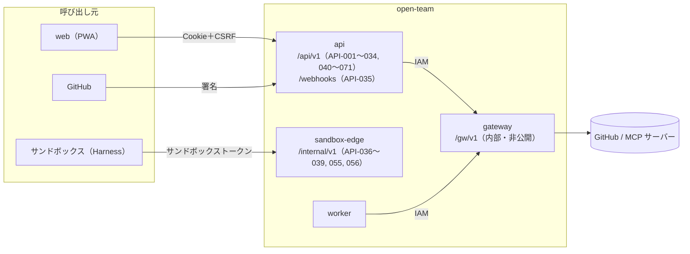
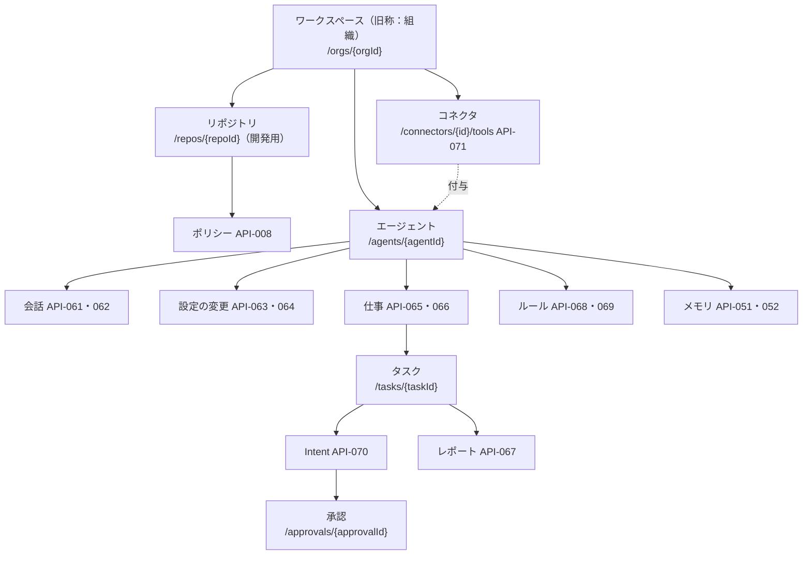

# 09. API設計
- プロジェクト：open-team（仮称） ／ 版数：v0.6（2026-10-01） ／ インプット：[04 機能仕様](../04_functional_spec/README.md)、[06 画面](../06_ux_design/README.md)、[07 アーキテクチャ](../07_architecture.md)、[08 DB](../08_database/README.md)

> **3行で**
> 1. REST（JSON）＋ SSE の API が 71 ID（API-001〜071）。画面用 `/api/v1`・Webhook `/webhooks`・サンドボックス用 `/internal/v1` の3系統と、非公開の Gateway 内部 API（`/gw/v1`）からなる。
> 2. v0.5 でエージェントは「名前を付けて頼む」になり、下書きの API（API-043〜048・057・058）は廃止、会話・設定変更・仕事の API（API-060〜067）を追加。v0.6 で「以後も許可」のルールと MCP の書き込み（API-019 の変更、API-068〜071）を追加。
> 3. コネクタ登録・プロフィール・レポート・ワークスペースのポリシー（13）と v0.3 の機能（12）の API は未設計。まず下の Q-72〜Q-79 を読む。

## 🧭 判断してほしいこと

| # | 種類 | 論点 | 選択肢 | おすすめ（理由） | 決まらないと止まるもの |
|---|---|---|---|---|---|
| Q-70 | 未決 | 外部向けの公開 API（CLI や CI からタスクを作るための API トークン）を提供するか（旧 09 §未決事項） | A: 提供する / B: 提供しない | —（元の記述なし） | 認証方式（[common.md](common.md)） |
| Q-71 | ✅決定 | メンションへの返信（コメント投稿は Won't。現在は Web Push だけ）。フェーズ1で `comment_issue` を外部作用として追加するか（旧 09・12 §未決事項） → **Web Push だけ（コメント投稿は Won't のまま）**（[D-33](../decisions.md#d-33)）| A: Web Push だけ / B: `comment_issue` を追加 | —（元の記述なし） | API-035 |
| Q-72 | 未決 | 13 が 09 への反映を求めた API が未設計：コネクタの登録・一覧・`tools/list` の再取得・`needs_review` の解除、プロフィール、レポートの一覧・取得、ワークスペースのポリシーの編集・版。あわせて Gateway の MCP 操作のパス（`/gw/v1/intents/{id}/execute` を使うか）、API-036 で 13 のツール・テンプレートを返す形（13 §既存ドキュメントへの影響、15 §Gateway での実行） | — | —（元の記述なし） | フェーズ0のコネクタ登録・プロフィール画面、TBL-026〜030 |
| Q-73 | 未決 | 12 v0.3 の機能の API が未設計：アプリ内モードの保存・版の履歴・差分・ロールバック・YAML の書き出し・モードの選択、`handoff`（ユーザーへの引き継ぎ）、AI 事前レビューの結果、アクティビティビュー（12 §競合機能の採用方針・§未決事項。ルールは v0.6 の API-068・069 で定義済み） | — | —（元の記述なし） | フェーズ1の該当機能 |
| Q-74 | ✅決定 | 下書きの廃止（14 §API）で置換先が書かれていない機能：手での定義編集（詳細設定の Canvas。旧 API-046）、試し実行（旧 API-047 と API-012 `isDryRun`・API-013 `agentDraftId`・`intent.preview`）、公開（旧 API-048、GitOps モードの `agent-config-prs`）、API-053（応答が旧 API-044 の形）・API-054（13 のテンプレートの応答）の扱い、API-035 の下書き関連の処理 → **試し実行は詳細設定の変更案（または今の定義）を普通のタスク（isDryRun＋変更案）で走らせる。公開はフェーズ2（D-14）、API-053 はチャット（D-16）**（[D-15](../decisions.md#d-15)）| — | —（元の記述なし） | API-012・013・035・053・054、SCR-016・017 |
| Q-75 | 未決 | 定義 v2（`jobs`・`grants`、`agents.template` の削除、`role`・`name_source`・`appearance`。14 §データベース・ADR-028）とワークスペース単位のエージェント（13）に合わせた API-041・042・059 の応答と API-011（`repositoryId`・`agentId` 必須、タスクの `job_id`）の形。現在の例は定義 v1 のまま | — | —（元の記述なし） | API-011・041・042・059 |
| Q-76 | 未決 | 15 の MCP の Intent（1タスク複数、`action_type = mcp_call`）に合わせた形が未設計：API-013 の `intent`（1件前提）、API-017・018 の MCP 承認カードの応答、`mcp_call` の Intent を受け付ける内部の経路、API-039 の `INTENT_ALREADY_SUBMITTED`（15 は UQ を外した） | — | —（元の記述なし） | API-013・017・018・039、MCP の承認カード |
| Q-77 | 未決 | API-056 のレポート：旧 09 は reviewer / triager 以外を 403 にし `title`・`body` だけを受ける。13 §ツールカタログは `submit_report` を全テンプレートに広げ `sources[]` を必須に、15 §届け先の宣言化は `report.summary`・`report.sources_markdown` を使う | A: API-056 を 13・15 に合わせて改訂 / B: 別の API | —（元の記述なし） | API-056、`deliver` |
| Q-78 | ✅決定 | ワークスペースへの改名（13 A-78）は API のパス・フィールド（`/orgs/{orgId}`・`organizationId`・`orgId`）に及ぶか（13 は明言なし。08 Q-62 と連動）。フェーズ0（サインイン省略、固定トークン（D-06）。13 §フェーズ0）での画面用 API の認証と API-001〜004 の扱い。下の索引の「フェーズ」列の割り当ての確認 → **API のパス・フィールドも /workspaces/{workspaceId}・workspaceId に改名**（[D-21](../decisions.md#d-21)）| A: パスも改名 / B: 据え置き | —（元の記述なし） | 全画面用 API、フェーズ0の実装 |
| Q-79 | 未決 | API-060 の応答の形と、API-062 の SSE のイベント名・`data` の形（14 §API は「エージェントの発言とカードを順に返す」だけ） | — | —（元の記述なし） | SCR-018 の実装 |

## 全体図

見てほしいところ：外部への書き込みは Gateway だけが行う。サンドボックスは `sandbox-edge` にしか話せない。

## 要点
- 共通仕様・エラーフォーマット・**エラーコード一覧（全件）**は [common.md](common.md)。HTTP は「競合 409・業務前提 422・停止中 423・回数上限 429」。
- 承認は intentHash に紐づけ、[以後も許可] は宛先の引数をすべて実際の値で固定したルールになる（[approvals.md](approvals.md)、[ADR-005](../adr/ADR-005-approval-bound-to-intent-hash.md)・[ADR-029](../adr/ADR-029-mcp-arg-roles-destination-fixed.md)）。
- エージェントは名前だけで作り、会話で頼む。広げる設定変更だけ確認カードで承認する（[agents.md](agents.md)、[ADR-026](../adr/ADR-026-name-and-ask.md)・[ADR-027](../adr/ADR-027-classify-widening-changes.md)）。
- 下書きの API は廃止したが、仕様は [agent-drafts-deprecated.md](agent-drafts-deprecated.md) に記録として残す。
- MCP の書き込みは自動で再試行せず、結果不明は API-070 でユーザーが確定（[ADR-031](../adr/ADR-031-mcp-write-no-auto-retry.md)）。届け先は宣言で決める（[ADR-030](../adr/ADR-030-declarative-deliver.md)）。
- ベースパスと認証：下の [認証](#認証)、全エンドポイントは [エンドポイント一覧](#エンドポイント一覧全-api-id-索引)。

---

## 詳細

## 認証

| 系統 | ベースURL | 認証 | 詳細 |
|---|---|---|---|
| 画面用 | `https://app.{domain}/api/v1` | Cookie `ot_session` ＋ 状態を変えるメソッドは `X-CSRF-Token`（API-004 で取得） | [common.md](common.md#共通仕様) |
| Webhook | `https://app.{domain}/webhooks` | `X-Hub-Signature-256` | [webhooks.md](webhooks.md) |
| サンドボックス用 | `https://sandbox-edge.internal/internal/v1`（`sandbox-vpc` からだけ届く） | `Authorization: Bearer {sandboxToken}` | [sandbox-internal.md](sandbox-internal.md) |
| Gateway 内部 | `/gw/v1`（`api`・`worker` からだけ） | IAM | [gateway-internal.md](gateway-internal.md) |

- フェーズ0はサインインを省略し、固定トークン（D-06）で画面を守る（13 §フェーズ0。[Q-78](#-判断してほしいこと)）。

## リソースの関係

見てほしいところ：v0.5 以降、タスクは「エージェント → 仕事」から生まれる。ルールはエージェント単位で、承認（API-019 の `remember`）からだけ作られる。

## エンドポイント一覧（全 API-ID 索引）
- フェーズ：0＝単一ユーザー・ローカル、1＝MVP、2＝複数ユーザー。13 §フェーズ計画・14 §フェーズ0の完成条件の機能の割り当てから読み取った（v0.2 の API はもともと MVP として設計。確認は [Q-78](#-判断してほしいこと)）。
- 認証の「viewer / maintainer / owner」はワークスペースのロール。「承認者」は BR-14、「SB」はサンドボックストークン。

API-001〜040（認証・ワークスペース・タスク・承認・安全装置・監査・設定・Webhook・内部）

| ID | メソッド | パス | 概要 | 権限 | 関連 FR / SCR | フェーズ | 状態 | 定義 |
|---|---|---|---|---|---|---|---|---|
| API-001 | GET | `/api/v1/auth/github/login` | GitHub の認可画面へリダイレクト | 不要 | FR-001 / SCR-001 | 1 | 有効 | [auth-workspace](auth-workspace.md) |
| API-002 | GET | `/api/v1/auth/github/callback` | OAuth のコールバック | 不要 | FR-001 / SCR-001 | 1 | 有効 | [auth-workspace](auth-workspace.md) |
| API-003 | POST | `/api/v1/auth/logout` | ログアウト | セッション | FR-001 / SCR-011 | 1 | 有効 | [auth-workspace](auth-workspace.md) |
| API-004 | GET | `/api/v1/me` | 自分の情報・CSRF トークン・通知の購読・VAPID の公開鍵 | セッション | FR-001, FR-017 / SCR-011, SCR-012 | 1（0 は Q-78） | 有効 | [auth-workspace](auth-workspace.md) |
| API-005 | GET | `/api/v1/orgs` | 自分が所属するワークスペースの一覧 | セッション | FR-002 / SCR-002, SCR-012 | 0 | 有効 | [auth-workspace](auth-workspace.md) |
| API-006 | GET | `/api/v1/orgs/{orgId}` | ワークスペースの詳細（Kill Switch の状態・設定） | viewer | FR-015 / SCR-002, SCR-011 | 0 | 有効 | [auth-workspace](auth-workspace.md) |
| API-007 | GET | `/api/v1/orgs/{orgId}/repos` | リポジトリの一覧 | viewer | FR-002, FR-003 / SCR-003, SCR-008 | 1 | 有効 | [auth-workspace](auth-workspace.md) |
| API-008 | GET | `/api/v1/repos/{repoId}/policy` | 最新のポリシースナップショット | viewer | FR-003 / SCR-003, SCR-009 | 1 | 有効 | [policies](policies.md) |
| API-009 | POST | `/api/v1/repos/{repoId}/policy/validate` | 貼り付けた YAML の検証（保存しない） | maintainer | FR-003 / SCR-009 | 1 | 有効 | [policies](policies.md) |
| API-010 | GET | `/api/v1/repos/{repoId}/issues` | Open の Issue の一覧（GitHub から取得） | maintainer | FR-005 / SCR-003 | 1 | 有効 | [tasks](tasks.md) |
| API-011 | POST | `/api/v1/tasks` | タスクの作成（委任）。v0.2 で `agentId`・`prompt` を追加 | maintainer | FR-005 / SCR-003 | 1 | 有効（Q-75） | [tasks](tasks.md) |
| API-012 | GET | `/api/v1/tasks` | タスクの一覧。v0.2 で `agentId` の絞り込み | viewer | FR-018 / SCR-002, SCR-004, SCR-013, SCR-017 | 0 | 有効 | [tasks](tasks.md) |
| API-013 | GET | `/api/v1/tasks/{taskId}` | タスクの詳細。v0.2 でエージェント・トリガー・レポート・`intent.preview`・自己レビュー | viewer | FR-013, FR-018, FR-026 / SCR-005 | 0 | 有効（Q-76） | [tasks](tasks.md) |
| API-014 | GET | `/api/v1/tasks/{taskId}/events` | タイムライン（ページング） | viewer | FR-018 / SCR-005 | 0 | 有効 | [tasks](tasks.md) |
| API-015 | GET | `/api/v1/tasks/{taskId}/stream` | タイムラインのリアルタイム配信（SSE） | viewer | FR-018 / SCR-005 | 0 | 有効 | [tasks](tasks.md) |
| API-016 | POST | `/api/v1/tasks/{taskId}/cancel` | タスクのキャンセル | 依頼者 / owner | FR-015 / SCR-005 | 0 | 有効 | [tasks](tasks.md) |
| API-017 | GET | `/api/v1/approvals` | 承認の一覧 | maintainer | FR-011 / SCR-002, SCR-006 | 0 | 有効（Q-76） | [approvals](approvals.md) |
| API-018 | GET | `/api/v1/approvals/{approvalId}` | 承認カードの詳細（差分を含む）。v0.2 で自己レビュー | maintainer | FR-011 / SCR-007 | 0 | 有効（Q-76） | [approvals](approvals.md) |
| API-019 | POST | `/api/v1/approvals/{approvalId}/decision` | 承認・却下。v0.6 で `remember`（以後も許可） | 承認者 | FR-011 / SCR-007 | 0 | 有効（v0.6 変更） | [approvals](approvals.md) |
| API-020 | POST | `/api/v1/orgs/{orgId}/kill-switch` | Kill Switch の発動 | maintainer | FR-015 / SCR-013 | 0 | 有効 | [policies](policies.md) |
| API-021 | POST | `/api/v1/orgs/{orgId}/kill-switch/release` | Kill Switch の解除 | owner | FR-015 / SCR-011 | 0 | 有効 | [policies](policies.md) |
| API-022 | GET | `/api/v1/orgs/{orgId}/budget` | 予算メーター（当日・当月の消費） | viewer | FR-013 / SCR-002 | 0 | 有効 | [policies](policies.md) |
| API-023 | GET | `/api/v1/orgs/{orgId}/audit-logs` | 監査ログの一覧 | viewer | FR-016 / SCR-010 | 0 | 有効 | [auth-workspace](auth-workspace.md) |
| API-024 | POST | `/api/v1/orgs/{orgId}/audit-logs/verify` | ハッシュチェーンの検証 | viewer | FR-016 / SCR-010 | 0 | 有効 | [auth-workspace](auth-workspace.md) |
| API-025 | GET | `/api/v1/orgs/{orgId}/audit-logs/export` | JSON Lines でのエクスポート | owner | FR-016 / SCR-010 | 0 | 有効 | [auth-workspace](auth-workspace.md) |
| API-026 | GET | `/api/v1/orgs/{orgId}/llm-credentials` | 登録済みキーの一覧（マスク済み） | viewer | FR-019 / SCR-011, SCR-012 | 1（0 は `.env`） | 有効 | [auth-workspace](auth-workspace.md) |
| API-027 | PUT | `/api/v1/orgs/{orgId}/llm-credentials/{provider}` | キーの登録・更新 | owner | FR-019 / SCR-011, SCR-012 | 1（0 は `.env`） | 有効 | [auth-workspace](auth-workspace.md) |
| API-028 | DELETE | `/api/v1/orgs/{orgId}/llm-credentials/{provider}` | キーの削除 | owner | FR-019 / SCR-011 | 1（0 は `.env`） | 有効 | [auth-workspace](auth-workspace.md) |
| API-029 | GET | `/api/v1/orgs/{orgId}/members` | メンバーの一覧 | viewer | FR-020 / SCR-011 | 1 | 有効 | [auth-workspace](auth-workspace.md) |
| API-030 | PATCH | `/api/v1/orgs/{orgId}/members/{userId}` | ロールの変更 | owner | FR-020 / SCR-011 | 1 | 有効 | [auth-workspace](auth-workspace.md) |
| API-031 | POST | `/api/v1/push-subscriptions` | 通知の購読の登録 | セッション | FR-017 / SCR-011, SCR-012 | 0 | 有効 | [auth-workspace](auth-workspace.md) |
| API-032 | DELETE | `/api/v1/push-subscriptions/{subscriptionId}` | 通知の購読の削除 | セッション（本人） | FR-017 / SCR-011 | 0 | 有効 | [auth-workspace](auth-workspace.md) |
| API-033 | GET | `/api/v1/repos/{repoId}/trust-proposals` | 信頼度提案の一覧 | viewer | FR-021 / SCR-009 | 1 | 有効 | [policies](policies.md) |
| API-034 | POST | `/api/v1/trust-proposals/{proposalId}/decision` | 提案の受け入れ・見送り | maintainer | FR-021 / SCR-009 | 1 | 有効 | [policies](policies.md) |
| API-035 | POST | `/webhooks/github` | GitHub の Webhook の受信（v0.2 で `issue_comment`・`push`・`pull_request` を追加） | 署名 | FR-002, FR-006, FR-022, FR-027, FR-028 | 1 | 有効 | [webhooks](webhooks.md) |
| API-036 | GET | `/internal/v1/task-context` | タスクのコンテキストの取得 | SB | FR-007, FR-008, FR-029 | 0 | 有効 | [sandbox-internal](sandbox-internal.md) |
| API-037 | POST | `/internal/v1/llm/messages` | LLM Proxy | SB | FR-009, FR-013, FR-014 | 0 | 有効 | [sandbox-internal](sandbox-internal.md) |
| API-038 | POST | `/internal/v1/events` | 進捗イベントの送信 | SB | FR-018 | 0 | 有効 | [sandbox-internal](sandbox-internal.md) |
| API-039 | POST | `/internal/v1/intents` | Intent の提出（`open_pr`） | SB | FR-010 | 1 | 有効（Q-76） | [sandbox-internal](sandbox-internal.md) |
| API-040 | PATCH | `/api/v1/orgs/{orgId}` | ワークスペースの設定の変更 | owner | FR-013, FR-009 / SCR-011 | 0 | 有効 | [auth-workspace](auth-workspace.md) |

API-041〜071（エージェント・下書き（廃止）・会話・仕事・ルール・コネクタ）

| ID | メソッド | パス | 概要 | 権限 | 関連 FR / SCR | フェーズ | 状態 | 定義 |
|---|---|---|---|---|---|---|---|---|
| API-041 | GET | `/api/v1/agents`（v0.17。v0.2 は `/repos/{repoId}/agents`） | エージェントの一覧（ワークスペース単位。生成した担当のライブラリ） | viewer | FR-022 / SCR-014 | 0 | 有効（v0.17 で実装。契約は `apps/app/src/agents/contract.ts`） | [agents](agents.md) |
| API-042 | GET | `/api/v1/agents/{agentId}` | 詳細（定義・実効ポリシー・スコアカード・スケジュール） | viewer | FR-022, FR-032 / SCR-017 | 0 | 有効（Q-75） | [agents](agents.md) |
| API-043 | POST | `/api/v1/repos/{repoId}/agent-drafts` | 下書きの作成 | maintainer | FR-025 / SCR-014, SCR-015 | — | 廃止（v0.5、→ API-060） | [agent-drafts-deprecated](agent-drafts-deprecated.md) |
| API-044 | GET | `/api/v1/agent-drafts/{draftId}` | 下書きの取得 | maintainer | FR-025 / SCR-016 | — | 廃止（v0.5、→ 明記なし） | [agent-drafts-deprecated](agent-drafts-deprecated.md) |
| API-045 | POST | `/api/v1/agent-drafts/{draftId}/messages` | 設計アシスタントへの送信（SSE） | maintainer | FR-024 / SCR-015 | — | 廃止（v0.5、→ API-062） | [agent-drafts-deprecated](agent-drafts-deprecated.md) |
| API-046 | PUT | `/api/v1/agent-drafts/{draftId}` | 下書きの更新と検証 | maintainer | FR-023, FR-025 / SCR-016 | — | 廃止（v0.5、→ 明記なし。Q-74） | [agent-drafts-deprecated](agent-drafts-deprecated.md) |
| API-047 | POST | `/api/v1/agent-drafts/{draftId}/dry-runs` | 試し実行の開始 | maintainer | FR-026 / SCR-016 | — | 廃止（v0.5、→ 明記なし。Q-74） | [agent-drafts-deprecated](agent-drafts-deprecated.md) |
| API-048 | POST | `/api/v1/agent-drafts/{draftId}/publish` | 公開（PR の作成） | maintainer | FR-027 / SCR-016 | — | 廃止（v0.5、→ 明記なし。Q-74） | [agent-drafts-deprecated](agent-drafts-deprecated.md) |
| API-049 | POST | `/api/v1/agents/{agentId}/disable` | エージェントの停止 | maintainer | FR-032 / SCR-017 | 0 | 有効 | [agents](agents.md) |
| API-050 | POST | `/api/v1/agents/{agentId}/enable` | エージェントの再開 | owner | FR-032 / SCR-017 | 0 | 有効 | [agents](agents.md) |
| API-051 | GET | `/api/v1/agents/{agentId}/memories` | メモリの一覧 | viewer | FR-031 / SCR-017 | 1 | 有効 | [agents](agents.md) |
| API-052 | DELETE | `/api/v1/agents/{agentId}/memories/{memoryId}` | メモリの削除 | maintainer | FR-031 / SCR-017 | 1 | 有効 | [agents](agents.md) |
| API-053 | POST | `/api/v1/tasks/{taskId}/skill-drafts` | タスクから Skill の下書きを作る | maintainer | FR-024, FR-030 / SCR-005 | 1 | 有効（Q-74） | [agents](agents.md) |
| API-054 | GET | `/api/v1/agent-templates` | テンプレートの一覧と説明 | セッション | FR-029 / SCR-014 | 1 | 有効（Q-74） | [agents](agents.md) |
| API-055 | POST | `/internal/v1/memories` | メモリの書き込み（`pending`） | SB | FR-031 | 1 | 有効 | [sandbox-internal](sandbox-internal.md) |
| API-056 | POST | `/internal/v1/reports` | レポートの提出 | SB | FR-033 | 0 | 有効（Q-77） | [sandbox-internal](sandbox-internal.md) |
| API-057 | GET | `/api/v1/repos/{repoId}/agent-drafts` | 下書きの一覧 | maintainer | FR-025 / SCR-014 | — | 廃止（v0.5、→ 明記なし） | [agent-drafts-deprecated](agent-drafts-deprecated.md) |
| API-058 | DELETE | `/api/v1/agent-drafts/{draftId}` | 下書きの破棄 | 作成者 / owner | FR-025 / SCR-016 | — | 廃止（v0.5、→ 明記なし） | [agent-drafts-deprecated](agent-drafts-deprecated.md) |
| API-059 | GET | `/api/v1/orgs/{orgId}/agents` | ワークスペース全体のエージェント一覧（`status` で絞り込み） | viewer | FR-032 / SCR-002 | 0 | 有効（Q-75） | [agents](agents.md) |
| API-060 | POST | `/api/v1/agents` | 名前（任意）だけで作成し、挨拶を返す | — | FR-034 / SCR-014, SCR-018 | 0 | 有効（v0.5、Q-79） | [agents](agents.md) |
| API-061 | GET | `/api/v1/agents/{agentId}/messages` | 会話の取得 | — | FR-038 / SCR-018 | 0 | 有効（v0.5） | [agents](agents.md) |
| API-062 | POST | `/api/v1/agents/{agentId}/messages` | お願い・返答の送信（SSE） | — | FR-035, FR-038 / SCR-018 | 0 | 有効（v0.5、Q-79） | [agents](agents.md) |
| API-063 | POST | `/api/v1/agents/{agentId}/config-changes/{changeId}/decision` | `widen` の確認カードの操作 | — | FR-036 / SCR-018 | 0 | 有効（v0.5） | [agents](agents.md) |
| API-064 | POST | `/api/v1/agents/{agentId}/config-changes/{changeId}/revert` | 元に戻す | — | FR-039 / SCR-018 | 0 | 有効（v0.5） | [agents](agents.md) |
| API-065 | GET ／ PATCH | `/api/v1/agents/{agentId}/jobs` ／ `/api/v1/agents/{agentId}/jobs/{jobId}` | 仕事の一覧 ／ 一時停止・再開・削除 | — | FR-037 / SCR-017 | 0 | 有効（v0.5） | [agents](agents.md) |
| API-066 | POST | `/api/v1/agents/{agentId}/jobs/{jobId}/move` | 仕事の移動 | — | FR-037, FR-040 / SCR-018 | 0（後回し可） | 有効（v0.5） | [agents](agents.md) |
| API-067 | POST | `/api/v1/reports/{reportId}/feedback` | 👍 / 👎 と理由 | — | FR-039 / SCR-018 | 0（後回し可） | 有効（v0.5） | [agents](agents.md) |
| API-068 | GET | `/api/v1/agents/{agentId}/rules` | 「以後も許可」のルールの一覧 | — | SCR（06） | 0 | 有効（v0.6） | [approvals](approvals.md) |
| API-069 | DELETE | `/api/v1/agents/{agentId}/rules/{ruleId}` | ルールの取り消し | — | SCR（06） | 0 | 有効（v0.6） | [approvals](approvals.md) |
| API-070 | POST | `/api/v1/intents/{intentId}/resolve` | `unknown_outcome` の解決 | — | FR-012 / SCR（06） | 0 | 有効（v0.6） | [approvals](approvals.md) |
| API-071 | PUT | `/api/v1/connectors/{connectorId}/tools/{tool}` | 分類・`arg_roles`・`scope`・`verify` の確定 | owner | SCR（06） | 0 | 有効（v0.6） | [connectors](connectors.md) |

- API-060〜070 の「権限」は 14・15 に記載がない（「—」）。API-071 だけ owner と明記。API-060〜067 の関連 FR は 14 §機能要件の FR 一覧（UC の対応）から対応づけた。
- 関連 FR / SCR の「SCR（06）」は、15 が 06 に反映を求めた画面（ルールの一覧・`unknown_outcome` のカード・ツールの分類画面）で、SCR-ID は 06 で付く。
- API-065 は 1つの ID で2つのエンドポイントを指す（14 §API のとおり）。

## Gateway の内部 API
API-ID を付けない非公開の操作（8件）。一覧と `agent-config-prs` の詳細は [gateway-internal.md](gateway-internal.md)。

## このドキュメントで決まったこと
- [ADR-002](../adr/ADR-002-gateway-holds-github-key.md)：GitHub の鍵は Gateway だけが持つ。
- [ADR-003](../adr/ADR-003-cooperative-enforcement-in-sandbox.md)：サンドボックスに渡すポリシーは参考で、強制はサーバー側。
- [ADR-005](../adr/ADR-005-approval-bound-to-intent-hash.md)：承認は intentHash に紐づける。
- [ADR-007](../adr/ADR-007-sse-realtime.md)：リアルタイム配信は SSE。
- [ADR-026](../adr/ADR-026-name-and-ask.md)〜[ADR-028](../adr/ADR-028-jobs-as-unit-of-work.md)：名前を付けて頼む・広げる変更だけ人に戻す・仕事を単位にする（API-060〜067、下書き API の廃止）。
- [ADR-029](../adr/ADR-029-mcp-arg-roles-destination-fixed.md)〜[ADR-031](../adr/ADR-031-mcp-write-no-auto-retry.md)：宛先の固定・届け先の宣言化・MCP の書き込みは自動で再試行しない（API-019 の変更、API-068〜071）。
- 解決済み（v0.2）：API-050 の「owner」は組織のロールの owner（BR-27）。下書きの破棄・公開 PR のクローズの扱いは [agent-drafts-deprecated.md](agent-drafts-deprecated.md#前提仮定廃止-api-関連)。
