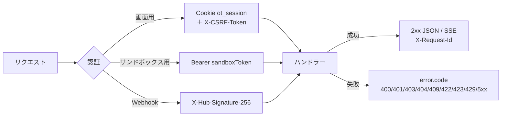

# 09. API設計：共通仕様とエラーコード
- プロジェクト：open-team（仮称） ／ 版数：v0.6（2026-10-01） ／ 入口：[README.md](README.md)

> **3行で**
> 1. API は画面用（`/api/v1`）・Webhook（`/webhooks`）・サンドボックス用（`/internal/v1`）の3系統で、形式は JSON・camelCase・UTC・金額は6桁の文字列。
> 2. エラーは `{ error: { code, message, details, requestId } }` の1形式。HTTP は「競合 409・業務前提 422・停止中 423・回数上限 429」に揃える。
> 3. エラーコードの一覧はこのファイルだけに置く（11 の「追加のエラーコード（D12）」と 15 の `RULE_NOT_ALLOWED` もここに統合）。

## 🧭 判断してほしいこと
共通仕様に固有の論点はない。API 全体の論点は [README.md](README.md#-判断してほしいこと)（Q-70〜Q-79）。

## 全体図


見てほしいところ：認証は3種類だけ。失敗はすべて同じエラーフォーマットで返る。

## 要点
- 共通の約束（ベースURL・形式・ページネーション・冪等性・レート制限）は [共通仕様](#共通仕様)。
- エラーの形は [共通エラーフォーマット](#共通エラーフォーマット)、コードの一覧は [エラーコード一覧](#エラーコード一覧)。
- HTTP ステータスの割り当て方（A-62）は [エラーの HTTP ステータスの決め方](#エラーの-http-ステータスの決め方)。
- エージェント定義の検証コード（`AGENT_SCHEMA_INVALID` など）は単独のエラーレスポンスにせず、検証結果の項目の `code` として返す（[検証結果の項目](#検証結果の項目のコードエージェント定義)）。

---

## 詳細

## 共通仕様

| 項目 | 仕様 |
|---|---|
| ベースURL | 画面用：`https://app.{domain}/api/v1`（`api`）／ Webhook：`https://app.{domain}/webhooks`（`api`）／ サンドボックス用：`https://sandbox-edge.internal/internal/v1`（`sandbox-edge`。`sandbox-vpc` からだけ届く） |
| バージョニング | パスにメジャーバージョンを入れる（`/v1`）。互換性のない変更をするときは `/v2` を作る |
| 認証（画面用） | Cookie `ot_session`。状態を変えるメソッド（POST・PUT・PATCH・DELETE）には `X-CSRF-Token` ヘッダーが必須（値は API-004 で取得） |
| 認証（サンドボックス用） | `Authorization: Bearer {sandboxToken}` |
| 認証（Webhook） | `X-Hub-Signature-256` |
| 形式 | JSON（UTF-8）。フィールド名は camelCase。日時は ISO 8601（UTC、例：`2026-09-30T12:00:00Z`）。金額は USD の数値（小数点以下6桁までの文字列。例：`"1.120000"`。浮動小数点の誤差を避けるため） |
| ID | UUID の文字列 |
| ページネーション | カーソル方式。クエリ `limit`（1〜100、既定は20）と `cursor`。レスポンスは `{ "items": [...], "nextCursor": "..." \| null }` |
| 冪等性 | POST API-011・API-019・API-020・API-043・API-047・API-048・API-053 は、`Idempotency-Key` ヘッダー（任意、UUID）を受け付け、24時間は同じ結果を返す（API-043・047・048 は v0.5 で廃止） |
| レート制限 | NFR-030（[05](../05_non_functional.md)）。超えた場合は 429 と `Retry-After` |
| リクエストID | すべてのレスポンスに `X-Request-Id` を付ける |
| YAML 由来のキー | ポリシー（API-008）とエージェント定義（API-042）のキーは、YAML のキー（snake_case）をそのまま返す（ファイルとの対応をわかりやすくするため） |

- フェーズ0（単一ユーザー・ローカル）ではサインインを省略し、固定トークン（D-06）で画面を守る（13 §フェーズ0）。画面用の認証の扱いは [Q-78](README.md#-判断してほしいこと)。

## 共通エラーフォーマット

```json
{
  "error": {
    "code": "VALIDATION_ERROR",
    "message": "入力内容に誤りがあります",
    "details": [{ "field": "instructions", "reason": "2000文字以内で入力してください" }],
    "requestId": "req_01J..."
  }
}
```

- 画面は `code` に対応するメッセージを表示する（[06](../06_ux_design/README.md) の各画面の「バリデーション・エラー表示」）。停止・失敗の理由は `halt_reason` / `fail_reason` と `matchedRule` で示す（11 §9）。

## エラーの HTTP ステータスの決め方
A-62：v0.1 の慣例に合わせる。

| 状況 | HTTP |
|---|---|
| 入力の形式が正しくない | 400 |
| 状態の競合（すでに終了・決定済み・更新された） | 409 |
| 業務上の前提を満たさない | 422 |
| 停止中（Kill Switch・エージェントの停止） | 423 |
| 回数の上限 | 429 |

## エラーコード一覧
「主な API」は、そのコードを返す代表的なエンドポイント。廃止（v0.5）の API だけで使うコードはその旨を書く。

<details>
<summary>エラーコード一覧（HTTP 400〜502、35件）</summary>

| code | HTTP | 意味 | 主な API |
|---|---|---|---|
| `VALIDATION_ERROR` | 400 | 入力の形式が正しくない | 全般 |
| `UNAUTHORIZED` | 401 | 認証されていない、セッション・トークンの期限切れ、Webhook の署名が不正 | 全般、API-035 |
| `CSRF_TOKEN_INVALID` | 403 | CSRF トークンがない、または一致しない | 画面用の状態を変える API |
| `FORBIDDEN` | 403 | ロール・承認者・GitHub 上の権限が足りない | 全般 |
| `NOT_FOUND` | 404 | リソースがない（他の組織のリソースも 404 にする） | 全般 |
| `TASK_ALREADY_ACTIVE` | 409 | 同じエージェントの同じ Issue に未完了のタスクがある（BR-29。Issue なしのタスクは判定しない） | API-011 |
| `TASK_ALREADY_TERMINATED` | 409 | タスクがすでに終了している | API-016 |
| `TASK_HALTED` | 409 | （サンドボックス用）タスクは停止・終了した。ただちに終了すること | API-036〜039・055・056 |
| `APPROVAL_NOT_PENDING` | 409 | 承認がすでに決定済み、または期限切れ（信頼度提案が open でない場合も） | API-019・034 |
| `INTENT_CHANGED` | 409 | intentHash が一致しない | API-019 |
| `INTENT_ALREADY_SUBMITTED` | 409 | このタスクの Intent はすでに提出されている（15 で1タスク複数 Intent に変更。[Q-76](README.md#-判断してほしいこと)） | API-039 |
| `REPORT_ALREADY_SUBMITTED` | 409 | このタスクのレポートはすでに提出されている | API-056 |
| `TASK_NOT_COMPLETED` | 409 | タスクが `succeeded` または `completed`（`report`）で終わっていない、または試し実行（Skill にできない。UC-024） | API-053 |
| `AGENT_SLUG_TAKEN` | 409 | 同じリポジトリに、同じ ID のエージェント（`removed` を除く）がある | 廃止 API-043・046 |
| `AGENT_DRAFT_NOT_EDITABLE` | 409 | 下書きが `drafting` でない（公開済み・マージ済み・破棄済み）。編集・設計アシスタント・破棄で使う | 廃止 API-045〜048・058 |
| `AGENT_DRAFT_ALREADY_PUBLISHED` | 409 | 下書きはすでに公開（PR 作成）されている | 廃止 API-048 |
| `AGENT_DRAFT_CONFLICT` | 409 | 下書きが、読み込んだ後に別の編集（設計アシスタントの反映を含む）で更新された | 廃止 API-046・048 |
| `ASSISTANT_BUSY` | 409 | 同じ下書きで、設計アシスタントが応答中 | 廃止 API-045 |
| `POLICY_INVALID` | 422 | リポジトリのポリシーが無効 | API-011・034 |
| `LLM_CREDENTIAL_MISSING` | 422 | 必要な LLM のキーが登録されていない | API-011・053 |
| `LLM_CREDENTIAL_INVALID` | 422 | キーの疎通確認に失敗した | API-027 |
| `ISSUE_NOT_OPEN` | 422 | Issue がない、またはクローズされている | API-011 |
| `DIFF_INVALID` | 422 | 差分をパース・適用できない、またはバイナリを含む | API-039 |
| `LAST_OWNER` | 422 | 最後の owner は降格できない | API-030 |
| `AGENT_DRAFT_INVALID` | 422 | 下書きに検証エラーがある（`details` に検証結果の `errors[]` を入れる） | 廃止 API-047・048 |
| `AGENT_NOT_ACTIVE` | 422 | エージェントが `active` でない（`invalid` / `removed`） | API-011・049・050・053 |
| `ASSISTANT_BUDGET_EXCEEDED` | 422 | 下書き1件あたりの設計アシスタントの費用が $0.5 に達した（今回の呼び出しの見積額を足すと超える場合を含む。BR-30） | 廃止 API-045 |
| `RULE_NOT_ALLOWED` | 422 | [以後も許可]（`remember = true`）の条件（[approvals.md](approvals.md#以後も許可を出す条件)）を満たさない（v0.6） | API-019 |
| `KILL_SWITCH_ENGAGED` | 423 | Kill Switch が発動中 | API-011・019・034 |
| `AGENT_DISABLED` | 423 | エージェントが停止中（BR-27） | API-011 |
| `RATE_LIMITED` | 429 | レート制限を超えた | 全般、API-037 |
| `DAILY_RUN_LIMIT` | 429 | エージェントの `max_runs_per_day` に達した。`Retry-After` は組織のタイムゾーンの翌日0時まで | API-011 |
| `INTERNAL_ERROR` | 500 | サーバーの内部エラー | 全般 |
| `GITHUB_UPSTREAM_ERROR` | 502 | GitHub API のエラー | API-010 ほか |
| `LLM_UPSTREAM_ERROR` | 502 | LLM プロバイダーのエラー | API-037・053 |

</details>

- 11 §9 の「追加のエラーコード（D12）」12件（`AGENT_SLUG_TAKEN`〜`DAILY_RUN_LIMIT`）は上の表と同じ内容で、11 からはこの表を参照する。

### 検証結果の項目のコード（エージェント定義）
12 FR-022 の検証コード。単独のエラーレスポンスにはせず、検証結果の項目の `code` として返す。返す場所：API-042 の `errors[]`、Check Run `open-team/agent-config` の出力、廃止した API-046 の `errors[]`・API-048 の `AGENT_DRAFT_INVALID` の `details`。

| code | 種類 | 意味 |
|---|---|---|
| `AGENT_SCHEMA_INVALID` | エラー | エージェント定義がスキーマに合わない（行番号つき） |
| `AGENT_EXCEEDS_POLICY` | エラー | エージェント定義がリポジトリのポリシー（または Hard Ceiling）より緩い（項目・定義の値・ポリシーの値） |
| `AGENT_SKILL_NOT_FOUND` | エラー | 参照された Skill がない |
| `AGENT_OWNER_INVALID` | エラー | `owner` が組織のメンバーでない、または viewer |
| `AGENT_LIMIT_EXCEEDED` | エラー | 21個目以降のエージェント（ファイル名順。既定エージェント `default` は数えない。BR-31） |
| `AGENT_TRIGGER_CONFLICT` | エラー | 同じリポジトリの複数のエージェントに同じラベル（`github_label` の `label`）を設定した |
| `AGENT_CLAMPED` | 警告（`warnings[]`） | 公開後にポリシーが厳しくなり、切り詰めて実行している |

- 項目の形：`{ "code", "file", "line", "path", "message", "defined", "limit", "by" }`。`defined`・`limit`・`by` は `AGENT_EXCEEDS_POLICY` の場合で、`by` は `policy` / `ceiling`。

## 前提・仮定
- A-31：画面用の API と Webhook は同じ `api` サービスで提供する。
- A-32：承認の判断に使う差分が1MBを超える場合は、ファイルごとに取得する（API-018）。
- A-61：12 の API 一覧（API-041〜059、API-011〜013・036 の変更）と、API-046・API-048 の詳細を正とする。リクエスト・レスポンスの形とエラーの割り当ては 09 で補った（エラーコードと監査ログのイベント名 `agent.enabled`・`agent.memory_deleted`・`task.report_submitted` は 12 v0.2 で正式に採用）。
- A-62：エラーの HTTP ステータスは v0.1 の慣例に合わせた（[上の表](#エラーの-http-ステータスの決め方)）。
- そのほかのエンドポイント固有の仮定（A-63〜67）は各詳細ファイルに置く。

## このドキュメントで決まったこと
- エラーコード一覧を本ファイルに一本化（11 D12・15 `RULE_NOT_ALLOWED` を統合）。
- [ADR-007](../adr/ADR-007-sse-realtime.md)：リアルタイム配信は SSE（API-015・045・062）。
