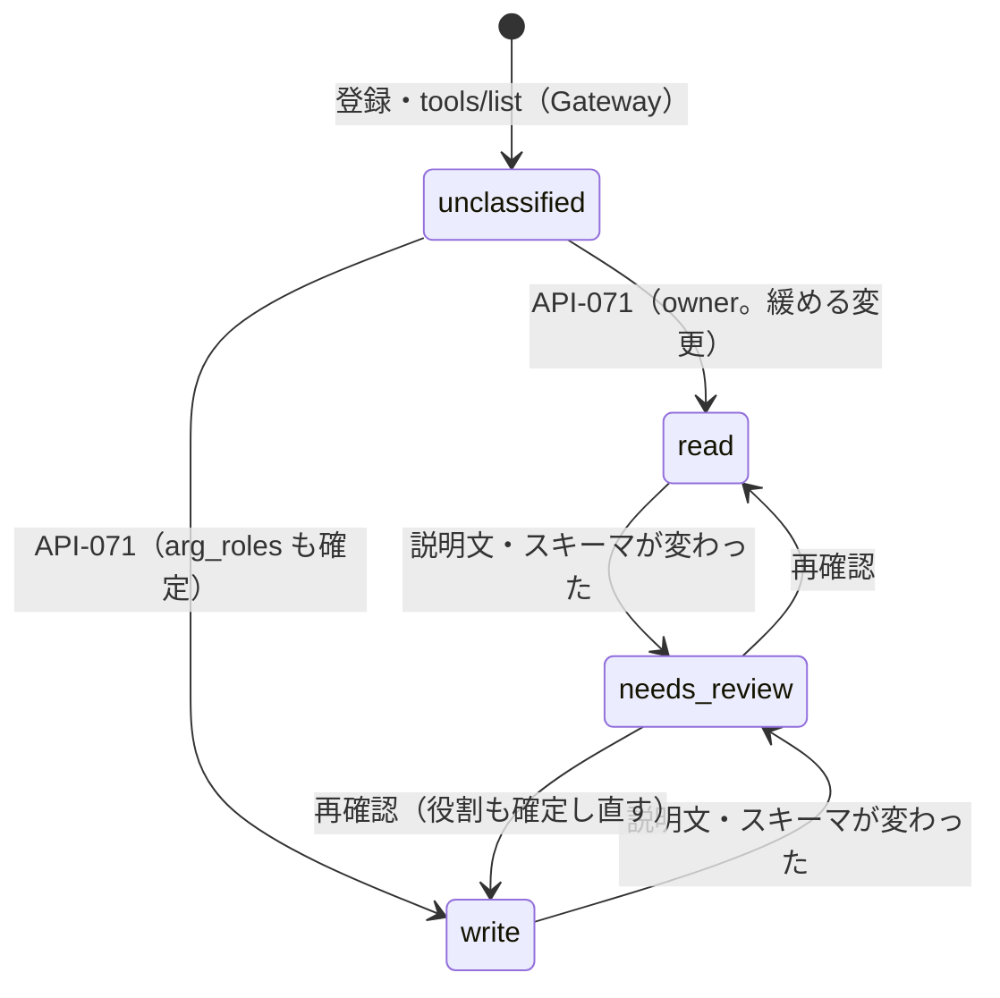

# 09. API設計：MCP コネクタとツールの分類
- プロジェクト：open-team（仮称） ／ 版数：v0.6（2026-10-01） ／ 入口：[README.md](README.md) ／ 共通仕様：[common.md](common.md)

> **3行で**
> 1. 定義済みの API は、ツールの分類・引数の役割（`arg_roles`）・`scope`・`verify` を確定する API-071 だけ（15。owner のみ）。
> 2. コネクタの登録・一覧・`tools/list` の取得・`needs_review` の解除、プロフィール、レポートの一覧の API は、13 が「09 に反映が要る」としたが未設計（Q-72）。
> 3. 外部連携は MCP に統一し、分類していないツールは書き込み扱い（[ADR-022](../adr/ADR-022-mcp-unified-unclassified-is-write.md)）。宛先の引数はルールで固定する（[ADR-029](../adr/ADR-029-mcp-arg-roles-destination-fixed.md)）。

## 🧭 判断してほしいこと
- [Q-72](README.md#-判断してほしいこと)：コネクタ・プロフィール・レポート・ワークスペースのポリシーの API が未設計。

## 全体図

見てほしいところ：分類と役割はユーザー（owner）が確定するまで効かない。`needs_review` の間は呼び出しが `deny`（BR-42）。

---

## 詳細

### API-071：PUT /api/v1/connectors/{connectorId}/tools/{tool}
- 概要（v0.6）：ツールの分類・`arg_roles`・`scope`・`verify` の確定。
- 権限：owner のみ。緩める変更（分類を `read` に、引数を `destination` から `content` に）は監査ログに残す（BR-44・BR-56）。
- データ元：TBL-028（`connector_tools`）。
- 確定する項目（15 §データベース：`connector_tools` の列）：

| 項目 | 値 | 説明 |
|---|---|---|
| 分類 | `read` / `write` / `unclassified` | 注釈やカタログの推奨は初期値の提案として表示するだけで、確定するまで `read` にならない（13） |
| `arg_roles` | `{引数名: destination \| content \| option}` | 入力スキーマの最上位のプロパティごと。未確定の引数とスキーマの変更で増えた引数は `destination`（BR-56） |
| `scope` | `self` / NULL | `destination` 引数がない書き込みツールでルールを許すには `self` の明示が要る |
| `verify` | `none`（既定）/ `readback`（フェーズ1） | `none` の Intent は `executed` で終わる |

- `tool_hash` は説明文・入力スキーマ・`arg_roles` から計算する。`arg_roles` を変えると `tool_hash` が変わり、それまでのルールは効かなくなる（[approvals.md](approvals.md#ルールの形)）。
- リクエスト・レスポンスの JSON の形は 15 に記載なし。

引数の役割の種類（15 §引数の役割）

| 役割 | 意味 | 例 | ルールでの扱い |
|---|---|---|---|
| `destination` | 作用の届く先 | `channel`、`to`、`cc`、`bcc`、`recipient`、`email`、`url`、`share_with`、`calendar_id`、`path` | すべて完全一致で固定しなければならない |
| `content` | 中身。毎回変わってよい | `text`、`body`、`message`、`subject`、`title`、`description` | ルールに書けない（自由） |
| `option` | 振る舞いの設定 | `unfurl_links`、`reply_broadcast`、`visibility`、`send_at` | ルールに書いたものだけ完全一致 |

- 引数名から推測した役割は初期値の提案で、ユーザーが確定するまで効かない。
- ネストしたオブジェクトや配列の要素ごとの役割はフェーズ0では扱わず、最上位で `destination` にする（A-84）。

### 未設計の API（13 §既存ドキュメントへの影響「09」）
13 は次の API を 09 に反映するよう求めているが、パス・形は 13 に書かれていない。設計は足さず、機能だけを並べる。テーブルの ID は 08 の書き直しで付いたもので、カラムは未設計（08 Q-65）。

| 機能 | 13 の記述 | テーブル（[08](../08_database/README.md)） | 状態 |
|---|---|---|---|
| コネクタの登録 | フェーズ0：リモートの MCP サーバー（Streamable HTTP）を URL と認証情報（API キー or OAuth）で登録。フェーズ1：カタログから OAuth で接続 | TBL-027 `connectors` | 未設計（Q-72） |
| ツールの取得・固定 | Gateway が `tools/list` を呼び、名前・説明・入力スキーマ・注釈を保存。説明文と入力スキーマのハッシュを固定 | TBL-028 `connector_tools` | 未設計（Q-72） |
| `needs_review` の解除 | 変わったツールは確認されるまで使えない。解除時にルールを引き継ぐかを選ぶ（15） | TBL-028 `connector_tools` | 未設計（Q-72） |
| プロフィール | 自宅・職場・通勤経路・関心のあるテーマ。項目ごとに公開先のエージェントを選ぶ（1ワークスペース50項目、各500文字。A-76） | TBL-029 `profiles` | 未設計（Q-72） |
| レポート | タスクの成果物（本文 ＋ 出典の URL）。アプリ内に保存 | TBL-030 `reports` | 一覧・取得は未設計（Q-72）。反応は API-067（保存先は未設計。08 Q-65） |
| ワークスペースのポリシー | アプリ内で編集、版の履歴、緩める変更は owner の承認 | TBL-026 `workspace_policies` | 未設計（Q-72） |
