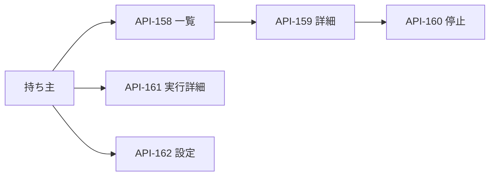

# 09. 成長機構のAPI
- 版数：v1.8（2026-10-26） ／ インプット：[FR-117〜122](../04_functional_spec/learning.md)、[SCR-034・035](../06_learning.md)

> **3行で**
> 1. 持ち主は学習した処理・検証根拠・実行状況を確認できる。
> 2. 版の停止と全体の有効・無効を操作できる。
> 3. 任意IRの登録や採用を指示する公開APIは作らない。

## 🧭 判断してほしいこと
なし。

## 全体図

見てほしいところ：自動採用は公開APIではなく本体のvalidatorが行う。

## 要点
- [共通仕様](#共通仕様)は既存の持ち主認証・CSRFを継承。
- [契約](#エンドポイント)はDB列または算出方法を示す。
- [エラー](#エラーコード)に状態競合を定義する。

## 詳細
### 共通仕様
ベースは`/api/v1`。Tailscale/Headscaleの持ち主identity、LAN直結なら既存パスキーsessionで認証。書込はOriginと`X-Makase-Request: 1`を必須にする。
camelCase JSON、ISO 8601、一覧はcursor＋limit（既定20、最大100）、最大body 16KiB。未知フィールドは422。エラーの形は[共通仕様](README.md#共通仕様)を継承。
持ち主以外は403、未ログインは401。LLMのツールとしてこれらのAPIを登録しない。

### エンドポイント

API-158〜162の入出力

| ID | メソッド・パス | 入力 | 正常応答・DB対応 | FR / SCR |
|---|---|---|---|---|
| API-158 | GET `/learning/programs` | status?（programの8状態）、cursor?、limit? | 200 `{items:[{id,version,status,operation,createdAt,expiresAt}],nextCursor}`。TBL-065、operationはir_json.scope.operation | FR-117・118 / SCR-034 |
| API-159 | GET `/learning/programs/:programId` | UUIDv7 | 200 `{id,version,status,statusReason,scope,dependencies,validation,sourceCount,updatedAt,expiresAt}`。TBL-065・066。sourceCountは元履歴IDの件数、validationは最終ゲートのstage別countsと失敗理由、未実施ならnull | FR-119 / SCR-034 |
| API-160 | POST `/learning/programs/:programId/disable` | `{expectedUpdatedAt}`、Idempotency-Key必須 | 200 `{id,status,updatedAt}`。TBL-065をdisabledへ。既にdisabledなら200、その他の終端状態なら409 | FR-122 / SCR-034 |
| API-161 | GET `/learning/runs/:runId` | UUIDv7 | 200 `{id,taskId,programId,status,stopReason,metrics,holes:[{id,nodeId,status,attempts}],updatedAt}`。TBL-067・068 | FR-120・121 / SCR-035 |
| API-162 | GET / PATCH `/learning/settings` | PATCHは`{enabled:boolean,expectedRevision:integer}`。Idempotency-Key必須 | 200 `{enabled,revision,limits}`。TBL-035 learning、limitsは運用設定から算出 | FR-122 / SCR-034 |

- API-159のscopeはoperation・入力型・仮名カレンダーslot・選択規則版だけ返す。bindings、認証情報、観測の生値は返さない。
- validation：`{suiteVersion,validatorVersion,stages:[{stage,total,passed,failed,distinctRequests}],reason}`。各値はTBL-066由来。reasonは失敗理由の秘匿済み要約。
- API-161のmetricsはDBに保存した値と同じ。outcomeはpass/fail/unknown、contractPassedはboolean|null。未知を成功へ数えない。
- API-160はexpectedUpdatedAtのCASで競合検出。再送は同じkey＋同じbodyなら保存済み応答、body不一致は409 IDEMPOTENCY_CONFLICT。既存冪等保持期間を継承する。
- API-162は設定revisionをCASし、監査と同一トランザクション。falseからtrueへの変更は失効版を再採用しない。チャットの許可やKernel規則を変更しない。
- 一覧のソートはcreatedAt DESC、id DESC。cursorは両値とstatusフィルタに結びつけ、不正なら400。
- 既存API-122のtask詳細に任意の`learningRunId`を追加する（TBL-067をtask_idで参照、なければnull）。既存SSEは詳細更新通知だけを送り、本文はAPIで再取得する。

### エラーコード
この表は[共通エラー台帳](README.md#成長機構v18)の一部。

| code | HTTP | 条件 |
|---|---|---|
| LEARNING_NOT_FOUND | 404 | program/runがない、または保持期間後 |
| LEARNING_CONFLICT | 409 | 版・revisionの競合、停止できない終端状態 |
| LEARNING_INPUT_INVALID | 422 | 入力schema・UUID・状態enumが不正 |
| LEARNING_CURSOR_INVALID | 400 | cursorが不正 |
| IDEMPOTENCY_CONFLICT | 409 | 同じkeyで異なるbody（既存規約） |

自動実行の`guard_miss`、`dependency_changed`、`budget_exhausted`、`contract_failed`、`unknown_outcome`はrunのstopReasonであり、HTTP失敗と混同しない。

## このドキュメントで決まったこと
[D-401](../00_learning.md#決定事項ログ)。
