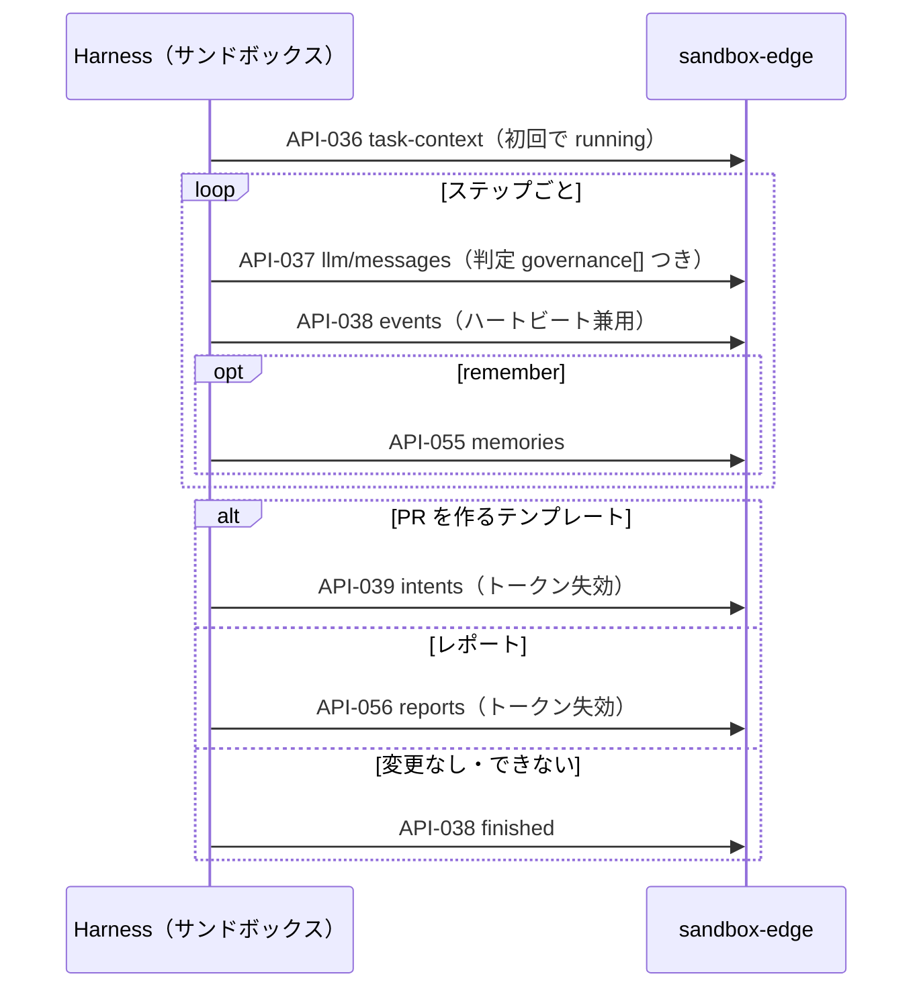

# 09. API設計：サンドボックス用の内部 API（`/internal/v1`）
- プロジェクト：open-team（仮称） ／ 版数：v0.6（2026-10-01） ／ 入口：[README.md](README.md) ／ 共通仕様：[common.md](common.md)

> **3行で**
> 1. サンドボックス（Harness）が `sandbox-edge` に呼ぶ API。認証はタスクごとのサンドボックストークンで、`sandbox-vpc` からだけ届く。
> 2. コンテキストの取得（API-036）→ LLM Proxy（API-037。ツール呼び出しはここで判定）→ 進捗（API-038）→ 成果物の提出（Intent：API-039、メモリ：API-055、レポート：API-056）。
> 3. サンドボックスに渡す `policy` は参考情報で、強制はサーバー側で行う（[ADR-003](../adr/ADR-003-cooperative-enforcement-in-sandbox.md)）。

## 🧭 判断してほしいこと
- [Q-76](README.md#-判断してほしいこと)：API-039 は `open_pr` の1件提出が前提。15 の MCP の Intent（1タスク複数、`mcp_call`）を受け付ける内部の経路が未設計。
- [Q-77](README.md#-判断してほしいこと)：API-056 のレポートの制約（reviewer / triager 以外は 403、`sources[]` なし）と 13・15 の食い違い。

## 全体図


見てほしいところ：成果物の提出（または `finished`）でトークンが失効し、それ以降の呼び出しは 401 / 409 `TASK_HALTED`。

---

## 詳細

### API-036：GET /internal/v1/task-context
- 認証：サンドボックストークン
- 副作用：初回の呼び出しでタスクを `running` にする。
- エラー：401 `UNAUTHORIZED`、409 `TASK_HALTED`

| 項目 | 内容（v0.2 の追加。12 FR-029） |
|---|---|
| `policy` | 実効ポリシー（`agent_snapshots.effective_policy`。BR-20）。エージェントが無駄な操作をしないための参考情報（ADR-003） |
| `policySummary` | FR-025 と同じ固定の文テンプレートで作った要約 |
| システムプロンプトの組み立て順 | テンプレートの指示 → `policySummary` → `agent.instructions` → `agent.skills` → `agent.memories` → タスクの入力。`agent.instructions` と `agent.memories` は「利用者が書いたデータ」として区切って入れる |
| `agent.skills` | スナップショットに固定した Skill（BR-22）の `name`・`description`・本文。システムプロンプトに入れるのは `name` と `description` だけで、本文は `load_skill` の判定（API-037。付けられた Skill 以外の名前は deny）が allow のときに、ハーネスが tool result として渡す |
| `agent.memories` | `active` の項目を新しい順に、合計4,000トークンまで（A-38）。`memory.enabled: false` のエージェントと試し実行では空。試し実行の `agent` は下書きから作ったスナップショットの値 |
| `tools`・`phases` | テンプレートで決まる（dev-coder / reviewer / triager）。reviewer・triager では `submit_intent` の代わりに `submit_report` を返し、`finish` も含める。`memory.enabled: false` のエージェントでは `remember` を含めない（UC-023） |
| `prompt`・`instructions` | `prompt` は Issue なしのタスクの本文（指示文だけの委任・スケジュール）、`instructions` は Issue に対する追加の指示（Web・メンション）。どちらも2,000文字まで（12 FR-028） |
| `openIssues` | triager のみ（ほかは `null`）。Open の Issue 一覧 `[{ "number", "title", "labels", "body" }]`（最大100件、`body` は先頭2,000文字）。新しいツールは作らず、コンテキストとして渡す |

- 13 で追加したツール（`web_search` / `web_fetch` / `mcp_call` / `notify`）とテンプレート（`researcher` ほか）を `tools`・`phases` で返すときの形は 13 に記載がない（[Q-72](README.md#-判断してほしいこと)）。

<details>
<summary>レスポンス（200）の例</summary>

```json
{
  "taskId": "t1...",
  "repository": { "fullName": "owner/app", "defaultBranch": "main" },
  "baseCommitSha": "a1b2c3d...",
  "snapshotUrl": "https://storage.googleapis.com/...(署名つき、15分)",
  "issue": { "number": 130, "title": "Fix login redirect", "body": "..." },
  "prompt": null,
  "instructions": null,
  "isDryRun": false,
  "openIssues": null,
  "agent": {
    "slug": "bug-fixer",
    "name": "バグ修正係",
    "template": "dev-coder",
    "instructions": "再現テストを先に書いてから修正する。\n公開APIのシグネチャは変えない。",
    "skills": [ { "name": "fix-flaky-test", "description": "flakyなテストを見つけて直すときに使う", "content": "...", "sha256": "c0ff..." } ],
    "memories": [ { "id": "m1...", "content": "テストは vitest。jest ではない", "createdAt": "2026-09-28T03:00:00Z" } ]
  },
  "policy": {
    "autonomy": { "read": "auto", "edit_code": "auto", "run_tests": "auto", "shell_network": "deny", "memory_write": "auto" },
    "paths": { "allow": ["src/**", "test/**"], "deny": [".github/workflows/**", "infra/**", "**/.env*", "src/billing/**"] },
    "commands": { "allow": ["npm test"] },
    "budget": { "max_steps": 60, "max_minutes": 30 }
  },
  "policySummary": ["`src/**` と `test/**` のファイルを変更できます（`src/billing/**` を除く）", "PRを作るには ren の承認が必要です"],
  "tools": ["list_files", "read_file", "search", "write_file", "apply_patch", "delete_file", "run_command", "load_skill", "remember", "submit_intent", "finish"],
  "phases": ["investigate", "plan", "implement", "test", "review", "submit"]
}
```

</details>

### API-037：POST /internal/v1/llm/messages
- 認証：サンドボックストークン
- リクエストボディ：

  | フィールド | 型 | 必須 | 説明 |
  |---|---|---|---|
  | phase | enum | ○ | `investigate` / `plan` / `implement` / `test` / `review` / `report`（v0.2 で `review`・`report` を追加。`design` は設計アシスタント専用で、この API では受け付けない） |
  | messages | array | ○ | `[{ role: "user"\|"assistant"\|"tool", content }]`（合計1MBまで） |
  | tools | array | ○ | ツールカタログの名前と JSON Schema |
  | maxTokens | integer | ○ | 1〜16,000 |

- エラー：401 `UNAUTHORIZED`（トークンが不正・失効）、409 `TASK_HALTED`（事前の判定で halt、またはタスクが終了している。`details` に `haltReason`）、429 `RATE_LIMITED`（60回/分を超えた）、502 `LLM_UPSTREAM_ERROR`（プロバイダーのエラー。リトライ後）
- 副作用：TBL-011 の INSERT、TBL-006 のカウンタの更新、TBL-010 の INSERT、TBL-007 の INSERT（`llm_called`・`tool_called`）、監査ログ `llm.called`・`decision.made`（allow 以外）。halt の場合は FR-013・FR-014 の停止処理

<details>
<summary>レスポンス（200）の例</summary>

```json
{
  "model": "anthropic/claude-sonnet-5-5",
  "content": [
    { "type": "text", "text": "src/auth.ts を修正します" },
    { "type": "tool_call", "id": "tc_1", "name": "write_file",
      "arguments": { "path": "src/auth.ts", "content": "..." } }
  ],
  "stopReason": "tool_call",
  "usage": { "inputTokens": 12000, "outputTokens": 900, "costUsd": "0.049500" },
  "governance": [
    { "toolCallId": "tc_1", "decision": "allow", "reasonCode": "autonomy_auto", "matchedRule": "autonomy.edit_code" }
  ],
  "budget": { "costUsd": "0.889500", "stepsUsed": 33 }
}
```

</details>

### API-038：POST /internal/v1/events
- 認証：サンドボックストークン
- リクエストボディ：`events`（必須、最大20件）`[{ type: "phase_started"|"tool_called"|"message"|"finished", payload }]`
- レスポンス（202）：`{ "accepted": 3, "dropped": 0 }`
- `finished` の payload は `{ outcome: "no_change"|"unable", reason }`。受け取ったらタスクを `failed`（`agent_no_change` / `agent_unable`）にし、サンドボックストークンを失効させる（`finish` ツールの結果）。
- 備考：`tool_called` の場合、サンドボックスが送るのは `resultSummary`（500文字まで）だけで、判定は API-037 の判定記録を使う。ハートビートを兼ねる（`last_heartbeat_at` を更新）。
- エラー：401、409 `TASK_HALTED`

### API-039：POST /internal/v1/intents
- 認証：サンドボックストークン
- リクエストボディ：

  | フィールド | 型 | 必須 | 説明 |
  |---|---|---|---|
  | actionType | `open_pr` | ○ | |
  | title | string | ○ | 1〜256文字 |
  | body | string | ○ | 20,000文字以内 |
  | diff | string | ○ | 5MB以内 |
  | testReport | object | − | `{ commands: string[], passed: boolean, summary: string }` |
  | selfReview | object | − | dev-coder の自己レビューの結果（v0.2。`{ model, rounds[], unresolved[] }`）。`action_intents.self_review` に保存する。intentHash には含めない（A-63） |

- レスポンス（201）：`{ "intentId": "i1...", "decision": "approve", "reasonCode": "autonomy_approve", "matchedRule": "autonomy.open_pr" }`
- エラー：409 `INTENT_ALREADY_SUBMITTED`、409 `TASK_HALTED`、422 `DIFF_INVALID`。reviewer・triager のタスクは Intent を提出できない（`submit_intent` はテンプレートにないツール。403 `FORBIDDEN`）
- 副作用：FR-010。TBL-008・TBL-010 の INSERT、サンドボックストークンの失効、承認フローまたは Gateway の実行ジョブの登録、監査ログ `intent.proposed`・`decision.made`
- 試し実行（v0.2。BR-24・FR-026）：Intent を保存して判定まで行ったあと、判定結果にかかわらず `status = simulated` にし、承認フローにも Gateway にも渡さない。タスクは `completed`（`dry_run`）。レスポンスは `{ "intentId", "decision", "reasonCode", "matchedRule", "simulated": true }`。
- v0.6（15）：`action_intents` の `task_id` の UQ を外し、`action_type` に `mcp_call` を追加した。MCP の書き込みは Harness の `mcp_call`（`assistant`）またはランタイムの `deliver`（タスクの最後）から Intent になり、`mcp_call` の戻り値は `{ intentId, status: "pending_approval" | "accepted" | "denied" }` だけ（結果は待たない。A-87）。この経路の内部 API と、API-039 の `INTENT_ALREADY_SUBMITTED` の扱いは [Q-76](README.md#-判断してほしいこと)。

### API-055：POST /internal/v1/memories
- 認証：サンドボックストークン
- リクエストボディ：`toolCallId`（必須。`remember` のツール呼び出しの ID。API-037 の `governance[].toolCallId`）、`content`（必須、1〜500文字）
- 処理（FR-031）：`toolCallId` に対する `memory_write` の判定記録（TBL-010）が `allow` であることを確認し、秘密情報のパターン（`ghs_`、`sk-`、`AKIA`、秘密鍵のヘッダーなど）をマスクして、`pending` で保存する（`source_task_id` と表示用の `source_task_ref` を付ける）。試し実行では受け付けるが行を作らない（BR-24）。`memory.enabled: false` のエージェントには `remember` を渡さない（UC-023）。
- レスポンス（201）：`{ "memoryId": "m9...", "status": "pending", "masked": false }`。試し実行の場合は `{ "memoryId": null, "status": "discarded", "masked": false }`。
- エラー：400 `VALIDATION_ERROR`（500文字を超えた）、401 `UNAUTHORIZED`、403 `FORBIDDEN`（`allow` の判定記録がない。deny、または `memory.enabled: false`）、409 `TASK_HALTED`
- 副作用：TBL-022 の INSERT、TBL-007 の INSERT（`tool_called`）

### API-056：POST /internal/v1/reports
- 認証：サンドボックストークン
- リクエストボディ：`title`（必須、1〜256文字）、`body`（必須、Markdown、最大50,000文字）
- レスポンス（201）：`{ "taskId": "t5...", "status": "completed" }`
- エラー：400 `VALIDATION_ERROR`、401 `UNAUTHORIZED`、403 `FORBIDDEN`（テンプレートが reviewer / triager でない＝`output_type` が `report` でない）、409 `REPORT_ALREADY_SUBMITTED`、409 `TASK_HALTED`
- 副作用（FR-033）：TBL-006 の更新（`report`、`status=completed`、`status_detail=report`。試し実行は `dry_run`）、サンドボックストークンの失効、そのタスクの `pending` のメモリを `active` に（試し実行を除く。BR-26。v0.6 で `succeeded` と `completed`（`report` / `actions_declined`）に拡大）、依頼者への Push 通知、監査ログ `task.report_submitted`。GitHub には何も書き込まない（A-39）
- 備考：レポートは外部作用ではないので承認は不要。表示時は Markdown として描画し、リンクは無害化する。
- 13・15 との食い違い：13 は `submit_report` を全テンプレートに広げ `sources[]` を必須にし（BR-45）、15 の `deliver` は `report.summary`・`report.sources_markdown` を使う（[Q-77](README.md#-判断してほしいこと)）。
