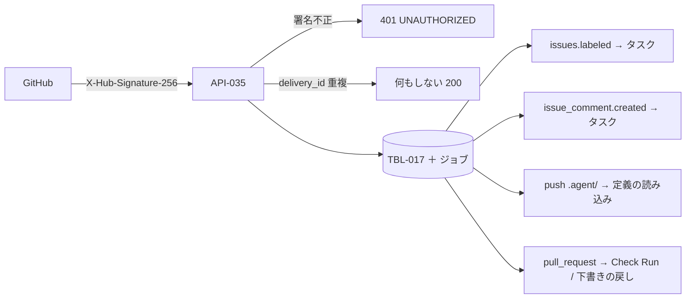

# 09. API設計：GitHub Webhook
- プロジェクト：open-team（仮称） ／ 版数：v0.6（2026-10-01） ／ 入口：[README.md](README.md) ／ 共通仕様：[common.md](common.md)

> **3行で**
> 1. GitHub の Webhook を1つの口（API-035）で受け、署名を確かめ、配信 ID で重複を除いてキューに積む。応答は常に 200。
> 2. ラベル・メンション（`@open-team <agent-id>`）でタスクを作り、`.agent/` の変更で定義を読み込み・検証する。
> 3. 条件を満たさずタスクを作らなかったときは、監査ログ `trigger.skipped` に理由を残す。開発用途（フェーズ1）の口。

## 🧭 判断してほしいこと
- [Q-71](README.md#-判断してほしいこと)：メンションへの返信（コメント投稿は Won't。現在は Web Push だけ）。

## 全体図

見てほしいところ：受信は同期で 200 を返し、処理はすべて worker のジョブで行う。

---

## 詳細

### API-035：POST /webhooks/github
- 認証：`X-Hub-Signature-256`
- レスポンス：200（受け付け。処理はキューで行う）、401 `UNAUTHORIZED`（署名が不正）
- 副作用：TBL-017 の INSERT（`delivery_id` が重複した場合は何もしない）、FR-002 の処理ジョブの登録
- v0.2 で処理するイベント（12 FR-022・FR-028。購読の追加は A-43）：

イベントごとの処理（5種類）

| event.action | 処理 |
|---|---|
| `issues.labeled` | ラベルが、いずれかの `active` なエージェントの `github_label` トリガーの `label` と一致すれば、そのエージェントのタスクを作る（既定の `open-team` ラベルは既定エージェント）。ラベルを付けたユーザーが依頼者（BR-07・BR-29・`max_runs_per_day`） |
| `issue_comment.created` | 本文の先頭が `@open-team <agent-id>` なら、`github_mention` トリガーを持つそのエージェントのタスクを作る（A-41）。残りの本文を Issue に対する追加の指示として `instructions` に入れる（2,000文字まで。12 FR-028）。コメントしたユーザーが依頼者。返信のコメントは投稿しない（依頼者に Web Push で通知） |
| `push` | デフォルトブランチへの push で `.agent/` 配下に変更があれば、定義の読み込みジョブ（FR-022 / UC-020）を登録する。同じリポジトリのジョブは直列に処理する。読み込みで、公開 PR（`agent_drafts.pr_number`）のマージを検出したら下書きを `merged` にする。停止中（`disabled`）のエージェントの定義が更新された場合は、`disabled` のままスナップショットだけを更新する（UC-020 3a） |
| `pull_request.opened` / `pull_request.synchronize` | PR が `.agent/**` を変更していれば（open-team が作った PR に限らない）、PR の head の定義を FR-022 で検証し、Gateway で Check Run `open-team/agent-config` を作って結果を返す（エラーがあれば `failure`、警告だけなら `neutral`、問題なしなら `success`。BR-28、A-43、A-66） |
| `pull_request.closed` | 公開 PR（`agent_drafts.pr_number` が一致し `published`）が、マージされずに（`merged = false`）クローズされたら、下書きを `drafting` に戻し、`pr_number` を `last_pr_number` に移す（再公開できる。UC-019 4a）。マージされた場合は何もしない（`push` で `merged` にする）。open-team のタスクの PR の場合は v0.1 のとおり（FR-021 の記録） |

- 下書き（`agent_drafts`）に関わる処理（`push` のマージ検出、`pull_request.closed`）は、下書きの廃止（v0.5、TBL-021）以降の扱いが未設計（[Q-74](README.md#-判断してほしいこと)）。
- 条件を満たさずにタスクを作らなかった場合は、監査ログ `trigger.skipped`（理由コード：`agent_not_active` / `agent_disabled` / `kill_switch` / `forbidden` / `already_active` / `daily_run_limit` など。スケジュールでは `previous_run_active` も。BR-29）を記録する。Webhook の応答は常に 200。

## 前提・仮定
- A-41：メンションの書式は `@open-team <agent-id> <指示>` とし、コメントの先頭にある場合だけ受け付ける。
- A-43：GitHub App の権限に `issue_comment` の購読と `checks: write`（公開 PR の検証結果の表示）を追加する。
- A-66：Check Run `open-team/agent-config` の結論は、エラーがあれば `failure`、警告だけなら `neutral`、問題なしなら `success` とする。
