# 10. ER図 / シーケンス図 / 状態遷移図
- プロジェクト：Agent-Team-Open ／ 版数：v0.6（2026-10-24） ／ インプット：[08_database](08_database.md)、[09_api](09_api.md)

> **3行で**
> 1. シーケンス図は5本：VM で操作する1歩（UC-046）・こわい操作の確認（UC-047）・交代（UC-048）・VM のターミナル（UC-053）・再起動からの再開（FR-084）。
> 2. 状態遷移図は5つ：`boxes.status`・`boxes.control`・`takeovers.status`・`browser_checks.status`・`sandbox_commands.status`。
> 3. ER図は新しい表と、それがぶら下がる今の表だけを描く（今の表の全体は `schema.ts`）。

## 🧭 判断してほしいこと
なし

## 全体図
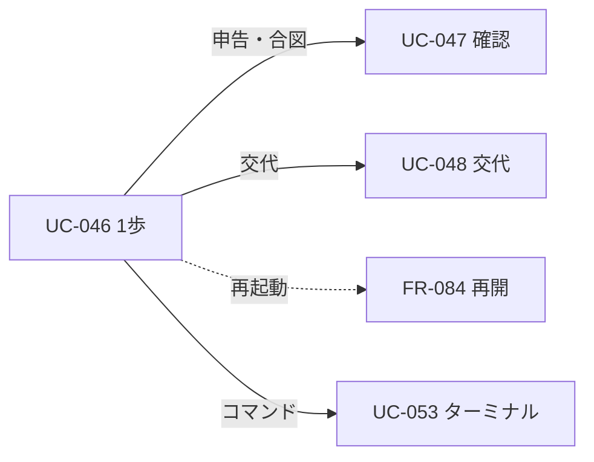
見てほしいところ：どの図も UC-046 の1歩から分かれる。ターミナル（UC-053）は VM の中のコマンドで、判定せず自由に実行し、VM の外に効く書き込みだけ確認する。

## 要点
- 変える操作の1歩は「Claude → 確かめ（dryRun）→ Kernel → 中身のハッシュつきの実行 → スクショ」（[UC-046](#uc-046vm-で操作する1歩)）
- ○ は `pending → executing` を1回だけ取れたときに実行する（[UC-047](#uc-047こわい操作の確認)）
- 交代は「渡す準備」でエージェントを止めてから、人に渡す（[UC-048](#uc-048交代)）
- ターミナルは VM の中で自由に実行し、出力は汚染として扱う。PR にするときだけ Intent・確認を通す（[UC-053](#uc-053vm-のターミナル)）

---

## 詳細

### ER図
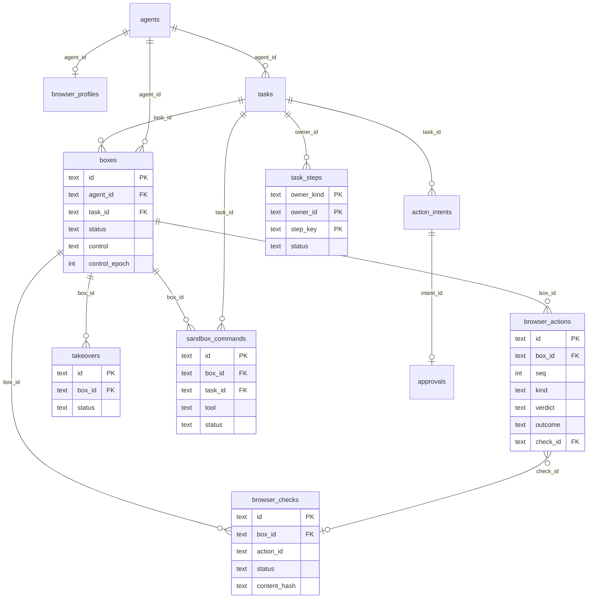

### シーケンス図

### UC-046：VM で操作する1歩
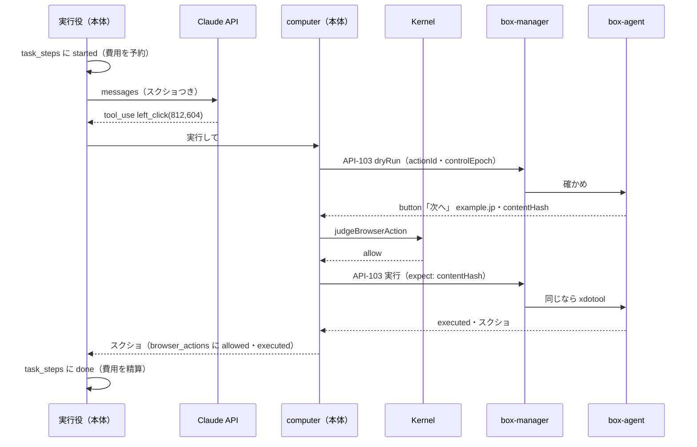

### UC-047：こわい操作の確認
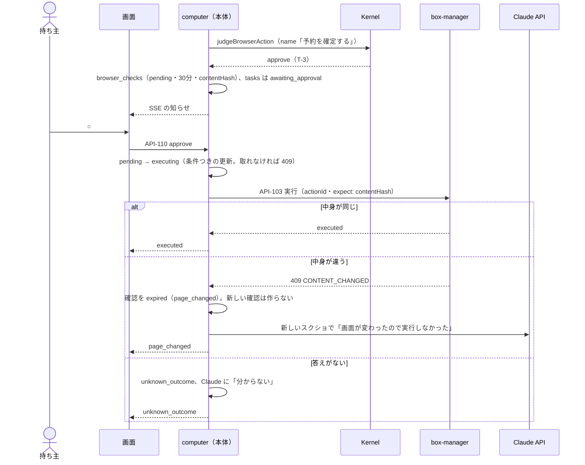

### UC-048：交代
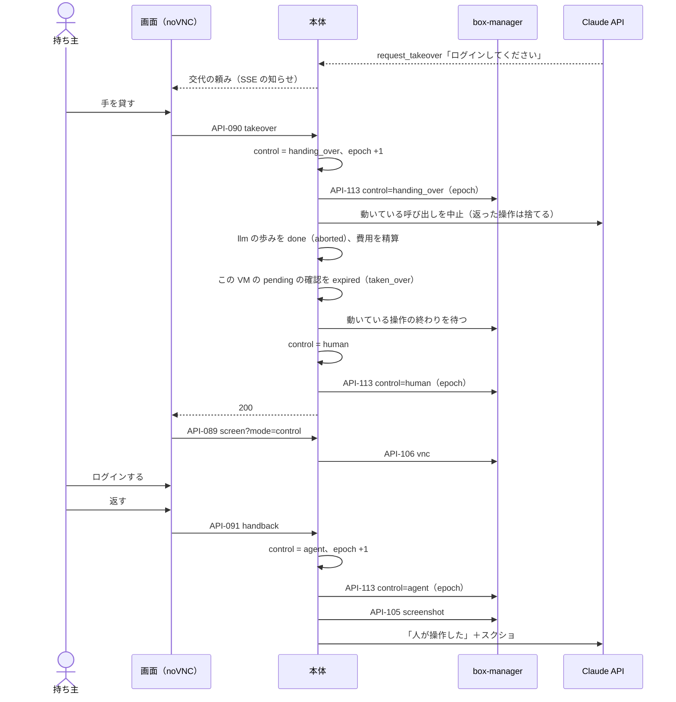

### UC-053：VM のターミナル
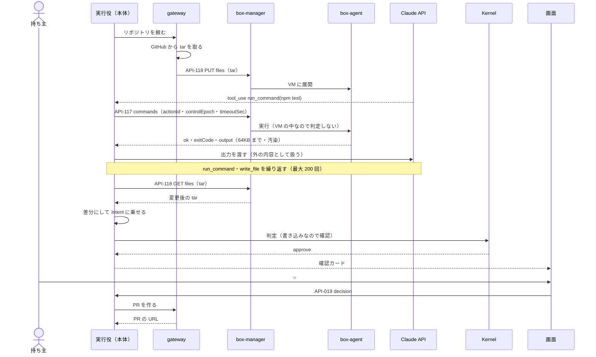

### FR-084：再起動からの再開
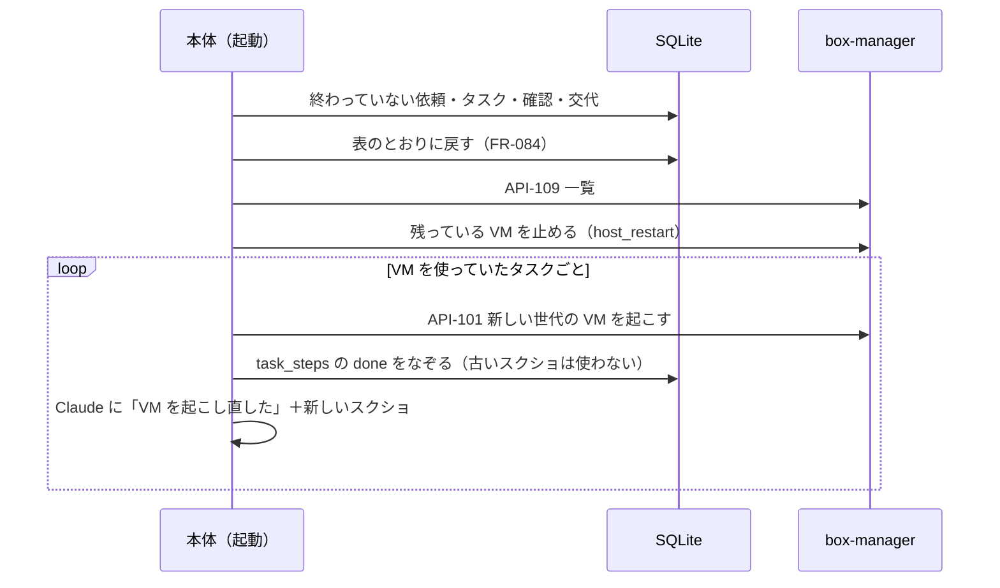

### 状態遷移図

### boxes.status
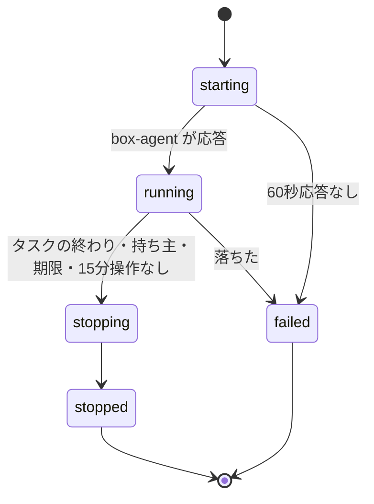

### boxes.control
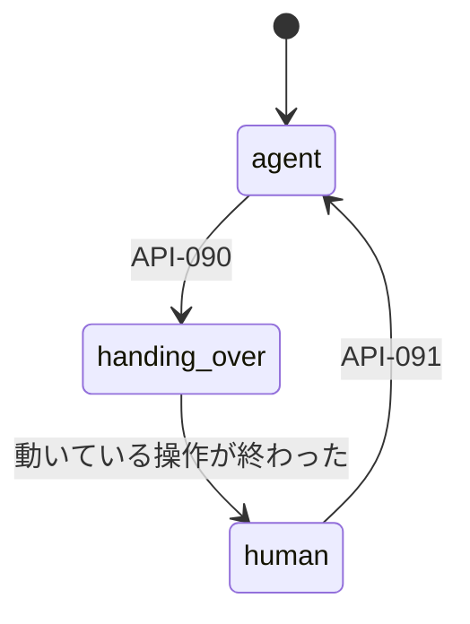

### takeovers.status
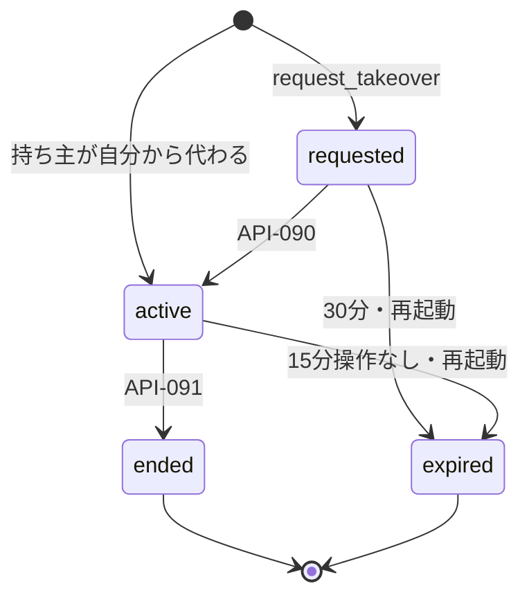

### browser_checks.status
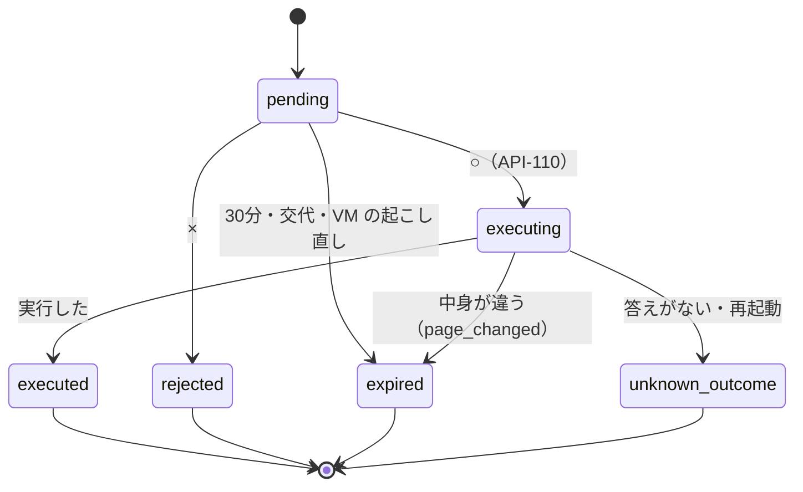

### sandbox_commands.status
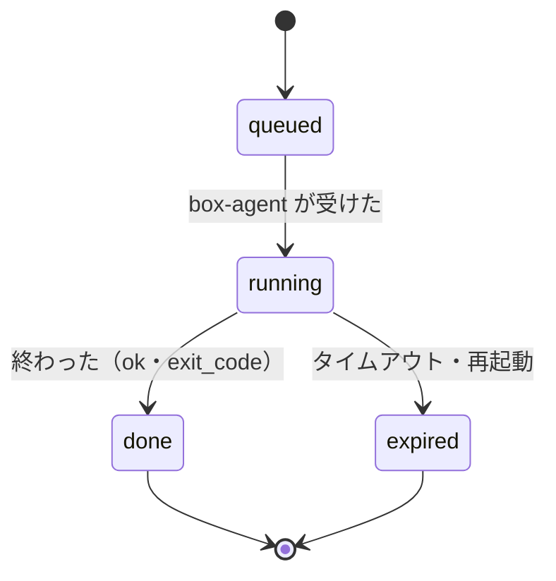

## このドキュメントで決まったこと
- なし（図は 03・04・08・09 の内容を描いたもの。UC-053 と `sandbox_commands.status` は D-178）
