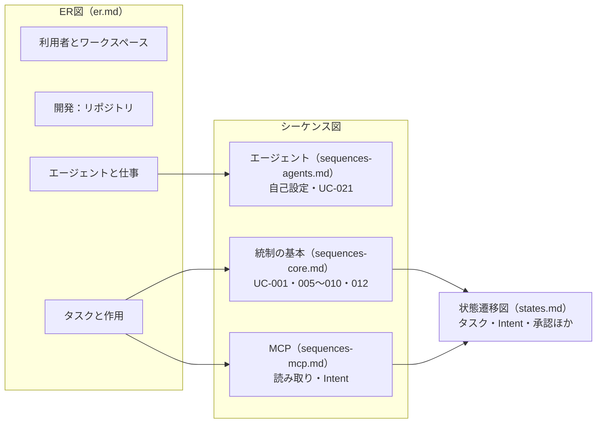
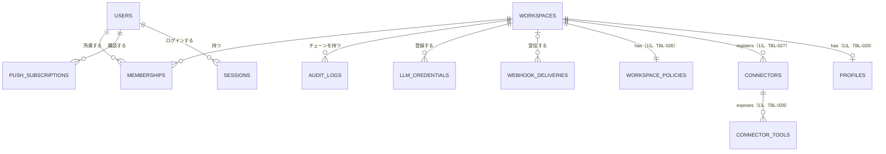
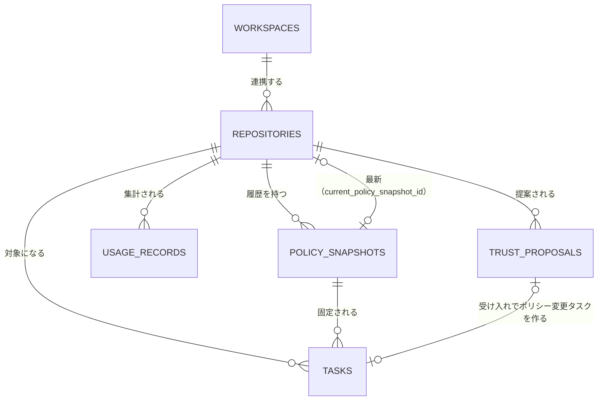
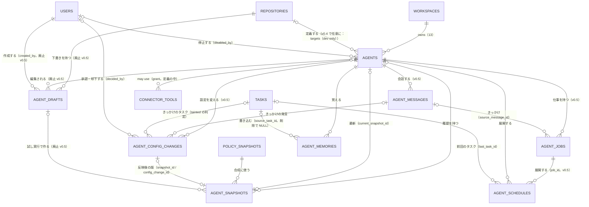
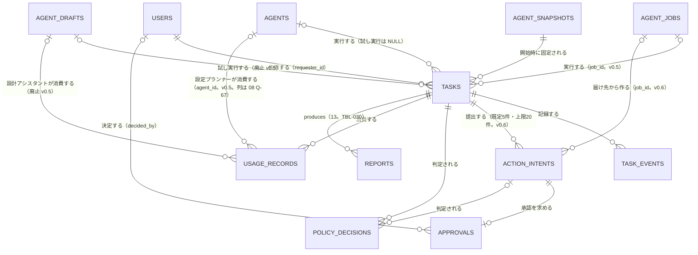

# 10. ER図 / シーケンス図 / 状態遷移図
- プロジェクト：open-team（仮称） ／ 版数：v0.6（2026-10-01） ／ インプット：[03](../03_use_cases/README.md)、[04](../04_functional_spec/README.md)、[07](../07_architecture.md)、[08](../08_database/README.md)、[09](../09_api/README.md)

> **3行で**
> 1. データの関係（ER図4枚）・処理の順序（シーケンス図13枚）・状態の変化（状態遷移図10枚）を、このディレクトリにまとめた。v0.2 の18枚に、汎用クラウドエージェント（13）・自己設定（14）・MCP の書き込み（15）の図を足した。
> 2. 図に書くのは、上流ドキュメントに書かれた流れと状態だけ。テーブル名は 13 の改名（organizations → **workspaces**）に合わせ、ID・カラムの正本は [08](../08_database/README.md)（13 の新テーブルは TBL-026〜030）。
> 3. 「v0.2（置き換え済み）」の印がある図は、v0.5 で作り方が変わる前の流れ。消さずに残し、今の流れは「自己設定」の図を見る。

## 🧭 判断してほしいこと
| # | 種類 | 論点 | 選択肢 | おすすめ（理由） | 決まらないと止まるもの |
|---|---|---|---|---|---|
| Q-81 | ✅決定 | v0.2 の作り方（下書き → 試し実行 → 公開PR → 有効化）は v0.5 で置き換え（TBL-021・API-043〜048 廃止。14 §データベース・§API）。一方で GitOps モード（ADR-017）と詳細設定の試し実行（REQ-022）は残る（14 §概要・§要件）。残る側の流れが未設計 → **GitOps モードはフェーズ2以降へ。US-024 廃止、US-025・026 は Could、US-027・UC-019・020・FR-027・NFR-051 はフェーズ2**（[D-14](../decisions.md#d-14)）| A: GitOps の流れを新しく設計 / B: v0.2 の図を正とする | —（元の記述なし） | [sequences-agents.md](sequences-agents.md#v02置き換え済みエージェントの作成--試し実行--公開--有効化)、[states.md](states.md#v02置き換え済み下書きagent_draftsstatus) |
| Q-82 | ✅決定 | UC-025 はエージェントを `status = idle` で作る（14 §UC-025）が、エージェントの状態は `active` / `invalid` / `disabled` / `removed`（10 v0.2 §状態遷移図 エージェント）で `idle` がない。あわせて、図の契機（定義の読み込み・ファイルの削除）はリポジトリの定義の言葉で、アプリ内の定義（既定。ADR-017）での契機が未整理 → **agents.status に idle を足す。作成直後と、動いている仕事（active / waiting_input）が0件のとき idle、1件以上で active**（[D-20](../decisions.md#d-20)）| A: `idle` を状態に足す / B: UC-025 を既存の状態に直す | —（元の記述なし） | [states.md](states.md#エージェントagentsstatus)、TBL-018 |
| Q-83 | ✅決定 | MCP の送信前の失敗で、Intent の状態を `approved のまま` とする（15 §Gateway での実行 表）が、手順1で先に `executing` にしている（同 手順1） → **送信前の失敗は executing → approved に戻して再試行。executing のまま残ったものだけ unknown_outcome**（[D-18](../decisions.md#d-18)）| A: `executing → approved` に戻す / B: `executing` のまま再試行 | —（元の記述なし） | [states.md](states.md#intentaction_intentsstatus)、FR-012 |
| Q-84 | 未決 | 自律レベル `handoff`（12 §競合機能の採用方針 REQ-035、15 §decide() の拡張 手順8）で、Intent とタスクがどの状態になるかが未設計 | — | —（元の記述なし） | 状態遷移図（Intent・タスク） |
| Q-85 | 未決 | 仕事（`agent_jobs.status`：`waiting_input` / `active` / `paused` / `done`）の遷移条件は一部しか書かれていない（14 §TBL-023・US-041・API-065）。状態遷移図は作っていない | — | —（元の記述なし） | 仕事の状態遷移図、FR-037 |
| Q-87 | 未決 | タスクの状態遷移（v0.2）に、15 の終わり方（`running → awaiting_approval` の条件、`completed`（`actions_declined`）、`failed`（`action_failed`））をどう組み込むか。どの状態から遷移するかが 15 の表からは決まらない | A: 04 のステータス定義で遷移を確定 | —（元の記述なし） | [states.md](states.md#タスクtasksstatus)、04 ステータス定義 |
- ER図にも効く 08 の論点：[Q-62](../08_database/README.md)（organizations → workspaces の改名の範囲。外部キー `organization_id` の列名など）、Q-64（リポジトリのないエージェントと NOT NULL）、Q-65（TBL-026〜030 と `tasks.tainted` のカラムが未設計）、Q-67（`usage_records.agent_id` 列がない）。

## 全体図

見てほしいところ：ER図は領域ごとに4枚に分けた（各15ノード以内）。統制の中心は「タスクと作用」で、PR（S1）と MCP（S3）の2つの経路が同じ Intent の状態遷移に入る。

## 要点
- ER図の全体像は下の [ER図の全体像](#er図の全体像)、カラムは [er.md](er.md)。`agent_drafts`（TBL-021）は v0.5 で廃止したが、図には「廃止」と書いて残した。
- 主要な流れ（サインイン・委任・承認・停止・Kill Switch・検証失敗）は [sequences-core.md](sequences-core.md)。図の中の `organizations` は旧称で、今の `workspaces` を指す。
- エージェントの作り方の今の流れは [自己設定のシーケンス](sequences-agents.md#uc-026お願いから仕事を作る自己設定)。設定の変更は `narrow` / `neutral` は即時、`widen` は承認待ち（[状態遷移](states.md#設定の変更agent_config_changesstatus)）。
- MCP の書き込みは結果を待たない Intent で、`unknown_outcome` は自動で再試行しない（[sequences-mcp.md](sequences-mcp.md)、[Intent の状態](states.md#intentaction_intentsstatus)）。
- 汚染（`tainted`）は一度付いたら外れない（[states.md](states.md#汚染taskstainted)）。
- フェーズ：MCP・Web 読み取り・自己設定・スケジュールはフェーズ0。サインイン（UC-001）・開発（GitHub・PR）はフェーズ1。ブラウザ・委任はフェーズ2で、図はない。

---

## 詳細

### 図の索引

全28枚の図と、関連する UC / FR / REQ（27行）

| ファイル | 図 | 何を説明するか | 関連 | フェーズ |
|---|---|---|---|---|
| README | ER 利用者とワークスペース | ユーザー・ワークスペース・ポリシー・コネクタ | TBL-001〜003・012〜014・016・017・026〜029、REQ-042・045 | 0〜1 |
| README | ER 開発：リポジトリ | リポジトリのポリシーと信頼度提案 | TBL-004・005・015 | 1 |
| README | ER エージェントと仕事 | エージェント・仕事・会話・設定の変更 | TBL-018〜025 | 0 |
| README | ER タスクと作用 | タスク・Intent・承認・判定・費用 | TBL-006〜011・030 | 0 |
| [sequences-core](sequences-core.md) | UC-001 | サインインとリポジトリ連携 | UC-001、API-001・002・005・035 | 1 |
| 〃 | UC-005 / UC-007 | タスクの委任と自律実行 | UC-005・007、FR-004〜009、API-011・015・036〜039 | 1 |
| 〃 | UC-009 / UC-010 | PR の承認・実行・検証 | UC-009・010、FR-010〜012、API-018・019 | 1 |
| 〃 | UC-008 | Breaker による自動停止 | UC-008、FR-009 | 0 |
| 〃 | UC-012 | Kill Switch | UC-012、FR-015、API-020 | 0 |
| 〃 | UC-010 E3 | 検証の不一致 | UC-010、FR-012 | 1 |
| [sequences-agents](sequences-agents.md) | UC-026（14） | お願いから仕事を作る（自己設定） | UC-025・026、FR-034〜038、REQ-052〜055 | 0 |
| 〃 | UC-021 スケジュール | スケジュールによる起動 | UC-021、FR-028、BR-25・29 | 0 |
| 〃 | UC-021 メンション | メンションによる起動 | UC-021、FR-028、A-41 | 1 |
| 〃 | UC-017〜020 | v0.2（置き換え済み）作成 → 公開 → 有効化 | UC-017〜020、API-043〜048（廃止） | — |
| 〃 | UC-018 | v0.2（置き換え済み）試し実行の simulated 化 | UC-018、BR-24 | — |
| [sequences-mcp](sequences-mcp.md) | MCP 呼び出しの経路（13） | 読み取り / 書き込みの分かれ道 | REQ-042・047、ADR-022 | 0 |
| 〃 | MCP の Intent（15） | 書き込みの Intent のライフサイクル | FR-004・010〜012（MCP 版）、BR-39・58・59 | 0 |
| 〃 | タスクの終わり方（15） | Intent の結果からタスクの状態を決める | FR-012、BR-26 | 0 |
| [states](states.md) | タスク | `tasks.status` | FR-005〜009 | 0 |
| 〃 | Intent | `action_intents.status`（MCP を含む） | FR-010〜012、BR-59・60 | 0 |
| 〃 | 承認 | `approvals.status` | FR-011 | 0 |
| 〃 | Kill Switch | `workspaces.kill_switch_engaged` | FR-015、API-020・021 | 0 |
| 〃 | エージェント | `agents.status` | FR-022・032、UC-020・022 | 0 |
| 〃 | 設定の変更（14） | `agent_config_changes.status` | FR-036、BR-47・51〜55、API-063・064 | 0 |
| 〃 | 汚染（13） | `tasks.tainted` | BR-38〜42・51、REQ-047 | 0 |
| 〃 | コネクタのツール（13・15） | 分類と `needs_review` | BR-42・44・56、API-071 | 0 |
| 〃 | メモリ / 下書き | `agent_memories.status` / `agent_drafts.status`（v0.2・置き換え済み） | FR-031 / FR-025〜027 | 0 / — |

- 概念モデル（12 v0.2・13・14 のクラス図）は [concepts.md](concepts.md)。
- 12 §シーケンス図の2枚（作成から有効化まで・スケジュールによる起動）は、より詳しい v0.2 の図（[sequences-agents.md](sequences-agents.md)）に含まれるため、別には載せない。

### ER図の全体像

関係だけを描く。各テーブルの主なカラムは [er.md](er.md)、全カラムは [08](../08_database/README.md)。`workspaces` は旧 `organizations`（TBL-002。13 で改名）。

見てほしいところ：ポリシーの基本はワークスペース単位（`workspace_policies`）。MCP の認証情報を持つ `connectors` もワークスペースにぶら下がる。

見てほしいところ：リポジトリとそのポリシーは、開発エージェントにだけかかる追加の上限（BR-43）。エージェントとリポジトリの関係は「エージェントと仕事」の図にある（v0.4 で任意になった）。

見てほしいところ：v0.5 でエージェントは「境界・会話・メモリ」の単位になり、トリガーと指示は `agent_jobs` に移った。設定の変更は必ず `agent_config_changes` を通って新しいスナップショットになる。ノードは14個。

見てほしいところ：1タスクが複数の Intent を出せるようになった（v0.6。v0.2 は「MVPは最大1件」）。Intent は届け先の宣言（`job_id`）からも作られる。

## このドキュメントで決まったこと
- 新しい設計判断はない。図の元になった判断は [ADR-005](../adr/ADR-005-approval-bound-to-intent-hash.md)（承認は intentHash に紐づける）、[ADR-022](../adr/ADR-022-mcp-unified-unclassified-is-write.md)、[ADR-024](../adr/ADR-024-taint-tracking-against-injection.md)、[ADR-027](../adr/ADR-027-classify-widening-changes.md)、[ADR-028](../adr/ADR-028-jobs-as-unit-of-work.md)、[ADR-031](../adr/ADR-031-mcp-write-no-auto-retry.md)。
- A-68：エージェントビルダーの図は 12 v0.2 を正とする（`completed` と `status_detail` は 12 v0.2 で確定）。v0.5 以降は 14・15 を正とする。
- A-69：`removed` のエージェントは、同じIDのファイルが戻れば同じ行を使って `active` / `invalid` に戻す（TBL-018 の UQ `(repository_id, slug)`）。
- A-70：`agent_schedules.last_task_id` と、スケジュールの「前回のタスクが未完了か」の確認は、08 の補完（A-57）に従う。
- 解決済み（v0.2）：公開PRが未マージでクローズされた下書きは `published → drafting`（UC-019 4a）。エージェント停止で止めたタスクの `halt_reason` は `agent_disabled`（UC-022）。
