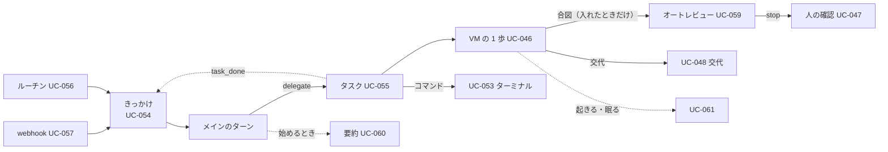
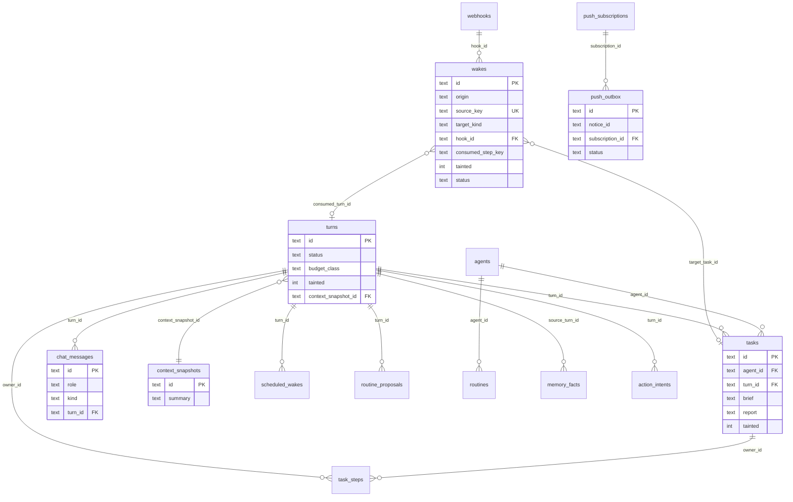
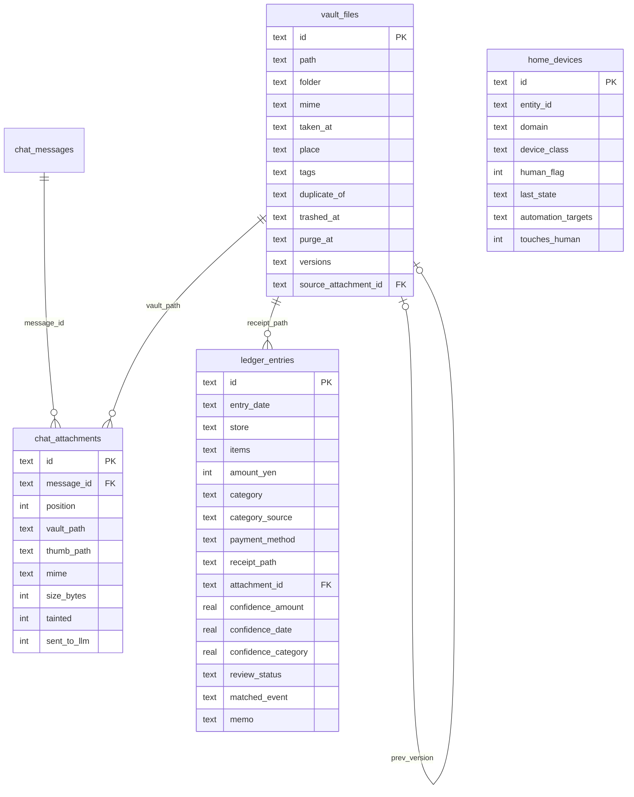

# 10. ER図 / シーケンス図 / 状態遷移図
- プロジェクト：Agent-Team-Open ／ 版数：v1.8（2026-10-26） ／ インプット：[08_database](../08_database/README.md)、[09_api](../09_api/README.md)

> **3行で**
> 1. シーケンス図は 17 本（[sequences.md](sequences.md)）。要約はターンを始めるときの 1 経路、VM は `box-browser` と `box-shell` の 2 コンテナの組で起きて眠り、本体の再起動では必ず新しい世代で起こし直す。v1.6 で、判定の詳細（Kernel・監査ログの鎖）と閉域の外向き・台帳を足した。v1.7 で、レシートの写真から家計簿まで（FR-112）と、家電の自動化を作る（FR-113）を足した。
> 2. 状態遷移図は 13 個（[states.md](states.md)）。`wakes.status` は `queued`・`consumed`・`dropped`、`workspace.vm_home_state` は `ok`・`broken` の 2 状態。
> 3. ER図は常駐の表と VM の表の 2 枚に分けて描き、VM の表の図に v1.6 の 4 表（`egress_events`・`policy_versions`・`audit_anchors`・`llm_models`）を、v1.7 で家の表の図（`vault_files`・`ledger_entries`・`home_devices`・`chat_attachments`）を足した（今の表の全体は `schema.ts`）。

## 成長機構（v1.8）
[UC-073〜076のシーケンス・program状態遷移](learning.md)と[新規5表のER図](../08_database/learning.md#全体図)を追加する。

## 🧭 判断してほしいこと
なし

## 全体図

見てほしいところ：どの図もきっかけ（UC-054）から始まり、タスクの終わりがまたきっかけに戻る輪になっている。

## 要点
- 送信からメインの返事・タスクの報告・通知までは 1 本の図（[UC-054・055](sequences.md#uc-054055きっかけからターン振り分け報告まで)）
- webhook は「大きさ → 受け口 → 署名 → 1 分 60 件（超えたら 429） → 重複」の順で確かめる（[UC-057](sequences.md#uc-057webhook-で起きる)）
- オートレビューは既定で切ってある。入れたときも会話は渡さず、`stop` なら人の確認に回る（[UC-059](sequences.md#uc-059オートレビュー)）
- 変える操作の1歩は「画面の番 → Claude → 直前の確かめ → 確かめ（dryRun）→ Kernel → 中身のハッシュつきの実行」を、返った操作の列の順に（[UC-046](sequences.md#uc-046vm-で操作する1歩)）
- 判定は Kernel の純粋な関数で、判定ごとに規則の版（`policy_sha256`）と「誰が決めたか」（`decided_by`）を残し、監査ログは `prev_hash`・`row_hash` の鎖にする（[判定の詳細](sequences.md#uc-046-の判定の詳細作動の形kernel行き先監査ログの鎖)）
- `closed` の外向きは、本体の窓口 `net` と egress が許可リストで絞り、台帳に書く。egress は box-manager が毎分取りに行く（[FR-101・103](sequences.md#fr-101103closed-での外向きと台帳)）
- レシートの写真は「添付 → 画像を読む役割 → `classify`（自信が低ければ LLM）→ 家計簿 → カレンダーと照らす → 確認のカード」の順（[FR-112](sequences.md#fr-112レシートの写真から家計簿まで)）。家電の自動化は Kernel が区分を見て、既定は人の ○ を待ってから HA に保存する（[FR-113](sequences.md#fr-113家電の自動化を作る)）
- ターンは 1 つずつ。動いている間に来たきっかけは `queued` のまま、ターンが終わったら次のターンで扱う（[turns.status](states.md#turnsstatus)）

---

## 詳細

### ER図：常駐の表

`memory_search`・`vm_snapshots` は外部キーを持たない。`webhooks` から `wakes` へは `hook_id` で結ぶ（D-284）。`action_intents`・`approvals`・`policy_decisions` は `task_id` か `turn_id` のどちらか一方を持つ（D-275）。

### ER図：VM の表

```mermaid
erDiagram
 boxes |o--o| tasks : "screen_task_id"
 boxes ||--o{ browser_actions : "box_id"
 tasks ||--o{ browser_actions : "task_id"
 browser_actions ||--o| auto_reviews : "auto_review_id"
 browser_actions }o--o| browser_checks : "check_id"
 auto_reviews |o--o| browser_checks : "check_id"
 boxes ||--o{ takeovers : "box_id"
 policy_versions ||--o{ browser_actions : "policy_sha256"
 audit_logs |o--o| audit_logs : "prev_hash"
 audit_logs }o--o| audit_anchors : "row_hash"
 egress_events }o--|| egress_daily : "日ごとの集計"
 llm_models ||--o{ usage_records : "model"
 boxes ||--o{ sandbox_commands : "box_id"
 tasks ||--o{ sandbox_commands : "task_id"
 tasks ||--o{ action_intents : "task_id"
 action_intents ||--o| approvals : "intent_id"
 boxes {
  text id PK
  text status
  text control
  int control_epoch
  int screen_epoch
  text screen_task_id FK
 }
 browser_actions {
  text id PK
  text box_id FK
  text verdict
  text decided_by
  text policy_sha256 FK
  text verdict_input
  text auto_review_id FK
  text check_id FK
 }
 auto_reviews {
  text id PK
  text action_id UK
  text verdict
 }
 browser_checks {
  text id PK
  text action_id UK
  text status
  int screen_epoch
  text content_hash
 }
 audit_logs {
  text id PK
  text prev_hash
  text row_hash UK
 }
 audit_anchors {
  text day PK
  text row_hash
 }
 policy_versions {
  int version PK
  text policy_sha256 UK
  text changed_by
  text reason
 }
 egress_events {
  text id PK
  text source
  text dest_host
  text purpose
  text decision
  int bytes_out
  int bytes_in
  int llm_tokens
 }
 egress_daily {
  text day PK
  text dest_host PK
  text purpose PK
  int events
 }
 llm_models {
  text id PK
  text provider
  text computer_use
  int context_tokens
  text prompt_cache
  real price_in
 }
```

v1.6 の 4 表（TBL-056〜059）は、`egress_daily` が `egress_events` の付属の表（D-368）。`policy_versions` の本文は `browser`・`terminal`・`network`・`review.auto.enabled` と行き先の表で、今の値は `workspace_policies` に置いたまま保存のたびに版を足す（D-369）。`audit_logs` の鎖は `prev_hash` で前の行につながる（D-350）。

### ER図：家の表（v1.7）

v1.7 の 4 表（TBL-060〜063）。`home_devices` は Home Assistant の機器の写しで、ほかの表とは外部キーで結ばない（`entity_id` で HA とつなぐ）。`chat_attachments` の元の画像は保管庫に置き、`ledger_entries` のレシートも保管庫の `レシート` を指す（D-373・D-375・D-376）。

### 図の一覧
| 種類 | 図 | ファイル |
|---|---|---|
| シーケンス | UC-054・055 きっかけからターン・振り分け・報告まで／UC-054 4a メインの書き込みと承認／UC-057 webhook／UC-056 ルーチンの提案／UC-059 オートレビュー（既定は切る）／UC-060 ターンを始めるときの要約／UC-061 VM が起きて眠る（2 コンテナ）／UC-046 VM の 1 歩／UC-047 こわい操作の確認／UC-048 交代／UC-053 ターミナル／FR-084 再開／FR-100 控えを取る・戻す／UC-046 の判定の詳細（作動の形・Kernel・監査ログの鎖）／FR-101・103 closed での外向きと台帳／FR-112 レシートの写真から家計簿まで／FR-113 家電の自動化を作る | [sequences.md](sequences.md) |
| 状態遷移 | `wakes.status`／`turns.status`／画面の番／`scheduled_wakes.status`／`routine_proposals.status`／`boxes.status`／`boxes.control`／`takeovers.status`／`browser_checks.status`／`sandbox_commands.status`／`workspace.vm_op`／`workspace.vm_home_state`／保管庫のファイル（v1.7） | [states.md](states.md) |

## このドキュメントで決まったこと
- なし（図は 03・04・08・09 の内容を描いたもの）
