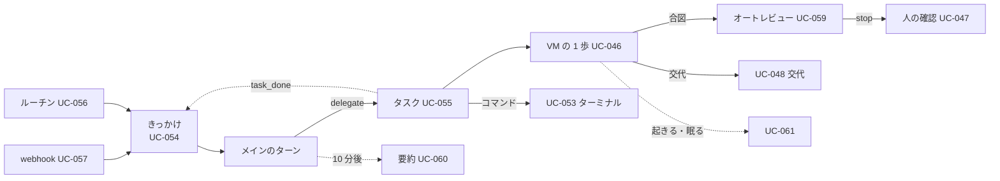
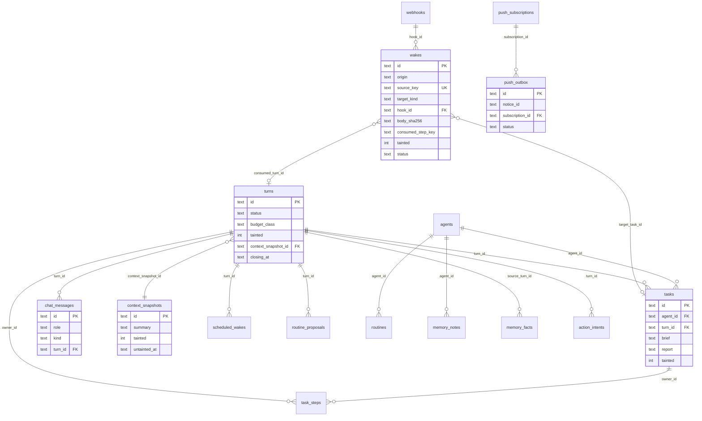
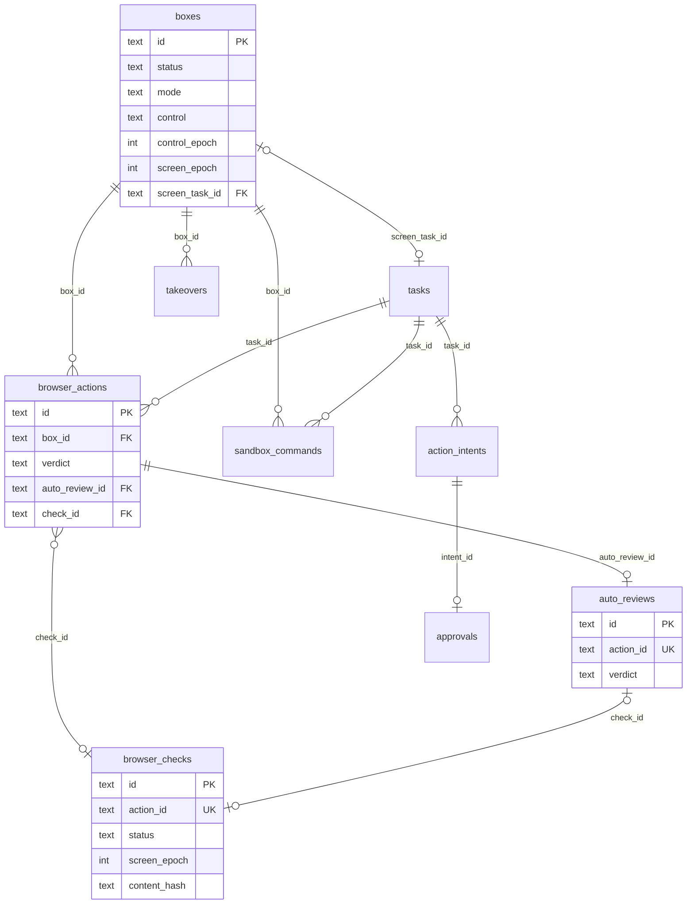

# 10. ER図 / シーケンス図 / 状態遷移図
- プロジェクト：Agent-Team-Open ／ 版数：v1.2（2026-10-24） ／ インプット：[08_database](../08_database/README.md)、[09_api](../09_api/README.md)

> **3行で**
> 1. シーケンス図は 13 本（[sequences.md](sequences.md)）。v1.2 で控えを取る・戻す（FR-100）を足した。v1.1 でメインの書き込みの承認（UC-054 4a）を足した。v1.0 で足したのは、きっかけからターン・振り分け・報告まで・webhook・ルーチンの提案・オートレビュー・要約・VM が起きて眠るの 6 本。
> 2. 状態遷移図は 12 個（[states.md](states.md)）。v1.2 で `workspace.vm_op`・`vm_home_state` を足した。v1.0 で足したのは `wakes`・`turns`・画面の番・予約・ルーチンの提案。
> 3. ER図は常駐の表と VM の表の 2 枚に分けて描く（今の表の全体は `schema.ts`）。

## 🧭 判断してほしいこと
なし

## 全体図

見てほしいところ：どの図もきっかけ（UC-054）から始まり、タスクの終わりがまたきっかけに戻る輪になっている。

## 要点
- 送信からメインの返事・タスクの報告・通知までは 1 本の図（[UC-054・055](sequences.md#uc-054055きっかけからターン振り分け報告まで)）
- webhook は「大きさ → 受け口 → 署名 → 件数 → 重複」の順で確かめる（[UC-057](sequences.md#uc-057webhook-で起きる)）
- オートレビューに会話は渡さない。`stop` なら人の確認に回る（[UC-059](sequences.md#uc-059オートレビュー)）
- 変える操作の1歩は「画面の番 → Claude → 直前の確かめ → 確かめ（dryRun）→ Kernel → 中身のハッシュつきの実行」を、返った操作の列の順に（[UC-046](sequences.md#uc-046vm-で操作する1歩)）
- ターンは 1 つずつ。持ち主のチャットは動いているターンの次の歩みに入る（[turns.status](states.md#turnsstatus)）

---

## 詳細

### ER図：常駐の表

`memory_log`・`memory_search`・`vm_snapshots` は外部キーを持たない。`webhooks` から `wakes` へは `hook_id` で結ぶ（D-284）。`action_intents`・`approvals`・`policy_decisions` は `task_id` か `turn_id` のどちらか一方を持つ（D-275）。

### ER図：VM の表

### 図の一覧
| 種類 | 図 | ファイル |
|---|---|---|
| シーケンス | UC-054・055 きっかけからターン・振り分け・報告まで／UC-054 4a メインの書き込みと承認／UC-057 webhook／UC-056 ルーチンの提案／UC-059 オートレビュー／UC-060 要約／UC-061 VM が起きて眠る／UC-046 VM の 1 歩／UC-047 こわい操作の確認／UC-048 交代／UC-053 ターミナル／FR-084 再開／FR-100 控えを取る・戻す | [sequences.md](sequences.md) |
| 状態遷移 | `wakes.status`／`turns.status`／画面の番／`scheduled_wakes.status`／`routine_proposals.status`／`boxes.status`／`boxes.control`／`takeovers.status`／`browser_checks.status`／`sandbox_commands.status`／`workspace.vm_op`／`workspace.vm_home_state` | [states.md](states.md) |

## このドキュメントで決まったこと
- なし（図は 03・04・08・09 の内容を描いたもの）
