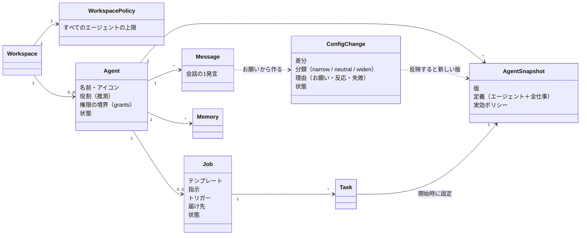
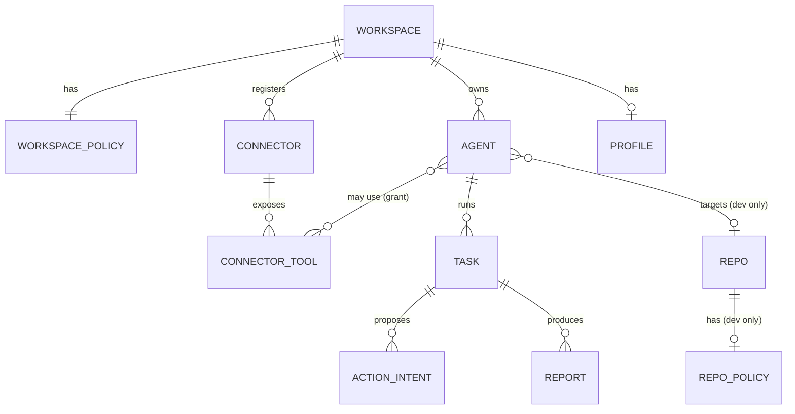
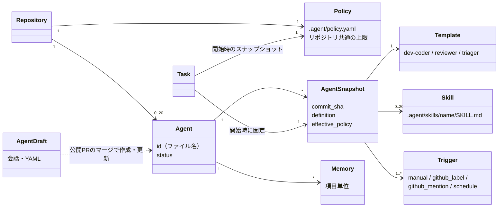

# 10. 概念モデル
- 入口：[README](README.md) ／ テーブルとしての形：[ER図の全体像](README.md#er図の全体像)

> **3行で**
> 1. 今の概念モデルは v0.5（14）：エージェントは「名前・権限の境界・メモリ・会話」を持つ担当者で、トリガー・テンプレート・指示は **仕事（job）** にまとめた。
> 2. ワークスペース・コネクタ・プロフィール・レポートの関係は v0.4（13）の図で補う。
> 3. v0.2（12）の図は、Template と Trigger がエージェントの直下にあった頃のもの。参考として畳んで残す。

## エージェントと仕事（v0.5。14）

見てほしいところ：設定の変更は必ず ConfigChange を通り、反映すると新しい AgentSnapshot になる。タスクは開始時のスナップショットに固定される。

| 概念 | 説明 |
|---|---|
| エージェント | 名前のある担当者。**権限の境界**（使えるコネクタのツール・Web の範囲・作用の自律度・予算）と、メモリ・会話・プロフィールの公開範囲を持つ。仕事どうしはこの境界を共有する |
| 役割 | 名前と最初のお願いから推測した得意分野（`research` / `watch` / `brief` / `assist` / `dev`）。挨拶・新しい仕事のテンプレートの初期値・「任せますか？」の提案に使い、**権限には影響しない**（BR-48） |
| 仕事（job） | 1つのお願いから作る実行の単位。テンプレート・指示・トリガー・届け先・通知の設定を持つ。`once` / `recurring` / `watch` の3種類 |
| 設定の変更（config change） | エージェントが自分の定義に加えたい差分。Kernel が分類し、広げる変更は承認を待つ。反映すると新しいスナップショットになる |
| 会話 | エージェントのチャット。お願い・確認カード・承認カード・結果の要約・変更の記録がすべてここに流れる |

## ワークスペースとコネクタ（v0.4。13）

見てほしいところ：リポジトリとそのポリシーは開発エージェントにだけ付く（dev only）。それ以外のエージェントはワークスペースのポリシーだけが上限。

| 概念 | 説明 |
|---|---|
| ワークスペース | これまでの「組織」。GitHub App のインストール単位ではなくなり、個人のワークスペースはサインイン時に自動で作る。GitHub はワークスペースにつなぐ連携先の1つになる（A-03 の改訂） |
| ワークスペースのポリシー | アプリ内で編集する、すべてのエージェントの上限。版の履歴を持ち、緩める変更は owner の承認が要る（個人は自分。BR-33 と同じ） |
| コネクタ | 登録した MCP サーバー（または組み込みの GitHub）。認証情報は Gateway だけが持つ |
| コネクタのツール | MCP サーバーが公開する各ツール。分類（`read` / `write` / `unclassified`）と、説明文のハッシュを持つ。v0.6 で引数の役割（`arg_roles`）も持つ |
| プロフィール | 自宅・職場・通勤経路・関心のあるテーマなど。項目ごとに公開先のエージェントを選ぶ |
| レポート | タスクの成果物（本文 ＋ 出典の URL）。アプリ内に保存する |

- 13 の図の `AGENT ||--o{ TASK : runs` は、v0.5 で `Job "1" --> "*" Task` に細かくなった（14）。

## v0.2（参考）：リポジトリとエージェント（12）

v0.5 で Template・Trigger は仕事に、AgentDraft は会話と設定の変更に置き換えた。Repository → Agent の関係は v0.4 で「開発のみ」になった。

12 v0.2 の概念モデル

