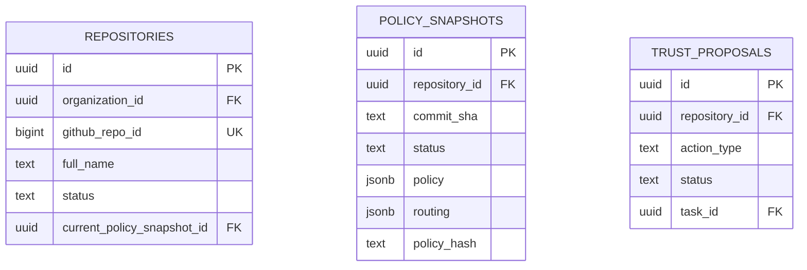
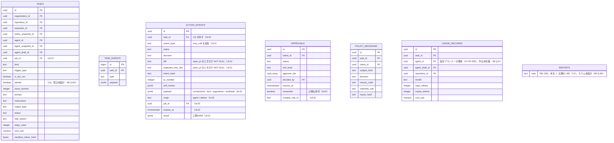

# 10. ER図：テーブルの主なカラム
- 入口：[README](README.md#er図の全体像)（関係の図） ／ 全カラム・制約：[08](../08_database/README.md)

> **3行で**
> 1. ER図の各テーブルの **主なカラム** だけを、README と同じ4つの領域に分けて載せる。関係（線）は README にあり、ここには書かない。
> 2. `workspaces` は旧 `organizations`（TBL-002）。外部キーの列名は 08 のとおり `organization_id` のまま（改名の範囲は 08 Q-62）。
> 3. v0.5・v0.6 で足した列には「（v0.5）」「（v0.6）」と付けた。13 の新しいテーブル（TBL-026〜030）は、元の記述にある項目だけを書く（カラムは未設計。08 Q-65）。

## 利用者とワークスペース

```mermaid
erDiagram
    USERS {
        uuid id PK
        bigint github_user_id UK
        text login
        bytea github_token_ciphertext
        timestamptz deleted_at
    }
    WORKSPACES {
        uuid id PK
        bigint github_installation_id UK
        text github_account_login
        text status
        boolean kill_switch_engaged
        text timezone
        bigint audit_seq
        bytea audit_last_hash
    }
    MEMBERSHIPS {
        uuid id PK
        uuid organization_id FK
        uuid user_id FK
        text role
    }
    AUDIT_LOGS {
        uuid organization_id PK
        bigint seq PK
        text event_type
        uuid task_id
        jsonb payload
        bytea prev_hash
        bytea hash
    }
    LLM_CREDENTIALS {
        uuid id PK
        uuid organization_id FK
        text provider
        bytea ciphertext
        bytea encrypted_dek
        text last4
    }
    PUSH_SUBSCRIPTIONS {
        uuid id PK
        uuid user_id FK
        text endpoint UK
    }
    SESSIONS {
        uuid id PK
        uuid user_id FK
        bytea token_hash UK
        timestamptz expires_at
    }
    WEBHOOK_DELIVERIES {
        text delivery_id PK
        uuid organization_id FK
        text status
    }
    WORKSPACE_POLICIES {
        text note "TBL-026。カラム未設計（08 Q-65）"
    }
    CONNECTORS {
        text note "TBL-027。カラム未設計（08 Q-65）"
    }
    CONNECTOR_TOOLS {
        text classification "TBL-028。read / write / unclassified（13）"
        text status "needs_review を含む（13・15）"
        jsonb arg_roles "destination / content / option（v0.6）"
        text scope "self / NULL（v0.6）"
        text verify "none / readback（v0.6）"
        text tool_hash "説明文・入力スキーマ・arg_roles（v0.6）"
    }
    PROFILES {
        text note "TBL-029。カラム未設計（08 Q-65）"
    }
```

USERS・WORKSPACES・MEMBERSHIPS など12テーブル

- `WORKSPACES` の列は v0.2 の `organizations` のもの。13 で GitHub App のインストールは「ワークスペースにつなぐ連携の1つ」になった（A-78）が、列の変更は未設計（08 Q-62）。
- `PROFILES` は1ワークスペースにつき50項目、各500文字まで（A-76）。

## 開発：リポジトリ

REPOSITORIES・POLICY_SNAPSHOTS・TRUST_PROPOSALS

## エージェントと仕事

```mermaid
erDiagram
    AGENTS {
        uuid id PK
        uuid organization_id FK
        uuid repository_id FK
        text slug
        text status
        uuid current_snapshot_id FK
        uuid disabled_by FK
        jsonb scorecard
        text role "NULL 可（v0.5）"
        text name_source "user / suggested（v0.5）"
        jsonb appearance "（v0.5）"
    }
    AGENT_SNAPSHOTS {
        uuid id PK
        uuid agent_id FK
        uuid agent_draft_id FK
        uuid policy_snapshot_id FK
        text source
        text commit_sha
        text status
        jsonb definition "v2 の形式（v0.5）"
        jsonb effective_policy
        text effective_policy_hash
        jsonb clamped
        text ceilings_version
        uuid config_change_id FK "（v0.5）"
    }
    AGENT_SCHEDULES {
        uuid id PK
        uuid agent_id FK
        uuid job_id FK "（v0.5）"
        int trigger_index
        text cron
        text timezone
        timestamptz next_run_at
        uuid last_task_id FK
    }
    AGENT_JOBS {
        uuid id PK
        uuid agent_id FK
        text slug
        text kind "once / recurring / watch"
        text template
        text status "waiting_input / active / paused / done"
        uuid source_message_id FK
    }
    AGENT_MESSAGES {
        uuid id PK
        uuid agent_id FK
        text author "user / agent / system"
        text kind
        text body
        uuid ref_id
    }
    AGENT_CONFIG_CHANGES {
        uuid id PK
        uuid agent_id FK
        text origin
        uuid source_message_id FK
        uuid source_task_id FK
        jsonb patch
        text classification "narrow / neutral / widen"
        jsonb widened_items
        text status "proposed / applied / rejected / reverted"
        uuid decided_by FK
        uuid snapshot_id FK
    }
    AGENT_MEMORIES {
        uuid id PK
        uuid agent_id FK
        uuid source_task_id FK
        text source_task_ref
        text content
        text status
        uuid deleted_by FK
    }
    AGENT_DRAFTS {
        uuid id PK "廃止（v0.5、→ TBL-024・TBL-025）"
        uuid repository_id FK
        uuid agent_id FK
        uuid created_by FK
        text slug
        text status
        text definition_yaml
        numeric assistant_cost_usd
        int pr_number
        int last_pr_number
    }
```

AGENTS・AGENT_SNAPSHOTS・AGENT_JOBS など8テーブル

- `agents.template` は v0.5 で削除し、仕事（`agent_jobs.template`）へ移した（14 §データベース）。
- `agents.repository_id` は 13 で「開発のみ」になった（概念モデル `AGENT }o--o| REPO`）。NULL 可にするかは 08 Q-64。
- 補足（v0.2）：`AGENTS` と `AGENT_SNAPSHOTS` の間には「履歴」（`agent_snapshots.agent_id`）と「最新」（`agents.current_snapshot_id`）の2本の関係がある（`REPOSITORIES` と `POLICY_SNAPSHOTS` と同じ形）。
- 補足（v0.2）：試し実行のスナップショットとタスクは、`agent_id` を持たず `agent_draft_id` で下書きに紐づく。`agent_snapshots.source` は `branch` / `draft` / `builtin`（組み込みの既定エージェント。BR-31）。
- 補足（v0.2）：`agent_memories.source_task_id` はタスクの削除で NULL になり（ON DELETE SET NULL）、表示用の `source_task_ref` が残る。`agent_schedules.last_task_id` はスケジュールの重複判定（BR-29）に使う。
- 仕事の中身（指示・トリガー・届け先）はスナップショットの定義が正で、`agent_jobs` は一覧と状態のためのもの。「以後も許可」のルールも定義の `rules` に置き、別のテーブルは作らない（15）。

## タスクと作用

TASKS・ACTION_INTENTS・APPROVALS など7テーブル

- `tasks.agent_draft_id`・`usage_records.agent_draft_id`・`agent_snapshots.agent_draft_id` は、v0.5 で廃止した `agent_drafts` を指す。列を残すかは 08 Q-67。
- `action_intents` の PR 専用の列（`title`・`body`・`diff`・`diff_stats`・`changed_paths`・`base_commit_sha`・`expected_tree_sha`）は NULL 可にし、`action_type = open_pr` のときだけ CHECK で NOT NULL を課す（15）。
