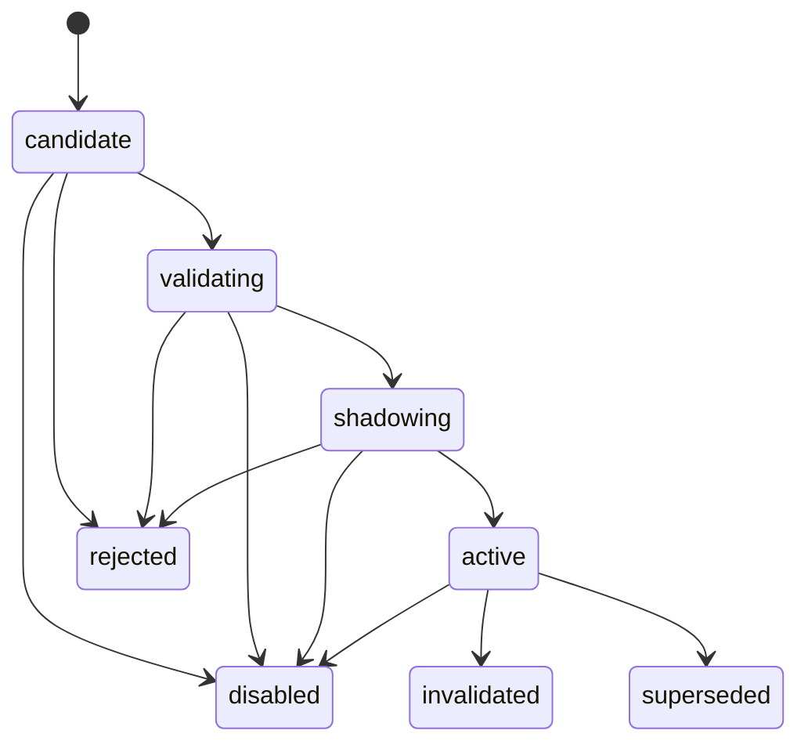
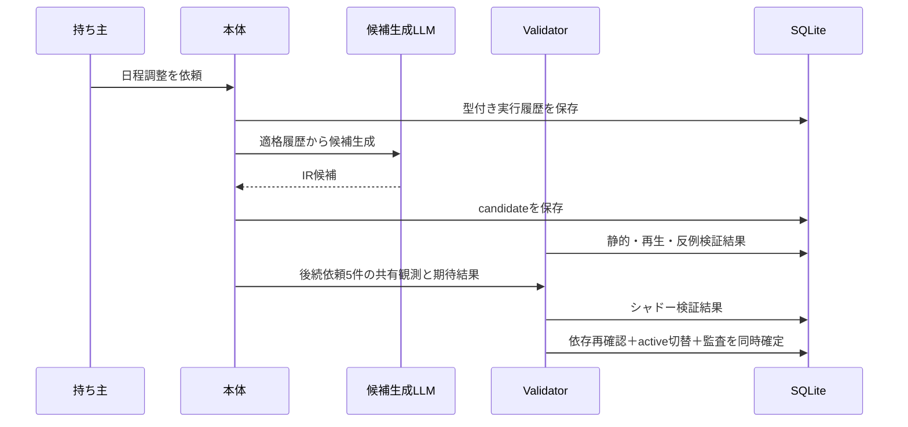
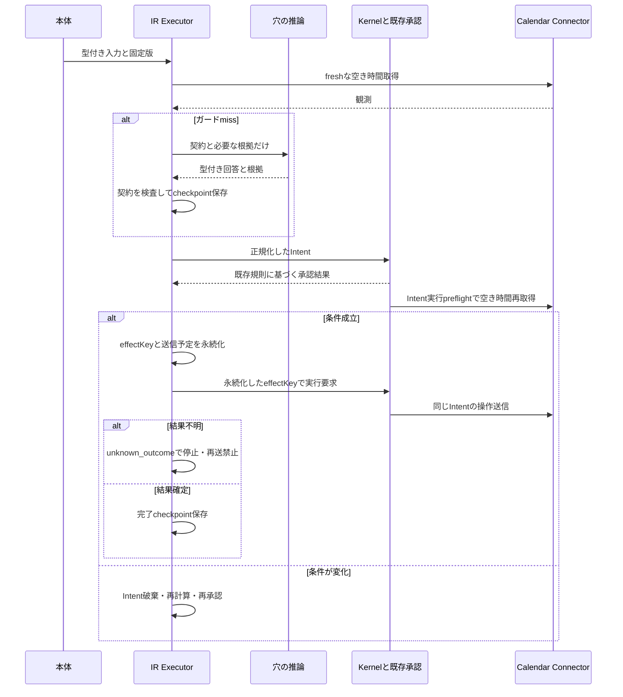
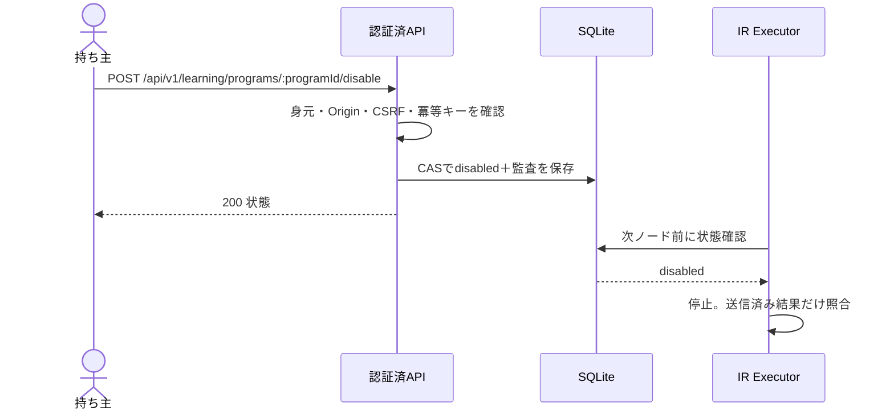

# 10. 成長機構の図
- 版数：v1.8（2026-10-26） ／ インプット：[機能仕様](../04_functional_spec/learning.md)、[DB](../08_database/learning.md)、[API](../09_api/learning.md)

> **3行で**
> 1. 採用前の検証と採用後の実行を分離する。
> 2. 未知条件だけAIへ戻し、結果不明の副作用は再送しない。
> 3. DBの関係は専用ER図を参照する。

## 🧭 判断してほしいこと
なし。

## 全体図

見てほしいところ：終端版をそのまま再有効化する遷移はない。

## 要点
- [ER図](../08_database/learning.md#全体図)はDB定義と共通。
- [採用](#uc-073074記録と採用)はvalidatorが決定。
- [局所推論](#uc-075局所推論)と[停止](#uc-076停止)で再開境界を示す。

## 詳細
### UC-073・074：記録と採用

検証には外部書込の経路を渡さない。

### UC-075：局所推論

権限拒否や通信障害はガードmissの分岐へ入らない。

### UC-076：停止

身元確認は既存のTailscaleまたはLANパスキーの規約を継承する。

## このドキュメントで決まったこと
[D-397・398・401](../00_learning.md#決定事項ログ)。
