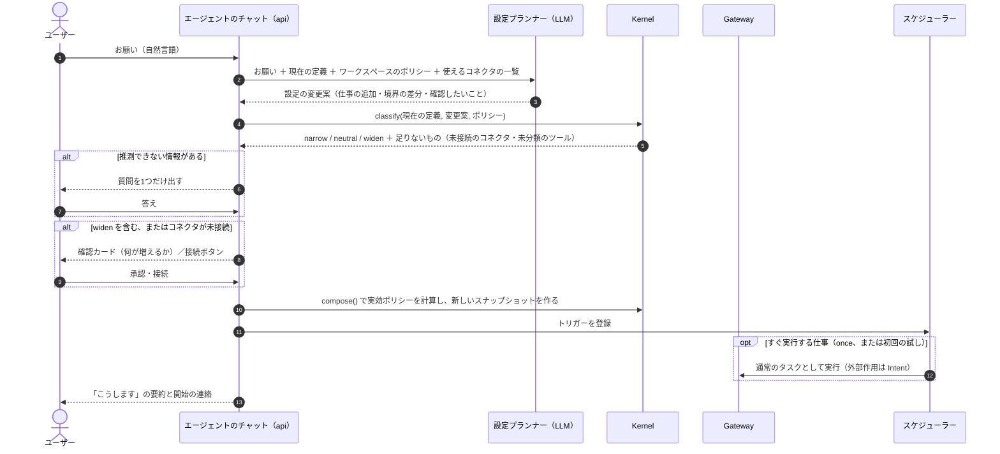
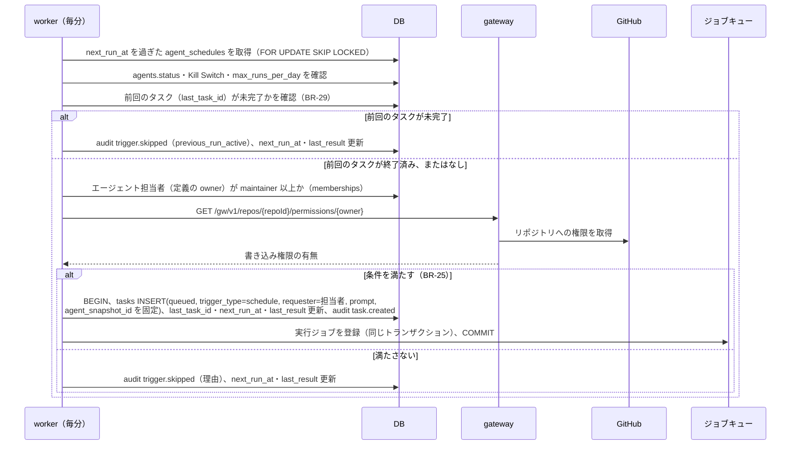
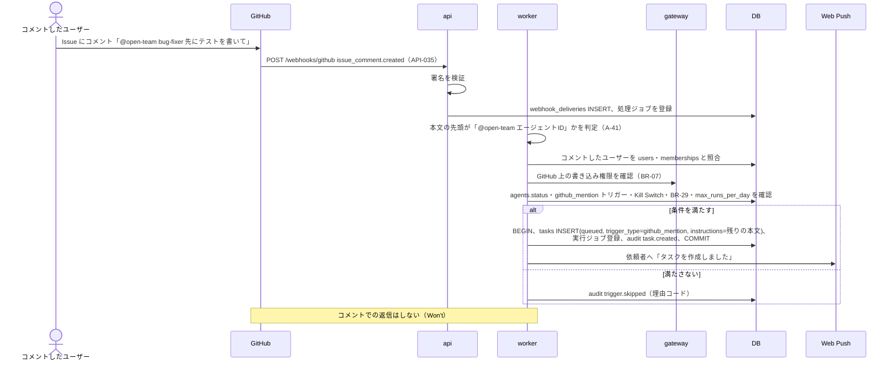
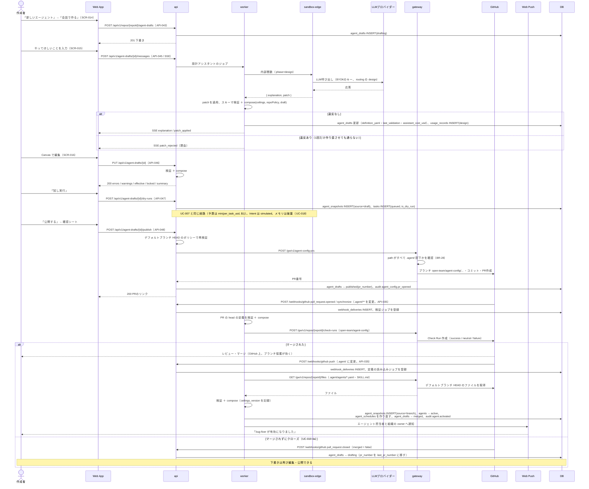
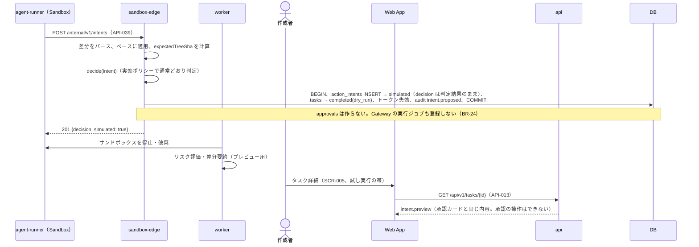

# 10. シーケンス図：エージェント（自己設定・トリガー）
- 入口：[README](README.md) ／ 関連：[03](../03_use_cases/README.md)、[04](../04_functional_spec/README.md)、[09](../09_api/README.md)

> **3行で**
> 1. 今のエージェントの作り方は「名前を付けて頼む」（v0.5）。お願いから設定プランナーが変更案を作り、Kernel の `classify()` が `widen` と判定したものだけユーザーに確認する。
> 2. 起動のしかた（スケジュール・メンション）は v0.2 の図のまま有効。スケジュールは v0.5 から仕事（job）ごとになる（`agent_schedules.job_id`）。
> 3. 下書き → 試し実行 → 公開PR の図は「v0.2（置き換え済み）」として末尾に残す。残る GitOps モードの流れは未設計（Q-81）。

## UC-026：お願いから仕事を作る（自己設定）

フェーズ0。UC-025（名前を付けて作る）の後、チャットでお願いを送ったときの流れ（14 §自己設定の仕組み）。

見てほしいところ：LLM（設定プランナー）は変更案を出すだけで、反映するかどうかは Kernel の `classify()` が決める。`widen` はユーザーの承認なしに反映されない（BR-47）。

- 設定プランナーの出力は定義の差分（JSON）に限り、FR-022 の検証を通らなければ反映しない。v0.3 の設計アシスタント（FR-024）を置き換える。
- 設定プランナーの呼び出しはタスクとは別で、外部の内容を読まないので `tainted` にならない。会話に貼られた外部の文章は、ユーザーの発言として記録する。
- 質問は1つのお願いにつき1つまで（BR-49）。答えが返らなければ仕事は `waiting_input` のまま止める。
- 変更案の状態は [設定の変更の状態遷移](states.md#設定の変更agent_config_changesstatus)。

## UC-021：スケジュールによる起動（v0.2）

フェーズ0。v0.5 からスケジュールは仕事ごと（`agent_schedules.job_id`）。

見てほしいところ：前回のタスクが未完了なら起動しない（BR-29）。タスクの作成とジョブの登録は同じトランザクション。担当者の権限確認（gateway・GitHub）は開発エージェントの場合の手順。

## UC-021：メンションによる起動（v0.2）

フェーズ1（GitHub が要る）。

見てほしいところ：コメントしたユーザーの open-team と GitHub 両方の権限を確かめてからタスクを作る。コメントでの返信はしない（Won't）。

---

## v0.2（置き換え済み）：エージェントの作成 → 試し実行 → 公開 → 有効化

v0.5 で「名前を付けて頼む」に置き換えた（ADR-026）。下書き（TBL-021）・API-043〜048 は廃止。GitOps モードと詳細設定の試し実行で残る部分の流れは Q-81。

UC-017〜UC-020 のシーケンス図（v0.2）

見てほしいところ：v0.2 では定義の正本がリポジトリで、PR のマージ（ブランチ保護が効く）で初めて有効になった。

## v0.2（置き換え済み）：試し実行での Intent の simulated 化

UC-018 のシーケンス図（v0.2）

見てほしいところ：試し実行の Intent は判定だけ通常どおり行い、承認も Gateway の実行も作らない（BR-24）。v0.5 で試し実行は「詳細設定」の機能（REQ-022、Could）として残る。
