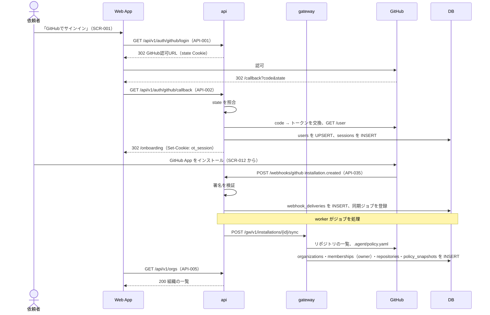
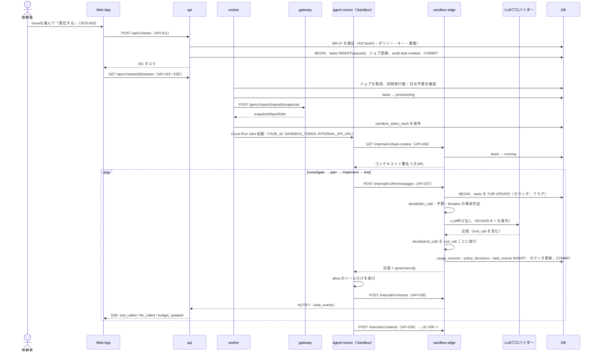
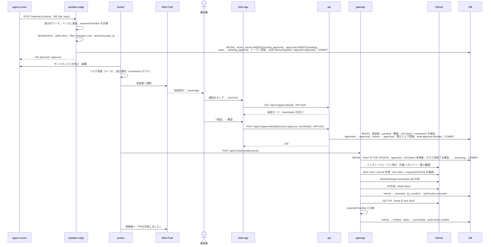
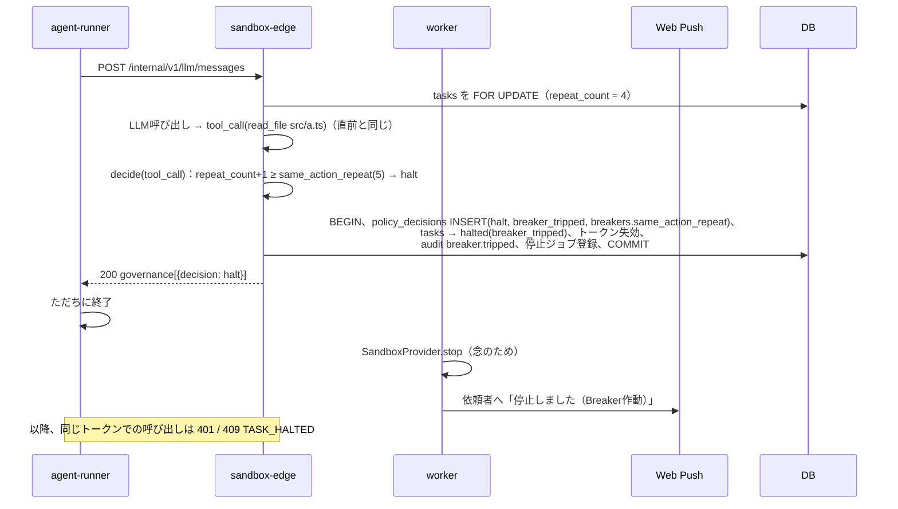
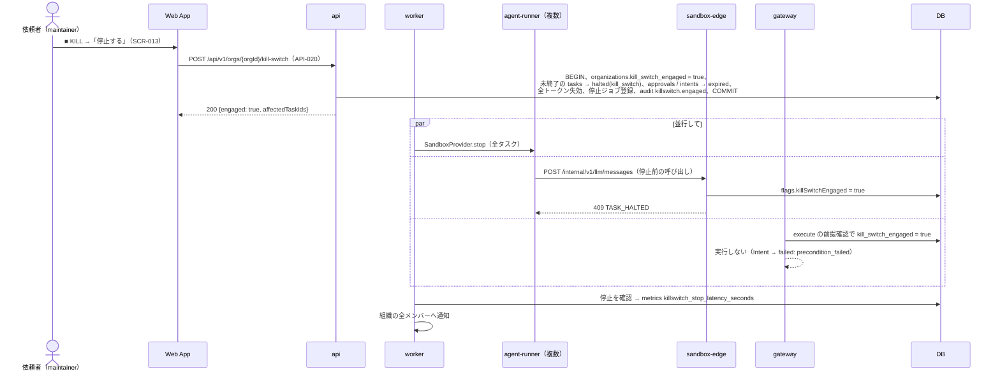
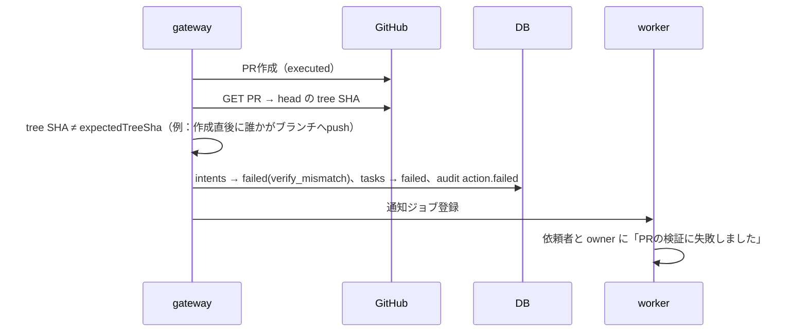

# 10. シーケンス図：統制の基本（委任・承認・停止）
- 入口：[README](README.md) ／ 関連：[03](../03_use_cases/README.md)、[04](../04_functional_spec/README.md)、[09](../09_api/README.md)

> **3行で**
> 1. 開発エージェント（GitHub・PR）を題材に、委任 → 自律実行 → 承認 → 実行 → 検証の主要フローと、停止系（Breaker・Kill Switch・検証の不一致）の6枚を載せる。
> 2. 図の中身は v0.2 の記述のまま。`organizations` は旧称で、今の `workspaces` を指す（13 で改名）。
> 3. MCP の書き込みの流れは [sequences-mcp.md](sequences-mcp.md)。判定・Kill Switch・監査ログの仕組みは PR と共通。

## UC-001：サインイン・リポジトリ連携（認証）

フェーズ1。フェーズ0（単一ユーザー・ローカル）ではサインインを省略し、固定トークン（D-06）で画面を守る（13 §フェーズ0）。

見てほしいところ：ユーザーのサインイン（API-002）と、GitHub App のインストール後の同期（worker → gateway）は別の流れ。GitHub の認証情報を扱うのは gateway だけ。

## UC-005 / UC-007：タスク委任と自律実行（主要フロー①）

見てほしいところ：LLM 呼び出しの前後で sandbox-edge が `decide()` を実行し、`allow` のツールだけがサンドボックスで動く。判定・費用・イベントは1つのトランザクションで記録する。

## UC-009 / UC-010：承認・実行・検証（主要フロー②）

見てほしいところ：承認は `intentHash` に紐づく（ADR-005）。Gateway は実行前に状態と Kill Switch を確かめ直し、PR の tree SHA を `expectedTreeSha` と比べて検証する。

## UC-008：Breaker 作動による自動停止（エラー時の代表例①）

見てほしいところ：停止の判断は決定論的な `decide()` が行い、停止・トークン失効・監査ログを1つのトランザクションで記録する。

## UC-012：Kill Switch（エラー時の代表例②）

見てほしいところ：Kill Switch は DB のフラグを先に立て、サンドボックスの停止・LLM 呼び出しの拒否・Gateway の実行拒否が並行して効く。`organizations.kill_switch_engaged` は今の `workspaces.kill_switch_engaged`。

## UC-010 E3：検証の不一致（エラー時の代表例③）

見てほしいところ：PR は作成済み（`executed`）でも、tree SHA が一致しなければ `failed`（`verify_mismatch`）にする。
