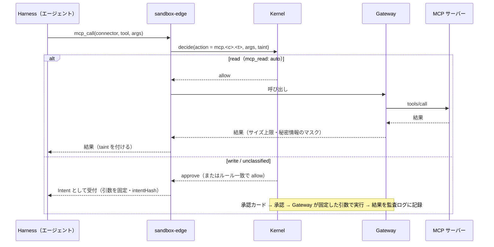
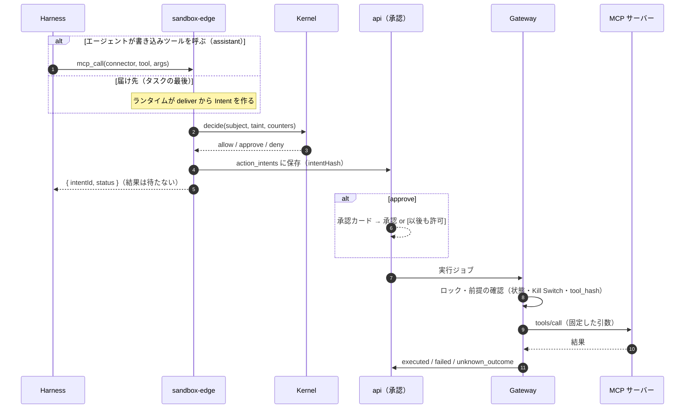
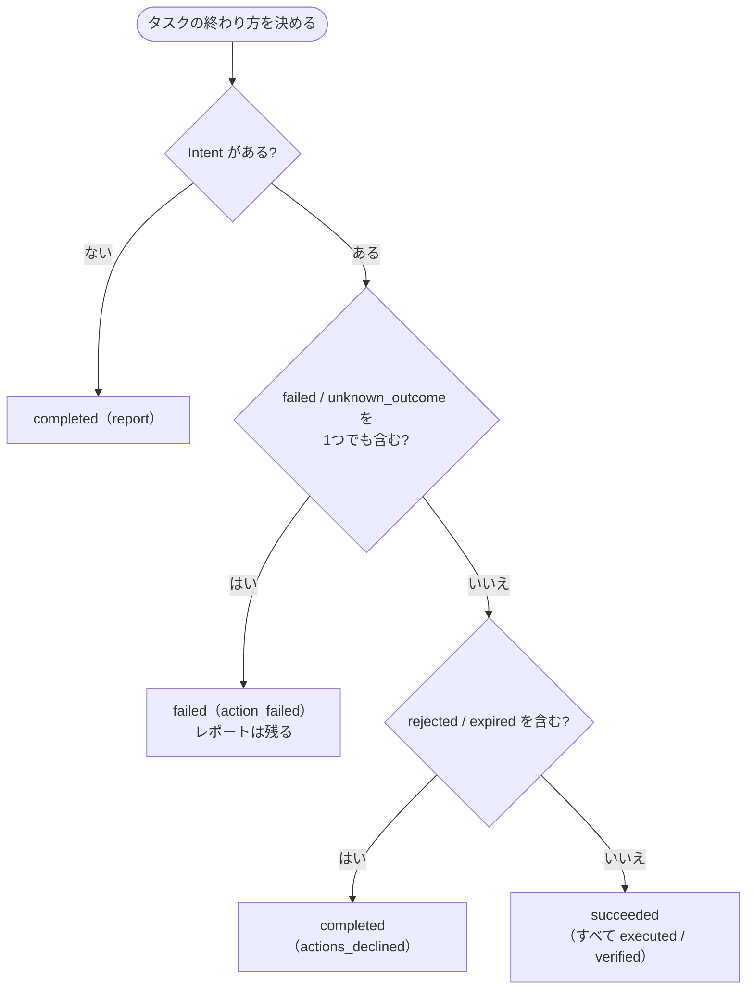

# 10. シーケンス図：MCP の呼び出しと書き込みの Intent
- 入口：[README](README.md) ／ 関連：[04](../04_functional_spec/README.md)、[07](../07_architecture.md)、[ADR-022](../adr/ADR-022-mcp-unified-unclassified-is-write.md)、[ADR-031](../adr/ADR-031-mcp-write-no-auto-retry.md)

> **3行で**
> 1. MCP のツールは、読み取り（`read`）ならすぐ呼び、書き込み・未分類なら Intent にする。認証情報は Gateway だけが持つ（フェーズ0）。
> 2. 書き込みの Intent は、エージェントが直接呼ぶ（`assistant`）か、仕事の届け先（`deliver`）からランタイムが作る。エージェントは結果を待たない。
> 3. 送信後に結果が分からなければ `unknown_outcome` にし、自動で再試行しない。タスクの終わり方は Intent の結果から決める。

## MCP 呼び出しの経路（13）

見てほしいところ：読み取りの結果を受け取った時点でタスクに `taint` が付く（BR-38、[汚染の状態](states.md#汚染taskstainted)）。書き込み側の詳しい流れは次の図（15）が正。

- 書き込みの Intent では引数をそのまま承認カードに表示し、承認は intentHash（コネクタ・ツール・引数・ツールの説明のハッシュ）に紐づける。
- 実行後の検証は、MCP に読み戻しの標準がないため、ツールごとに `none`（既定）/ `readback`（フェーズ1）を設定する。

## MCP の書き込みの Intent（15）

見てほしいところ：宛先は定義が決め、LLM は中身だけを書く（BR-58）。Gateway は実行直前に `tool_hash` を確かめ、ツールが変わっていれば実行しない（`expired`（`tool_changed`））。

- `mcp_call` の戻り値は `{ intentId, status: "pending_approval" | "accepted" | "denied" }` だけ。書き込みの結果に依存する手順は作らない（フェーズ0、A-87）。
- エージェントのループが終わった時点で承認待ちの Intent があれば、タスクを `awaiting_approval` にし、サンドボックス（または実行用のプロセス）を終了する。
- `tools/call` のタイムアウトは60秒、保存する応答は64KBまで（A-86）。結果ごとの状態と再試行は [Intent の状態](states.md#intentaction_intentsstatus)。
- `decide()` の評価順（Kill Switch → 予算 → Breaker → 操作の分類 → ツールの状態 → Intent の数 → パス → 自律レベル → ルール）は [04](../04_functional_spec/README.md)。汚染はこの判定の結果を変えない。

## タスクの終わり方（15）

15 §タスクの終わり方の表を図にしたもの。上から順に当てはめる。

見てほしいところ：`succeeded` の意味は「PR の作成と検証が完了」から「外部作用がすべて実行された（検証できるものは検証済み）」に広がった。

- メモリの有効化（BR-26）は `succeeded` と `completed`（`report` / `actions_declined`）で行う。
- 定期実行の仕事では、次の実行が始まった時点で前の実行の `pending_approval` を `expired`（`superseded`）にし、そのタスクを `completed`（`actions_declined`）で終わらせる（BR-60）。
- この終わり方を、タスクの状態遷移図のどの遷移にするかは Q-87。
