# 10. 図：シーケンス図
- プロジェクト：Agent-Team-Open ／ 版数：v1.1（2026-10-24） ／ 親：[10 図](README.md)

> **3行で**
> 1. v1.0 で足したのは 6 本：きっかけからターン・振り分け・報告まで（UC-054・055）・webhook（UC-057）・ルーチンの提案（UC-056）・オートレビュー（UC-059）・要約（UC-060）・VM が起きて眠る（UC-061）。
> 2. v0.6 の 5 本（VM の 1 歩・確認・交代・ターミナル・再開）は、画面の番と VM が残る形に直した。
> 3. どの図も「SSE は合図だけで、中身は REST」の決まり（D-196）は省いて描いた。

---

### UC-054・055：きっかけからターン・振り分け・報告まで
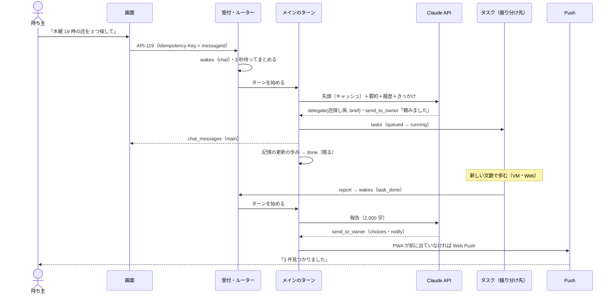

### UC-054 4a：メインの書き込みと承認
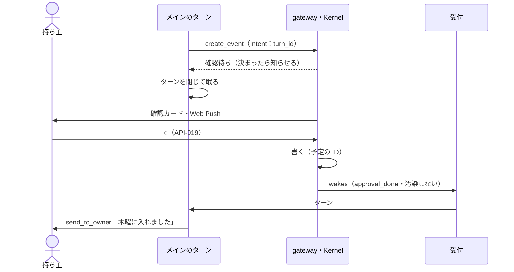

### UC-057：webhook で起きる
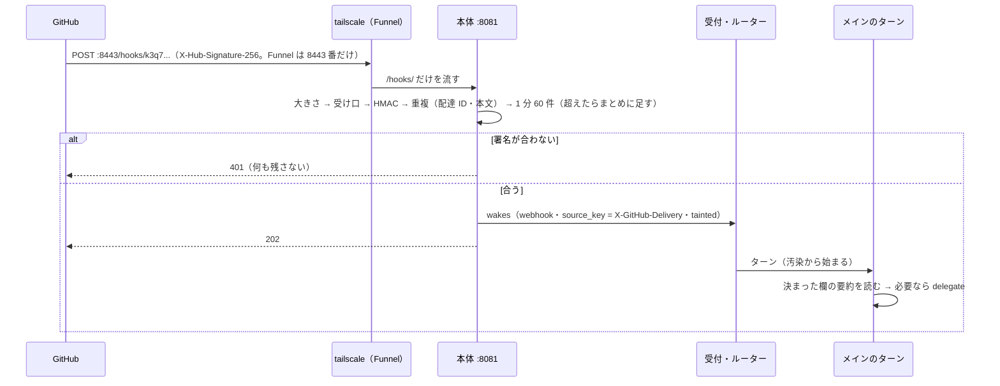

### UC-056：ルーチンの提案と承認
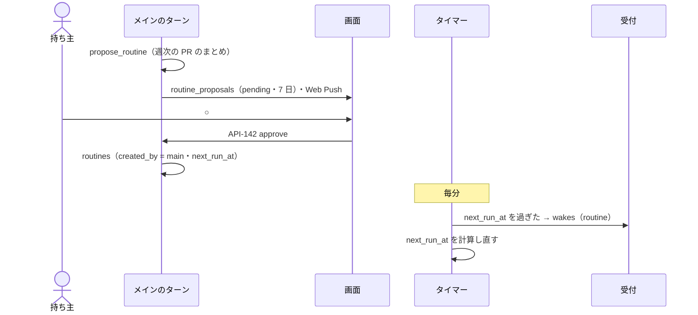

### UC-059：オートレビュー
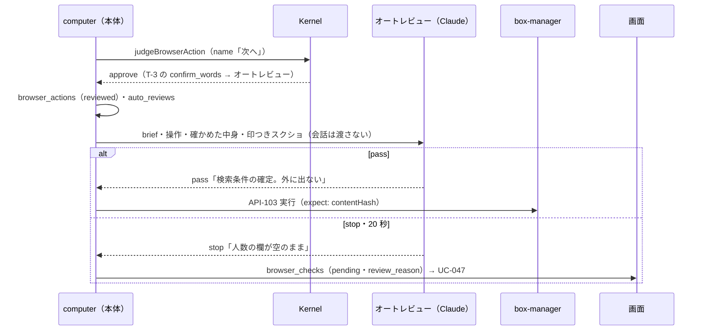

### UC-060：留守の間に要約する
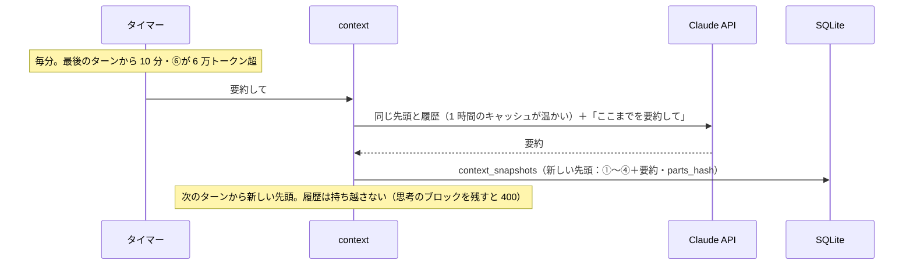

### UC-061：VM が起きて眠る
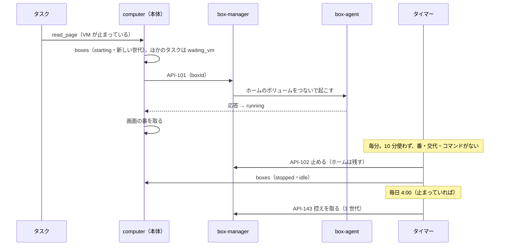

### UC-046：VM で操作する1歩
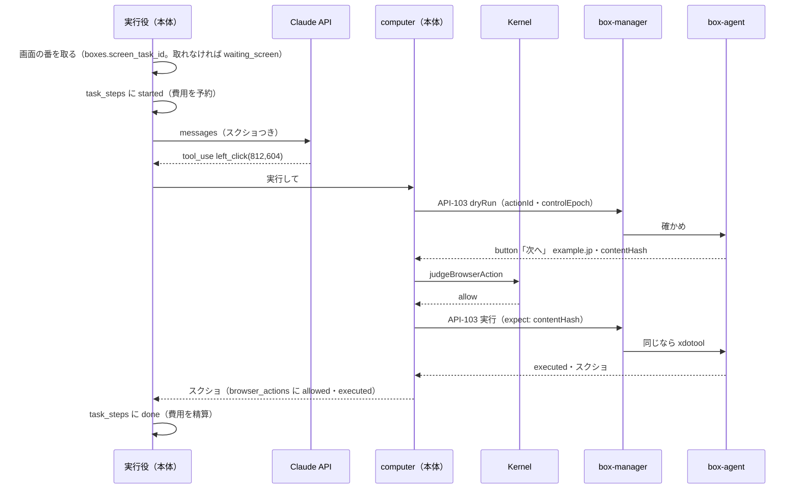

### UC-047：こわい操作の確認
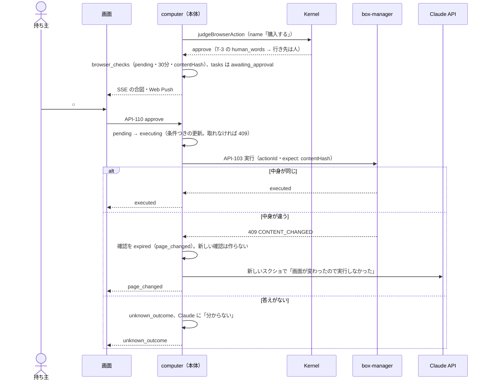

### UC-048：交代
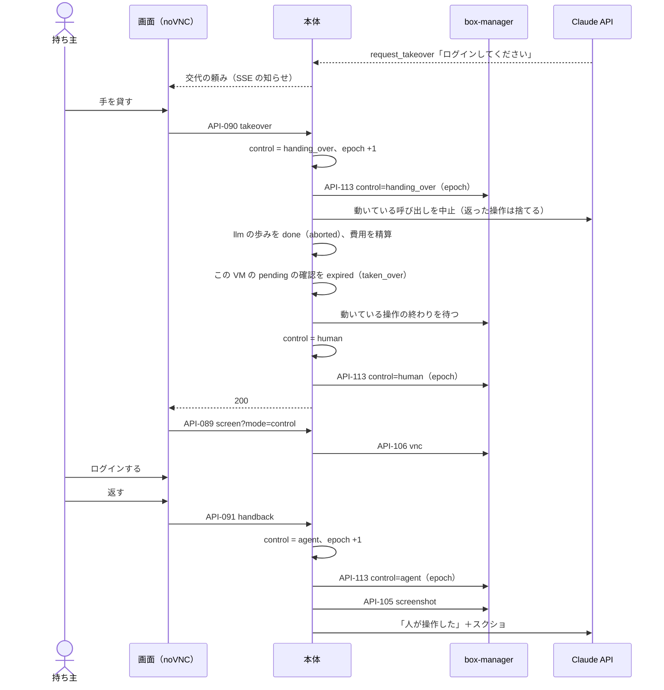

### UC-053：VM のターミナル
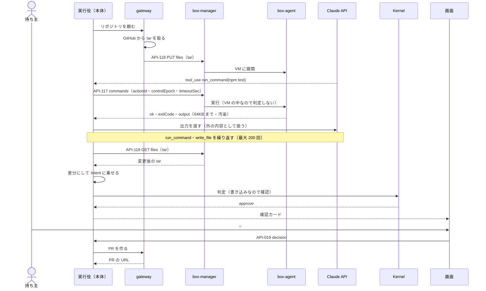

### FR-084：再起動からの再開
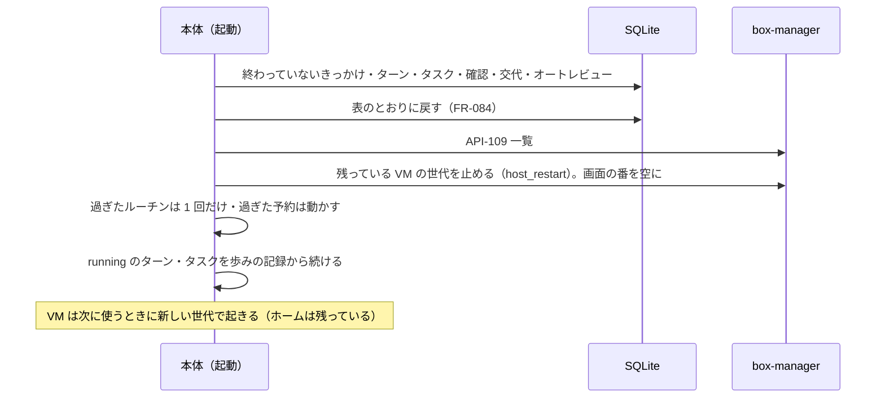

