# 10. 図：シーケンス図
- プロジェクト：Agent-Team-Open ／ 版数：v1.7（2026-10-26） ／ 親：[10 図](README.md)

> **3行で**
> 1. きっかけからターン・振り分け・報告まで（UC-054・055）・webhook（UC-057）・ルーチンの提案（UC-056）・オートレビュー（UC-059）・要約（UC-060：ターンを始めるときの 1 経路）・VM が起きて眠る（UC-061：`box-browser` と `box-shell` の 2 コンテナ）の 6 本を描いた。v1.6 で、判定の詳細（作動の形・Kernel・監査ログの鎖）と閉域での外向き・台帳の 2 本を足した。v1.7 で、レシートの写真から家計簿まで（FR-112）と家電の自動化を作る（FR-113）の 2 本を足し、全部で 17 本になった。
> 2. VM の 1 歩・確認・交代・ターミナル・再開は、画面の番と VM が残る形で描いた。再開（FR-084）は必ず新しい世代で起こし直す。控え（FR-100）は 2 つのボリュームを 1 つの tar にまとめる。
> 3. どの図も「SSE は合図だけで、中身は REST」の決まり（D-196）は省いて描いた。

---

### UC-054・055：きっかけからターン・振り分け・報告まで
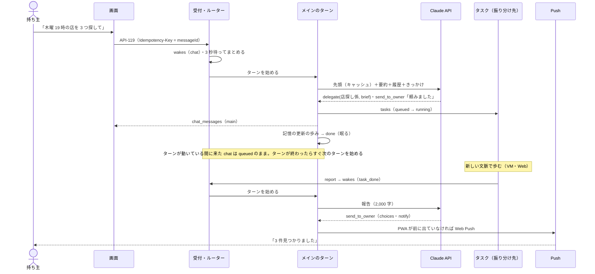

### UC-054 4a：メインの書き込みと承認
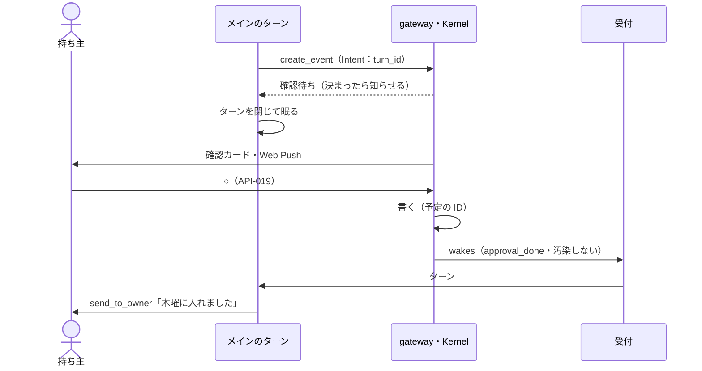

### UC-057：webhook で起きる
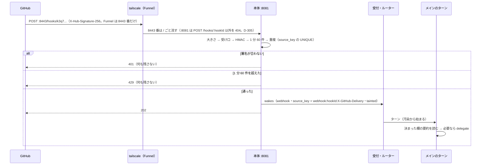

### UC-056：ルーチンの提案と承認
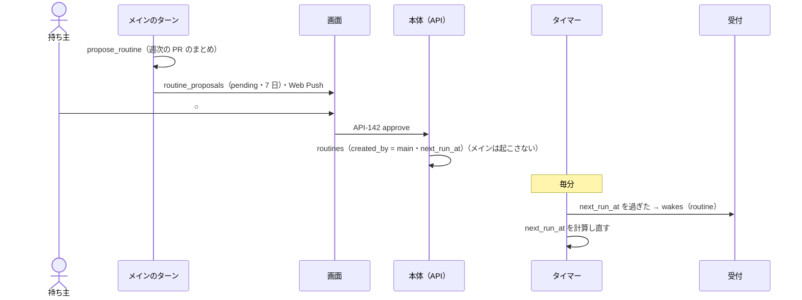

### UC-059：オートレビュー
既定は切ってある（`review.auto.enabled = false`。D-351）。切っている間は LLM を呼ばず人の確認に回る。入れたときだけ、下の alt の下側になる。
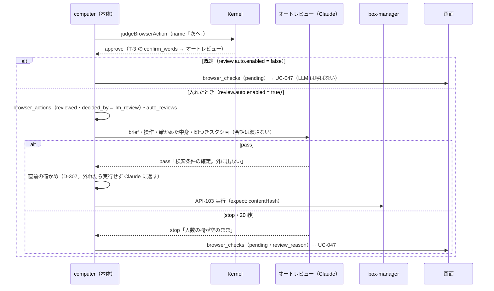

### UC-060：ターンを始めるときに要約する
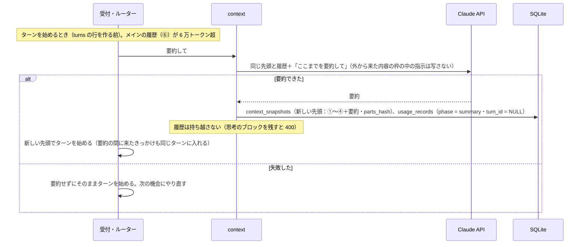

### UC-061：VM が起きて眠る
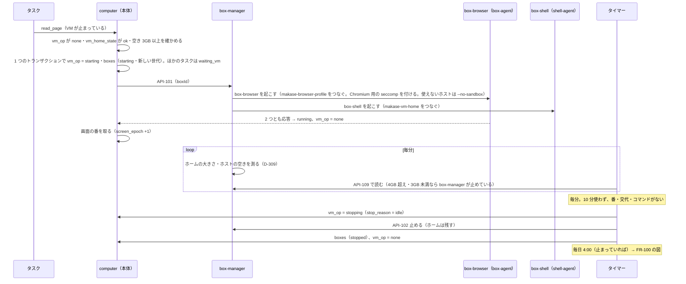

### UC-046：VM で操作する1歩
1 歩＝1 つの返事の操作の列（D-255）。実行の前に毎回、本体が直前の確かめをする（D-307）。
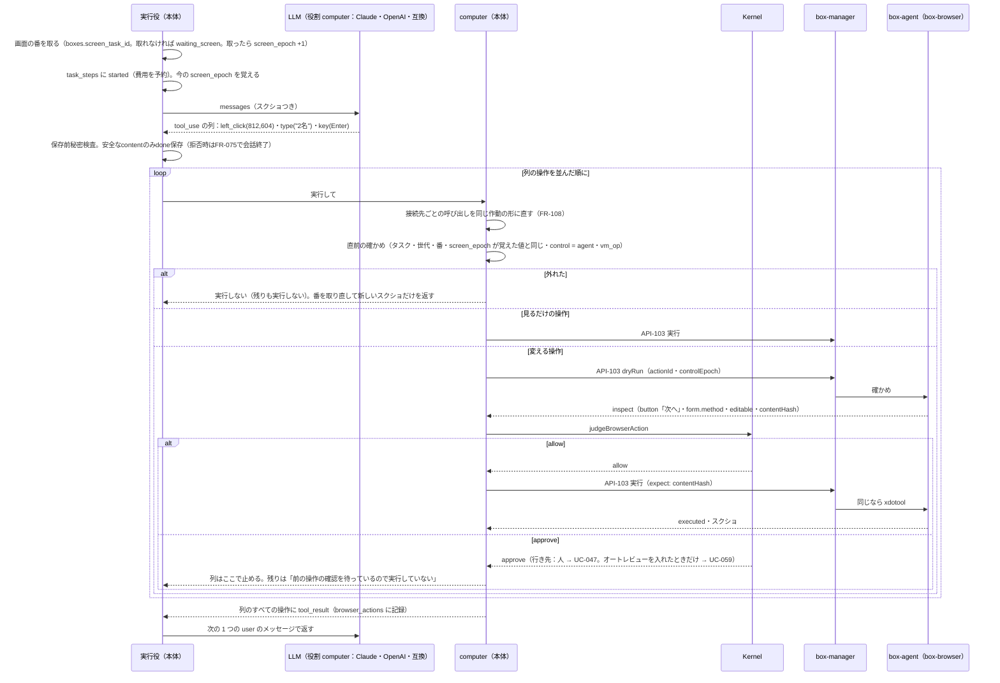

### UC-047：こわい操作の確認
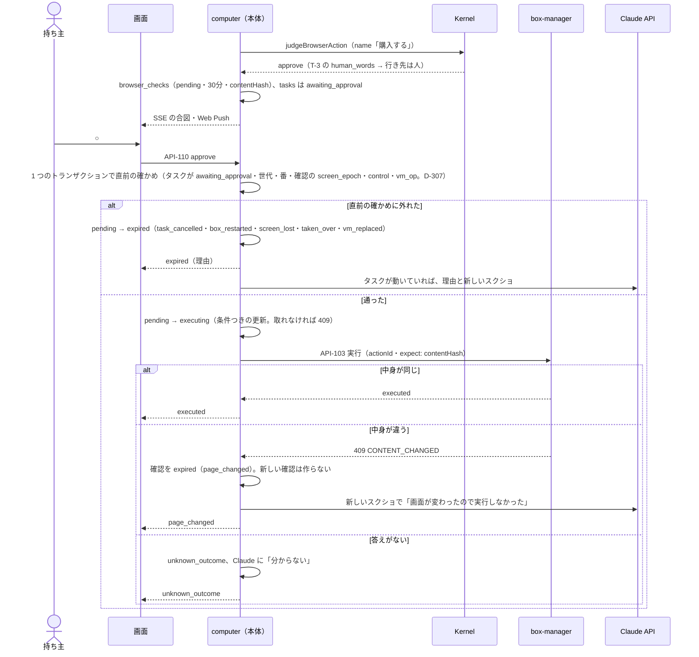

### UC-048：交代
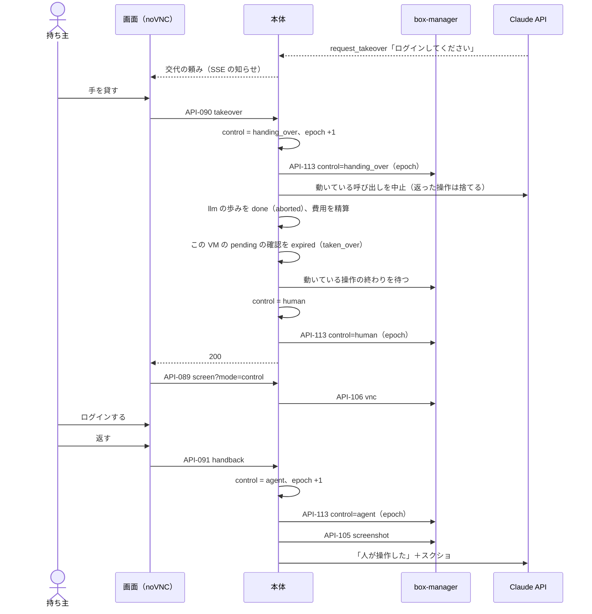

### UC-053：VM のターミナル
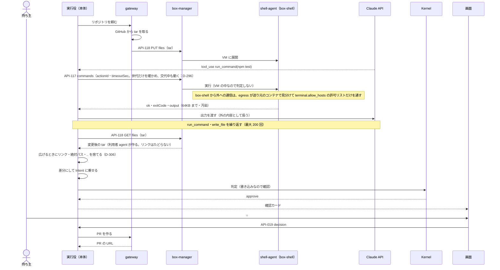

### FR-084：再起動からの再開
本体の再起動では、止まっていない世代を必ず止め、次に使うときに新しい世代で起こし直す。
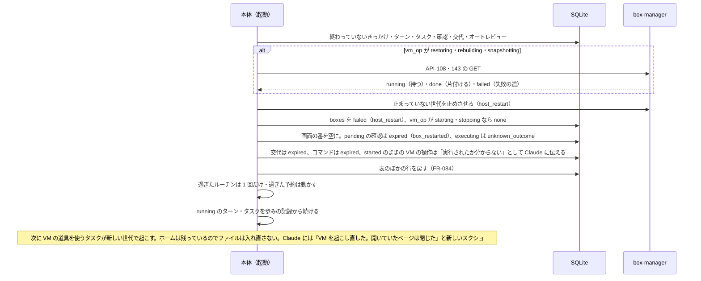

### FR-100：控えを取る・戻す
控えも戻しも box-manager が裏で動かし、本体は終わりを問い合わせる（D-294・D-295）。控えは控え専用のボリュームに書く（D-309）。
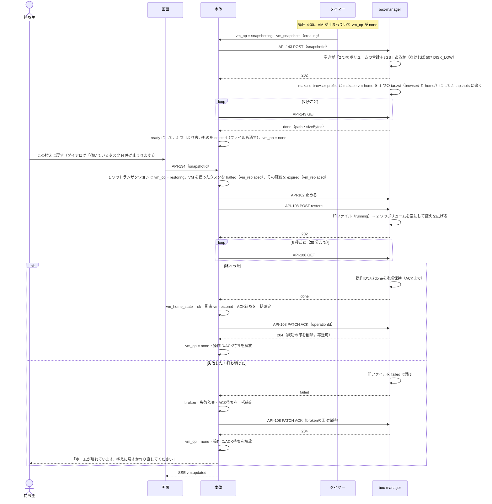

### UC-046 の判定の詳細：作動の形・Kernel・行き先・監査ログの鎖
接続先（Anthropic・OpenAI・互換）によらず、確かめ以降は同じ形の作動を見る（FR-108・D-354）。オートレビューは既定で切ってあり、入れたときだけ alt の最後の枝（FR-099・D-351）。
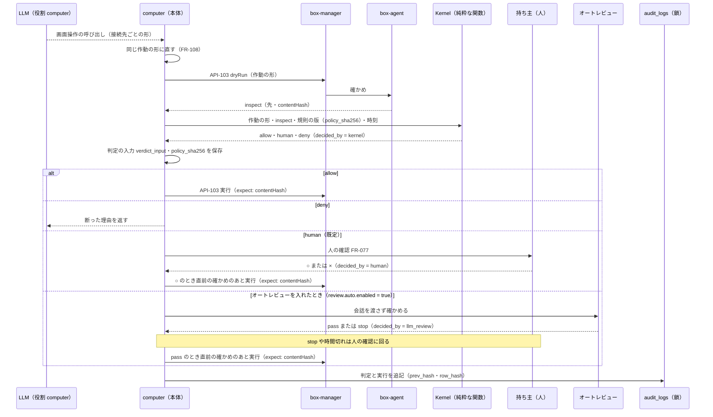

### FR-101・103：closed での外向きと台帳
本体の外向きは窓口 `net`、VM の外向きは egress が絞る。egress の記録は box-manager が毎分取りに行く（D-359）。
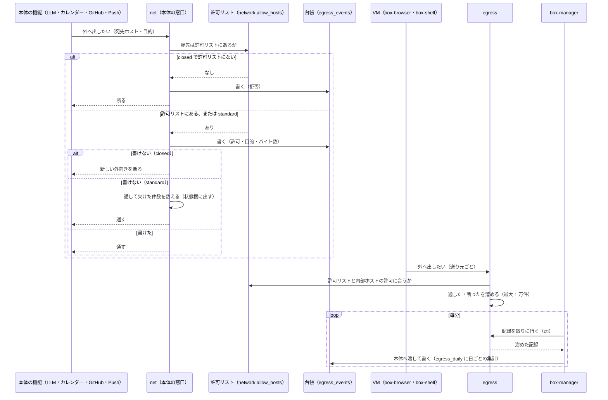

### FR-112：レシートの写真から家計簿まで
添付は外から来たものなので汚染の印が付く（BR-06）。費目は間違えても直せるので `classify` を使い、自信が低ければ LLM に回す（BR-16）。
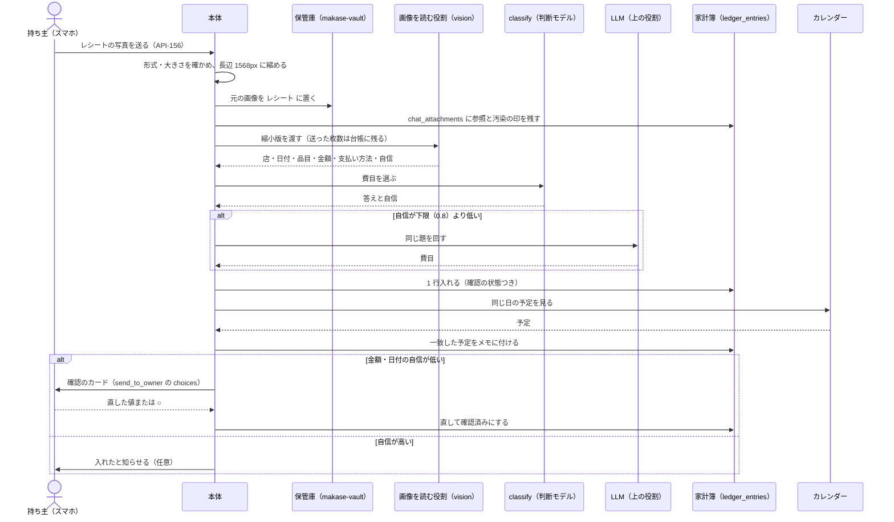

### FR-113：家電の自動化を作る
区分は Kernel の規則で決める。`classify`・LLM は機器を選ぶ下ごしらえまでで、区分の判断には使わない（BR-16）。
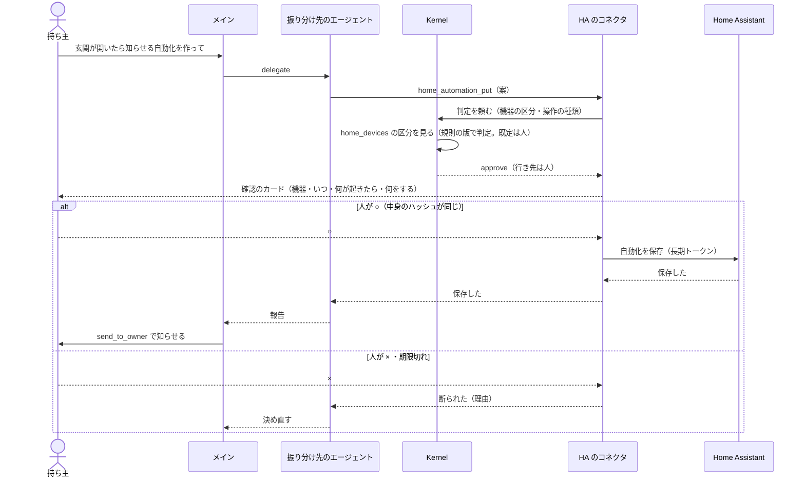
