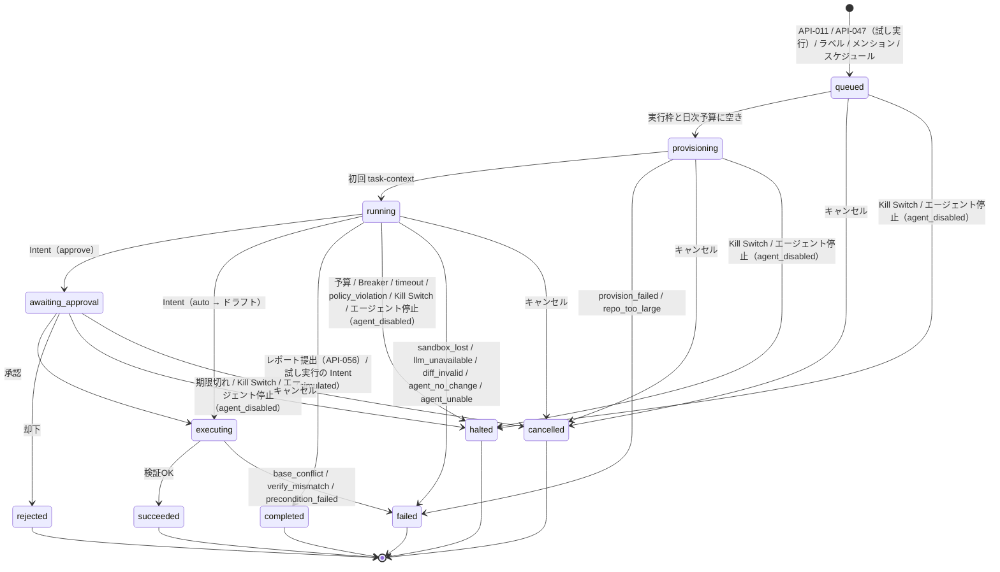
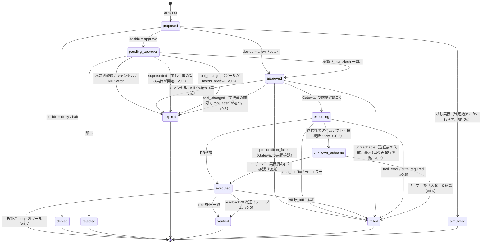
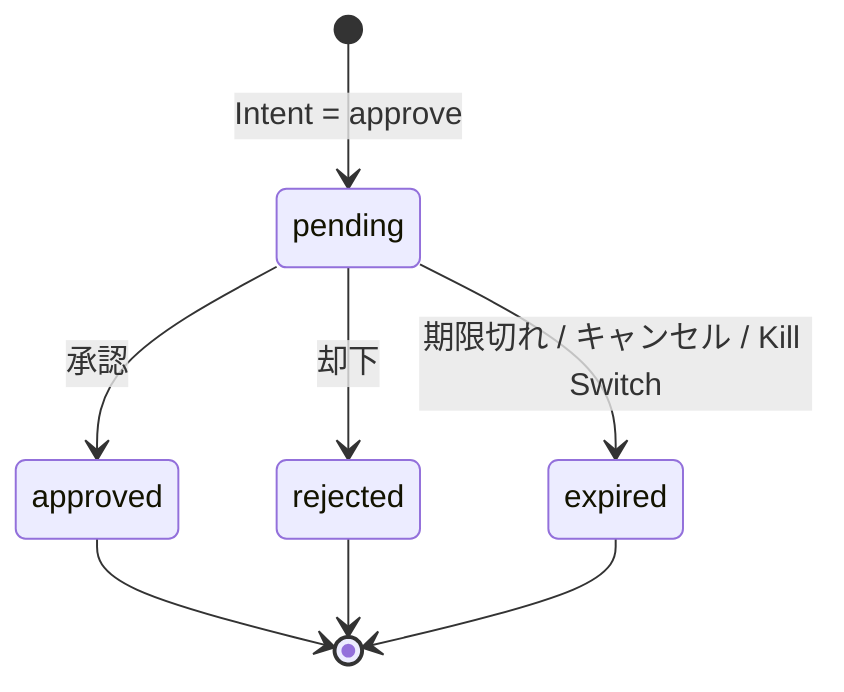
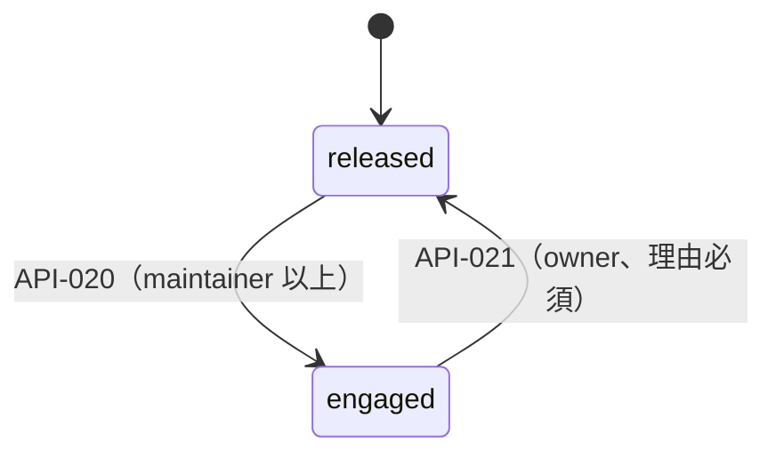
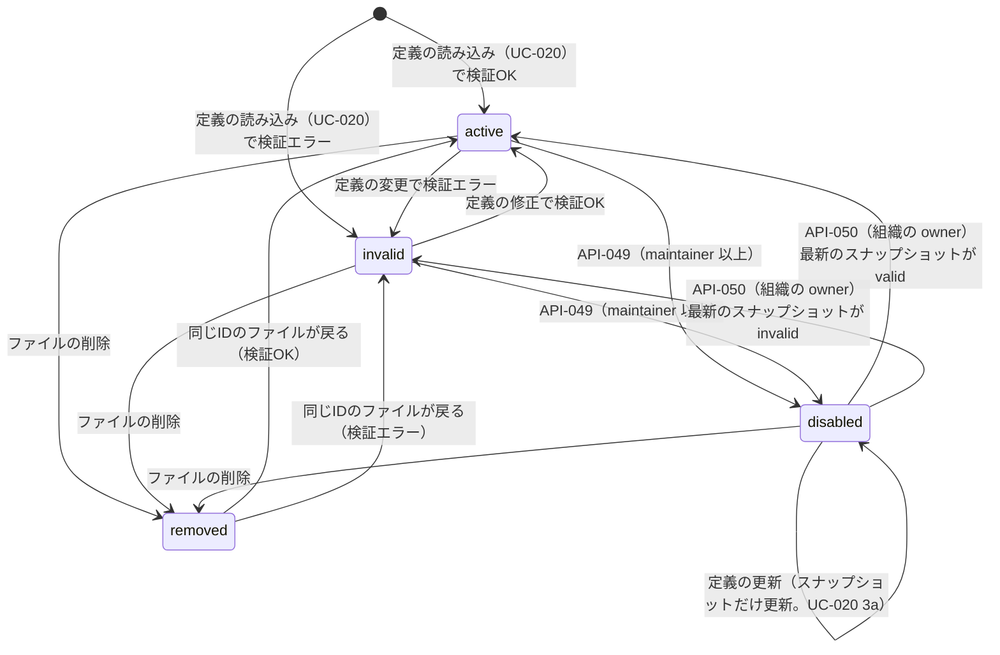
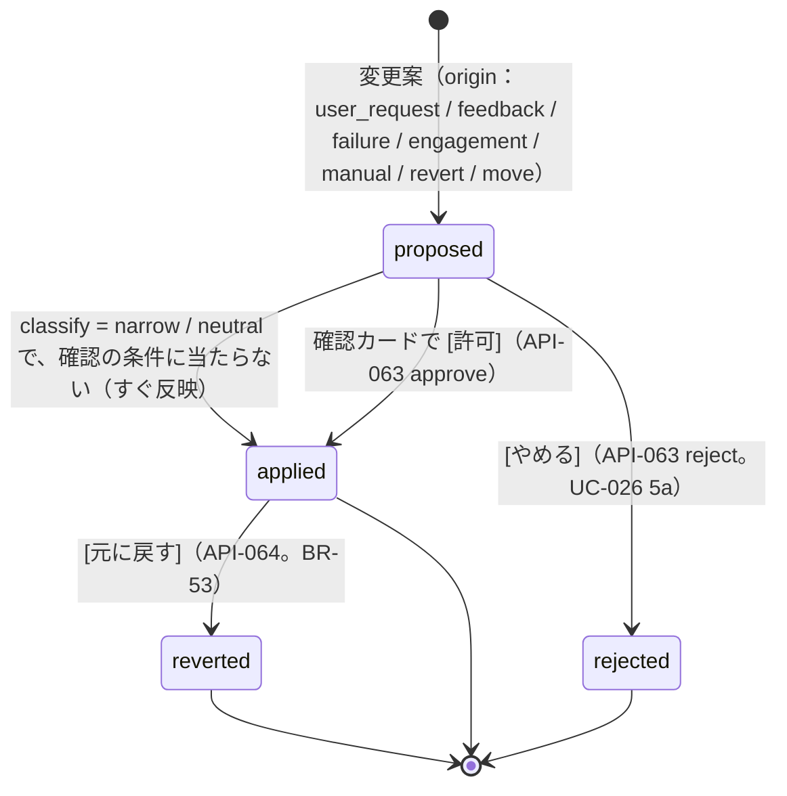
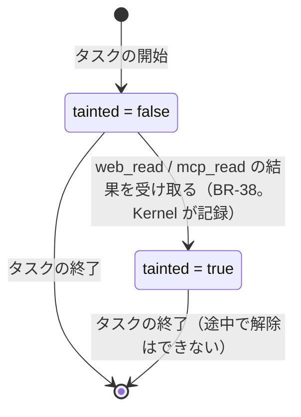
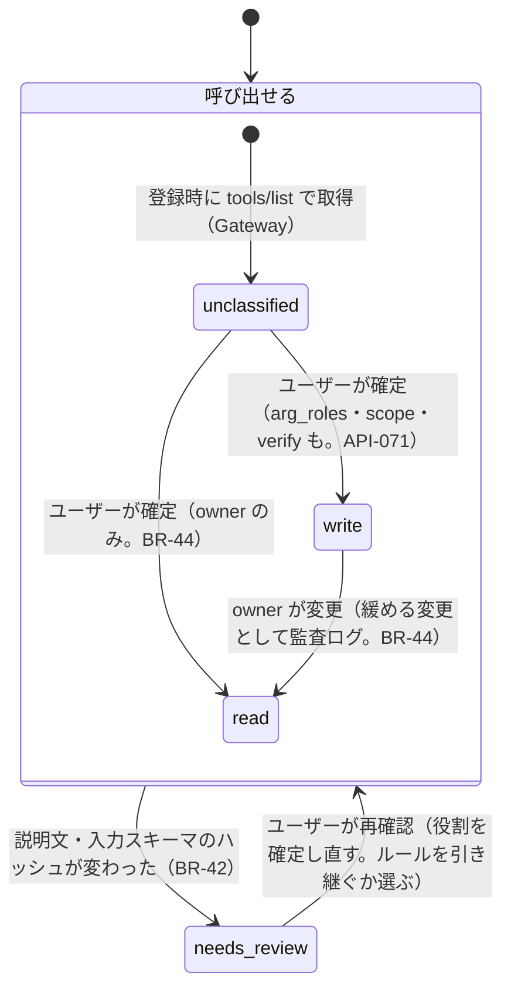
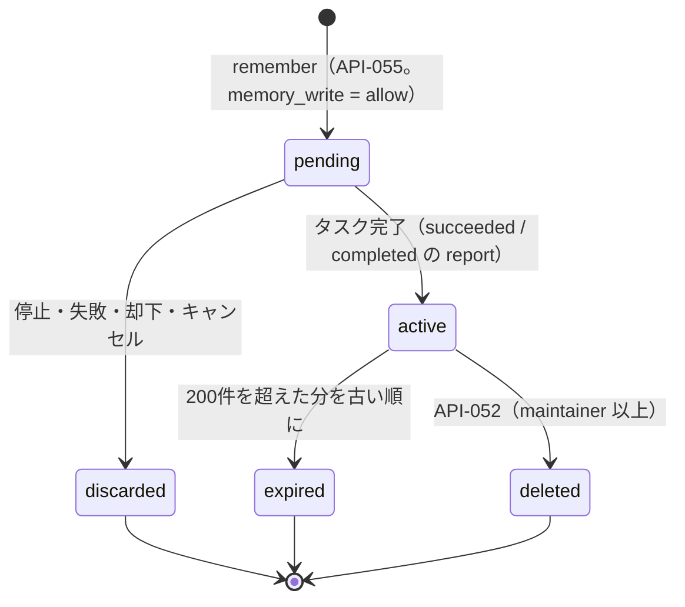
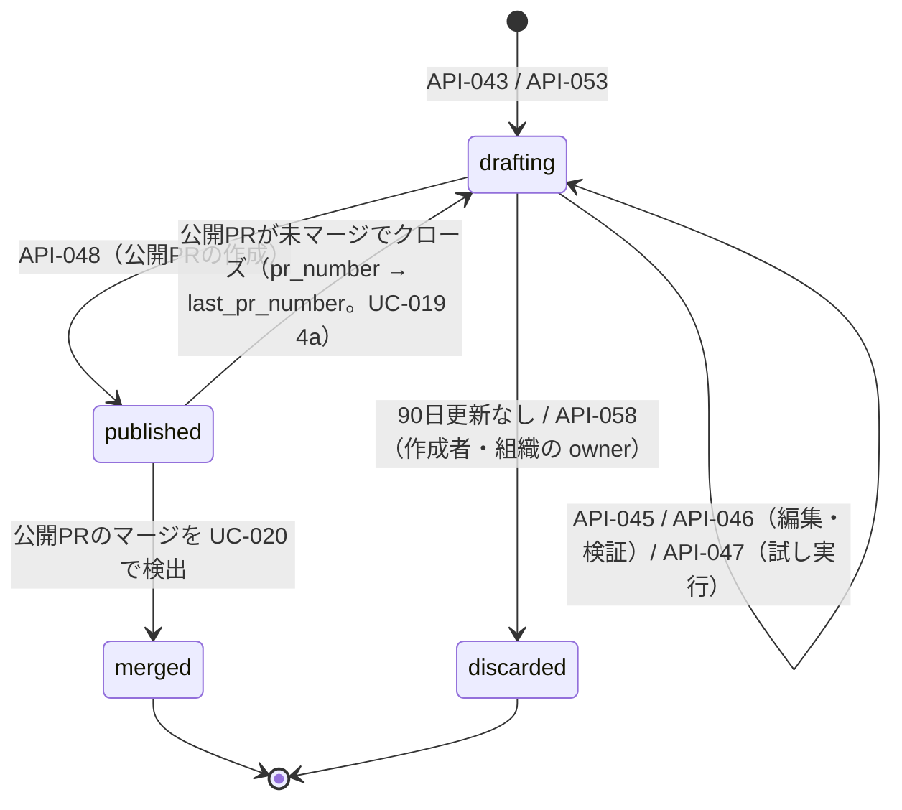

# 10. 状態遷移図
- 入口：[README](README.md) ／ ステータスの定義の正本：[04](../04_functional_spec/README.md)、カラム：[08](../08_database/README.md)

> **3行で**
> 1. 状態を持つ10個（タスク・Intent・承認・Kill Switch・エージェント・設定の変更・汚染・コネクタのツール・メモリ・下書き）の遷移を載せる。
> 2. Intent には v0.6 の MCP の遷移（`unknown_outcome`、`expired` の `superseded` / `tool_changed`、`executed` で終わる）を足した。足した遷移には「（v0.6）」と付けた。
> 3. 下書き（`agent_drafts`）は v0.5 で廃止したため「v0.2（置き換え済み）」として末尾に畳んだ。

## タスク（tasks.status）

見てほしいところ：終了状態は6つ。外部作用なしで正常に終わると `succeeded` ではなく `completed`。

- 補足（v0.2）：`completed` は外部作用なしで正常に終わった状態（`status_detail` が `dry_run`：試し実行の終了、`report`：レポートの提出）。試し実行では `awaiting_approval`・`executing`・`succeeded` には進まない（Intent は常に `simulated`）。試し実行の予算は $1 で、超えると `halted`（`budget_exceeded`）。
- 補足（v0.2）：「エージェント停止」は API-049 による停止で `halt_reason = agent_disabled`（UC-022）。停止したタスクはエージェントを再開しても再開しない。メモリの有効化は `succeeded` と `completed`（`report`）のときだけ（BR-26）。
- v0.6（15）：MCP の書き込みでは、ループの終了時に承認待ちの Intent があれば `awaiting_approval` にする。`completed` に `actions_declined` が加わり、`failed` に `action_failed` が加わる（[タスクの終わり方](sequences-mcp.md#タスクの終わり方15)）。メモリの有効化は `completed`（`actions_declined`）でも行う。図への組み込みは Q-87。

## Intent（action_intents.status）

見てほしいところ：`unknown_outcome` からは自動では進まない。ユーザーが確定するまで止まる（BR-59）。MCP で検証が `none` のツールは `executed` で終わる。

- 補足（v0.2）：`approved → failed` は、Gateway の前提確認に失敗した場合（UC-010 E1。Kill Switch と実行が競合した場合など）。
- v0.6：`decide = allow` には「以後も許可」のルールに一致した場合を含む（`mcp_write` は一律の `auto` にできない）。1タスクの Intent は既定5件・上限20件で、超えると `deny`（`intent_limit`）。
- v0.6：`unknown_outcome` のカードには [実行済みとして閉じる] [失敗として閉じる] [もう一度実行] を出す（API-070）。[もう一度実行] は同じ引数で **新しい Intent** を作り、ルールがあっても `auto` にしない。
- v0.6：送信前の失敗は「`approved` のまま」最大3回、指数バックオフで再試行する（15 §Gateway での実行）。手順1で先に `executing` にすることとの関係は Q-83。
- v0.6：定期実行の仕事から出た Intent の承認期限は `min(作成から24時間, 同じ仕事の次の実行の予定時刻)`。期限切れ・置き換えのたびに通知はしない。
- `decide = handoff`（12 v0.3）の状態は未設計（Q-84）。

## 承認（approvals.status）

見てほしいところ：承認の決定は1回だけ。期限切れ・キャンセル・Kill Switch はすべて `expired` に集まる。

- v0.6：[以後も許可] で決定すると `approved` と同時にルールを作る（`approvals.remember = true`、`created_rule_id`）。`approved` への遷移は同じ。

## Kill Switch（workspaces.kill_switch_engaged）

旧 `organizations.kill_switch_engaged`（13 で改名）。

見てほしいところ：止めるのは maintainer 以上、戻すのは owner だけで理由が必須。

## エージェント（agents.status）

見てほしいところ：起動（タスクの作成）できるのは `active` だけ。`disabled` の間も定義は読み込むが、状態は変えない。

- 公開後にポリシーが厳しくなった場合は `active` のまま、厳しい方の値で実行する（clamp。警告 `AGENT_CLAMPED`。BR-21）。
- `disabled` の間も定義の読み込みでスナップショットは更新するが、状態は `disabled` のまま（ファイルが消えた場合だけ `removed`）。停止中はどのトリガーでも起動しない（BR-27）。
- 試し実行は下書きから行うため、状態に関係しない。
- 既定エージェント（`default`）は、`.agent/agents/default.yaml` がなければ組み込みの定義（`source = builtin`）で `active` になる（BR-31）。
- v0.5：UC-025 はエージェントを `status = idle` で作る（14）が、この図に `idle` はない。アプリ内の定義（既定）での遷移の契機も未整理（Q-82）。

## 設定の変更（agent_config_changes.status）

フェーズ0（14）。エージェントが自分の定義に加えたい差分の状態。

見てほしいところ：`widen` は確認カードの [許可] でしか `applied` にならない（BR-47）。反映するたびに新しいスナップショット（`snapshot_id`）ができる。

- 確認カードになる条件：`widen` を含む（BR-47）、きっかけのタスクが `tainted`（`neutral` でも。BR-51）、自動調整が1つの仕事につき1日1回を超える（BR-52）、[元に戻す] された種類の調整を14日以内に再び行う（BR-54。UC-028 3）。
- [元に戻す] は、`narrow` か `neutral` の変更（`origin = revert`）として即時に反映する（BR-53）。
- 承認カードの [以後も許可] で作るルールは `widen` だが、ユーザーの直接の操作なので確認カードは重ねない（15。監査ログは `agent.config.widened`、`origin = approval_rule`）。設定プランナーはルールを提案・追加できない（BR-57）。
- 1つの変更案に複数の項目があれば、最も広い分類を全体の分類にし、カードには `widen` の項目だけを並べる。

## 汚染（tasks.tainted）

フェーズ0（13）。タスク単位で追う（データの流れまで追うかは 13 の未決事項。フェーズ0はタスク単位）。

見てほしいところ：一度 `tainted` になったら外れない。外の内容を読んだ後の作用ほど厳しく扱う。

`tainted` になると変わること：

| 対象 | 扱い | 根拠 |
|---|---|---|
| 設定の変更案 | `neutral` でも自動で反映せず、確認カードにする | BR-51 |
| 書き込みの Intent の承認カード | プロフィールの値を含む部分を強調し、読んだ情報源（URL・コネクタ）を並べる | BR-41、15 §承認カード |
| リスク評価（MCP の書き込み） | +2 | 15 §承認カード |
| AI事前レビュー | 常に実行する（厳しくする方向にだけ使う） | BR-34（フェーズ1） |
| MCP の書き込みの判定（`decide()`） | **変えない**。ルールの条件は汚染の有無にかかわらず同じ（BR-39 の v0.6 改訂） | 15 §decide() の拡張 |

- 読むだけの `watcher` は書き込み系のツールを持たない（BR-40、Hard Ceiling）。

## コネクタのツール（connector_tools）

フェーズ0（13・15）。分類（`classification`）と、`needs_review` の状態（`status`）は別の項目。

見てほしいところ：サーバーの注釈（`readOnlyHint` など）やカタログの推奨は初期値の提案にすぎず、ユーザーが確定するまで `read` にならない。

- `unclassified` は書き込みとして扱い（`approve`）、ルールを持てない。[以後も許可] も出さない。
- `needs_review` の間は呼び出しを `deny`（`tool_needs_review`）にし、そのツールの `pending_approval` と未実行の `approved` の Intent をすべて `expired`（`tool_changed`）にする。
- 確定していない引数と、スキーマの変更で増えた引数は `destination` として扱う（BR-56）。ルールの引き継ぎの既定は「引き継がない」。コネクタが無効なら `deny`（`connector_disabled`）。

## メモリ（agent_memories.status）

見てほしいところ：タスクが書いたメモリは、タスクが正常に終わったときだけ `active` になる。

- 補足（v0.2）：試し実行のタスクの書き込みは受け付けるが、行を作らない（BR-24・BR-26）。`memory.enabled: false` のエージェントには `remember` を渡さない。書き込んだタスクが保持期間で削除されても、項目は `source_task_ref` で出どころを示す。`active` の項目だけを、次のタスクの開始時に新しい順に合計4,000トークンまで入れる（A-38）。
- v0.6：`pending → active` の「タスク完了」には `completed`（`actions_declined`）も含む（15）。

## v0.2（置き換え済み）：下書き（agent_drafts.status）

`agent_drafts`（TBL-021）は v0.5 で廃止（→ TBL-024 `agent_messages`・TBL-025 `agent_config_changes`）。Q-81。

下書きの状態遷移図（v0.2）

- 補足（v0.2）：`published` の間も試し実行（API-047）はできるが、編集（API-045・API-046）と破棄（API-058）はできない。公開PRがマージされずにクローズされると `drafting` に戻り、編集と再公開（API-048）ができる。
