# 10. 図：状態遷移図
- プロジェクト：Agent-Team-Open ／ 版数：v1.5（2026-10-25） ／ 親：[10 図](README.md)

> **3行で**
> 1. `wakes.status` は `queued`・`consumed`・`dropped` の 3 つ。`turns.status` の `halted` には `context_exceeded`（入力が 20 万トークン超）がある。
> 2. `boxes.status`・`boxes.control`・`takeovers.status`・`browser_checks.status`・`sandbox_commands.status` は、VM（`box-browser` と `box-shell` の 2 コンテナの組）が眠って起きる形で描いた。
> 3. 値の意味は [04 ステータス定義](../04_functional_spec/README.md#ステータス定義)。`workspace.vm_op` と `workspace.vm_home_state`（`ok`・`broken` の 2 状態）も描いた。

---

### wakes.status
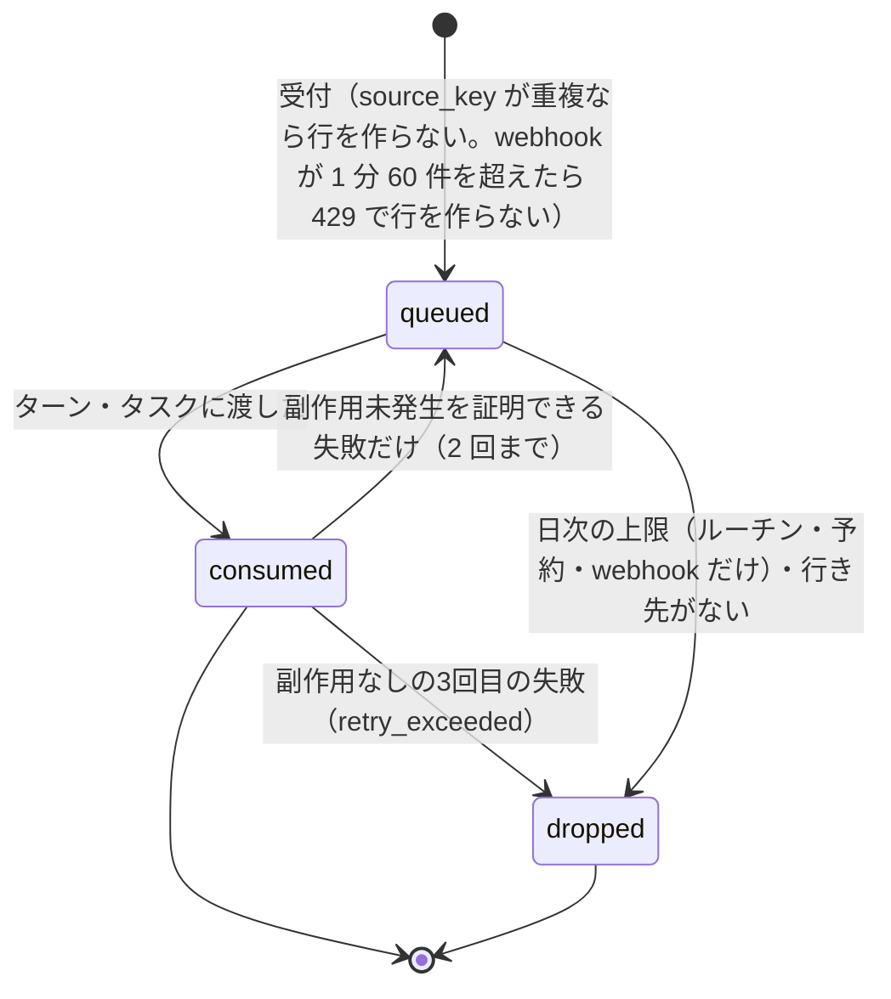

### turns.status
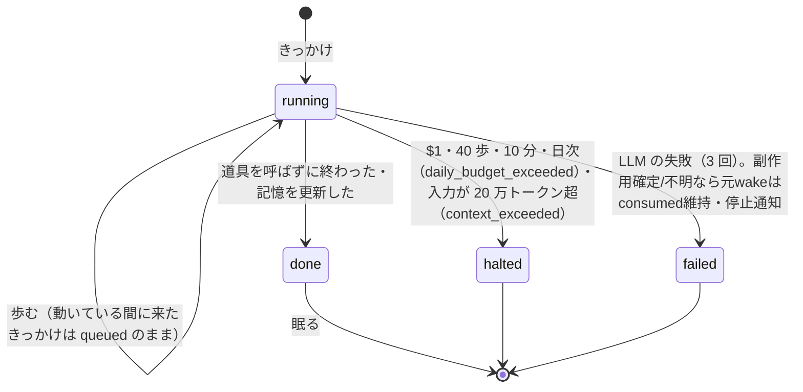

### 画面の番（boxes.screen_task_id）
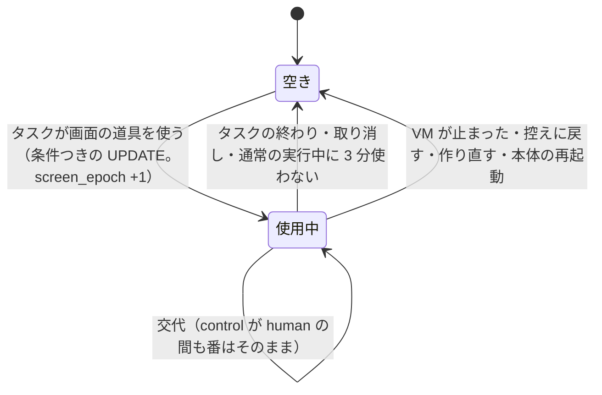

### scheduled_wakes.status
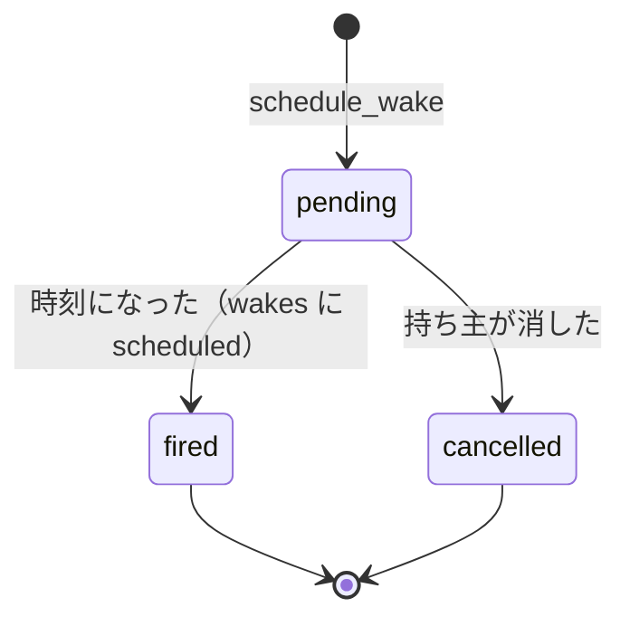

### routine_proposals.status
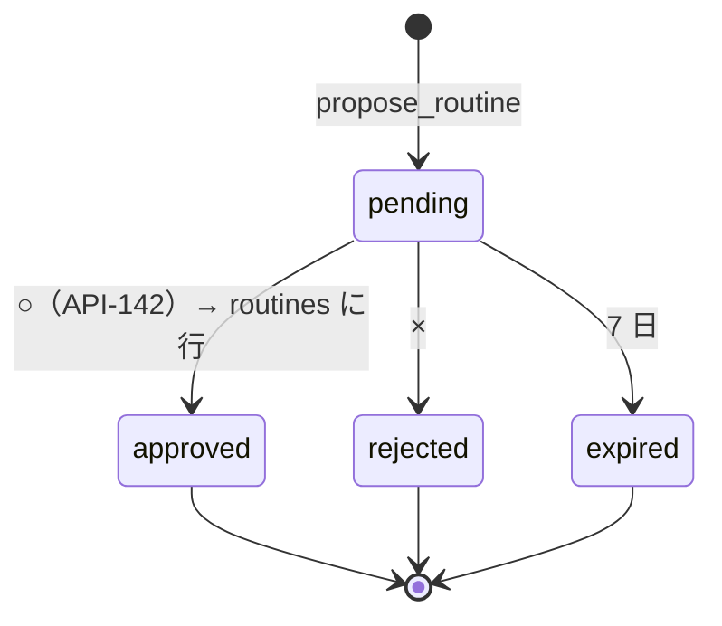

### boxes.status
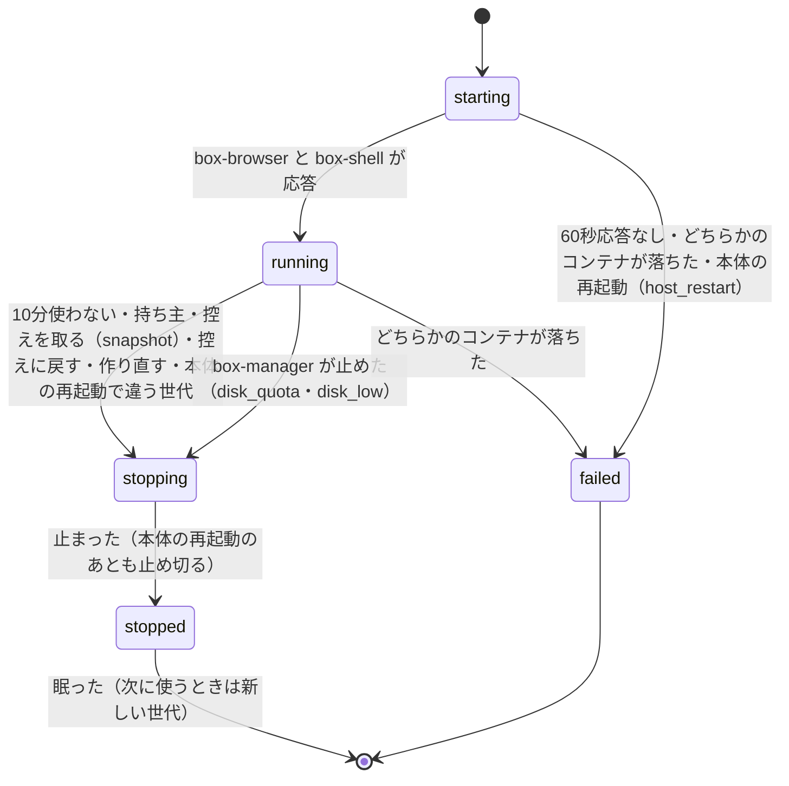

### boxes.control
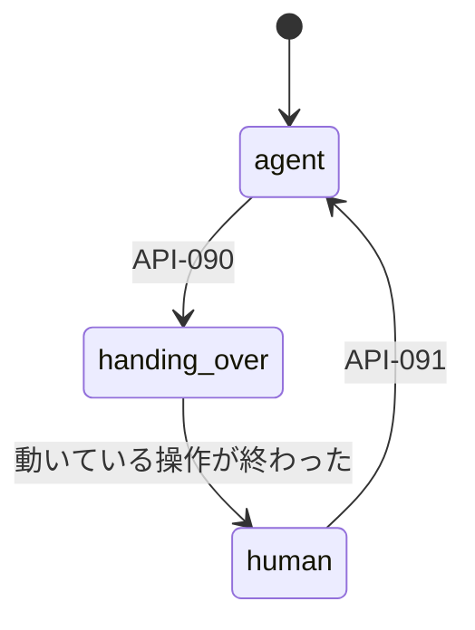

### takeovers.status
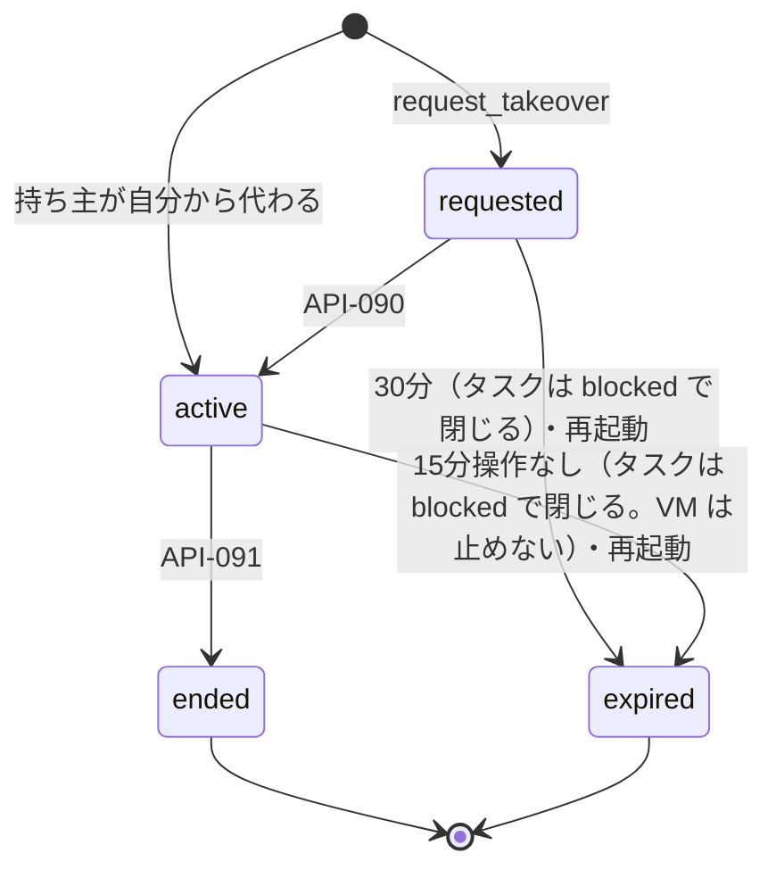

### browser_checks.status
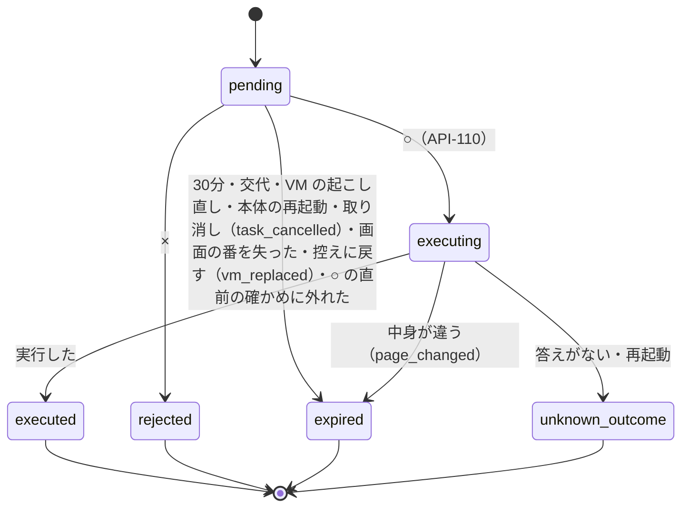

### sandbox_commands.status
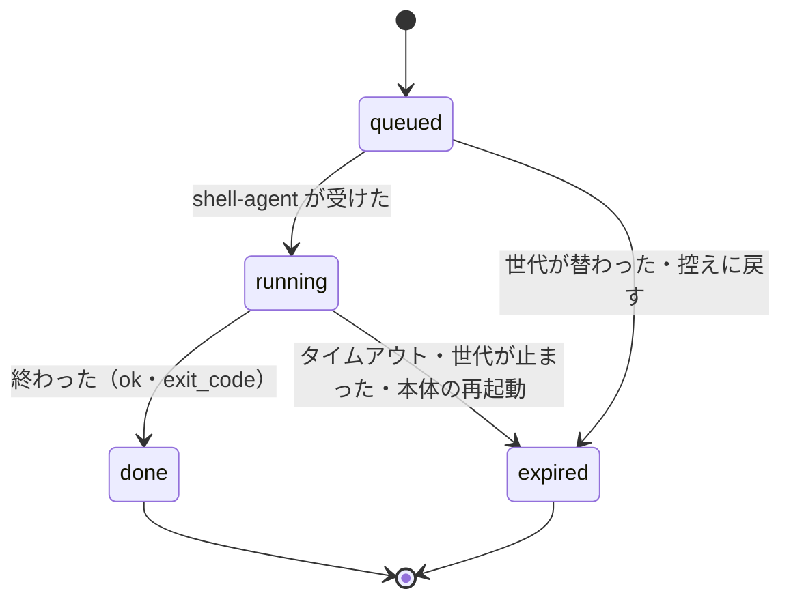

### workspace.vm_op
VM の操作は 1 つずつ（D-251）。失敗・打ち切りの道は D-294・D-295。時間の上限は `vm_op_started_at` から数える。
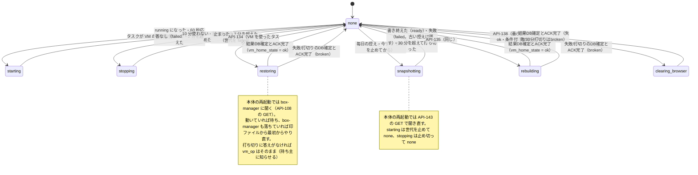

### workspace.vm_home_state
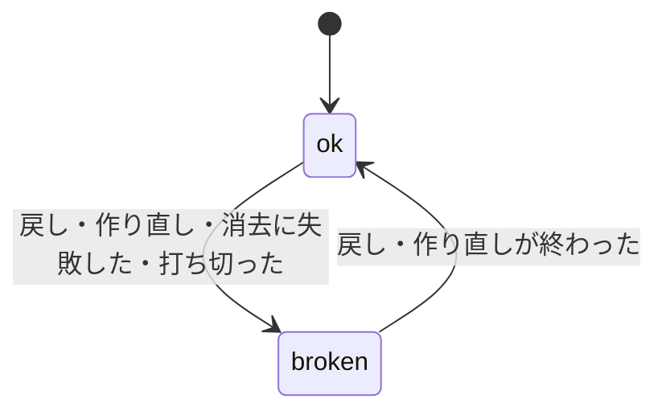
`broken` の間は戻す・作り直すだけを受ける（FR-100）。ホームが 4GB を超えたときは box-manager が VM を止め（`stop_reason = 'disk_quota'`）、超えている間はタスクのために VM を起こさない。持ち主はブラウザのデータを消す（FR-079）・控えに戻す・作り直す（FR-100）のどれかで戻す。
