# 10. 図：状態遷移図
- プロジェクト：Agent-Team-Open ／ 版数：v1.2（2026-10-24） ／ 親：[10 図](README.md)

> **3行で**
> 1. v1.0 で足したのは `wakes.status`・`turns.status`・画面の番・`scheduled_wakes.status`・`routine_proposals.status` の 5 つ。
> 2. v0.6 の `boxes.status`・`boxes.control`・`takeovers.status`・`browser_checks.status`・`sandbox_commands.status` は、VM が眠って起きる形に直した。
> 3. 値の意味は [04 ステータス定義](../04_functional_spec/README.md#ステータス定義)。v1.2 で `workspace.vm_op` と `workspace.vm_home_state` を足した（D-294・D-295・D-301）。

---

### wakes.status
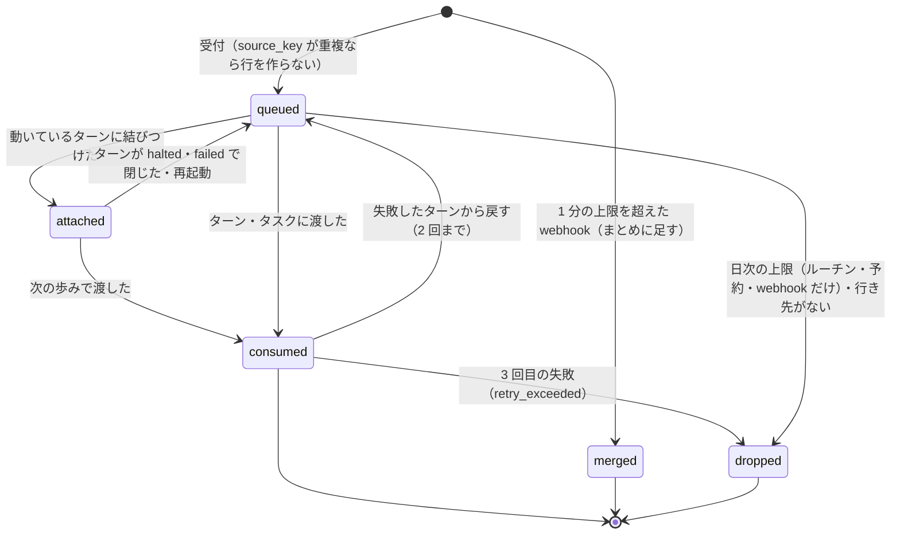

### turns.status
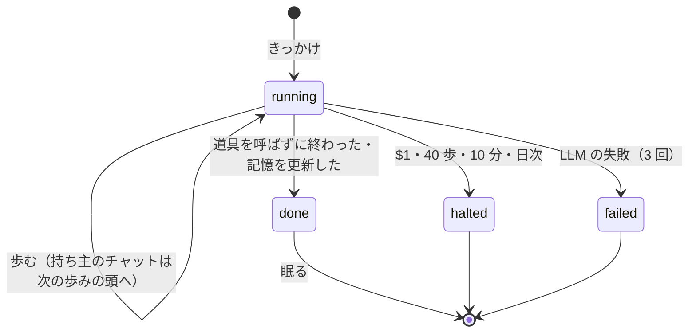

### 画面の番（boxes.screen_task_id）
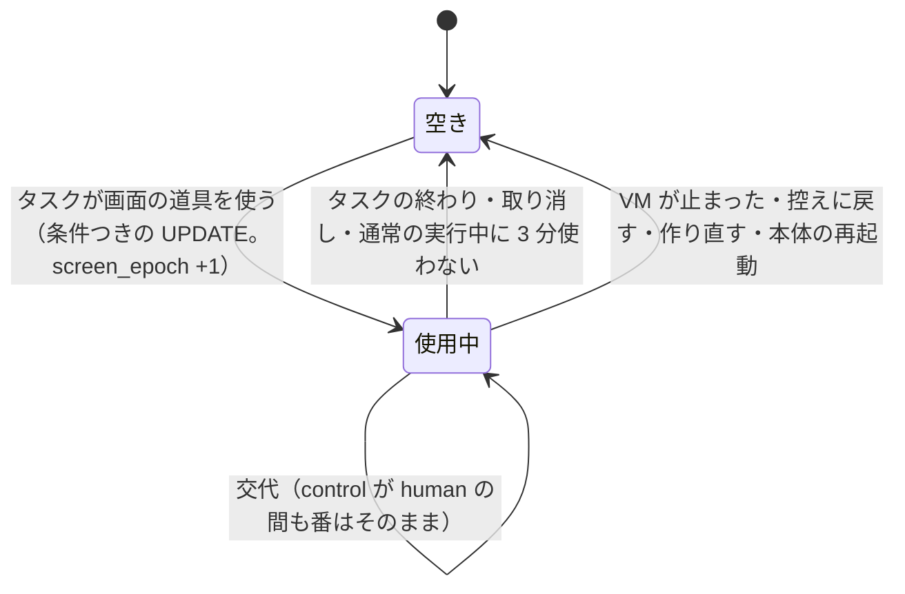

### scheduled_wakes.status
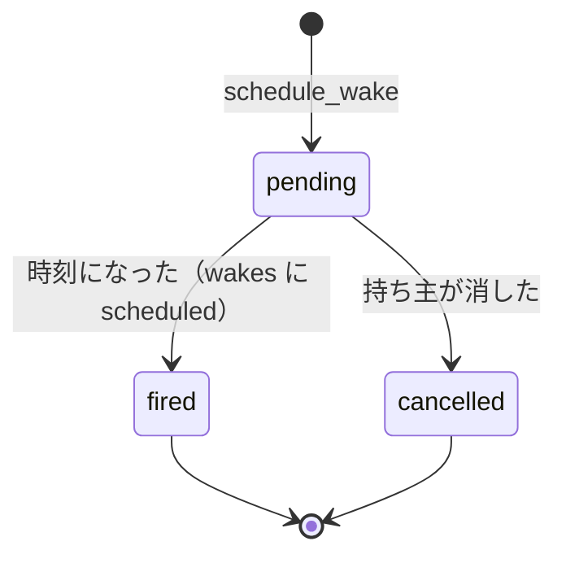

### routine_proposals.status
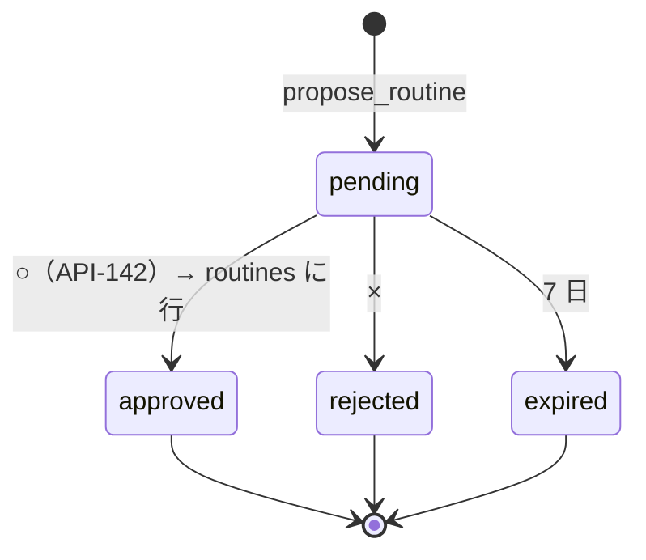

### boxes.status
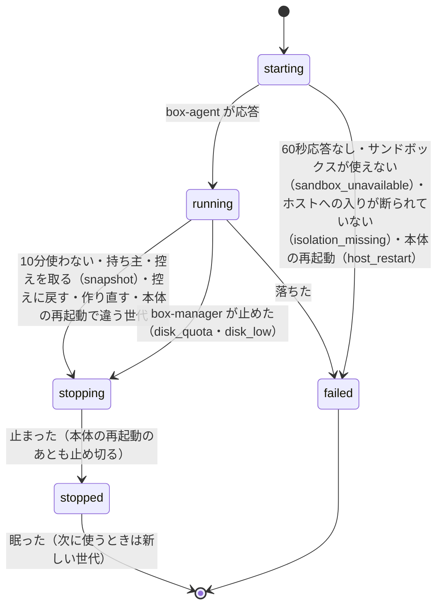

### boxes.control
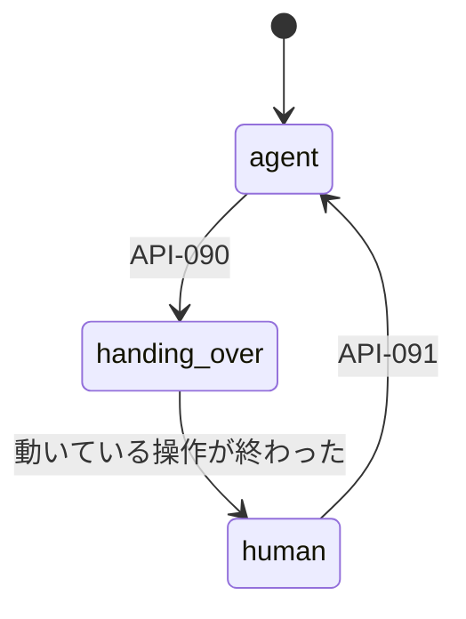

### takeovers.status
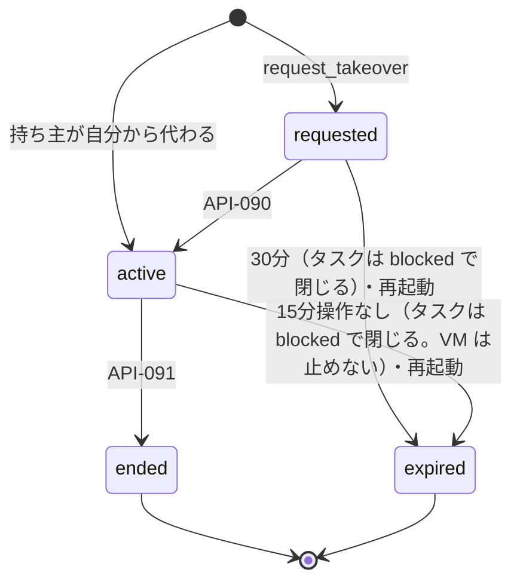

### browser_checks.status
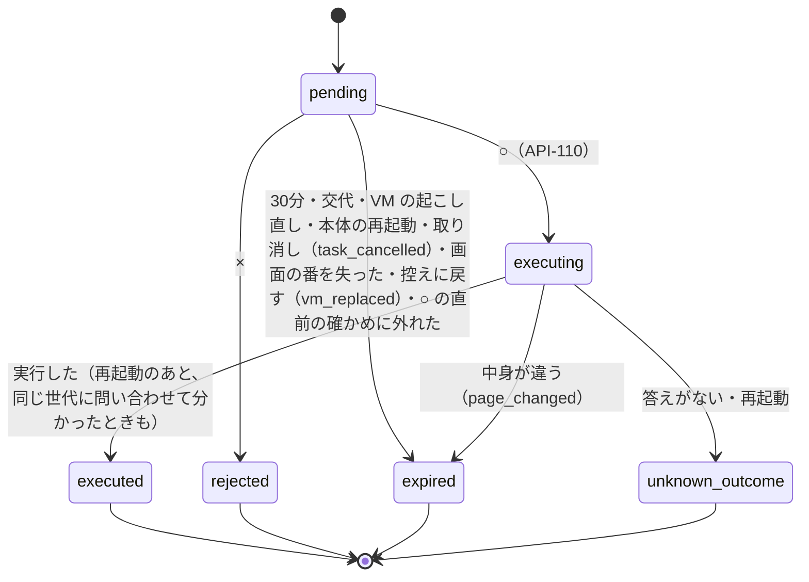

### sandbox_commands.status
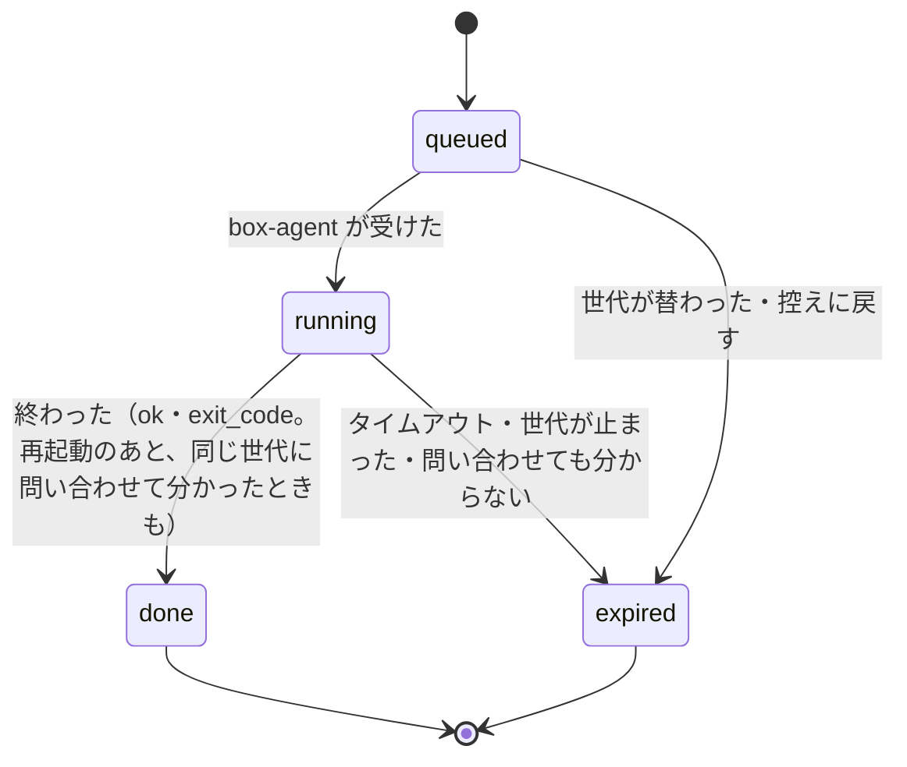

### workspace.vm_op
VM の操作は 1 つずつ（D-251）。失敗・打ち切りの道は D-294・D-295。時間の上限は `vm_op_started_at` から数える。
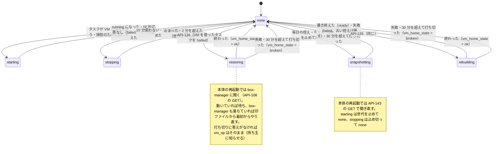

### workspace.vm_home_state
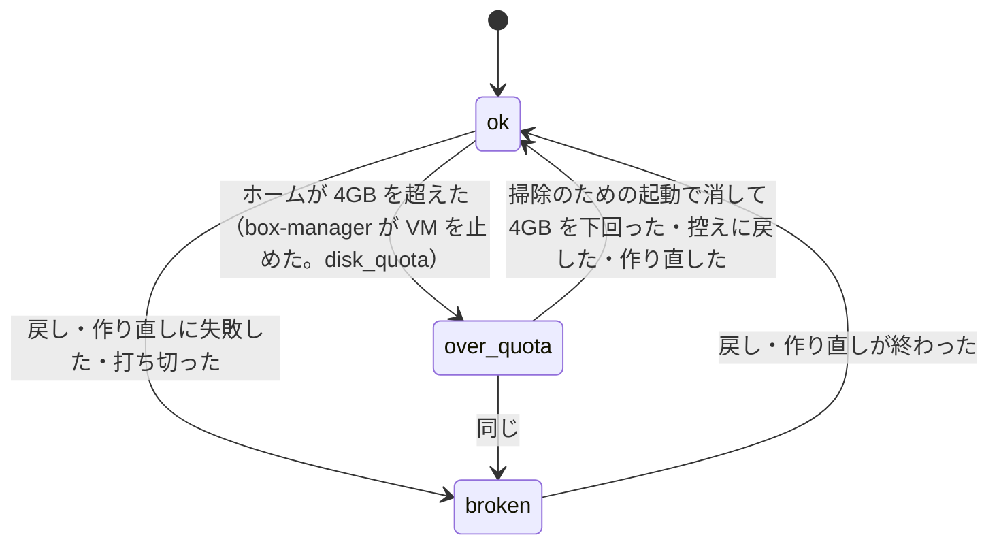
`over_quota` の間は掃除のための起動（`boxes.mode = 'cleanup'`。タスクは受けない）と戻す・作り直すだけ、`broken` の間は戻す・作り直すだけを受ける（FR-074・FR-100）。
