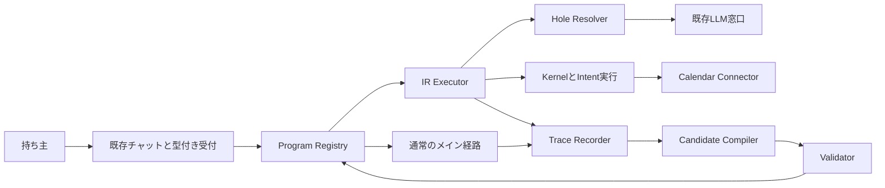

# 11. 成長機構の統合技術仕様
- 版数：v1.8（2026-10-26） ／ インプット：[要件](01_requirements.md#成長機構v18)〜[図](10_diagrams/learning.md)

> **3行で**
> 1. Makaseは仕事の履歴から、成立条件付きの実行プログラムを増やす。
> 2. 日程調整の既知処理をLLMなしで動かし、未知部分だけ推論する。
> 3. 自動採用は検証ゲート、外部操作は既存Kernelが担当する。

## 🧭 判断してほしいこと
新しい未決事項なし。[R-114〜116](00_learning.md#-判断してほしいこと)と委任判断[D-396〜401](00_learning.md#決定事項ログ)は実測時に見直す対象。

## 全体図

見てほしいところ：型付き依頼確定後にIRを選ぶ。受付の言語理解まで消えるわけではない。

## 要点
- [構成](#構成と既存実装との接続)はローカルNode本体内。
- [データ](08_database/learning.md)は不変版とcheckpointを結ぶ。
- [API](09_api/learning.md)は所有者の閲覧・停止用。
- [検証](#検証と評価)は機能成功と推論削減を別々に確認。
- [運用](#設定と運用)は資源・期限・再開を制限する。

## 詳細
### 構成と既存実装との接続
Node 24・Hono・SQLite WAL・Reactを継承し、新たな常駐サービスは増やさない。C4レベル1・2は[07](07_architecture.md)、レベル3の追加部品は上図。
Trace Recorderは本体側のツール窓口で観測を記録。Candidate Compilerは既存LLM窓口を利用し、Validatorは固定演算と独立oracleで判定する。
Program Registryはscopeと現在の依存版で照合。Executorは型付きノードだけを評価し、Hole Resolverは既存の裏タスク枠を利用する。
UI・認証・Kernel・ネットワーク許可・コネクタは既存設計を継承。IRからのIntentも同じ操作判定を通す。
実装調査で確認したLLM中心runnerやCloudflareのWorkflow replayは、この成長機構の実装済み根拠にはならない。再起動の再開と、別依頼での処理再利用を区別する。

### 機能・データ・画面
FR-117記録→FR-118候補→FR-119自動採用→FR-120実行→FR-121穴→FR-122停止・計測。
TBL-064〜068で観測、版、検証、run、holeを保存する。既存Intentとtask使用量を利用し、別の承認DBを作らない。
SCR-034「学習した処理」、SCR-035「学習実行詳細」を既存設定とタスク詳細から開く。API-158〜162は閲覧・停止・設定に限定。
日程候補の計算結果とカレンダーへの登録結果を分ける。候補作成の成功だけで仕事全体を成功としない。

### 設定と運用
TBL-035の`learning`は`enabled=true, revision=1`を初期値とする。以下はサーバー設定で固定し、公開PATCHではenabledだけ変更できる。

| 設定 | 既定値 | 意味 |
|---|---|---|
| maxNodes / maxHoles / maxHoleAttempts | 32 / 4 / 2 | 1IR、1run、1holeの上限 |
| maxCandidatesPerScope / maxCandidatesPerDay | 1 / 3 | 非終端候補と日次生成の上限 |
| maxPrograms | 100 | 保持中の全版数の上限。上限到達時は新規候補を止める |
| maxConcurrentRuns / maxConcurrentValidation | 1 / 1 | 家庭用ホストで競合を抑える |
| maxLearningCostMicrousdPerDay | 500000 | 候補生成・学習用推論の1日0.50 USD上限。既存全体・自動予算の残額との最小値 |
| retentionDays / maxStorageMiB | 30 / 512 | 個別観測の保持と学習領域の容量目安 |
| candidateTtlDays / maxActiveDays | 30 / 30 | 採用できない候補の期限とactiveの最大期限 |
| maxObservationAgeSeconds | 30 | 副作用直前の再観測の鮮度 |

- 候補生成1回のLLM要求は最大60秒、検証ジョブは1回10秒以内でcheckpointを保存してyieldする。ユーザー実行を優先し、ラズパイでの性能はNFRの実測で判定する。
- 自動学習は自動きっかけの予算・接続先規約を継承。自動利用を許可されない認証方式は使用しない。価格不明のモデルは学習を開始しない。
- 既存タイマーから5分ごとの学習チェックを呼び、期限・根拠欠落・依存版を確認。実行直前にも確認するため、tick待ちで失効版を動かさない。
- 予算・容量不足は学習を待機させる。依頼の通常処理は既存予算の範囲で継続できる。推論の穴の費用は当該taskに、候補生成の費用は学習に計上する。
- DBバックアップと復旧は既存運用を継承。復旧後はアカウント・依存版・期限を再確認してから実行する。送信中checkpointは結果照合まで再送しない。
- 全体OFFや版停止は次ノード開始を止める。外部への送信中は取り消し保証をしない。

### 検証と評価
候補の採用ゲートは[FR-119](04_functional_spec/learning.md#fr-119)が唯一の定義。採用試験と効果測定用のholdoutは分ける。
効果測定は学習に未使用の100件以上の固定日程ケースで、通常経路とIR経路へ同じ観測を供給して比較する。seed・モデル版・operator版・suite版を記録し、外部書き込みは行わない。
成功とは、出力契約と正解oracleを通ること。実運用の完了率では外部操作結果も別に含める。未知・途中停止を成功から除外し、母数からは除かない。
入口の自然言語解析・報告、穴、学習を含む呼出数と費用を区別して記録する。学習費の償却前に「安くなった」と断定しない。
検証観点は型・scope誤一致、DST、汚染、偽の根拠、失効競合、再起動、送信後応答欠落、採用競合、停止中の副作用、データ削除とFKの整合性。

### エラー・監視
schema不適合は候補rejected、依存版変更はinvalidated、未解決の好みはneeds_owner、予算不足はblocked、送信後不明はunknown_outcome。
監視は候補採用率・ガードmiss率・穴率・契約違反件数・再利用件数・学習費・実行費・不確定結果を集計する。秘密や会議本文をログに出さない。
未確定副作用の照合は既存コネクタで可能な範囲に限定し、照合不能なら人へ戻す。複数カレンダー間のトランザクション保証はない。

### 範囲と主要判断
任意コード生成、ブラウザ操作の自動コンパイル、仕事横断の自動合成、モデル重みの学習、他人の履歴共有は今回の対象外。
主要判断は[ADR-085](adr/ADR-085-learning-ir.md)・[ADR-086](adr/ADR-086-learning-activation.md)・[ADR-087](adr/ADR-087-learning-holes.md)。委任判断は[00のログ](00_learning.md#決定事項ログ)。

## このドキュメントで決まったこと
D-391〜402を統合。実装タスク分解は含めない。
