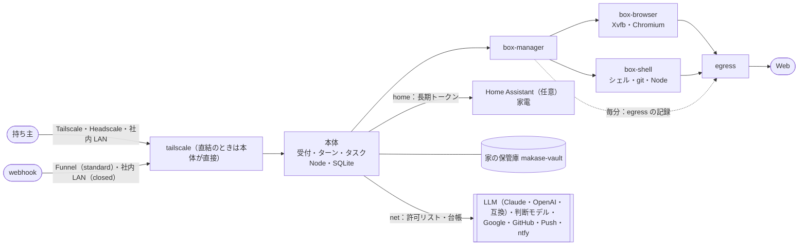

# 11. 技術仕様書
- プロジェクト：Agent-Team-Open ／ 版数：v1.8（2026-10-26） ／ インプット：[01](01_requirements.md)〜[10](10_diagrams/README.md)

> **3行で**
> 1. Linux ホスト1台（家に置くセットアップ済みのラズパイ「キット」も同じ）の上で Docker Compose の 7 種類のコンテナを動かす。box-browser と box-shell の組が VM（持ち主に 1 台）。キットでは任意のサービスとして Home Assistant も入れる。持ち主1人が PC とスマホから 1 本のチャットでメインと話す。LLM は役割ごとに Claude・OpenAI・OpenAI 互換から選ぶ。
> 2. 本体は常駐型：受付・ルーター・メインのターン・裏のタスク・タイマーが、歩みの記録で耐久性を持ち、用がなければ眠る。メインは振り分け、`send_to_owner` でだけ話し、記憶（2 層）を持つ。VM は残り続け、画面の番を順に使う。こわい操作は Kernel の合図 → 人（オートレビューは既定で切）。
> 3. v1.7 は、家の中の機械に届く（家の保管庫・Home Assistant の家電・写真とレシートの画像）、家計簿、仕分けの判断モデル、そして非エンジニアにキットで届けることを足した。鍵などの家電は必ず人が確認し、判断モデルは Kernel の判定に使わない（BR-15・16）。実装の順番・タスクはこの文書の範囲外（D-211）。

## 成長機構（v1.8）
本仕様の追加の核は[成長機構の統合技術仕様](11_learning.md)。REQ-119〜122、FR-117〜122、TBL-064〜068、API-158〜162、SCR-034・035を統合する。
仕事の経験を検証済みIRへ変換し、条件が合う部分はLLMなしで実行、未知部分だけ推論する。初回実証は日程調整。任意コード・画面操作のコンパイル・仕事横断合成は対象外。

## 🧭 判断してほしいこと
P1の必須受入条件は[全11件対応表](changes/2026-10-25-p1-review-fixes.md)。既存の単体/VM/隔離/eval/導入試験に組み込む。[停止・移行・VMイメージの運用契約](11_operations.md)も本仕様の一部。
全体の一覧は [README](README.md#-判断してほしいこと全ドキュメントから集約)。この文書だけの論点はなし。

## 全体図

見てほしいところ：持ち主 → 本体 → VM の一方向。VM から本体へは戻れない（egress の記録は box-manager が取りに行く：D-359）。外に出る道は、すべて許可リストと台帳を通る。webhook は本体の別の口にしか届かない。Home Assistant と保管庫は本体だけがつなぎ、VM からは届かない（v1.7）。

## 要点
- 構成とその理由は [07](07_architecture.md) と ADR-041〜070
- 常駐の仕組みは [04 resident](04_functional_spec/resident.md)、VM とこわい操作は [04 vm](04_functional_spec/vm.md)
- 新しい表は [08](08_database/README.md)、新しい API は [09](09_api/README.md)、図は [10](10_diagrams/README.md)
- リスクは [§12](#12-リスクと対策)

---

## 詳細

### 1. 概要
- 目的：持ち主が一言頼むか予定を置いておけば、API のないサイトの仕事やコードの修正まで、留守の間に進む（[01](01_requirements.md)）
- スコープ：REQ-076〜117（REQ-089・095 を除く。REQ-111・118 は次の版の候補で今の版は Won't）。Won't は [01 §7](01_requirements.md#7-スコープ外wont)
- 読む人：本体・VM・画面を作る開発者（持ち主）と、OSS として自分の機械に置く開発者。v1.7 から、キットを受け取って家に置く家の人（非エンジニアを含む。D-371）も使う人に入る
- ライセンス：AGPL-3.0（`AGPL-3.0-only`）。リポジトリ直下の `LICENSE`。依存ライブラリは AGPL と両立するものだけ（[ADR-055](adr/ADR-055-agpl-license.md)）

### 2. システム全体像
- コンテナ図は [07 レベル2](07_architecture.md#レベル2コンテナ図)、本体の部品は [07 レベル3](07_architecture.md#レベル3本体のコンポーネント図)
- 技術：Node 24・Hono・`better-sqlite3`（WAL・FTS5）・React＋Vite（PWA・Service Worker）・`web-push`・LLM（Claude：computer use・プロンプトキャッシュ・`@anthropic-ai/sdk`、OpenAI、OpenAI 互換：`base_url`。役割ごとに選ぶ：D-352。v1.6 で D-315 を置き換え）・Docker Compose・Tailscale（serve・funnel。Headscale・社内 LAN の直結も可：D-341）・WebAuthn（直結のパスキー：D-358）・Xvfb・Chromium・x11vnc・noVNC

### 3. 機能概要
| 区分 | FR |
|---|---|
| v1.0 で足した（常駐） | FR-090〜098（受付・ターン・振り分け・`send_to_owner`・ルーチン・予約・webhook・記憶・文脈）、FR-017（Web Push を Must に） |
| v1.0 で足した（VM・確認） | FR-099（オートレビュー）・FR-100（控えと作り直し） |
| v1.0 で直した | FR-013・061・072・073・074・076〜079・083〜086・088・089 |
| 引き継ぎ（差分あり） | FR-016・018・075・080・081。どこから移すかは [04 移植元](04_functional_spec/tools.md#移植元) |
| 使わない | FR-063（FR-093 に統合）・FR-082（D-316）・FR-087（次の版：D-315） |
| v1.7 で足した | FR-109（キットの初回設定）・FR-110（家の保管庫と道具）・FR-111（写真の整理）・FR-112（家計簿）・FR-113（Home Assistant のコネクタと機器の区分）・FR-114（チャットの画像の添付）・FR-115（仕分けの役割 `classify`）・FR-116（ChatGPT でサインイン：接続先 `openai_chatgpt`。D-385〜390） |
| v1.6 で足した | FR-101〜103（閉域・内部ホスト・台帳）、FR-104〜106（規則の版と試験・再実行・監査ログの鎖）、FR-107・108（役割ごとのモデル・computer use の変換）。FR-099 のオートレビューは既定で切（D-351） |

### 4. データモデル
- [08 の ER図](08_database/README.md#全体図)。常駐の表は TBL-041〜054（TBL-048・049 は作らない）、VM の表は TBL-031〜040（TBL-036 は使わない、TBL-037 は作る）
- 依頼（`asks`・`ask_pending_replies`・`ask_members`）は使わない。`tasks` に `turn_id`・`brief`・`report`・`tainted` などを足す（[08 変える表](08_database/README.md#変える表)）

### 5. インターフェース
- 画面向け：[09 エンドポイント一覧](09_api/README.md#エンドポイント一覧)。チャットは API-119・120、タスクは API-122〜124、きっかけは API-125〜128・136・139・140・142、記憶は API-130・131・141、VM は API-088〜091・099・133〜135・138、通知は API-031・032・137
- 公開：webhook の口 API-129（:8081・Funnel）
- 内部：box-manager の API-101〜109・113・117・118・143・144
- 外部：LLM（Claude Messages API：computer use・プロンプトキャッシュ。OpenAI。OpenAI 互換：`base_url`。役割ごとに選ぶ：v1.6・D-352）、Google カレンダー API、GitHub API と webhook、Tailscale（Headscale）、Web Push のサービス・任意の ntfy
- v1.6 の API：台帳 API-148、規則 API-149、判定の再実行 API-150、監査ログの検査 API-151、モデル API-152。画面は SCR-027〜029。表は TBL-056〜059
- v1.7 の API：保管庫 API-153、家計簿 API-154、Home Assistant API-155、添付 API-156、初回設定 API-157。画面は SCR-030〜033。表は TBL-060〜063

### 6. 画面構成
- [06 の画面遷移図](06_ux_design.md#全体図)。v1.0 で作り直したのはチャット（SCR-020）とタスク（SCR-021）、足したのは記憶（SCR-025）ときっかけ（SCR-026）

### 7. 非機能要件への対応方針
| NFR | 実現手段 |
|---|---|
| NFR-061・088 | VM は 1 台。画面の番は `boxes.screen_task_id` の条件つきの UPDATE。裏のタスクの同時数は `workspace.max_tasks`。ターミナルは shell-agent が 2 本まで受ける |
| NFR-062 | VM の資源の上限は box-manager が固定で付ける（`box-browser` はメモリ 1.5GB・CPU 1.5、`box-shell` はメモリ 1GB・CPU 1）。ホームは 4GB（2 つのボリュームの合計）・控えは 3 世代・最低の空き 32GB（D-300）。ホームの大きさとホストの空きは box-manager が毎分測り、超えたら自分で VM を止める。本体は API-109 で読むだけ（D-309）。最低のホストはメモリ 4GB（推奨 8GB） |
| NFR-063 | Xvfb を 1280×800 で起こす。computer use のツールへの画面の大きさの渡し方は、実装するときの既定モデルのツールの版の仕様に従う |
| NFR-064・085 | ホストのポートは出さない。入口は `tailscale serve`（443 → :8080。tailnet だけ）と、受け口があるときの `tailscale funnel --https=8443`（`/` ごと :8081 へ。:8081 は `POST /hooks/:hookId` 以外を 404：D-305）だけ。Funnel の公開はポート単位なので、443 番は Funnel にしない（D-241）。:8081 は Hono の別のアプリで、ルートは 1 つ。入口は 3 択（D-341）：Tailscale（既定）・Headscale（調整サーバーだけ社内。`tailscale serve` が同じヘッダーを付ける）・社内 LAN の直結（社内 CA の TLS。本体のパスキー＋12 時間のセッション Cookie：D-358）。`closed` では Tailscale の SaaS と Funnel を使わず、webhook は社内の GitLab・GHES から LAN の中で受ける |
| NFR-065 | Hono のミドルウェアで Origin と `X-Makase-Request` を確かめる |
| NFR-066 | VM は `box-browser` と `box-shell` の 2 コンテナの組。どちらも `internal: true` のネットワークだけ・権限なし・`no-new-privileges`・ルートは読み取りだけ。egress がグローバルでないアドレスを断り、送り元のコンテナで許可リストを分ける（ADR-045・ADR-068）。本体・box-manager・tailnet・ホスト自身・クラウドのメタデータは固定で断り、`network.internal_hosts` に書いた内部ホストだけ例外（v1.6・D-343。R-106）。ブラウザとターミナルが別のコンテナなので、コマンドからブラウザの X・CDP・プロフィールには届かない。Chromium から開くのは `shell:8000`〜`8099` だけ egress を通さない |
| NFR-089 | `network.mode = closed` のとき、本体の外向きは窓口 `net`、VM の外向きは egress が、`network.allow_hosts`（LLM の接続先も明示）にない先を断り、`egress_events` に拒否として残す。egress は記録を自分の中に溜め（最大 1 万件）、box-manager が毎分取りに行き本体に渡す（D-359）。台帳に書けないとき：`closed` は新しい外向きを断り、`standard` は通して欠けた件数を記録し状態欄に出す。egress の溜まりが満杯のときも同じ（D-360） |
| NFR-090 | Kernel は純粋な関数（時刻・乱数・LLM・ネットワークを使わない。時刻は入力に入れる）。判定の入力を保存し、`POST /api/verdicts/:id/replay` で再実行して比べる（D-349） |
| NFR-091 | `audit_logs` の各行に `prev_hash`・`row_hash`（SHA-256）。毎日 0 時の末尾を `audit_anchors` に残して書き出し、`POST /api/audit/verify` で全行を検査する（D-350） |
| NFR-092・093 | 表は [05 NFR-092](05_non_functional.md#nfr-092-キットの選び方と同居できるもの)（キットの選び方と同居できるもの。D-383）。ラズパイ 5 のローカル生成モデルは 4B 級までを `summary` と短い文章に限る（D-380）。ローカル LLM は `llm_models` の能力（`tools`・文脈の長さ）で役割に選べるかを決める（D-353）。32k 級では 1.6 万トークンで要約する（D-363） |
| NFR-094 | キットのイメージは書き込み済みで、初回は 5 手順（電源と LAN → Tailscale の招待 → パスキー → API キー → 最初のお願い）だけ。画面 `/setup`（SCR-033）が状態を出す（API-157。D-372・384）。第三者が説明なしで 15 分以内に最初のお願いまで行けるか測る |
| NFR-095 | 保管庫の道具は消す＝`ゴミ箱` へ移す（30 日で自動で消える）、上書き＝前の版を `.versions` に残す（30 日）。ゴミ箱を空にする・30 日より前に消すのは Kernel が必ず人にする。保管庫の控えは毎週（任意。[運用契約](11_operations.md)）。VM には保管庫をつながない（D-373） |
| NFR-096 | `classify` は判断モデルを `decision` に 1 回呼ぶだけ（p95 1 秒以内、ラズパイ 5）。自信が下限（既定 0.8）より低ければ上の役割に回す。4B の生成モデルは 8GB では本体がメモリを見て、VM を起こしている間は止める（D-379・380） |
| NFR-097 | レシートの読み取りは画像を読める役割が行い、金額・日付の自信が低いときは確認のカードで直してもらう。試しのレシート 50 枚で金額・日付 95%・費目 90% 以上（D-375） |
| NFR-067・068 | VM のイメージを小さくし、起動のときに Chromium を先に立ち上げておく。スクショは PNG を縮めずに渡す |
| NFR-070・071 | タイマーで `VACUUM INTO`。歩みの記録で再開（ターンもタスクも同じ仕組み） |
| NFR-076 | edge の上限（費用・歩数・回数・時間）を歩みごとに確かめる。LLM を呼ぶ前に見積もりの費用を予約する（TBL-038）。費用は `llm_models` に宣言した単価で計算し（ローカルは 0 を明示）、単価が空なら動かさない（D-353・355）。日次の上限は全体の `daily_usd` と自動のきっかけ用の `daily_auto_usd` の 2 本（D-322） |
| NFR-080 | shell-agent がコマンドごとに 120 秒で打ち切り、出力を 64KB で切る |
| NFR-082 | タイマーは SQLite を読むだけで LLM を呼ばない（要約はターンの開始時）。VM は 10 分で止める |
| NFR-083 | 先頭（①〜⑤）を `context_snapshots` に固定し、`cache_control` を付ける。`cache_read_tokens` と 5 分・1 時間の書き込みを記録し、外れを部分ごとのハッシュで残す。履歴は追記だけ（D-256）で、古いスクショはサーバー側の context editing で消す（FR-098） |
| NFR-084 | box-manager が `makase-browser-profile` と `makase-vm-home` を 1 つの tar（zstd。中は `browser/` と `home/`）にして控え専用のボリュームに書く（D-309）。戻すときは 2 つのボリュームを空にしてから展開する。どちらも裏で動かし、本体は 5 秒ごとに終わりを問い合わせる。失敗はホームを `broken` に（D-294・D-295） |
| NFR-086 | `send_to_owner`・確認・交代の頼みを書くのと同じトランザクションで `push_outbox` に入れ、送り手がすぐ送る。失敗・再起動のあとも送り直す（D-267） |
| NFR-087 | プロフィール 100 個・4,000 字。書くときに数と字数を数える。`search_memory` は FTS5 の `bm25` で 1 回 500ms 以内（10 万行で） |

### 8. セキュリティ設計
| 観点 | 設計 |
|---|---|
| 認証 | Tailscale・Headscale の身元＋`OWNER_LOGIN`（ADR-046）。社内 LAN の直結は本体のパスキー（WebAuthn）。最初の登録は `docker compose exec makase makase owner-enroll` の 1 回限りの URL（D-358）。webhook は受け口ごとの HMAC（ADR-065） |
| 認可 | 持ち主1人。ロールなし。エージェントの道具は役（メイン・振り分け先）で分ける |
| 入力の検証 | 今の Worker の検証（`edge/validate.ts`・`schema-check.ts`）を引き継ぎ、道具の結果の画像と computer use の操作の形を足す。`open_url` は `http`・`https` だけ（D-158）。webhook の本文は決まった欄だけ抜いてメインに渡す |
| VM の隔離 | ADR-043〜045・060・061・068、NFR-066。VM は `box-browser` と `box-shell` の 2 コンテナ。資格情報を置かない。ターミナルの外向きは許可リスト。別コンテナなので、コマンドから Chrome のプロフィールも CDP も X も届かない。通信は送り元のコンテナで分け、`box-browser` はアドレスの判定だけ、`box-shell` は `terminal.allow_hosts`（`closed` では `network.allow_hosts` と `internal_hosts.terminal` に入っている先だけが効く：D-366）。内部ホストへの作動はブラウザだけホストごとに `confirm`（既定）か `auto`。ターミナルは Kernel で判定しないので egress が通すかだけ（D-365）。ホームは 4GB まで（D-300）。Chromium のサンドボックスは `box-browser` 用の seccomp で動かし、使えないホストでは `--no-sandbox` で起こして状態欄に出す（R-100）。tar はリンクをたどらない（D-306） |
| こわい操作 | ADR-047・052・064・076・077。Kernel の決定論の判定と行き先（純粋な関数。規則は版つき：D-347〜349）。オートレビューは既定で切（`review.auto.enabled = false`：D-351）。判定ごとに `decided_by`（`kernel`・`human`・`llm_review`）を残す。先が分からない操作も確認。承認（人・オートレビュー）は中身のハッシュに結びつき、1回だけ実行。外に出す・支払う・消す・秘密・POST の送信・別オリジンの iframe は必ず人（D-242）。canvas・Enter を含む修飾キーも人（D-297）。T-7 は標準のフォームの送信だけ（D-298）。取り消したタスクの確認は期限切れにする（D-250）。すべての実行の前に同じ直前の確かめ（D-307） |
| 汚染 | VM・Web・webhook・汚染したタスクの報告は汚染（BR-06・BR-11）。汚染のあとの API の書き込みは確認に回る。汚染したものは「外から来た内容」の枠に入れて渡す |
| 記憶 | 記憶（プロフィールと検索の 2 層）は情報として渡す。検索で汚染した報告が返ったら、呼んだターン・タスクは汚染する。プロフィールの材料は持ち主のメッセージだけ（BR-12・D-246）。汚染はタスク・言い直し・予約・ルーチンに引き継ぐ（D-245）。ルーチンは持ち主の ○ で作る（BR-13） |
| 外へのアドレス | `web_fetch` にも egress と同じ判定をかける（D-164） |
| 外向きの管理（v1.6） | `network.mode`（`standard`・`closed`）と `network.allow_hosts`。本体の外向きは `net`、VM は egress。外に出た通信は `egress_events` に（中身は残さない。行 90 日・日ごとの集計は無期限：D-344・368）。LLM のキーは `.env`。接続先ごとに宛先が決まっているので、ログとトークン数を台帳に書く |
| 判定の改ざん（v1.6） | 規則の版（`policy_versions`・SHA-256）と監査ログの鎖で検出する。root を取られると規則も鎖も作り直せるので、守れるのは外に控えた先頭より後だけ（R-103）。`policy_versions` に入れる範囲は `browser`・`terminal`・`network`・`review.auto.enabled` と行き先の表（D-369） |
| ChatGPT でサインイン（v1.7） | 利用者自身の ChatGPT アカウントの枠を使う正式な道だけ（OSS の自分での登録 `dynamic_agent_client`）。ほかのアプリの client を借りる非公式の OAuth（`openai-oauth` など）は使わない（D-390）。トークンは暗号化して本体に置き、VM・ログ・画面・監査には出さない。自動のきっかけでは既定で使わない（D-389） |
| 秘密 | `.env`（600）。refresh token・受け口の秘密・Home Assistant の長期トークン（`home.token`）は暗号化して SQLite（ChatGPT のトークンは `workspace.chatgpt_auth`：D-386）。VM には置かない（D-377）。ログでマスク。通知の文に秘密を入れない |
| 家電の区分（v1.7・BR-15） | 鍵（`lock`）・空調と暖房（`climate`・`water_heater`）・ガスと水のバルブ（`valve`）・警報（`alarm_control_panel`）・シャッターやガレージ（`cover`）・家電のコンセントのうち持ち主が「こわい」に印を付けたもの（`human_device_classes`）を動かす、またはそれらに触る自動化を作る・変えるのは、必ず人の確認。ほかの機器を動かすのは通す。自動化を作る・変える・消すのは既定で人の確認（設定で「こわくない機器だけなら通す」にできる）。区分は Kernel の規則（規則の版に入る：D-369）で決め、判断モデルや LLM では決めない（D-378） |
| 保管庫（v1.7） | `makase-vault` は本体だけがつなぐ。VM と box-manager にはつながない（ADR-061 のまま）。VM での作業が要るときは、本体が要るファイルを VM のホームにコピーし、書き戻しは道具で行う。消す＝ゴミ箱（30 日）、上書き＝前の版（30 日）。ゴミ箱を空にする・30 日より前に消すのは必ず人（NFR-095。D-373）。保管庫のファイルは持ち主のものだが、中身の指示は信用しない |
| 判断モデル（v1.7・BR-16） | 間違えても困らない仕分け（レシートの費目・知らせる価値・振り分けの下ごしらえ・家電への短い指示で機器と操作を選ぶところ）にだけ使う。Kernel の判定・こわい操作の判断・機器の区分の判断には使わない。選んだあとの判定は Kernel と BR-15。自信が低ければ上の役割（LLM）に回す（D-379） |
| 画像の添付（v1.7） | 1 回 10 枚まで・1 枚 20MB まで（JPEG・PNG・HEIC）。本体が長辺 1568px に縮め、元の画像は保管庫に置く（`chat_attachments`）。外から来たものなので汚染の印が付く（BR-06）。顔で人を見分けることはしない（Won't：D-374・376） |
| 個人の情報 | スクショは Claude に送る。写真・レシートの画像は既定でクラウドの LLM に送り、台帳に残る（件数と費用を先に見積もって見せ、上限の中で行う。家に GPU の PC があればローカルに切り替えられる：D-374。R-108）。ホストに残すスクショは DB の外のファイルで、7日で消す。秘密の欄の領域は塗る（D-162）。VM のホーム（`makase-browser-profile` と `makase-vm-home`）と控えには Cookie が入る（ディスクの暗号化を勧める：R-81）。Web Push の文は Push のサービスを通るので、要約だけにする。成果物の HTML はスクリプトを動かさずに配る（D-243） |

### 9. エラーハンドリング・ログ・監視
- API のエラーは共通の形（[09 共通仕様](09_api/README.md#共通仕様)）。RPC 越しの値の返し方は、同じプロセスになったので普通の例外に戻してよい
- VM の失敗は1回だけ起こし直し、だめならタスクを `failed`（`sandbox_lost`）にしてメインに報告する
- ターンの LLM の失敗は 3 回までやり直し、だめなら `failed` にして `system` のメッセージを出す
- ログは JSON の行（NFR-079）。監視の仕組みは持たず、SCR-023 でホストの状態（キャッシュの当たり率・今日の費用を含む）を見る

### 10. 環境・設定

環境変数（.env）

| 名前 | 必須 | 中身 |
|---|---|---|
| `ANTHROPIC_API_KEY` | `anthropic` の役割があるとき | Claude の API キー |
| `OPENAI_API_KEY` | `openai` の役割があるとき | OpenAI の API キー（D-361） |
| `OPENAI_COMPATIBLE_API_KEY` | いいえ | `openai_compatible` のキー。ローカルで要らなければ空（D-361） |
| `CLAUDE_REVIEW_MODEL` | いいえ | オートレビューのモデル。既定 `claude-sonnet-5-5`（D-226）。v1.6 では設定の `llm.roles.review` が優先 |
| `OWNER_LOGIN` | はい（Tailscale・Headscale） | 持ち主の Tailscale のログイン名。社内 LAN の直結ではパスキーで確かめる（D-358） |
| `OWNER_LOGIN_REPLACE` | いいえ | `1` のとき、違っていても `workspace.owner_login` を上書きして起動する（D-170） |
| `TS_AUTHKEY` | はい（初回。直結では不要） | Tailscale（Headscale）の認証キー |
| `TS_HOSTNAME` | いいえ | 既定 `makase` |
| `TS_FUNNEL` | いいえ | `auto`（既定：受け口があれば 8443 番で `/hooks/` を公開）・`off` |
| `BOX_MANAGER_TOKEN` | はい | 本体 ↔ box-manager の共有トークン |
| `ENCRYPTION_KEY` | はい | refresh token と受け口の秘密（v1.7：ChatGPT のトークンも）の暗号化の鍵 |
| `VAPID_PUBLIC_KEY`・`VAPID_PRIVATE_KEY`・`VAPID_SUBJECT` | はい | Web Push の鍵（手順書の作り方で作る）と連絡先（`mailto:`） |
| `GOOGLE_CLIENT_ID`・`GOOGLE_CLIENT_SECRET` | カレンダーを使うとき | OAuth のクライアント |
| `GITHUB_APP_ID`・`GITHUB_APP_PRIVATE_KEY` | GitHub を使うとき | GitHub App |
| `TZ` | いいえ | 既定 `Asia/Tokyo`（ルーチン・ログの日付・控えの時刻） |

設定（v1.6・v1.7：本体の設定。`.env` ではなく設定画面・`workspace_policies`）

| 名前 | 既定 | 中身 |
|---|---|---|
| `network.mode` | `standard` | `standard`・`closed`（D-340） |
| `network.allow_hosts` | 空 | `closed` で外向きを許す先。LLM の接続先も書く |
| `network.internal_hosts` | 空 | 内部ホスト（CIDR・ホスト名）。`browser` と `terminal` で別。ホストごとに `confirm`（既定）か `auto`（D-343・365） |
| `review.auto.enabled` | `false` | オートレビュー（D-351） |
| `llm.roles.<役割>` | `main`・`worker`・`computer`：`anthropic` の `claude-opus-5-5`。`review`・`summary`：`claude-sonnet-5-5` | 接続先（`anthropic`・`openai`・`openai_compatible`。v1.7：`openai_chatgpt`）・モデル・`base_url`（互換のみ）。OpenAI・互換の既定はなし（D-352・362） |
| `llm.chatgpt_allow_auto` | `false` | ルーチン・webhook・予約した確認で始まる仕事に ChatGPT の枠（`openai_chatgpt`）を使ってよいか。既定は切（無料の枠を守る。常駐での使い方が利用規約で許されるか分かるまでの安全側：D-389） |
| `llm.roles.classify` | 接続先 `decision`・下限 `0.8` | 仕分けの役割。判断モデルの接続先と、自信の下限。下限より低ければ上の役割（LLM）に回す（D-379） |
| `vault.path` | 空 | 保管庫のマウント先（USB の SSD または NAS。D-373）。キットでは設定済み |
| `home.url` | 空 | Home Assistant の URL。キットでは同じホストの HA（D-377） |
| `home.token` | 空 | Home Assistant の長期トークン。**暗号化して保存**し、画面に出さない。VM には置かない（D-377） |
| `human_device_classes` | 空 | 持ち主が「こわい」に印を付けた家電のコンセントなど。鍵・空調・バルブ・警報・シャッター・ガレージ（`lock`・`climate`・`water_heater`・`valve`・`alarm_control_panel`・`cover`）は印なしでも必ず人（BR-15。D-378） |
| `llm.experimental_generic_computer` | `false` | 互換の `generic` の画面操作を試すとき `true`（D-354） |

- 環境の差：開発は本体だけ `pnpm dev` に差し替える上書きの Compose。本番はホストごとに1つ

### 11. テスト方針
| レベル | 観点 |
|---|---|
| 単体 | `judgeBrowserAction` の合図と行き先の表（BR-14）、中身のハッシュ、`pending → executing` の1回だけ、歩みの記録のなぞり、再開の表（FR-084）のすべての行、費用の予約と精算・`daily_usd` と `daily_auto_usd` の判定、`type` の改行・`open_url`・スクショの枚数・秘密の欄の塗りつぶし・`paused_ms`・`clickable`、パックの JSON の検証。受付の重複（`source_key`）・3 秒のまとめ・ターン中に届いた `chat` が `queued` のままターンの終わりで次のターンが始まること・持ち主のチャットの割り込み。ルーチンの cron の次の時刻・過ぎた分を 1 回だけ。webhook の署名・1 分 60 件で 429・大きさ。記憶（プロフィール）の数と字数・消してよい事実だけ消す。先頭のハッシュとキャッシュの外れの判定。行き先の表の T-7・iframe・名前のない作動・`textarea` の Enter（D-242）、`tool_call_id` での再開（D-249）、取り消しのときの確認の期限切れ（D-250）、`vm_op` の直列（D-251）、`screen_epoch`（D-258）、送り待ちの再送（D-267）。失敗したターンのきっかけの戻し（D-276）、`input:<n>` からの組み直しが同じバイトになること（D-277）、`memory:<n>`、ターンの開始時の要約（6 万トークン超で `turns` の行の前に要約・失敗したら要約せずに始める・20 万トークン超で `context_exceeded`：D-323）、`chat` が日次の上限で待ち、毎分のタイマーで始まること（D-322）、購読ごとの送り待ちと `skipped`（D-288）。T-4 の修飾キーつき Enter・Enter を含む T-5・canvas の行き先（D-297）、`submitsForm`・`formMethod` での T-7（`formmethod`・`dialog`・GET を含む。D-298）、すべての実行の前の直前の確かめ（列の残り・`pass`・○。D-307）、`screen_epoch` を取るときだけ増やす・確認に写す（D-299）、`vm_op` の失敗・打ち切り・再起動の各値（D-294・D-295）、`vm_home_state`（`ok`・`broken`）の遷移、再開の表の本体の再起動の戻し方（D-327）、戻す・作り直すで止めるタスクの選び方と `vm_replaced`（D-308）、tar を広げるときにリンク・絶対パス・`..` を捨てる（D-306） |
| 結合 | 本体＋偽の box-manager で UC-046〜048・054〜061 を通す。LLM は今の ScriptedLlm。二重の ○、交代と動いている呼び出しの重なり、承認のあとの画面の変化、実行の途中での再起動、画面の番の取り合い（タスク 3 つ）、タスクの完了が同時に 2 つ届く、ターンの途中に持ち主のメッセージ、オートレビューの時間切れ |
| VM | 実の VM に決まった試験ページ（パスワード欄・購入ボタン・同じ出どころとほかの出どころの iframe・canvas・JS のダイアログ・新しいタブ）を開かせ、確かめた先と実行した先が同じであることを確かめる。止めて起こしたあとにホームとログインが残ること。控えから戻せること（2 つのボリュームが一緒に戻る）。戻しを途中で失敗させたとき `broken` になり、戻す・作り直すだけを受けること（D-294）。控えの途中で本体を落としても、再開で `ready` か `failed` に決まること（D-295）。ホームを 4GB 超えにすると止まり、タスクのために起こされず、3 つの操作で戻れること（D-319）。Chromium がサンドボックスつきで動くこと・使えないホストで `--no-sandbox` で起き、API-111 に「ブラウザのサンドボックスなし」が出ること（D-326）。本体を再起動すると新しい世代で起こし直すこと（D-327） |
| 隔離 | VM から本体・box-manager の口・192.168.x・100.64.x・`::1`・IPv4 を入れた IPv6 に届かないこと（`isolated` モードか任意の規則を入れた構成では、ホストのブリッジのアドレスにも）。DNS rebinding で抜けないこと。`web_fetch` からも同じアドレスに届かないこと（D-164）。インターネットから 443 番に届かず 8443 番の `/hooks/` だけが届くこと（D-241）。Funnel から :8080 の口（`/api/*`・`/`）に届かないこと。Funnel の 8443 番から `/hooks/<hookId>` がパスのまま :8081 に届くこと（D-305）。`closed` で、許可リスト外への外向きが本体からも VM からも 0 であること（NFR-089）。固定の除外（本体・box-manager・tailnet・ホスト自身・`169.254.169.254`）は `internal_hosts` に書いても断ること（D-343）。成果物の HTML のスクリプトが動かないこと（D-243）。D-326 の隔離：`box-shell` から `box-browser` の X・CDP・VNC・box-agent・プロフィールのボリュームに届かないこと。`box-shell` の通信が許可リスト外（LAN を含む）に出られないこと。Chromium から `shell:8000` だけが egress を通さず開け、ほかのホストは egress を通ること。`box-browser` から `box-shell` の shell-agent にトークンなしで何もできないこと。`~/work/<taskId>` に置いたリンクが成果物にも差分にも写らないこと（D-306） |
| 判定の確かめ（v1.6） | Kernel の再実行の一致（過去の判定の入力を全部再実行して 100% 同じ。NFR-090・D-349）。規則の試験（入力と期待する行き先 `allow`・`human`・`deny`。全部通らないと保存できない。過去 30 日への試し当て：D-348）。監査ログの鎖の検査（1 行の書き換え・消去・差し込みを必ず見つける。100 万行で 60 秒以内：NFR-091・D-350）。`policy_sha256` が判定ごとに残ること |
| 外向きの台帳（v1.6） | `closed` で許可リスト外への外向きが 0。台帳に書けないとき（D-360）：`closed` は新しい外向きを断り、`standard` は通して欠けた件数が台帳と状態欄に出る。egress の溜まりが満杯のときも同じ。box-manager が毎分取りに行き、取りこぼしや二重がないこと（D-359）。中身（本文）が台帳に残らないこと |
| モデル（v1.6） | 接続先（`anthropic`・`openai`・`openai_compatible`）ごとに、試験ページで確かめた先と実行した先が同じこと（R-104・D-354）。能力が足りないモデルを役割に選べないこと（D-353）。単価が空なら動かさないこと。32k 級のモデルで 1.6 万トークンで要約すること（D-363） |
| 家の機械（v1.7） | 家計簿：試しのレシート 50 枚で金額・日付 95%・費目 90% 以上（NFR-097。自信が低いものは確認のカードに回ること）。家電の区分（BR-15）：鍵（`lock`）を動かす操作、鍵に触る自動化を作る・変える操作は必ず人の確認になる（自動では通らない）。ほかの機器の操作は通る。区分を判断モデルや LLM が決めていないこと（BR-16）。保管庫：消すとゴミ箱へ移り 30 日残る、上書きで前の版が `.versions` に残る、ゴミ箱を空にするのは人の確認なしでは通らない、VM から保管庫に届かない（NFR-095）。添付：HEIC を含む 10 枚・20MB が縮められ、汚染の印が付く。写真の整理（撮影日・場所・重複）が LLM なしで動くこと |
| ChatGPT でサインイン（v1.7） | ①デバイスコードのサインイン（コードと URL が出る→スマホで承認→`approved`。待ち・承認されない・期限切れの各状態）。②403 `subscription_sharing_user_not_eligible` でその接続先が選べず理由が出る。③429 `subscription_sharing_usage_limit_exceeded` と、ストリームの途中の `response.failed` で、ほかの支払いに切り替えずターン・タスクを止めて知らせる（`llm.chatgpt_limit`。費用 0 で回数とトークンを残す）。④アクセスのトークンの切れ（1 時間）の前の取り直しと、リフレッシュのトークンの入れ替わり。`invalid_grant`・401 で「ChatGPT との接続が切れた」と出て、もう一度のサインインを求める。⑤自動のきっかけ（ルーチン・webhook・予約）で `llm.chatgpt_allow_auto = false` のとき使われない。⑥`store: false`・`stream: true` で送り、サーバー側の道具を宣言に出さない（FR-087）。⑦トークンがログ・画面・API・監査に出ない。⑧**無料の ChatGPT アカウントで実際に試す**（無料でも枠が使えるか・枠の大きさ・画像の入力・computer use・常駐での使い方が利用規約で許されるか：D-390。結果が出るまで能力は `tools` だけ） |
| キットの試験（v1.7） | 初回 15 分の第三者テスト：非エンジニア 3 人に説明なしで始めてもらい、2 人以上が電源から最初のお願いまで 15 分以内（NFR-094。詰まった箇所は手順書に戻す）。ラズパイでの実測：判断モデルの日本語の精度・速さ・ライセンス（R-109）、4B の生成モデルの速さ・メモリ・道具の呼び出し、8GB での VM との排他（R-112）、`classify` p95 1 秒以内（NFR-096） |
| 入口（v1.6） | 社内 LAN の直結でパスキーのログイン（登録は `makase owner-enroll` の 1 回限りの URL。使ったら無効、12 時間でセッション切れ、Cookie の属性。D-358）。Headscale で `Tailscale-User-Login` が付くこと |
| 実機 | ラズパイ 5・WSL2・amd64 の Linux で NFR-067〜069・082〜084・086 を測る。NFR-092 の表の数字（8GB・16GB の同居）も測って直す |
| eval（D-199） | 失敗したタスク・ターンをケースにして、ハーネスを直す前と後で比べる。`npm run eval:capture <taskId\|turnId>` で歩みの記録・操作・確かめの結果（秘密は `***`）を `evals/cases/<日付>-<短い名前>/` に書き出し、期待する結果を手で足す。種類は (1) 判定と行き先：録った確かめの結果を `judgeBrowserAction` に通す（LLM なし・毎回）、(2) 道具の選び方と振り分け：録ったきっかけで、メインが自分で答えるか・どのエージェントに振るか・黙るか（LLM あり・ハーネスを変えたとき）、(3) オートレビュー：通すべき・止めるべき操作の組で、止めるべきものを通さないこと（LLM あり）、(4) パックの通し：告知ページパックの頼みの例 3 件を実の VM で通す（リリースの前）。ハーネスを変える PR は (1) が緑で、(2)〜(4) の点が下がらないこと |

### 12. リスクと対策
| # | リスク | 対策 |
|---|---|---|
| R-76 | ページの仕掛けでログイン済みのブラウザを悪用される。JS が `form.submit()`・`fetch` で送るものは T-7 で拾えない（v1.2・D-298） | 合図・確認するドメイン・汚染・操作の記録。`div` のボタンも `clickable` で T-3 の対象（D-173）。オートレビューに会話を渡さず「迷ったら stop」。canvas・Enter を含む修飾キーは人（D-297）。JS の送信は申告（`confirm_action`）とオートレビューに頼る残る危険として扱い、eval (3) に JS で送るページの組を入れる |
| R-77 | ラズパイで遅い | VM1つ・1280×800・画面の番 1 つ・実機で測る |
| R-78 | WSL2・ノートが止まる。止まっている間はルーチンも動かない | 歩みの記録で再開。過ぎたルーチンは 1 回だけ。手順書に WSL を止めない設定 |
| R-79 | box-manager がホストを握られる | 決まった操作だけ・中身はコードで固定・口は ctl だけ |
| R-80 | ヘッダーの偽装 | 画面と API の口は front だけで待ち受け、front には Tailscale と本体だけ。webhook の口は身元を読まない |
| R-81 | VM のホームと控えがディスクから漏れる | ディスクの暗号化を勧める・消す操作 |
| R-82 | スクショの画像で費用がかさむ | 1タスク $3・操作 300 回・55 分。会話に残すスクショは直近 3 回分（サーバー側の context editing：D-256）。安い道具から試す・`read_page`。スクショは振り分け先の文脈だけに入る（ADR-059） |
| R-83 | 自動の操作を禁じるサイトがある | 持ち主の責任。確認するドメインで止められる |
| R-84 | VM の中のコマンドが暴走する | 資源の上限・タイムアウト（NFR-080）・控えから戻す（FR-100） |
| R-85 | パックの更新で持ち主の手直しが消える | 更新の前に知らせを出す（SCR-024） |
| R-86 | 「4 人の工程の受け渡し」が 1 人の手順書 4 本になり、工程の見え方が弱くなる | タスクのページで歩みを手順書ごとに区切って見せる。メインが工程ごとに別のタスクに分けてもよい（ADR-059） |
| R-88 | 前のタスクの残り（ファイル・Cookie・ツール）に仕掛けが残る | 汚染・資格情報を置かない・控えから戻す・作り直す（ADR-061） |
| R-89 | Funnel の公開口が攻撃される | 別のポート（8443）と別の口・`/hooks/` だけ・署名・件数と大きさの上限・受け口を作らなければ公開しない（ADR-065） |
| R-90 | オートレビューがだまされる・見逃す | 必ず人の分類（BR-14・D-242）・会話を渡さず、ページの文は信用しない材料として枠に入れる・迷ったら stop・記録と eval (3)（ページに承認を促す文がある組を含める） |
| R-91 | 記憶が汚染される・作り話が入る | 材料を持ち主のメッセージに限る（BR-12・D-246）・情報として渡す・画面で直せる |
| R-92 | ルーチン・webhook で日次の上限を使い切る | `daily_auto_usd`（自動のきっかけ用の別の上限：ADR-069）・15 分以上の間隔・20 本まで・webhook は 1 受け口 1 分 60 件を超えたら 429 |
| R-93 | キャッシュの外れで費用がかさむ | 先頭を固定・道具を途中で変えない・外れを部分ごとに記録して直す（ADR-066） |
| R-94 | 画面の番の待ちでタスクが遅れる | 3 分使わなければ返す。ターミナルは番なしで進む。待っている数を画面に出す |
| R-97 | box-manager がホームを毎分測る（`du`）のがラズパイで重い。測る間にホームやホストの空きが急に増える（D-300・D-309） | 下限 3GB を残し、最低の空きを足し算で決めた（NFR-062）。実機で測り、重ければ間隔を延ばす。控えの前にも空きを確かめる |
| R-98 | プロフィールや `~/work` が増えてホームの 4GB を超えると VM が止まり、タスクが進まない（D-319） | 超えている間はタスクのために VM を起こさず、SCR-023 の VM の欄に大きさと次の 3 つの操作を出す：「ブラウザのデータを消す」（FR-079）・「控えに戻す」・「作り直す」（FR-100）。ホストの空きが 3GB を切ったら VM を止める（D-300） |
| R-100 | Chromium のサンドボックスが使えないホストでは、ページの仕掛けで Chromium を取られると `box-browser` のコンテナの中（プロフィール＝Cookie）まで読まれうる。要約に汚染の印を引き継がないので、外から来た指示が要約に残る危険もある（D-326・D-323） | コンテナの隔離（権限なし・読み取りだけのルート・内部ネットワーク・プロフィール以外に秘密なし）。状態欄に「ブラウザのサンドボックスなし」を出す。要約の指示で「外から来た内容」の枠の中の指示を写さない。汚染のあとの書き込みは今までどおり確認に回る。ブラウザのデータを消す・控えに戻す操作 |
| R-101 | ローカル LLM の画面操作が下手（`generic` は試し） | `generic` は `llm.experimental_generic_computer = true` のときだけ。`computer` の役割は Claude か OpenAI を勧め、画面操作の成功率の目標は持たない。`main`・`worker` は道具の呼び出しと文脈 32k を最低にする（NFR-093・D-354） |
| R-102 | 閉域で Web Push が使えず、知らせに気づくのが遅れる | `closed` は画面の中の通知（SSE）と任意の社内 ntfy。`standard` の Web Push も宛先と時刻は外に出ると手順書に書く（D-342） |
| R-103 | root を取られると、規則の版も監査ログの鎖も作り直される | 毎日の末尾のハッシュを外に控える運用（[運用契約](11_operations.md)）。守れるのは控えた先頭より後だけと明記する（D-350） |
| R-104 | 接続先ごとの computer use の違いで、確かめた先と実行した先がずれる | 同じ作動の形に直してから確かめ・Kernel へ（D-354）。接続先ごとに試験ページで確かめた先と実行した先が同じことを確かめる |
| R-105 | （不採用）チーム共有で他人の VM に届く | 今の版は持ち主 1 人（REQ-078）。ADR-075 は不採用（v1.7：D-383）。家族で使うのは次の版の候補（REQ-118）で、入れるときに VM の分離を決める |
| R-106 | 内部ホストの許可が広すぎる | 既定は空・CIDR は狭く・既定は `confirm`（人）・固定の除外は書いても断る・台帳で見える（D-343・344） |
| R-107 | 家電の誤操作で物理的な害（鍵が開く・ガスが出る・暖房が付きっぱなしなど）（v1.7） | 機器の区分（BR-15）は必ず人。自動化を作る・変える・消すのは既定で人の確認。区分は Kernel の規則で、判断モデル・LLM では決めない（BR-16）。操作は台帳・監査ログに残る（D-378） |
| R-108 | 写真・レシートがクラウドに出る（v1.7） | 送った枚数は台帳に残る。件数と費用を先に見積もって見せ、上限の中で行う。家に GPU の PC があればローカルに切り替えられる。顔で人を見分けない（D-374） |
| R-109 | 判断モデルの日本語の精度・ライセンスが分からない（v1.7） | 候補（Von・Laya・Rizzo Flow）を実機で確かめてから既定にする。自信が低ければ LLM に回す。Kernel・こわい操作には使わない（D-379・BR-16） |
| R-110 | 保管庫のファイルを消す・壊す（v1.7） | 消す＝ゴミ箱（30 日）・上書き＝前の版（30 日）・空にするのは人・毎週の控え（任意）・VM につながない（NFR-095。D-373） |
| R-111 | 非エンジニアのサポートが重い（v1.7） | 少数から手渡し・写真つきの手順書・状態の画面（SCR-033）。ストア配布・ホスティング版・API の肩代わりはやらない（D-382）。サポートの線引きは[運用契約](11_operations.md) |
| R-113 | ChatGPT の枠・利用規約が変わる／無料の枠が小さくて止まる（v1.7） | 無料の枠は小さく、常駐での使い方・画像・computer use は公式の文書に書かれていない。①家の中のモデルと API キーの道を残し、どちらもしなくても家の中のモデルだけで動かせる（D-387）。②429・途中の `response.failed` はほかの支払いに切り替えず止めて知らせる（費用の上限に当たったときと同じ扱い：D-388）。③自動のきっかけでは既定で使わない（`llm.chatgpt_allow_auto = false`：D-389）。④利用規約・無料の枠の大きさ・画像・computer use は確かめてから広げ、確かめるまで能力は `tools` だけ（D-390）。⑤非公式の OAuth は使わない。⑥切られても通知は来ないので、次の呼び出しの失敗で気づいて知らせる |
| R-112 | ラズパイ 8GB でメモリが足りない（v1.7） | 16GB を推奨。8GB では本体がメモリを見て、VM を起こしている間は 4B の生成モデルを止める（排他）。実機で測る（D-380。NFR-092） |

### 13. 未決事項・Claude判断で決めた項目
- 未決：なし。v0.6 の Q-124 は D-201（ADR-059）で決着。Q-114〜123 は D-172〜D-182
- Claude判断：[00 決定事項ログ](00_overview.md#決定事項ログ) の D-136〜D-146・D-151〜D-171・D-187〜D-189・D-191〜D-199・D-212〜D-240・D-241〜D-274（D-248 を除く）・D-275〜D-309・D-328。v1.4 の D-315〜D-327 はユーザーの決定。v1.6 の D-340〜D-370（閉域・判定の確かめ・モデルの選択）はユーザーの決定と Claude判断（ADR-074〜078）。v1.7 の D-371〜D-384（家の人に広げる・キット・保管庫・Home Assistant・判断モデル）はユーザーの決定（2026-10-26。ADR-079〜083）

### 14. 参照ドキュメント
- [00](00_overview.md)〜[10](10_diagrams/README.md)、[adr/](adr/)
- 参考資料：[GrokBot の講義の解説動画のノート](../../参考資料/2026-10-17_GrokBotの仕組み_常駐型エージェントのアーキテクチャ.md)、[スクリーンショットの書き起こし](../../参考資料/index.md)
- 今の実装：`apps/worker/src`（移す元）、`apps/web/src`
- 置き換える前の設計：[docs/cloudflare-design.md](../cloudflare-design.md)
